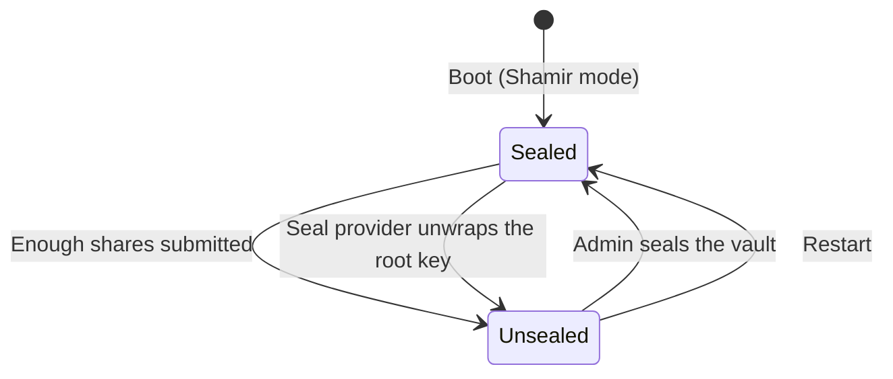
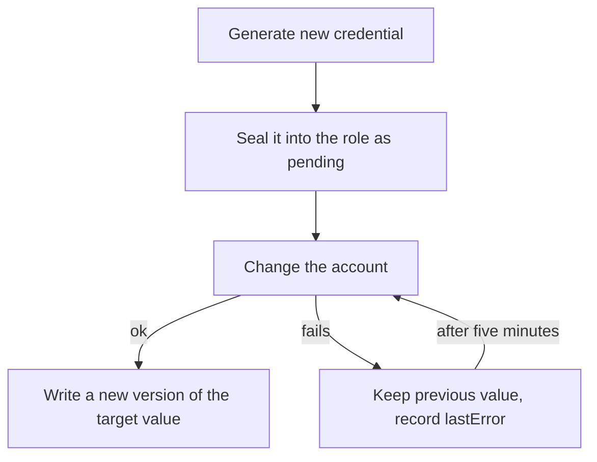
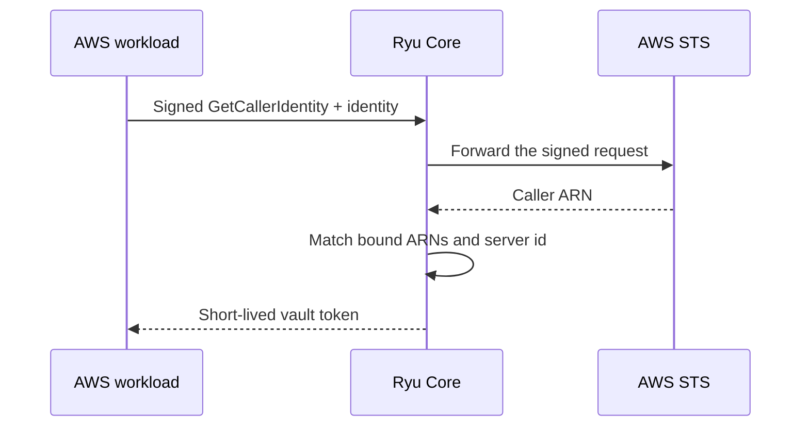

This page extends [Vault engines and machine access](/docs/security/secret-vault-engines). Every
route here needs the same node bearer and capabilities as the rest of the vault, except the login
routes, which authenticate the machine itself. Key shares and credentials appear only in the
response that creates them. They are never written to the audit log.

## Seal, unseal, and key rotation

Values and engine keys are encrypted with versioned data keys. Rotating the data key
(`POST /api/vault/sys/rotate`, admin only) creates a new version and re-encrypts every stored row with it.

The vault runs in one of two seal modes:

- **Auto-unsealed** (the default). Its keys are protected by the node's master key in the
  operating system keychain.
- **Shamir**. A root key is split into key shares (for example five shares, any three unlock) that
  you hand to different people.

In Shamir mode the vault starts sealed after every restart and resolves nothing until enough
shares are submitted to `POST /api/vault/sys/unseal`, unless a
[seal provider](/docs/security/secret-vault-seal-auth#auto-unseal-with-a-seal-provider) unseals it
at boot. You can [rekey](/docs/security/secret-vault-seal-auth#rekey-the-key-shares) the shares
without reinitializing.

An administrator can seal the vault immediately at any time. Shares are shown once and are never
stored or logged.



<Callout type="warn">
In Shamir mode, losing enough shares to fall below the threshold makes the vault unrecoverable.
Store shares separately and test an unseal before relying on it.
</Callout>

## Auto-unseal with a seal provider

In `shamir` seal mode the vault starts sealed until enough key shares are submitted. A **seal
provider** lets a node unseal itself at boot, without anyone submitting shares and without an OS
keychain. Headless Linux servers and containers that run with the keychain turned off can use one.

| Provider | Where the unseal key comes from |
| --- | --- |
| `static` | A 32-byte key in `RYU_VAULT_SEAL_KEY` (64 hex characters or base64), or in the file named by `RYU_VAULT_SEAL_KEY_FILE`. Use your container platform's secret mount. |
| `transit` | A transit key on another Ryu node. Set `RYU_VAULT_SEAL_TRANSIT_ADDRESS` to that node's URL; the `address` you configure must match it exactly, so the credential is never sent anywhere else. Core logs in on every use with the AppRole pair in `RYU_VAULT_SEAL_TRANSIT_ROLE_ID` and `RYU_VAULT_SEAL_TRANSIT_SECRET_ID`. The identity needs `use` on `sys/transit/<key>`. A fixed token in `RYU_VAULT_SEAL_TRANSIT_TOKEN` also works, but only until that token expires (at most 24 hours). |

The vault database never stores the provider's secret. It stores only the wrapped root key and the
provider settings. Configuring a provider generates a new root key, checks that the provider can
unwrap it, and returns **recovery shares** exactly once:

```sh
curl -X PUT "$RYU_URL/api/vault/sys/seal-provider" \
  -H "authorization: Bearer $RYU_TOKEN" -H 'content-type: application/json' \
  -d '{"provider":{"kind":"transit","address":"https://vault-root.example.com","keyName":"fleet-seal"},
       "recoveryShares":5,"recoveryThreshold":3}'
```

At boot, Core unwraps the root key through the provider. If the provider is unreachable, Core keeps
retrying with backoff. The recovery shares still unseal the vault through `POST
/api/vault/sys/unseal`, so losing the provider never locks you out. Unlike HashiCorp Vault recovery
keys, they are full unseal shares, so store them as carefully as unseal keys. Use these routes to
manage the provider:

- `GET /api/vault/sys/seal-provider` - show the provider and share settings.
- `POST /api/vault/sys/seal-provider/unseal` - retry the provider unseal now.
- `DELETE /api/vault/sys/seal-provider` - remove the provider. The recovery shares become the
  vault's ordinary unseal shares.

Each route needs `admin` on `sys/seal`. Switching the vault back to `auto` mode removes the provider.

Cloud KMS services (AWS KMS, Google Cloud KMS, Azure Key Vault) are not built in. For fleet
auto-unseal, point the `transit` provider at a Ryu node.

## Rekey the key shares

Rekeying replaces the root key and issues a new set of shares with a new count and threshold. You
do not need to reinitialize the vault. A quorum of the **current** shares (or recovery shares) must
authorize it, and the caller needs `admin` on `sys/rekey`. Ryu has no unauthenticated rekey.

```sh
# 1. Start: choose the new share count and threshold. Returns a nonce.
curl -X POST "$RYU_URL/api/vault/sys/rekey/init" -d '{"shares":7,"threshold":4}' …
# 2. Submit current shares, one per call, with the nonce.
curl -X POST "$RYU_URL/api/vault/sys/rekey/update" -d '{"nonce":"rkn_…","share":"rks1-…"}' …
```

When the current threshold is reached, every data key is rewrapped with the new root key in one
transaction:

- The final `update` returns the new shares.
- With a seal provider configured, the provider's wrapped copy is replaced in the same transaction.
- The old shares stop working immediately.

Shares that do not combine to the current root reset the progress and change nothing.
`POST /api/vault/sys/rekey/cancel` discards a rekey in progress, and `GET /api/vault/sys/rekey`
shows its progress. A rekey that is not finished within an hour expires.

## Static roles

[Dynamic credentials](/docs/security/secret-vault-engines#dynamic-credentials) create a new account
for each lease. A **static role** instead takes over one account that already exists and rotates its
credential on a schedule. Ryu writes each new credential as a new version of a vault value, so every
`secret:NAME` reference keeps working and the previous version stays in history.

| Provider | Rotation |
| --- | --- |
| `postgres` | `ALTER ROLE "<user>" WITH PASSWORD …`, or your own `rotationStatements` with `{{name}}` and `{{password}}`. |
| `redis` (alias `valkey`) | `ACL SETUSER <user> resetpass >…`. The user's ACL rules are kept. |
| `webhook` | A signed `{"action":"rotate","role","username","password"}` POST to your endpoint. It may answer `{"value":"…"}` to supply the credential itself, for example a SaaS API key that only the vendor can mint. |
| `aws-iam` | `iam:CreateAccessKey` for the IAM user, then `iam:DeleteAccessKey` for the previous key. If that delete fails, the role keeps the old key id, reports it in `lastError`, and deletes it on the next rotation before creating another key. The value is JSON with `accessKeyId` and `secretAccessKey`. |

```sh
curl -X PUT "$RYU_URL/api/vault/static/roles/app-db" \
  -H "authorization: Bearer $RYU_TOKEN" -H 'content-type: application/json' \
  -d '{"provider":{"kind":"postgres","connectionUrl":"postgres://admin:…@db:5432/app?sslmode=require","username":"app"},
       "rotationPeriodSecs":86400,
       "target":{"environment":"prod","name":"APP_DB_PASSWORD"}}'
```

The first rotation runs as soon as the role is saved. Pass `"rotateNow": false` to wait for the
scheduler instead. Rotation periods range from five minutes to one year. Passwords are 32
alphanumeric characters by default; set `passwordLength` to change it.

Rotation never loses a credential. Ryu seals the new credential into the role before it changes the
account:



If any step fails, the previous value stays current. Ryu records the failure in `lastError` and
retries with the same pending credential after five minutes.

Saving a role again for the same account and target keeps the pending credential and the current
AWS key id that Ryu tracks. While a rotation is pending, Ryu refuses to change the role's account
or target.

Use these routes to operate a role:

- `POST /api/vault/static/rotate/<name>` - rotate now.
- `GET /api/vault/static/creds/<name>` - read the current credential. Needs `read` on the target value.
- `GET /api/vault/static/roles` - list roles. Responses never include credentials.

Managing a role needs `admin` on `sys/static/<name>` and `write` on its target value. Rotations
replace the target value without a change request, so in a protected environment saving or
rotating a role also needs `admin` on the target.

A target whose `write` rule carries parameter constraints cannot be managed, because the generated
value cannot be checked against them. Deleting a role stops rotation and leaves the account and its
last value as they are.

The `redis` provider also works as a [dynamic credential](/docs/security/secret-vault-engines#dynamic-credentials)
provider. Each lease gets a fresh ACL user with the role's `aclRules` (default `~* +@read`). Ryu
deletes the user when the lease is revoked or expires. Use `rediss://` for TLS.

Static roles that target MySQL, MariaDB, and MongoDB are not built in. Use the `webhook` provider
for those.

## TLS certificate login

A `cert` machine identity trusts one or more CA certificates and lists the allowed common names,
DNS SANs, or URI SANs (globs). Set at least one list, so that the CA alone cannot log in. This
works with the [PKI engine](/docs/security/secret-vault-engines#certificates-pki): mesh nodes and
sandboxes log in with a certificate Ryu issued.

```json
{
  "name": "mesh-node",
  "auth": {
    "kind": "cert",
    "caPem": "-----BEGIN CERTIFICATE-----…",
    "allowedDnsSans": ["*.mesh.internal"]
  },
  "policies": ["mesh-runtime"]
}
```

To log in, the client sends its certificate and a short **proof JWT** signed with the certificate's
private key. The JWT carries `aud` `ryu-vault-cert-login`, `sub` set to the identity name, `iat`,
an `exp` at most five minutes later, and a unique `jti`. Each proof works only once.

```sh
curl -X POST "$RYU_URL/api/vault/auth/cert/login" -H 'content-type: application/json' \
  -d '{"identity":"mesh-node","certificatePem":"-----BEGIN CERTIFICATE-----…","proof":"eyJ…"}'
```

The certificate must be valid at login time and signed directly by one of the configured CAs. If
it has an Extended Key Usage extension, that extension must allow client authentication. A
certificate revoked through the PKI engine cannot log in, even before it expires.

## AWS IAM login

An `aws-iam` identity lets EC2, ECS, Lambda, and other AWS workloads log in with their own IAM
credentials. You do not distribute any secret. The client signs an `sts:GetCallerIdentity` request,
and Core forwards it to AWS STS. Core accepts only that exact call, against an AWS STS endpoint,
and binds the caller ARN that STS returns:

```json
{
  "name": "ecs-api",
  "auth": {
    "kind": "aws-iam",
    "boundIamPrincipalArns": ["arn:aws:iam::123456789012:role/api-*"],
    "serverIdHeaderValue": "vault.example.com"
  }
}
```

An assumed-role session ARN also matches its `arn:aws:iam::…:role/<name>` form.

`serverIdHeaderValue` is required. The client must include and sign an `X-Ryu-Server-ID` header
with that value (not Vault's `X-Vault-AWS-IAM-Server-ID`), so a request signed for another server
cannot be replayed here.

Send the login to `POST /api/vault/auth/aws/login` with `identity` and the same fields as HashiCorp
Vault's AWS login, each base64-encoded, in camelCase (the snake_case names are also accepted):

- `iamHttpRequestMethod`
- `iamRequestUrl`
- `iamRequestBody`
- `iamRequestHeaders`



## Kubernetes login

A `kubernetes` identity validates a pod's service-account token with the cluster's `TokenReview`
API. Use it for clusters whose OIDC issuer is not reachable from Ryu. Otherwise the
[OIDC/JWT method](/docs/security/secret-vault-engines#machine-identities) is simpler.

```json
{
  "name": "prod-deployer",
  "auth": {
    "kind": "kubernetes",
    "host": "https://10.0.0.1:6443",
    "caPem": "-----BEGIN CERTIFICATE-----…",
    "boundServiceAccountNamespaces": ["prod-*"],
    "boundServiceAccountNames": ["deployer"]
  }
}
```

Log in with `POST /api/vault/auth/kubernetes/login` and
`{"identity":"prod-deployer","jwt":"<token>"}`. No cluster credential is stored in the vault.

### Reviewer credential

By default Core sends the pod's own token as the reviewer credential, so that service account needs
the `system:auth-delegator` role. To use a dedicated reviewer token instead:

1. Set `reviewerJwtEnv` to the name of an environment variable that holds the reviewer token. The
   name must start with `RYU_VAULT_K8S_REVIEWER_`, so an identity cannot send any other variable to
   the cluster host.
2. Pin the API server that token may be sent to in the matching `RYU_VAULT_K8S_HOST_<NAME>`
   variable. For `RYU_VAULT_K8S_REVIEWER_PROD`, set `RYU_VAULT_K8S_HOST_PROD=https://10.0.0.1:6443`.

Core refuses to create the identity, and refuses every login, unless the identity's `host` matches
that pin. Whoever configures an identity cannot send the reviewer token to another server.

## Login results

All three methods issue the same short-lived vault token as AppRole and OIDC/JWT. Every login,
accepted or denied, is written to the vault audit log.

A refused login on any of these routes answers HTTP 403 with the same body, `login rejected`, in
each of these cases:

- the identity does not exist;
- the identity logs in another way;
- the identity is disabled;
- the caller presented a bad credential.

A caller without a credential cannot learn which identity names exist or how they log in. The
audit log keeps the real reason. A 503 means the vault is sealed or no audit device accepted the
record, and the login can be retried.

Continue with [Vault engines and machine access](/docs/security/secret-vault-engines),
[tokens, wrapping, and quotas](/docs/security/secret-vault-tokens), and the
[Core API reference](/docs/extend/develop/api-reference/core/vault).
