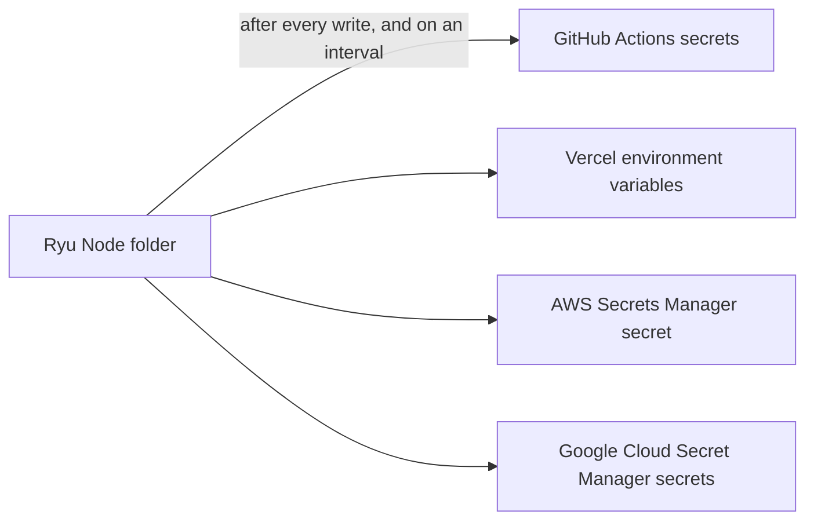

A secret sync keeps a deployment platform's copy of your secrets in step with a
[Secret Vault](/docs/security/secret-vault) folder. It is a
[destination](/docs/security/secret-vault-external#destinations) on a **sync target**: an
[external store](/docs/security/secret-vault-external) that only accepts pushes.



Syncs are one way. Sync targets cannot be used as sources, and Ryu never reads values back from
GitHub or Vercel.

## Targets

| `kind` | Auth (`authMethod`) | Settings | What a push writes |
|---|---|---|---|
| `github-actions` | `token` | `repository` (`owner/repo`), optional `githubEnvironment` | One repository secret per key, or one environment secret per key when `githubEnvironment` is set |
| `vercel` | `token` | `projectId`, optional `teamId`, `vercelTargets` (`production`, `preview`, `development`; all three by default) | One encrypted environment variable per key, for those targets |
| `aws-secrets-manager` | `access-key` | `region`, optional `pathPrefix` | One secret whose value is the folder as a JSON object |
| `gcp-secret-manager` | `service-account` or `token` | `projectId` | One secret per key, with a new version only when the value changed |

`address` is optional for sync targets: it defaults to the platform's public API (for AWS, the
regional Secrets Manager endpoint). Set it for GitHub Enterprise Server or a regional endpoint.

Credentials are encrypted with the vault's keys and are never returned, logged, or audited:

- **GitHub:** a fine-grained token with the repository's **Secrets** (and, for environment secrets,
  **Environments**) write permission. Each value is encrypted to the repository's public key
  before it leaves the node.
- **Vercel:** an access token for the project's account or team.
- **AWS:** `accessKeyId`, `secretAccessKey`, and an optional `sessionToken`. The key needs
  `secretsmanager:CreateSecret`, `PutSecretValue`, `GetSecretValue`, and `ListSecrets` (for the
  connection test). Without `GetSecretValue`, every push writes a new version.
- **Google Cloud:** `serviceAccountKey` holding a service-account key file's JSON. The account needs
  to create secrets and add versions (Secret Manager Admin, or Secret Version Adder on existing
  secrets) and, to skip unchanged values, Secret Accessor. A short-lived `token` also works.

Connect a target with `POST /api/vault/external/stores`, for example:

```json
{
  "name": "acme-app-ci",
  "kind": "github-actions",
  "authMethod": "token",
  "repository": "acme/app",
  "githubEnvironment": "production",
  "credentials": { "token": "…" }
}
```

`POST /api/vault/external/stores/{id}/test` checks the credentials without writing anything.

## Syncing a folder

Add a destination for the folder with `POST /api/vault/external/destinations`:

```json
{ "storeId": "…", "environment": "prod", "path": "/web", "remotePath": "WEB_" }
```

- For GitHub, Vercel, and Google Cloud, `remotePath` is an optional **name prefix**: with `WEB_`,
  the value `API_KEY` is pushed as `WEB_API_KEY`. Use different prefixes (or different stores) to
  sync several folders into one repository or project.
- For AWS, `remotePath` is the **secret name**, joined to the store's `pathPrefix`
  (`ryu` + `prod/web` writes `ryu/prod/web`).

A push checks every name before the first write. A name the platform does not accept (for example
a GitHub name that starts with `GITHUB_`, or a Vercel name that is not letters, digits, and `_`
starting with a letter or `_`) or a value over its size limit fails the push with no partial upload. If Vercel accepts
the request but rejects some variables (for example a name that clashes with an existing sensitive
or system variable), the push is marked failed and the error lists each rejected name and Vercel's
error code, never a value; fix those variables and the next push retries.

GitHub, Vercel, and Google Cloud keys are only created or updated: a value deleted in Ryu stays on
the platform until you remove it there. The AWS secret is replaced as a whole, but an empty folder
never wipes a secret that still has values.

Pushes follow the same rules as every other destination: they run after each write to the folder
and on `intervalSecs`, retry with backoff, skip values a control group gates, and need `read` and
`list` on the folder. A folder with a live source cannot be synced.

## In the desktop app

Open **Vault** and choose the **Syncs** tab (vault admins only):

- **Connect target** adds a GitHub Actions, Vercel, AWS Secrets Manager, or Google Cloud Secret
  Manager target. Credentials are sent once and never shown again.
- **Sync a folder** picks a target, an environment and folder, the name prefix (or, for AWS, the
  secret name), and how often to re-push.
- Each sync shows its last push: how many keys went out, or why it failed. **Push now** pushes
  immediately; **Stop** ends the sync and leaves values already pushed in place.
- **Test** checks a target's credentials without writing anything. A target still used by a sync
  cannot be removed.

Folders sourced from OpenBao, HashiCorp Vault, or Infisical are listed on the same tab with
**Pull now**.

## From the command line

`ryu-cli secrets external` manages stores, syncs, and sources. A store is created from a JSON file
(the same body as the API, or `-` for stdin) so its credentials never appear in arguments or shell
history. For Google Cloud, `credentials.serviceAccountKey` may hold the key file's JSON object.

```sh
ryu-cli secrets external add github.json
ryu-cli secrets external test acme-app-ci
ryu-cli secrets external sync acme-app-ci --env prod --path /web --remote WEB_ --interval 1h
ryu-cli secrets external syncs                # folder, store, prefix, key count, last status
ryu-cli secrets external push <destination-id>
ryu-cli secrets external unsync <destination-id>
```

`external stores`, `external remove STORE`, and `external source` / `sources` / `pull` /
`unsource` cover the rest of the [external store](/docs/security/secret-vault-external) surface.
Every subcommand accepts `--json`.

Continue with [External Secret Stores](/docs/security/secret-vault-external) and the
[Secret Vault](/docs/security/secret-vault).
