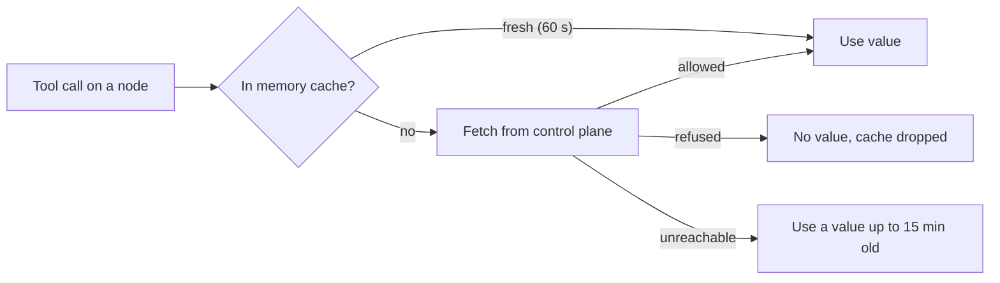
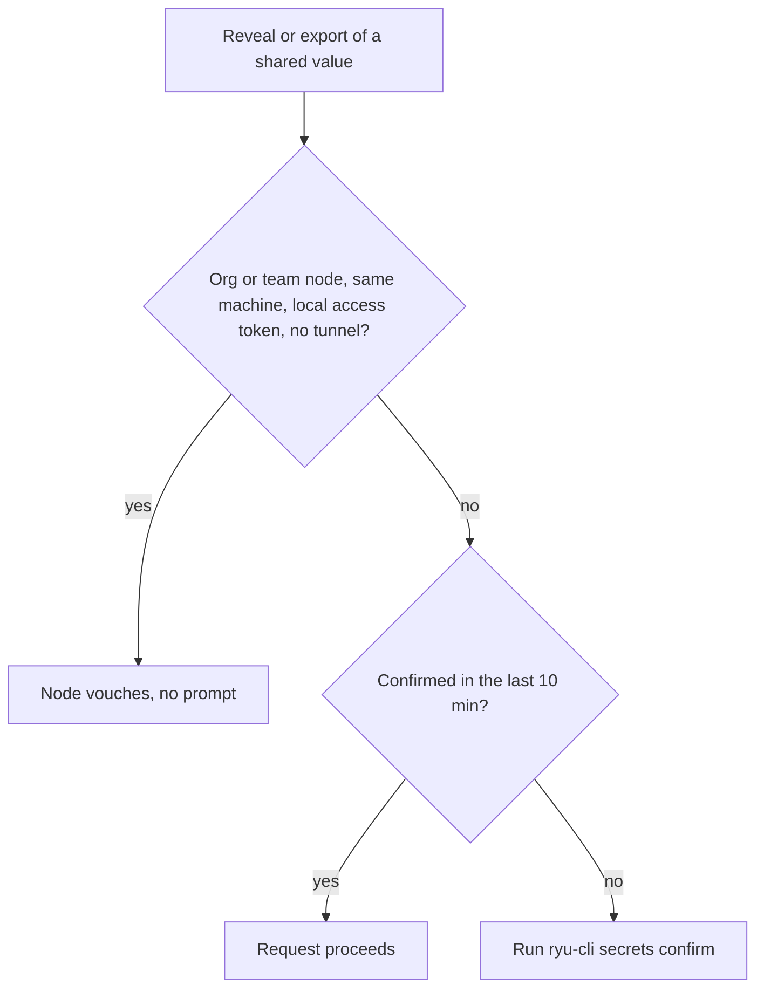

Part of the [Secret Vault](/docs/security/secret-vault) guide. This page covers Team and Organization values: where they live,
which changes and reads ask you to confirm it's you, and which node can act for you.

## Where shared values live

Team and Organization values on a managed node live in the control plane: one saved value reaches
every eligible node in the organization, and each node fetches it at dispatch time over its gateway
credential.

The organization's [access policy](/docs/security/organization-admin-controls) applies to each
fetch:

- When the organization has an IP allowlist, the node must be on an allowed network. Add the
  outbound addresses of hosted or cloud nodes to the allowlist.
- When it requires two-factor authentication, the member the node acts for must have an
  authenticator app or a passkey.

A refused fetch returns no value, and Core drops any cached copy. Core keeps those values in memory
only, for a short cache window (60 seconds by default), and keeps using a recently fetched value
for up to 15 minutes if the control plane is briefly unreachable.

Older Team or Organization values stored on the node itself can be moved to the control plane with
`POST /api/vault/migrate-shared` (administrators only).

Team and Organization values can also be managed in the browser from the organization's **Vault**
page in Console: secrets by environment, versions and rollback, change-request approvals, policies,
and the vault audit log. See [Organizations in Console](/docs/billing/organization-console#vault).

## Confirm it's you

Some changes to Team and Organization values can't be undone or would widen who can read secrets.
These ask you to confirm it's you (a step-up for access keys) first, even when you have the vault
capability:

- permanently destroying versions;
- creating, editing, or deleting a policy;
- adding or removing a policy binding;
- creating, editing, or deleting an environment.

One confirmation covers further changes of this kind for 10 minutes. Listing and ordinary writes
don't ask.

Revealing or exporting a Team or Organization value returns plaintext, so it needs the same
confirmation unless an organization or team node enrolled in the organization vouches for the
request. **Reveal** on the console's Vault page asks once, and the confirmation then lasts 10
minutes.

## What a node vouches for

`ryu-cli secrets get`, `ryu-cli secrets export`, `ryu-cli secrets run`, and the desktop app go through your
node. An organization or team node vouches only for requests made on its own machine by the CLI or
the desktop app with the node's local access token, as the signed-in member. Those don't ask. A
node does not vouch in these cases:

- the node is a personal node;
- the node is remote, including hosted and managed nodes;
- a forwarding tunnel (Tailcat, a Cloudflare Quick Tunnel, OpenTunnel, or a plugin tunnel) is
  active on the node, because the node can't then tell its own machine from tunneled traffic;
- a web page calls the node with your account token instead of the node's local access token.

### Confirm from the CLI

In those cases, the request needs a confirmation that it's you. The CLI proves it with
`ryu-cli secrets confirm`, run on the machine where you ran `ryu-cli login`. It confirms the account
that machine's Ryu is signed in to, whichever node the CLI targets.

| Method | Command |
|---|---|
| Authenticator app code | `ryu-cli secrets confirm 123456` |
| Backup code | `ryu-cli secrets confirm CODE` |
| Password (piped on stdin) | `ryu-cli secrets confirm --method password` |
| Emailed code | `ryu-cli secrets confirm --method otp` sends it, then `ryu-cli secrets confirm CODE --method otp` finishes |

A confirmation lasts 10 minutes. An authenticator or backup code also marks the session as signed
in with two-factor. The CLI then renews its account token, so nodes of an organization that
requires two-factor accept it again.

### What a node can reach

Through an organization or team node, a reveal or export reaches only what that node can use for
you at run time:

- an organization node reaches the organization's values and those of your teams;
- a team node reaches only its own team's values and the organization's.

A confirmation from `ryu-cli secrets confirm` doesn't widen that, so a team node never reads another
team's values for you. A reveal outside that reach is refused, and an export leaves those values
out. Through your own personal node, or in the organization console, a confirmation covers every
value you can read.

A team node acts for you on Team and Organization values only while you're a member of its team.
That holds for organization admins too. An admin who isn't on the team can still use the node's own
and personal values, but Team and Organization requests through it are refused with
`node_proxy_required`. Use an organization node, a node of your own team, or your personal node.

### Whose sign-in a node uses

Team and Organization requests through a node act as you, with the sign-in that the Ryu on your
machine uses, and `ryu-cli secrets confirm` applies to that sign-in. Signing out of it, or revoking
it from your account's sessions, stops those requests at once.

The organization's IP allowlist is checked against the node's network address, and required
two-factor and the session lifetime apply to that sign-in.

## The CLI and forwarding tunnels

If the CLI targets a remote node and the Ryu on your machine refuses it, set
`RYU_IDENTITY_CORE_TOKEN` to that Ryu's local access token (`secrets/node-auth.token` in its data
directory). The CLI uses the same token to confirm and to get the identity token it sends with each
request.

### While a forwarding tunnel is active

While a forwarding tunnel is active on the node on your own machine, that node gives the CLI neither
its session nor an identity token. During that time:

- `ryu-cli secrets confirm` stops and asks you to stop the tunnel;
- `ryu-cli secrets get` can't read a Team or Organization value;
- `ryu-cli secrets export` and `ryu-cli secrets run` leave those values out without an error.

Stop the tunnel before you export or run with shared values.

### When shared values are unavailable

How `ryu-cli secrets get`, `ryu-cli secrets export`, and `ryu-cli secrets run` behave depends on why
shared values are unavailable:

| Situation | Behavior |
|---|---|
| A confirmation is missing | The commands stop with an error that tells you to run `ryu-cli secrets confirm`. They don't leave the shared values out and carry on. |
| No Team or Organization values for you to read | An export doesn't ask, so `ryu-cli secrets run` with only your own values and node values works without a confirmation. |
| Your sign-in has ended, or the access policy refuses it (for example, it requires two-factor and you signed in without it) | `export` and `run` carry on with your own and the node's values, print a warning that Team and Organization values are missing, and say how to fix it. |
| You aren't a member of the node's organization | There are no shared values for you; the commands carry on without a warning. |
| The control plane can't be reached | `export` and `run` carry on with your own and the node's values and print a warning that Team and Organization values are missing. |

An export in the desktop app shows the same warnings.

## Changes go through your own node

These go through a node only when it's your own personal node:

- changes to Team and Organization values (setting, deleting, rolling back, restoring, destroying
  or importing them);
- approving or rejecting change requests.

Through an organization or team node, Ryu refuses them with `personal_node_required`, because that
node may be run by someone else. Make those changes from the Ryu on your own machine or in the
organization console.

Listing values works through any node you can use, and reveals and exports stay within the
[node's reach](/docs/security/secret-vault-shared-values#what-a-node-can-reach).

Creating a node enrollment code also asks you to confirm it's you, in the console's Fleet page and
when you bind a node from the desktop app. An enrolled node can resolve members' shared values, so
a signed-in session alone can't create one.
