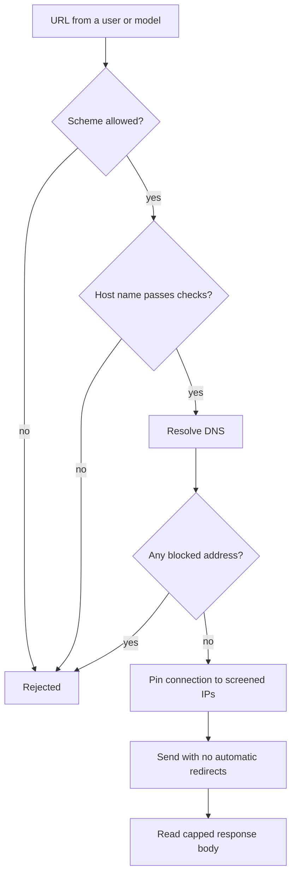

When a Core-owned feature fetches a URL that a user or model supplied, it goes through the guarded egress path. That path screens the destination, pins the connection, denies redirects, and bounds the response.

These guarantees belong to the transport, not to the URL. A URL that passed validation earlier, or a separate provider or child-process client, does not get them.

## Where the guarded path applies

The check runs at the point of use for:

- model and runtime downloads
- skill archives
- workflow webhooks
- Core notifications
- hosted-node delegation
- mail delivery

Artifact downloads need an integrity digest before executable bytes are installed. Child-process crawlers and unpinned remote Git clones fail closed.

## Address and transport checks

- Accepts only `https` and `http` URLs. Features whose policy turns off plain `http` (such as notification delivery) accept only `https`.
- Blocks loopback, private, link-local, CGNAT, and ULA address ranges on guarded requests. Unspecified, broadcast, multicast, reserved, benchmarking (`198.18.0.0/15`), and IPv6 documentation (`2001:db8::/32`) addresses are blocked too.
- Rejects the host if any address it resolves to is blocked, not only the first one.
- Checks IPv6 forms that embed an IPv4 address (IPv4-mapped, NAT64, and IPv4-compatible) against the IPv4 rules.
- Pins guarded client connections to the validated IP, so DNS cannot re-resolve to a different address after the check.
- Turns off automatic redirects on guarded requests, so a redirect cannot send them to an internal target. A guarded fetch that follows a redirect itself screens and pins each hop again, up to 5 hops.
- Caps guarded response bodies.
- Requires SHA-256 metadata before downloaded runtimes, tools, plugins, or MCP servers can be
  installed and executed.

Other outbound surfaces must use an equivalent broker or stay constrained. A URL screened earlier does not make them SSRF-safe.

## Host name checks

### Internal and cloud-metadata host names

The address check blocks the `169.254.169.254` metadata IP. Before DNS runs, the host name check also rejects internal and metadata *host names*. Matching ignores case and a trailing dot.

| Rejected host | Examples |
|---|---|
| `localhost` and any `*.localhost` | `localhost`, `app.localhost` |
| Any `*.local` or `*.internal` name | `printer.local`, `db.internal`, `metadata.google.internal` |
| `metadata.goog` and its subdomains | `metadata.goog` |
| The bare host `metadata` | `metadata` |

This catches a name that resolves to an internal or metadata endpoint through DNS instead of a literal IP. The rules live in the shared egress crate, `crates/core/egress/src/lib.rs`.

Core's own catalog, model, and skill fetch helpers use a narrower name list: `localhost`, the bare `metadata` host, and the two metadata domains. There, a name such as `db.internal` is rejected by the address check when it resolves to a blocked address.

### Homograph and hostile-host guard

The guard rejects a host that:

- contains non-ASCII characters (this covers Unicode lookalikes, zero-width, and bidi control characters)
- contains control characters or whitespace
- fails to round-trip through IDNA / punycode encoding (a decode mismatch)

This blocks lookalike-domain (homograph) attacks and hosts that use invisible or directional Unicode to hide their real target.

<Callout type="info">
Use the guarded transport for server-side fetches. Provider-owned HTTP clients, browser/crawler
navigation, command-line network tools, downloads, and sidecar callbacks need their own pinned
egress boundary. A preflight check alone does not close DNS rebinding or redirect risks.

Outbound content checks are covered in [Outbound DLP](/docs/security/outbound-dlp).
</Callout>

## Related

<Cards>
  <DocCard href="/docs/security/outbound-dlp" />
  <DocCard href="/docs/security/network-binding-auth" />
  <DocCard href="/docs/security/trust-model" />
  <DocCard href="/docs/gateway/security" />
  <DocCard href="/docs/extend/mcp/security" />
  <DocCard href="/docs/security/safe-actions" />
</Cards>
