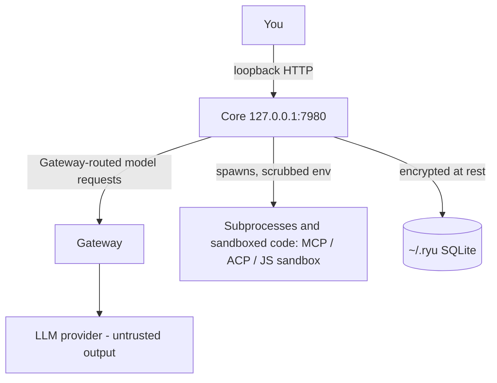

Ryu's threat model treats the language model as untrusted. Prompt injection, a poisoned tool result, or a malicious document can steer it. The components downstream of the model are built to contain that.

<Figure name="security" />

## The boundary

- **Core and Gateway bind loopback only by default.** No other machine can reach them until you change the bind address. Core requires a node credential even on loopback. See [Network binding and auth](/docs/security/network-binding-auth).
- **The LLM never receives raw secrets.** Login state lives in [Passport](/docs/standalone/passport) and named secrets live in the [Secret Vault](/docs/security/secret-vault). Both are consumed at the execution boundary, not placed in the prompt. See [Credential and environment scrubbing](/docs/security/credential-scrubbing).
- **Subprocesses are the primary attack surface.** MCP servers and ACP agents run real code on your machine, and model- or plugin-authored JavaScript runs in Core's JS sandbox. They are spawned with a scrubbed environment and, for shell commands, gated by command approval. See [Sandboxing and isolation](/docs/security/sandboxing-isolation) and [Command approval](/docs/security/command-approval).
- **Plugin containment depends on what the plugin contributes.** A plugin's hook, adapter, and UI code runs in a sandbox. A plugin's sidecar or MCP server runs with Ryu's own privileges, so publisher trust is the only control on that part. See [Plugin isolation](/docs/security/plugin-isolation).
- **Data at rest is encrypted.** State under `~/.ryu/` uses SQLite with field-level encryption for sensitive columns. See [Encryption at rest](/docs/core/encryption-at-rest).
- **A handed-off working tree is untrusted content.** When a chat continues on another computer with its working tree, the destination treats the result like a fresh clone. See [RNP continuity](/docs/extend/integrate/rnp#bring-the-working-tree).
  - The folder is not trusted automatically.
  - Files whose names look like secrets are left out unless you tick them in the review.
  - The remote URL from the other computer is shown to you. It must be a credential-free HTTPS or SSH URL that does not resolve to a private or loopback address.
  - Git runs without repository hooks, filters, external diff drivers, or textconv on both ends.
- **Rendered content is untrusted.** Links, Markdown, catalog records, citations, and dashboard widget data from users, agents, or external services are treated as untrusted.
  - Browser surfaces allow only safe web URL schemes at the rendering boundary.
  - Chart identifiers and colors are normalized before they become CSS.
  - A rejected value renders as plain text or is dropped. It never becomes executable markup.

## What is not a boundary

<Callout type="warn">
Ryu is single-tenant and local-first. It does not provide multi-tenant isolation, and there is no per-tab sandbox around Shadow or the desktop surfaces. Everything in one install shares one trust domain.

The controls here harden the boundary between you and the outside world (untrusted model output, subprocesses, the network), not between two users of the same install. Do not run an untrusted second party inside a single Ryu install and expect isolation.
</Callout>

## Related

<Cards>
  <DocCard href="/docs/security/sandboxing-isolation" />
  <DocCard href="/docs/security/command-approval" />
  <DocCard href="/docs/standalone/passport" />
  <DocCard href="/docs/core/encryption-at-rest" />
</Cards>
