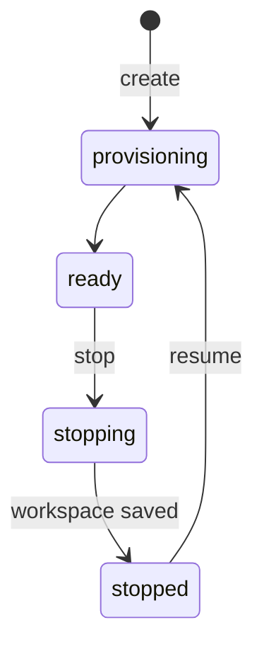

The Ryu Box API is a tenant-scoped HTTP API under `/v1` for creating and
operating [Ryu Box](/docs/standalone/box) workspaces. A Box service listens on
`http://127.0.0.1:8090` by default. Core and other clients use the same bearer
boundary.

## Authentication and request limits

Every protected request sends:

```text
Authorization: Bearer <RYU_BOX_API_TOKEN>
```

Use `RYU_BOX_API_TOKENS` when one service hosts more than one tenant. Its JSON
object maps tenant ids to distinct, non-empty bearer keys; the service refuses
to start when an entry is empty or not a string. Do not reuse a Core, Gateway,
Mail, or provider credential.

The service accepts JSON bodies up to 512 KiB. Command output is bounded to
1 MiB. Both declared and chunked request bodies are capped while they stream.
Responses include `X-Request-ID`; errors expose a stable `code`, safe message,
status, and request id.

## Endpoint surface

| Method | Path | Purpose |
|---|---|---|
| `GET` | `/health` | Driver, mode, version, and feature state, without a bearer; in local mode `driverReady` is `false` when the driver does not answer within 5 seconds |
| `GET` | `/ready` | `200` when the service can run Boxes, otherwise the driver's `503` error, without a bearer |
| `GET` | `/` | Describe the service without a bearer; redirect only when `RYU_PRODUCT_DASHBOARD_URL` is set |
| `GET` | `/v1/boxes` | List active Boxes in the caller's tenant |
| `POST` | `/v1/boxes` | Create a Box; requires `Idempotency-Key` |
| `GET` | `/v1/boxes/:id` | Read one tenant-owned Box |
| `DELETE` | `/v1/boxes/:id` | Destroy one Box and retain its audit event |
| `GET` | `/v1/boxes/:id/events` | Read bounded lifecycle events |
| `POST` | `/v1/boxes/:id/commands` | Run one bounded command in a ready Box |
| `POST` | `/v1/boxes/:id/prompt` | Queue work for a supported agent provider |
| `GET` | `/v1/boxes/:id/prompts`, `/prompts/:run` | List prompt runs without prompt text, or read one run |
| `POST` | `/v1/boxes/:id/prompts/:run/claim`, `/complete`, `/cancel` | Claim a queued prompt, complete a claimed one, or cancel a run |
| `POST` | `/v1/boxes/:id/stop` | Stop the workspace while retaining its disk; an optional `{"reason"}` is recorded |
| `POST` | `/v1/boxes/:id/resume` | Resume a stopped workspace |
| `POST` | `/v1/boxes/:id/desktop/actions` | Act on the Box's screen: `screenshot`, `click`, `type`, `key`, `scroll`, or `focus_app` |
| `POST` | `/v1/boxes/:id/browser/:verb` | Drive the Box's browser: `tabs`, `navigate`, `navigate_tab`, `close_tab`, `snapshot`, `screenshot`, `click`, `type`, `scroll`, `hover`, `click_at`, `key`, `drag`, `context`, `annotate`, and `clear_annotations` |
| `GET` | `/v1/boxes/:id/desktop/ws` | Open the Box's screen stream (RFB over WebSocket) with a `desktop` access token |
| `POST` | `/v1/boxes/:id/fork` | Fork a ready or stopped Box; requires `Idempotency-Key` |
| `GET`, `PUT`, `POST`, `DELETE` | `/v1/boxes/:id/files`, `/files/content`, `/files/directories`, `/files/archive` | List, read, write, archive, and remove workspace files |
| `GET`, `POST` | `/v1/boxes/:id/processes`, `/processes/:pid/logs`, `/processes/:pid/stdin`, `/processes/:pid/kill` | List, follow, feed, and stop processes |
| `POST` | `/v1/boxes/:id/interrupt` | Stop every process the service started in the Box |
| `GET`, `POST`, `DELETE` | `/v1/boxes/:id/previews`, `/previews/:token` | List, create, and remove preview URLs |
| `POST` | `/v1/boxes/:id/access-tokens` | Mint a two-minute terminal or tunnel WebSocket URL, or a 30-second single-use `desktop` token |
| `GET` | `/v1/boxes/:id/terminal`, `/v1/boxes/:id/tunnel` | Open a terminal or TCP tunnel WebSocket |
| `POST` | `/v1/boxes/:id/ssh` | Start SSH access inside the Box |
| `POST` | `/v1/boxes/:id/snapshots` | Save the Box filesystem as a snapshot |
| `GET`, `DELETE` | `/v1/snapshots`, `/v1/snapshots/:id` | List, read, or remove the tenant's snapshots |
| `GET`, `PUT`, `DELETE` | `/v1/secrets`, `/v1/secrets/:name` | List secret names, store a secret, or remove one |
| `GET` | `/v1/usage` | Running, resource-unit, and storage seconds per Box, for up to 31 days; see [Usage report](/docs/standalone/box-lifecycle#usage-report) |
| `GET` | `/v1/limits` | The tenant's running and stored Boxes and resource units against its limits |

Request bodies and streaming behavior for the file, process, preview, terminal,
SSH, snapshot, secret, and usage routes are described in
[Local mode features](/docs/core/boxes-local-mode#routes-and-features).

Connected provider mode forwards the provider's supported `/v1` routes through
the same tenant-authenticated bridge. The `/health` response reports the
active mode and feature list so a client can distinguish local coverage from
connected coverage.

## Create a Box

```sh
export BOX_API_BASE=http://127.0.0.1:8090/v1
export BOX_API_TOKEN=replace-me

curl -fsS -X POST "$BOX_API_BASE/boxes" \
  -H "Authorization: Bearer $BOX_API_TOKEN" \
  -H "Idempotency-Key: create-demo-001" \
  -H "Content-Type: application/json" \
  -d '{"name":"demo","size":"small","network":"none"}'
```

The create body supports:

| Field | Values or limit | Default |
|---|---|---|
| `name` | Letters, numbers, `.`, `_`, `-`; up to 64 characters | `box` |
| `image` | An allowlisted image name; up to 128 characters | `ubuntu:24.04` |
| `size` or `type` | `small` (2 vCPU, 4 GiB), `default` (4 vCPU, 8 GiB), `large` (8 vCPU, 16 GiB) | `default` |
| `network` | `none`; `egress` for HTTP and HTTPS to public hosts through a filtering proxy; or `allowlist` with `allowedHosts` | `none` |
| `allowedHosts` | Up to 64 hostnames, `*.example.com` wildcards allowed; only with `allowlist`, which it selects when `network` is omitted | none |
| `ttlSeconds` | Positive integer up to seven days; `null` selects the default | 24 hours |
| `env` | Up to 64 non-secret environment variables, each value up to 32 KiB | none |
| `secrets` | Up to 32 tenant secret names to expose as environment variables | none |
| `repo` | An `https` repository URL, or `{ "url", "branch", "tokenSecret" }`; needs `egress` or an allowlist | none |
| `setup` | Up to 16 shell commands run as root before the Box is ready | none |
| `snapshot` | A snapshot id or name to boot from instead of `image` | none |
| `desktop` | `true` to run the Box's virtual desktop and browser | `false` |
| `labels` | Up to 8 `key: value` labels; keys use `a-z`, `0-9`, and `-` (up to 32 characters), values up to 64 characters | none |

The response contains a public Box projection, including the effective
`ttlSeconds`. It does not expose the tenant id or driver reference. On a
Ryu-hosted service the projection also carries:

- `placement` - the provider, location, and tier the Box landed on, and its
  isolation (`vm` for a Box with its own virtual machine, `gvisor` for a slot
  on a shared overflow host).
- `desktop` - `ready`, current `viewers`, and the screen size.
- `runningSince`.
- `billing`, while the Box runs. `minimumWaived` is `true` when this start owes
  no new 5-minute minimum: a resume onto the Box's own parked machine inside
  the server hour already paid for, which ends at `paidHourEndsAt`.
- `billing.waiver`, a signed token on a waived start of a Box that a Ryu node
  bills through its Gateway. The Gateway waives the minimum only when the
  signature matches the same Box and start.

### Asynchronous lifecycle

With `repo` or `setup`, create returns `202` while the Box is still
provisioning. On Ryu-hosted Box (its own virtual machine, or a sandboxed slot
on a shared overflow host), create, stop, and resume always answer `202`.

The Box then moves through its states in the background: create and resume
go `provisioning` → `ready`, and stop goes `stopping` → `stopped` while the
workspace is saved. Poll `GET /v1/boxes/:id` until it reaches the state you
need. Running time is
metered from `ready` and ends when `stopping` starts, so saving a stopped Box
is not billed as compute.



If no capacity is available at all, create and resume answer
`503 capacity_unavailable` with a `Retry-After` header instead of `202`. A
failed create frees its name and idempotency key. A failed resume leaves the
Box `stopped` with its saved workspace untouched, so retry the same request.

### Admission and limits

Admission is tenant- and service-scoped and counts running and stored Boxes
separately. Running Boxes are `provisioning`, `ready`, `running`, or
`stopping`; stored Boxes are `stopped` or `error`.

| Default limit | Self-hosted tenant | Whole service |
|---|---|---|
| Running Boxes | 8 | 64 |
| Resource units (`small` = 1, `default` = 2, `large` = 4) | 16 | 128 |
| Stored Boxes | 64 | not limited |

On Ryu-hosted Box, your plan sets the tenant limits.

- A create is refused when either the running or the stored limit is reached.
- A resume is checked against the running limits. A stop is never refused.
- An admission failure returns `429 quota_exceeded` before the driver is called.
- A create or fork that fails before the driver started anything is retired at
  once. It frees its quota, its name, and its `Idempotency-Key`, so the same
  request can be retried.
- Box names are unique among a tenant's live Boxes. Deleting or expiring a Box
  frees its name.

`GET /v1/limits` reports where the tenant stands:

```json
{
  "ok": true,
  "type": "limits",
  "running": 1,
  "maxRunning": 8,
  "stored": 4,
  "maxStored": 64,
  "resourceUnits": 1,
  "maxResourceUnits": 16
}
```

Self-hosted operators set the limits with `RYU_BOX_TENANT_MAX_RUNNING`,
`RYU_BOX_TENANT_MAX_STORED`, `RYU_BOX_TENANT_MAX_RESOURCE_UNITS`,
`RYU_BOX_MAX_RUNNING`, and `RYU_BOX_MAX_RESOURCE_UNITS`.

## Desktop

A Box created with `"desktop": true` runs a virtual desktop and a browser
inside the Box. Its display is reachable only through the Box API.

To watch it, mint a `desktop` access token for the viewer, then open the
stream with the token as a WebSocket subprotocol:

```sh
curl -fsS -X POST "$BOX_API_BASE/boxes/$BOX_ID/access-tokens" \
  -H "Authorization: Bearer $BOX_API_TOKEN" \
  -H "Content-Type: application/json" \
  -d '{"scope":"desktop","origin":"https://app.example.com","sub":"user-123","viewOnly":false}'
```

```json
{
  "ok": true,
  "type": "access_token.created",
  "token": "<single-use token>",
  "expiresAt": "2026-10-19T10:00:30.000Z",
  "url": "wss://box.example.com/v1/boxes/bx_replace_me/desktop/ws",
  "protocols": ["ryu.box.v1", "ryu.token.<single-use token>"]
}
```

- Dial `url` with exactly the returned `protocols`. The token is never accepted
  in a query string, so it does not reach access logs. `url` is present only
  when the service knows its public address (`RYU_BOX_PUBLIC_URL`).
- The token is valid for 30 seconds and for one connection. Reusing it answers
  `401 token_replayed`; mint a new one for every reconnect.
- The browser's `Origin` must equal the token's `origin` and be in the
  service's allowlist, `RYU_BOX_STREAM_ORIGINS`. When that variable is unset
  the allowlist is the service's own `RYU_BOX_PUBLIC_URL` origin and the Ryu
  desktop app (`tauri://localhost`, `http://tauri.localhost`,
  `https://tauri.localhost`); list your web app's origin explicitly. Minting a
  token for any other origin, or dialling without an `Origin`, answers `403`.
- With `viewOnly`, the service forwards the screen and drops every keyboard
  and mouse message the viewer sends. It also removes the Fence and
  ContinuousUpdates pseudo-encodings from the viewer's `SetEncodings`, so the
  desktop keeps sending frames to a viewer whose replies it never forwards.
- A token for another tenant's Box answers `404`, never `403`.
- At most four streams watch one Box; a fifth answers `429`. Stopping, parking,
  or deleting the Box closes its streams, and every stream closes after 12
  hours.

Agents act on the screen without a stream:

```sh
curl -fsS -X POST "$BOX_API_BASE/boxes/$BOX_ID/desktop/actions" \
  -H "Authorization: Bearer $BOX_API_TOKEN" \
  -H "Content-Type: application/json" \
  -d '{"action":"click","x":640,"y":360,"button":"left","count":1}'
```

| `action` | Fields |
|---|---|
| `screenshot` | optional `maxWidth`; returns `image`, `width`, and `height` |
| `click` | `x`, `y`, optional `button` (`left`, `right`, `middle`) and `count` (1 to 3) |
| `type` | `text` |
| `key` | `keys`, an array such as `["ctrl", "l"]` |
| `scroll` | `direction` (`up`, `down`, `left`, `right`), optional `x`, `y`, and `amount` |
| `focus_app` | `app` |

An action body with any other field is refused with `400 invalid_request`.

## Idempotency and errors

Create and fork store the request body hash with the idempotency key.

| You send | Answer |
|---|---|
| The same key and body again | The existing Box, `200`, header `Idempotent-Replayed: true` |
| The same key with a different body | `409 idempotency_conflict` |
| The key of a Box that was since deleted | `409 idempotency_key_resource_deleted`; the key stays spent, so send a new one |

A fork replay is answered from its key before the source Box is loaded, so it
still returns the fork, or that `409`, after the source Box was deleted.

Keys are scoped to your account. A fork's key is bound to its route and source
Box: sending the same key and body to `POST /v1/boxes`, or to a fork of a
different Box, returns `409 idempotency_conflict`, as does reusing a create's
key for a fork. Use one key per create or fork.

Clients should branch on `code`, not on the message text. Every code is listed
in [Error codes](#error-codes).

Errors use the `box.error` JSON envelope by default. A request whose `Accept`
header names `application/problem+json` gets the same error as RFC 9457
problem details instead: `type`, `title`, `status`, `detail`, `instance`,
`code`, and `docs`, followed by the envelope's other members. Wildcards such
as `*/*` keep the envelope.

`429 quota_exceeded` is a quota, not a rate limit, and carries no `Retry-After`
or `RateLimit` header. The body adds `retryable` and a `hint`.

- Active-Box, resource, snapshot, and storage quotas are `retryable: false`
  until you delete a Box, snapshot, or files, or the operator raises the limit.
- Preview concurrency limits are `retryable: true` and clear once an open
  preview request or WebSocket finishes.
- `@ryuhq/services` never retries `quota_exceeded` on its own.

A command that cannot start is not an HTTP error. Like a shell, it completes
with exit code `127` when the command or its interpreter is not found and `126`
when it cannot be run, with the reason on stderr. A missing working directory
also completes with a non-zero exit code (`126` on the filesystem driver).

A Ryu-hosted Box service answers `402 insufficient_credits` within about a
minute of the organization's credits running out. A self-hosted Box service is
unaffected.

- **Refused:** creating, forking, and resuming Boxes; running commands and
  managed prompts; enabling SSH; creating previews; taking snapshots; opening
  terminals and tunnels.
- **Still allowed, so you can clean up:** listing, reading, stopping, and
  deleting Boxes and snapshots, and `GET /v1/usage`.

What happens to stopped Boxes is described in
[Ryu capacity pricing](/docs/standalone/box#ryu-capacity-pricing).

### Error codes

Each problem `type` and `docs` URI links to its code's row here.

| Code | Meaning |
| --- | --- |
| <span id="unauthorized" />`unauthorized` | The API key is missing or not valid. |
| <span id="invalid_json" />`invalid_json` | The request body is not valid JSON. |
| <span id="invalid_request" />`invalid_request` | The request, a path (including an empty, `.` or `..` id under `/v1`, such as `/v1/boxes//stop`; one trailing slash is accepted), or a parameter is not valid. |
| <span id="body_too_large" />`body_too_large` | A request body or a file read exceeds a size limit. |
| <span id="quota_exceeded" />`quota_exceeded` | A quota is full. Read `retryable` and `hint`. |
| <span id="insufficient_credits" />`insufficient_credits` | The organization has no Ryu credits left. Ryu-hosted Box only. |
| <span id="not_found" />`not_found` | The Box, route, process, or path does not exist. |
| <span id="conflict" />`conflict` | The request conflicts with current state, such as a name already in use. |
| <span id="idempotency_conflict" />`idempotency_conflict` | The `Idempotency-Key` was reused with a different body. |
| <span id="idempotency_key_resource_deleted" />`idempotency_key_resource_deleted` | A create or fork was repeated with the `Idempotency-Key` of a Box that has since been deleted. Send a new key. |
| <span id="box_not_ready" />`box_not_ready` | The Box is stopped or not ready yet. |
| <span id="box_busy" />`box_busy` | The Box is changing state or already running as many commands as it can. |
| <span id="forbidden" />`forbidden` | The Box user cannot access the path. |
| <span id="not_supported" />`not_supported` | The service runs without its Bun server, so it cannot open WebSockets. |
| <span id="secrets_unavailable" />`secrets_unavailable` | Secrets are not configured on the Box service. |
| <span id="driver_unavailable" />`driver_unavailable` | The workspace driver is not available or did not answer. |
| <span id="driver_not_safe" />`driver_not_safe` | The Docker daemon is neither rootless nor using a gVisor or Kata runtime. |
| <span id="driver_failed" />`driver_failed` | The workspace driver failed the operation. |
| <span id="upstream_not_configured" />`upstream_not_configured` | No upstream subscription is configured for this tenant. |
| <span id="upstream_unavailable" />`upstream_unavailable` | The upstream service, or the port behind a preview, did not answer. |
| <span id="upstream_timeout" />`upstream_timeout` | The upstream service did not answer in time; the request may still be running there. |
| <span id="upstream_account_conflict" />`upstream_account_conflict` | This tenant's upstream key resolves to an account another tenant is bound to. |
| <span id="upstream_account_unverified" />`upstream_account_unverified` | The upstream account could not be verified. |
| <span id="capacity_unavailable" />`capacity_unavailable` | No placement tier has capacity for this Box size right now; `503` with a `Retry-After` header. The Box's saved state is untouched, so retry the same request. |
| <span id="billing_owner_mismatch" />`billing_owner_mismatch` | The tenant is billed by Core ticks, so its usage is not read from `GET /v1/usage`. |
| <span id="stream_direct_only" />`stream_direct_only` | The stream cannot be served on this route; open it directly on the Box service. |
| <span id="token_replayed" />`token_replayed` | A single-use access token was already used. Mint a new one for every connection. |
| <span id="request_failed" />`request_failed` | An unexpected server error. Quote the `requestId` when you report it. |

<Cards>
  <DocCard href="/docs/standalone/box-lifecycle" />
  <DocCard href="/docs/core/boxes" />
  <DocCard href="/docs/standalone/box" />
  <DocCard href="/docs/core/sandbox" />
</Cards>
