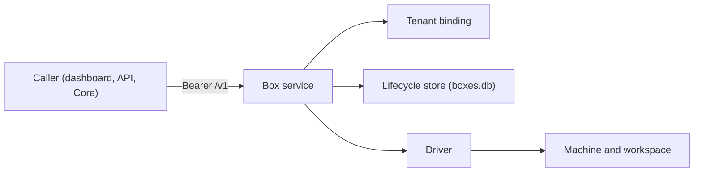
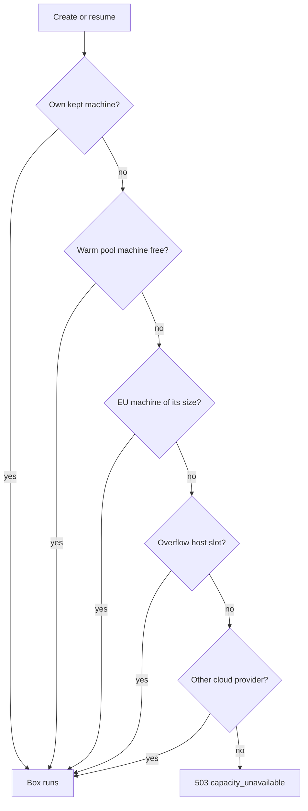
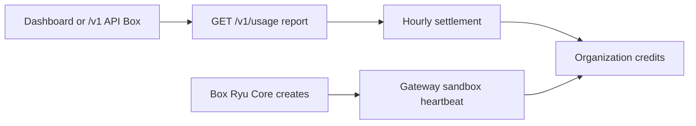

<Callout type="info">
  Hosted Ryu Box is on by default for every organization. If the Box card,
  **New Box**, or resume are missing from your organization's Products page,
  Ryu Box has been turned off for your organization. You can still list, stop,
  and delete existing Boxes. Self-hosting the Box service, described on this
  page, does not depend on that switch.
</Callout>

Ryu Box is a standalone persistent workspace service for agent commands,
previews, prompts, and long-running work. Its filesystem survives commands,
stop/resume cycles, and forks.

<Figure name="box" />

The service owns the tenant boundary, bearer authentication, lifecycle store,
and Box HTTP entry point. A selected driver owns the actual machine. Core can
use the same service through the persistent workspace contract.

## Self-hosting

<Callout type="warn">
  The self-hosted Box service is not yet published. There is no public source
  repository or container image to download and run.
</Callout>

Use Ryu-hosted Box, which Ryu enables for each organization. See the
[Box SDK quickstart](/docs/standalone/sdk/box#what-you-need).

The rest of this page describes how the service behaves, so the same contract
applies once it is published. A self-hosted deployment reads these settings:

| Setting | Effect |
|---|---|
| `RYU_BOX_DATA_DIR` | Directory that holds the lifecycle store `boxes.db` |
| `RYU_BOX_HOSTNAME`, `RYU_BOX_PORT` | Bind address, `127.0.0.1:8090` by default. Change it only behind an authenticated network boundary |
| `RYU_BOX_DRIVER=docker` | The safe default driver |
| `RYU_BOX_DRIVER=filesystem` with `RYU_BOX_ALLOW_UNSAFE_LOCAL=true` | Runs commands on the host without isolation. Meant only for contract tests; refuses to start when `NODE_ENV=production` |

## Each Box has its own screen

A Box created with `"desktop": true` runs a virtual desktop and a Chromium
browser inside the Box, next to your files and commands. Nothing outside the
Box sees that display, and the Box has no public VNC port:

- People watch and control it through an authenticated WebSocket stream on the
  Box API (`/v1/boxes/:id/desktop/ws`), opened with a short-lived,
  single-use `desktop` access token. See [Box API](/docs/standalone/box-api#desktop).
- Agents drive it through `POST /v1/boxes/:id/desktop/actions` (screenshot,
  click, type, key, scroll, focus an app) and the browser verbs under
  `/v1/boxes/:id/browser/:verb`.
- A stream can be view-only: the service then forwards only the screen and
  drops every keyboard and mouse message.
- At most four viewers watch one Box at a time. Stopping, parking, or deleting
  the Box closes every stream.

When Ryu Core runs a conversation's heavy work on a Box (a cloud task,
computer use, the browser, or a parallel sub-agent), that Box is the
conversation's [session Box](/docs/surfaces/desktop/user-guide/virtual-desktop#session-box-screens)
and its screen appears in the desktop and web apps.

## Placement and capacity on Ryu-hosted Box

On Ryu-hosted Box, a Box normally runs in its own virtual machine, created
when the Box starts or resumes and deleted when it stops. When that capacity is
short, a Box can instead land on a host Ryu reserves for overflow, which it may
share with other Boxes.

Wherever it lands, each Box keeps its own container, screen, browser, and
gVisor sandbox. No Box sees another's files, display, or network. A Box never
runs on your organization's own Ryu server.

Ryu does not queue Boxes. It starts each one on the first capacity available,
in this order:

1. on a resume, the machine Ryu kept for this Box after it stopped, while
   Ryu still keeps it (see below);
2. a machine already running in Ryu's small warm pool, which starts fastest;
3. a new machine of the Box's size in one of Ryu's EU locations;
4. a slot on a host Ryu reserves for overflow, shared with other Boxes but
   with its own container, gVisor sandbox, screen, and workspace;
5. a machine of the same size at another cloud provider, at the same price to
   you.

`GET /v1/boxes/:id` reports where a Box landed under `placement`. In the rare
case that none of these has room, create and resume answer
`503 capacity_unavailable` with a `Retry-After` header. Retry the same request
with the same idempotency key.

When you stop a Box, Ryu saves its workspace to Ryu's storage before it
deletes the machine. Resuming restores it onto a fresh machine, possibly in
another location. If you resume within the same hour, Ryu may reuse the
machine it kept for that hour, which makes the resume faster.

A Box's own memory and running processes do not survive a stop; its files do.

## Choose the service shape

| Shape | Use it when | State owner |
|---|---|---|
| Local Docker | Ryu owns the workspace capacity and needs a local isolated driver | Ryu Box plus the Docker driver |
| Local filesystem | A development or contract test needs no Docker daemon | Ryu Box; host execution is not isolation |
| Connected provider | A configured workspace provider owns machine capacity or a wider API surface | Ryu Box owns the tenant bridge; the provider owns machine state and subscription billing |

Connected provider mode is opt-in through `RYU_BOX_UPSTREAM_URL`. It keeps
the provider credential server-side and preserves the Ryu Box `/v1` contract.
See [Box API](/docs/standalone/box-api) for the route and credential boundary.

## Ryu capacity pricing

Every Box is a Linux machine in one of three sizes, priced per running hour.
Box has no GPU or Windows option.

| Size | Price |
|---|---|
| `small` (2 vCPU, 4 GiB) | **$0.025** per hour |
| `default` (4 vCPU, 8 GiB) | **$0.04** per hour |
| `large` (8 vCPU, 16 GiB) | **$0.07** per hour |

### Compute

Compute is charged only while the Box runs, in whole minutes, rounded up. A
stopped Box costs nothing for compute.

Each start, whether you create the Box or resume it, is charged for at least
five minutes (a **5-minute minimum**). A Box that runs for one minute costs
five minutes of its size.

The minimum applies once per server hour already paid for:

- A stopped Box resumed on the same machine within that hour is charged its
  minutes only, with no new minimum.
- A resume on a different machine, or after that hour, pays the minimum again.

### Storage

Storage is the measured size of each Box's saved workspace and of its
snapshots, for as long as they are stored. One allowance covers every Box of the
organization, whether it was created from the dashboard, the API or a
conversation.

| Plan | Included storage | Beyond it | Kept |
|---|---|---|---|
| Paid plan | **25 GiB** | **$0.05** per GiB-month (30 days) | While the plan is active; if the plan ends, while the organization has credit and for 30 days after it runs out |
| No paid plan, or a paid plan in its free trial | **10 GiB** | Not available | A stopped Box for 14 days after it stopped |

Without a paid plan, creating, resuming or forking a Box and taking a snapshot
are refused once the organization stores 10 GiB, until you delete stopped Boxes
or snapshots. Stopping a Box always saves its work, even at the limit. When
storage is deleted at the end of its retention, the stopped Box and its saved
workspace are gone; a running Box is never deleted this way.

### Running Boxes per plan

Your plan limits how many Boxes run at the same time. A create or resume over
the limit is refused until another Box stops. A paid plan in its free trial has
the trial limit until the trial converts.

| Plan | Running Boxes |
|---|---:|
| No paid plan, a free trial, A Major Pass, desktop license | 1 |
| Plus, Pro | 2 |
| Max | 4 |
| Teams Lite, Teams | 10 |
| Business | 20 |

### How a Box is charged

A Box is charged through exactly one of two paths, never both:

**Dashboard and API Boxes.** A Box created from the Ryu dashboard or directly
through the `/v1` API is settled hourly from the service's `GET /v1/usage`
report. Each hour is charged once, shortly after it ends, spending the plan's
included pool first, then gift balance, then top-up credit. A default Box that
runs for a full hour costs $0.04.

**Boxes Ryu Core creates.** A one-shot sandbox command, a persistent sandbox,
or a conversation's session Box is charged through the Gateway sandbox
heartbeat. It uses the same rates, the same 5-minute minimum per start, and the
same free resume within the hour already paid. It shows in the credit ledger as
**Box session compute**.

A Core Box is charged while it runs, until one of these ends it:

- Core stops or parks it;
- a budget or balance stop;
- its time to live runs out.

Its saved workspace counts toward the same storage allowance, and storage
above it is charged hourly as **Box** in the credit ledger. If Core stops
reporting a running Box, for example because the node went offline, the Box
service parks it within about two minutes. A Box Core no longer meters does
not keep running.

### When credits run out

Creating or resuming a Box from the Ryu dashboard or Ryu's organization API is
refused with `402 insufficient_credits` while the organization has no plan pool
left and no positive balance. New work sent directly to the Box service's own
`/v1` API is refused the same way within about a minute. Ryu checks every few
minutes and stops the organization's running Boxes once credits run out.

What happens to stored work:

- A stopped Box keeps its saved workspace.
- On a paid plan, storage above the included amount keeps accruing until you
  delete it or it expires.
- While your paid plan is active, running out of credit before the next plan
  refill does not delete anything.
- Without an active paid plan, stopped Boxes and snapshots are deleted 30 days
  after credit ran out.

Without a plan, a positive credit balance (for example from manual no-plan
credit checkout) is enough to run one Box at a time with the 10 GiB of
storage above.

### Billing outside Ryu credits

In connected-provider mode, the provider's subscription is the capacity
billing authority and Ryu does not debit the same machine time again. A
self-hosted Box is never billed by Ryu. See
[Metering Rates](/docs/billing/metering#sandbox-compute) for spend-cap guidance.

## Organization entry point

In a hosted organization, open **Products** in the Ryu dashboard to create and
manage Box workspaces. Programmatic callers use the authenticated `/v1` API
directly.

Deleting a Box from the dashboard permanently removes its disk and stored
state, so Ryu first asks you to confirm it's you with a fresh second-factor or
emailed code, the same check as removing a cloud computer. One confirmation
covers further removals for a few minutes. Stopping and resuming a Box need no
extra confirmation.

The standalone `GET /` route returns a short JSON description of the service:
its name, version, API version, and the `/health` path. It redirects people only
when `RYU_PRODUCT_DASHBOARD_URL` is set to a non-empty URL, such as your own
console or landing page. Ryu's hosted deployment sets it to the Ryu dashboard,
so a self-hosted Box never sends visitors to Ryu by default.

The browser never receives a service bearer or a driver reference. A Box
resource is always resolved under the selected organization or standalone
tenant binding.

## Read next

<Cards>
  <DocCard href="/docs/standalone/box-api" />
  <DocCard href="/docs/standalone/box-lifecycle" />
  <DocCard href="/docs/core/boxes" />
  <DocCard href="/docs/security/sandboxing-isolation" />
</Cards>
