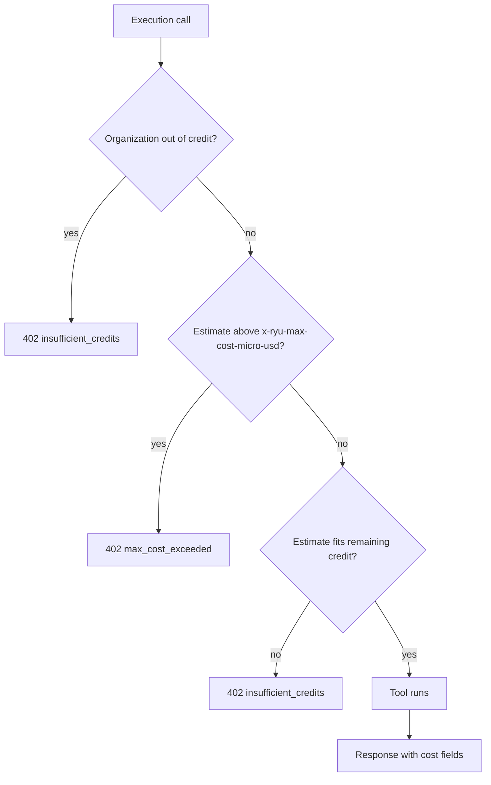

This reference covers the cost fields on every Connect execution response, the
caller's maximum, `GET /v1/balance`, `Idempotency-Key` retries, and billing
receipt metering. For bearers, execution paths, and error codes, see the
[Connect API](/docs/standalone/connect-api).

## Call cost and the caller's maximum

Every execution response says what the call costs. `/v1/composio`,
`/v1/composio/execute`, and `/v1/exec/tool` add these top-level fields, and MCP
`tools/call` puts the same object in the result's `_meta` under
`com.ryuhq/call`.

| Field | Meaning |
|---|---|
| `ryuCallId` | Connect's own ID for the call (`call_…`) |
| `costMicroUsd` | The call's price at Ryu's rates, in micro-USD |
| `chargedMicroUsd` | What Ryu's Connect settlement charges the organization for it; `null` on a Connect Ryu does not bill, or for an organization Ryu does not bill for hosted services |
| `estimated` | `true` while the price is not final, for example while a Composio receipt is still being read |
| `priceSource` | `connect_native` for a toolkit Connect serves itself, `composio_rates` for a Composio execution, `null` for a call with no price |
| `exceededMaxCost` | `true` when the final price went above the caller's maximum |
| `ledgerRefId` | The ledger reference of the charge (`composio:<transactionId>`), or `null` |

A call to a registered MCP server costs nothing. A call that fails before a
billing receipt exists costs nothing.

These fields describe a call made to Connect directly. When Ryu Core makes the
call, the Ryu Gateway charges it at call time as a Composio tool call, and
Connect's settlement then skips it. For a toolkit Connect serves natively, that
Gateway charge uses the Composio own-app rate and add-ons, not the native price
these fields report.

### Cap one call

Send `x-ryu-max-cost-micro-usd: <micro-USD>` to cap one call, the same header
the Ryu Gateway accepts. Over MCP, send the header on the HTTP request that
carries `tools/call`.

- On a Ryu-hosted Connect, a call whose estimate is above the cap is refused
  before it runs with `402` and `code: "max_cost_exceeded"`.
- A Composio call is estimated without any premium charge, which is only known
  afterwards. A premium charge is still charged in full and the response says
  `exceededMaxCost: true`.
- Until Connect has seen a tenant's first Composio receipt, it does not know
  whether the tenant uses its own auth app. The cap is checked against the
  cheapest auth source's price, while the credit hold uses the
  Composio-managed price.
- A value that is not a non-negative whole number is `400` with
  `code: "invalid_request"`.

### Credit holds

A Ryu-hosted Connect also holds each call's estimate against the
organization's remaining credit before it runs. The hold counts calls that ran
since Ryu last charged the organization and calls still running. A call that
does not fit gets `402` with `code: "insufficient_credits"`.

| Caller | Credit check |
|---|---|
| Self-serve Connect keys | The hold applies to every call |
| A tenant the operator binds for Ryu Core (the Ryu Gateway charges its calls as they run) | Refused only once the organization has no credits left |
| An organization Ryu does not bill for hosted services | Never refused or charged |

Both `402` refusals carry the same detail fields as the Ryu Gateway's tool
refusals:

- `estimate_micro_usd`;
- `balance_micro_usd` (what was left to spend), when known;
- `max_cost_micro_usd`, when you sent a maximum;
- `top_up_url`, when the deployment names a page for adding credit.

Over MCP they are in `_meta["com.ryuhq/refusal"]` beside `code`.

## Check the balance

`GET /v1/balance` reports what the tenant can spend before it calls:

| Field | Meaning |
|---|---|
| `billed` | Whether Ryu bills this tenant's calls |
| `suspended` | `true` when the organization has no credits left |
| `headroomMicroUsd` | The organization's remaining credit when Ryu last reported it, or `null` |
| `unsettledMicroUsd` | Calls recorded since Ryu last charged the organization, or `null` |
| `heldMicroUsd` | Estimates of the tenant's calls still running |
| `availableMicroUsd` | What new calls can hold now, never below zero, or `null` when Connect holds nothing |
| `unsettledSince` | The time from which recorded calls are not charged yet, or `null` |
| `topUpUrl` | Where to add credit, or `null` |

## Safe retries with Idempotency-Key

Send `Idempotency-Key: <label>` (at most 128 characters) to make a retry safe
on `/v1/composio`, `/v1/composio/execute`, `/v1/exec/tool`, or the HTTP request
that carries an MCP `tools/call`. Labels belong to your tenant. Each label is
tied to the route and the request body; the order of JSON fields does not
matter.

- The first call with a label runs, and Connect keeps its answer for 24 hours.
- A retry with the same label and body gets that answer back with the header
  `idempotent-replayed: true`. The tool does not run again and the call is not
  charged again; the answer keeps the first call's `ryuCallId` and receipt.
- The same label with a different body gets `409` with
  `code: "idempotency_conflict"`.
- While the first call is still running, a retry gets `409` with
  `code: "idempotency_in_progress"` and `Retry-After`.
- If Connect restarted while the first call was running, it cannot know
  whether the tool ran, so the label answers `409` with
  `code: "idempotency_outcome_unknown"` and is never run again. Check the
  tool's effect before retrying under a new label.
- If the first call's answer was larger than 8 MiB, Connect ran it but could
  not keep the answer, so a retry gets `409` with
  `code: "idempotency_result_unavailable"` and the call is not run again. The
  answer is gone: check the tool's effect, then use a new label if it still
  needs to run.
- If Connect cannot record labels at that moment, for example because its disk
  is full, a labelled call gets `503` with `code: "idempotency_unavailable"`
  and is not run. Retry shortly with the same label.

A refusal given before the tool could run, such as a `402`, `403`, `429`, or
`503` with `code: "metering_unavailable"`, is not kept, so retrying with the
same label after fixing the cause runs the call. A `5xx` after the tool may
have run is kept. Over MCP the `409` answers are `isError` results with the
code in `_meta["com.ryuhq/refusal"]`.

## Billing receipts and metering

Composio executions pause with `503` and `code: "metering_unavailable"` when
Connect cannot account for a receipt. Over MCP the refusal is an `isError`
result with that code in `_meta["com.ryuhq/refusal"]`. A refused call never
reaches Composio, so it is safe to retry later.

### A receipt Connect cannot store

If Connect cannot store a call's billing receipt, for example because its disk
is full, that call still returns its result and receipt. Connect keeps the
receipt and refuses further Composio executions on every path until it is
stored. Once the receipt is stored, execution resumes and the receipt appears
in the usage report.

### A receipt Composio has not returned yet

If Connect cannot read a call's billing receipt from Composio yet, the call
still returns its result, without a receipt. Connect keeps the call's log ID and
reads the receipt again before the tenant's next execution and before its usage
report. The receipt appears in `GET /v1/usage` once Composio answers, stamped
with the time it was read.

While 256 of a tenant's receipts are still unread because Composio cannot be
reached, its executions are refused until one is read. Other tenants are
unaffected.

### A receipt that can never be read

A receipt is no longer retried, and no longer counts toward that limit, when:

- Composio has no such log;
- its billing details cannot be verified;
- it is still unread after 24 hours.

The first page of `GET /v1/usage` lists it under `unresolved` as
`{ transactionId, at, reason }`, where `at` is the call's time and `reason` is
`unverifiable` or `expired`. These entries have no usage and are not priced.

<Cards>
  <DocCard href="/docs/standalone/connect-api" />
  <DocCard href="/docs/standalone/connect-api-usage" />
  <DocCard href="/docs/standalone/connect" />
</Cards>
