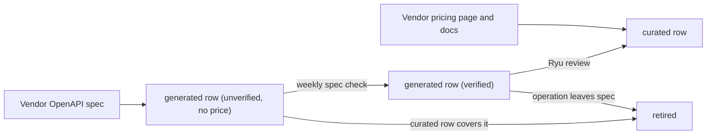

Ryu keeps its own catalog of the third-party API endpoints Ryu Connect can
call. Anyone can read it, with no account or key, on the website's
[tool catalog](https://ryuhq.com/tools) or as JSON from the Ryu API
(`https://api.ryuhq.com`). Every row says where its data comes from:

- **Prices** are taken from each vendor's own pricing page and keep the
  vendor's unit (USD, or a vendor credit such as Tavily credits), the page's
  address and the date Ryu last checked it. A price Ryu has not verified shows
  no figure and is never used for a paid call.
- **Verification** is Ryu's latest check of the endpoint against the vendor's
  published docs: `verified`, `unverified`, `drifted` (the vendor's docs or
  prices changed; paid calls pause until Ryu re-checks) or `retired` (with a
  successor when there is one).
- **Reliability** is how real calls went over the last seven days, from calls
  hosted Connect ran and calls Ryu Core made through Ryu Gateway. It is the
  same evidence as the `reliability` field on
  [search and describe](/docs/standalone/connect-api-discovery#reliability).

## Catalog tiers

Every endpoint has a `tier`, one of two values.

- **`curated`** rows are written and reviewed by Ryu: a job from Ryu's
  capability list, a price from the vendor's pricing page, and checks against
  the vendor's reference docs.
- **`generated`** rows list the rest of a vendor's API, read from the OpenAPI
  spec the vendor publishes itself. Each one names the spec's address, the
  date Ryu checked it and the operation it describes (`operation.method` and
  `operation.path`).

### Generated rows

A generated row starts `unverified` and has no price, so it shows "No
published price" and is never used for a paid call.

- A weekly check may mark it `verified` when the spec still lists its
  operation. That confirms the operation exists, not a price.
- The row still never routes a paid call until Ryu reviews it into a curated
  row.
- Most have no job yet. They are answered by endpoint lookup
  (`/api/tool-catalog/catalog/endpoints/{id}`) but not listed in platform
  views.
- Ryu assigns a job to some after review, and those are listed under their
  platform after the reviewed rows.

A reviewed row always wins. When a curated row covers the same operation, the
generated one is left out or retired with the curated row as its successor. A
generated row is also retired when the operation leaves the vendor's spec. Ryu
reads only specs the vendor publishes, never another catalog.



## Free routes

A few endpoints are free for anyone and need no key at the vendor. When Ryu has
reviewed such an endpoint and checked it with a live call that sent no
credential, its row carries `freeRoute`. That is the method (`GET`) and the
vendor URL as a template, such as `https://api.vendor.example/v1/items/{id}`.

Only a reviewed (`curated`) row whose price is `free` and whose verification is
a live call gets one. A row Ryu has not verified never does.

<Callout type="warn">
  Free routes are off by default. A Connect deployment serves them only when
  its operator sets `RYU_CONNECT_FREE_ROUTES=on`.
</Callout>

A Connect deployment that turns free routes on serves them with no Connect key
at all.

```sh
curl -fsS 'https://connect.example/v1/free/<endpoint>/v1/items/42?lang=en'
```

- The path after the endpoint id must fill the template segment for segment;
  otherwise the call answers `400 invalid_path`. An endpoint without a free
  route answers `404 free_route_not_found`, and anything but `GET` or `HEAD`
  answers `405`.
- Only the query string and the `Accept` and `Accept-Language` headers reach
  the vendor. Connect adds no credential and forwards no cookie or
  authorization header.
- Answers are at most 1 MiB, served under sandbox headers with
  `x-ryu-free-route: true` and `x-ryu-metered: false`.
- Calls are limited per client, per minute and per hour, and for the whole
  route; a limited call answers `429 free_route_rate_limited` with
  `Retry-After`. An IPv6 client is counted by its /64 network, an IPv4 client
  by its address.
- Nothing is charged and no usage line is written, so free routes do not count
  toward [tag budgets](/docs/standalone/connect-api-tags).

No catalog row has a free route yet; rows gain one as Ryu verifies them.

## Browse API

These three routes are `GET`, public, answer JSON with an `ETag`, and return
`304` for a matching `If-None-Match`. [Search](#search) is described below.

| Route | Answer |
|---|---|
| `/api/tool-catalog/catalog/platforms` | Every platform with a live endpoint: `slug`, `label`, `summary`, `capabilities` and `endpoints` counts, `verified_endpoints`, `providers` and `price_from` (the cheapest usable one-call price) |
| `/api/tool-catalog/catalog/platforms/{slug}` | One platform's endpoints grouped into `domains[].rows[]`. A row is one job, keyed `comparison_key` (`<platform>/<capability>`, such as `web/web.search`), with its `endpoints`, ordered by Ryu, and `cheapest_endpoint` |
| `/api/tool-catalog/catalog/endpoints/{id}` | One endpoint with its row `siblings` and its full reviewed `price` record. Retired endpoints are answered here with their successor; platform views leave them out |

An unknown platform or endpoint is `404` with `code: "not_found"`.

Rows are built on the server, so every client compares the same vendors. A
row orders its endpoints by:

1. usable endpoints first;
2. then verified ones;
3. then better reliability (enough calls, a higher success rate, a lower p95);
4. then the cheaper ones.

A job Ryu has not promoted yet is listed with `compared: false` and no
`comparison_key`. The order is information for you to choose with: Connect
never picks a different endpoint than the one you call.

Each endpoint carries:

| Field | Meaning |
|---|---|
| `id`, `name`, `summary` | The endpoint, its title, and what the job does |
| `provider`, `provider_display` | The vendor's id and name |
| `capability`, `capability_id`, `capability_name` | The comparison key, the job's id and its name |
| `cost` | One call's price: `value` in the vendor's `currency`, `usd`, `free`, `basis` and `metered_by`, with `provenance`, `confidence`, `checked_on` and `source_url` |
| `verification` | `state`, `method`, `checked_on`, `verified_on`, `successor` |
| `paid_routing_allowed` | Whether Ryu may route a paid call to it (verified, with a verified price) |
| `platform_eligible`, `platform_blocked` | Whether it is usable now, and why not when it is not |
| `reliability` | Evidence from real calls, or `null` when no call was counted |
| `reviews` | [Agent reviews](/docs/standalone/connect-api-reviews) of real calls (counts always; the rating once five organizations reviewed), or `null` when nobody did |
| `docs_url`, `source`, `tier`, `toolkit` | The vendor's reference page (for a generated row, the vendor's OpenAPI spec), whose catalog it is (`ryu`), the [catalog tier](#catalog-tiers) (`curated` or `generated`), and the Connect toolkit when it has one |

`cost.basis` says what the one-call figure covers:

| `basis` | Meaning |
|---|---|
| `one_call` | The price depends on the number of calls alone |
| `base_call` | The per-call part; the `metered_by` meters, such as `results_over_10`, add to it |
| `usage` | The price depends only on other meters, such as `pages`. There is no one-call figure, and `value` and `usd` are `null` |

A free endpoint has `free: true`; an unknown price is never shown as free.

## Search

`GET /api/tool-catalog/catalog/search?q=<words>` searches live endpoints (not
retired ones) and answers `{ object: "list", version, data, ranking? }`.

| Parameter | Rule |
|---|---|
| `q` | At most 200 characters. An empty `q` lists endpoints in catalog order |
| `limit` | 1 to 25, default 8 |
| `ranking` | `hybrid` to also rank by meaning (see below) |
| `judge` | `true` to rerank the top eight with a small model |

Each row has `endpoint`, `title`, `provider`, `capability`, `platform`, `tier`,
`state` (the verification state), `docsUrl`, `paidRoutingAllowed` and `score`.
Open `/catalog/endpoints/{endpoint}` for its price and siblings.

Word search (the default) ranks with the same BM25 scoring as Connect's tool
search, over the endpoint id, its title, its provider, and the name and
description of its job and platform. It is free and cacheable.

### Hybrid search

`ranking=hybrid` and `judge=true` work exactly as
[Connect's hybrid search](/docs/standalone/connect-api-discovery#hybrid-search)
does, with the same `ranking` fields on the answer and its rows. Send your Ryu
Gateway key in `x-ryu-gateway-key`.

- The query's embedding and the judge run through Ryu Gateway and are charged
  to that key's organization. The catalog's own embeddings are Ryu's.
- Without a key, or when hybrid search is not enabled on the deployment, the
  answer is the word search answer with `ranking.fallback` saying why.
- A hybrid answer is sent `private, no-store`.

## Reliability feed

`GET /api/tool-catalog/reliability` returns the evidence for every tool Ryu
has counted calls for: `{ type: "ryu.tool_reliability", generatedAt,
windowDays, entries: [{ key, sources, evidence }] }`. The feed is computed at
most every five minutes.

| Field | Meaning |
|---|---|
| `key` | The catalog endpoint id (a `composio.<SLUG>` tool keys `<toolkit>.<SLUG>`) |
| `sources` | The per-source counts and latency histograms |
| `evidence` | The folded row described under [reliability](/docs/standalone/connect-api-discovery#reliability) |

Only tools with a public catalog identity are counted: Composio-shaped tools
and Ryu's built-in vendor endpoints. Your own registered MCP servers, relay
tools and Core tools are never recorded, and no organization, user, argument,
answer or error text is part of it.

## Review feed

`GET /api/tool-catalog/reviews` returns the [review](/docs/standalone/connect-api-reviews)
summary of every endpoint someone reviewed: `{ type: "ryu.tool_reviews",
version, generatedAt, entries: { "<endpoint>": summary } }`, keyed like the
reliability feed.

The summary is computed at most every five minutes from the last 90 days of
reviews. It counts each reviewing organization once under an opaque hash, and
never carries a comment, call id or organization.

## In Ryu's Integrations Store

The desktop [Integrations tab](/docs/surfaces/desktop/user-guide/store#compare-integrations-across-providers)
reads this catalog with the same reader it uses for Treg's public catalog, and
shows both side by side with their source labels.
