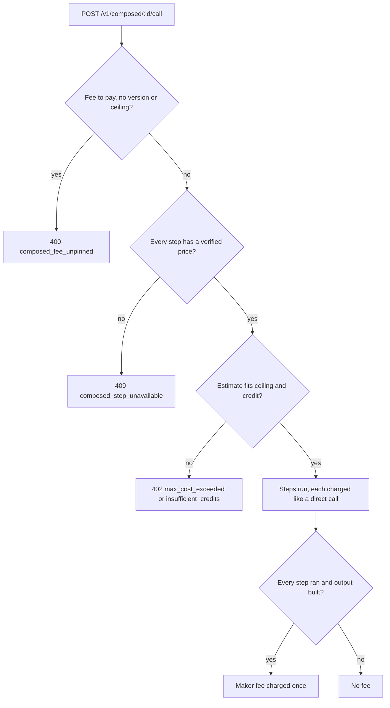

A composed tool is a small recipe of catalog calls that runs as one tool. A
maker defines its input, the steps (each one a call to an endpoint the maker
chose, such as Tavily search then Exa contents) and how each step's input and
the tool's output are mapped. Connect runs the steps, charges each one like a
direct call, and charges the maker's fee once for each run that completes.

Nothing is routed for the caller: every step names its endpoint, so the
provider is the maker's choice, shown before you run it.

## Define a tool

```sh
curl -X POST https://connect.example/v1/composed \
  -H "Authorization: Bearer $RYU_CONNECT_KEY" \
  -H "Content-Type: application/json" \
  -d '{
    "slug": "search-and-read",
    "name": "Search and read",
    "description": "Search the web and read the top page.",
    "input": { "topic": { "type": "string", "description": "What to search for" } },
    "steps": [
      {
        "id": "search",
        "capability": "web.search",
        "endpoint": "tavily.search.basic",
        "input": {
          "query": { "template": "latest on {{input.topic}}" },
          "maxResults": { "value": 3 }
        }
      },
      {
        "id": "read",
        "capability": "web.extract",
        "endpoint": "exa.contents.text",
        "input": { "urls": { "list": [ { "from": "steps.search.result.results.0.url" } ] } }
      }
    ],
    "output": {
      "title": { "from": "steps.search.result.results.0.title" },
      "text": { "from": "steps.read.result.pages.0.text" }
    },
    "makerPriceMicroUsd": 2000,
    "visibility": "marketplace"
  }'
```

- `input` - up to 16 fields, each `string`, `integer`, `number`, `boolean` or
  `string_array`, required unless `"required": false`.
- `steps` - 1 to 8 steps. Each names a job (`web.search`, `web.extract`), an endpoint
  with an adapter for that job (the candidates in the
  [routing listing](/docs/standalone/connect-api-routing#jobs-and-candidates)),
  and the job's input. A step's `result` is the job's result in Ryu's shape.
- A mapping fills one input or output field (see the table below). A step may
  read only steps declared before it. Steps that do not read each other run at
  the same time.
- `makerPriceMicroUsd` - your fee per completed run, 0 to 100,000,000
  micro-USD ($100). Default 0.
- `visibility` - `org` (default; every key of your organization can see and run
  it) or `marketplace` (also listed for every Connect user). Listing is a flag:
  there is no review queue. Setting a fee or listing on the marketplace needs
  an organization key, because the fee is credited to the organization.

| Mapping | Value |
|---|---|
| `{"value": …}` | A constant |
| `{"from": "input.<field>"}` | A field of the tool's input |
| `{"from": "steps.<id>.result.<path>"}` | A dotted path into an earlier step's result; numbers index lists |
| `{"template": "… {{input.topic}} …"}` | A string with input values filled in |
| `{"list": [ …mappings ]}` | A list built from other mappings |

The answer has the tool's `id` (`cmp_…`). `PUT /v1/composed/<id>` with a full
definition (same `slug`) makes a new version; versions never change, so a
caller can pin one. `DELETE /v1/composed/<id>` retires the tool. Only the key's
tenant that made the tool can change it.

## Find and run a tool

- `GET /v1/composed` lists the tools you can run (`?scope=mine`, `org` or
  `marketplace` narrows it).
- `GET /v1/composed/<id>` shows its input, each step's endpoint, provider and
  current price, the maker's fee (`maker.fee`, with `waived` when you do not
  pay it), the estimate and its versions. The steps' mappings are shown only
  to the maker.
- `POST /v1/composed/<id>/plan` with `{"input": {…}}` returns the estimate and
  whether every step can run now. Nothing is sent, held or charged.
- `POST /v1/composed/<id>/call` runs it, as in this example.

```sh
curl -X POST https://connect.example/v1/composed/cmp_…/call \
  -H "Authorization: Bearer $RYU_CONNECT_KEY" \
  -H "Content-Type: application/json" \
  -H "Idempotency-Key: research-42" \
  -d '{ "input": { "topic": "agent runtimes" }, "version": 1, "maxCostMicroUsd": 20000 }'
```

```json
{
  "object": "composed_run",
  "ok": true,
  "runId": "crun_…",
  "tool": { "id": "cmp_…", "name": "Search and read", "maker": "org_…", "version": 1 },
  "output": { "title": "…", "text": "…" },
  "estimateMicroUsd": 13000,
  "chargedMicroUsd": 13000,
  "makerFee": { "priceMicroUsd": 2000, "chargedMicroUsd": 2000, "waived": null, "ledgerRefId": "composio:rcx_…" },
  "steps": [
    { "id": "search", "endpoint": "tavily.search.basic", "provider": "tavily", "outcome": "served", "rung": "operator", "chargedMicroUsd": 8000, "ryuCallId": "call_…" },
    { "id": "read", "endpoint": "exa.contents.text", "provider": "exa", "outcome": "served", "rung": "operator", "chargedMicroUsd": 3000, "ryuCallId": "call_…" }
  ]
}
```

## Money

A run passes these checks before Connect sends anything, then charges each
step as it runs and the maker's fee once at the end:



### Before anything is sent

- Every step's endpoint must have a verified per-call price now, or the run is
  refused with `409 composed_step_unavailable`.
- The estimate is every step's price plus the maker's fee. A ceiling
  (`maxCostMicroUsd` or `x-ryu-max-cost-micro-usd`) below it refuses the run
  with `402 max_cost_exceeded`.
- The fee and every step's price are held against your credit first.

### A fee you agreed to

A maker can publish a new version with a different fee at any time. A run that
pays a fee must therefore name the `version` (a version's fee never changes) or
set a ceiling. Otherwise it is refused with `400 composed_fee_unpinned` and the
current fee (`maker_fee_micro_usd`). A run with no fee to pay needs neither.

### Steps

Steps run exactly like direct
[vendor calls](/docs/standalone/connect-api-relay#the-credential-ladder). On
your own key they cost nothing. On Ryu's key each is charged its verified price
on its own call id when the vendor answers 2xx.

### The maker's fee

The fee is charged once per run, only when every step ran and the output was
built. A run that fails part-way charges the steps that ran and no fee.

It is paid from your organization's top-up credit only. Plan, gift and
standalone credit are for your own use and never become another
organization's earnings.

The fee is not charged when:

- your top-up credit cannot cover it when the run is settled (the maker earns
  nothing for that run);
- the deployment is billed through Polar, which has no top-up balance to check;
- the caller is in the maker's own organization (`waived: "own_org"`);
- the deployment is one Ryu does not bill (`waived: "unbilled"`).

### What the maker earns

The maker earns the fee as spendable credit in the organization's wallet, on
deployments that bill from the local wallet. Ryu takes no share of it, and
earned credit can be spent but not withdrawn. Neither rule is final and both
may change.

## Refusals

| Status, code | Meaning |
|---|---|
| `400 invalid_definition` | The definition is malformed or a mapping reads something it cannot; `problems` lists why |
| `409 composed_slug_taken` | You already have a tool with this slug; `PUT` a new version instead |
| `403 maker_org_required` | Only an organization key can set a fee or list on the marketplace |
| `403 composed_not_owner` | Only the tenant that made the tool can change it |
| `404 composed_tool_not_found`, `composed_version_not_found` | The tool or version is not visible to you |
| `400 invalid_input` | The input does not match the tool's fields |
| `400 composed_fee_unpinned` | The run would pay a maker fee with no `version` or ceiling; nothing was sent |
| `409 composed_step_unavailable` | A step's endpoint has no verified price right now; nothing was sent |
| `402 max_cost_exceeded`, `insufficient_credits` | The estimate does not fit your ceiling or credit; nothing was sent |
| `composed_step_failed` (the step's status) | A step failed; later steps did not run and no fee was charged |
| `422 composed_mapping_unresolved` | A step's answer lacked a value the next step or the output needed; no fee was charged |

Listing, describing and planning need `tools:read`; running, defining and
changing need a key or `tools:exec`. Your organization's
[tool policy](/docs/standalone/connect-api-access-policy) applies to every
step.
