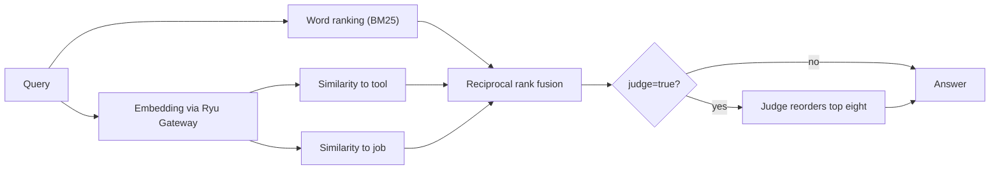

Connect answers the same search and describe over REST and MCP, for the tools
the tenant can call. What the [tool policy](/docs/standalone/connect-api-access-policy#tool-policy)
hides (retired tools, denied tools, and preview tools nobody pinned) is not
listed and describe answers it as not found.

## Search and describe

`GET /v1/tools/search?q=<words>` ranks the tenant's tools by relevance with
the BM25 scoring that Ryu Core's tool search uses for lexical ranking:

- It matches whole words of a tool's ID, name, description, and argument
  names, with rare words counting most.
- An exact ID or name comes first.
- A word that is not a whole word of any tool matches the words it starts, so
  `authent` finds `..._AUTHENTICATED_USER`.

`limit` is 1 to 25 (default 8), `q` at most 200 characters, and an empty `q`
lists tools in catalog order. Word search is free;
[hybrid search](#hybrid-search) is opt-in and charged as Ryu Gateway
inference.

Each result, and `GET /v1/tools/describe?id=<id>`, carries these fields beside
`id`, `name`, `kind`, and `description` (describe adds `parameters`, the JSON
Schema of the arguments):

| Field | Meaning |
|---|---|
| `provider` | Who runs the call: `ryu` for a toolkit Connect serves itself, `composio`, or the registered MCP server's ID |
| `tier` | `native` (actions Ryu maintains), `provider` (Composio's catalog), or `registered` (a tenant's MCP server) |
| `toolkit` | The vendor toolkit of a `composio.<SLUG>` tool, such as `github` |
| `price` | `{ amountMicroUsd, per: "call", source, estimated }`; `source` is `connect_native`, `composio_rates`, or `unmetered` for a registered server, which Connect never charges |
| `score` | The search score; search results only |
| `catalog` | Present only for a tool Ryu's curated catalog covers: `{ source, capability, platform, docsUrl, state, checkedOn, verifiedOn, method }` |
| `reliability` | Present only for a tool with counted calls: `{ samples, failures, successRate, p50Ms, p95Ms, sufficient, sources, lastSuccessAt, lastFailureAt, lastFailure, windowDays }` (see [reliability](#reliability)) |
| `reviews` | Present only for a tool someone reviewed: the [review summary](/docs/standalone/connect-api-reviews#summaries), with the rating once five organizations reviewed it |
| `lifecycle` | Present only for a `preview` or `deprecated` tool: `{ state, successor, sunsetAt, note }` ([lifecycle](/docs/standalone/connect-api-access-policy#lifecycle)) |
| `pin` | Present when the caller's team or organization pinned the tool: `{ version, scope, satisfied }` ([pins](/docs/standalone/connect-api-access-policy#pins)) |

A Composio price is `estimated`, because a premium action's surcharge is only
known from its receipt.

`catalog` says what Ryu has checked about a tool against the vendor itself:

- `source` names whose catalog the entry comes from (`ryu` for Ryu's own).
- `capability` and `platform` name the job and the system it acts on, such as
  `issue.create` on `github`.
- `docsUrl` is the vendor's own reference page.
- `state` is the latest verification verdict.

| `state` | Meaning |
|---|---|
| `verified` | The latest check passed on `verifiedOn`. `method` says how strong it was: `docs_page` (the vendor's reference and pricing pages still state what Ryu records), `live_free` (a call that costs nothing behaved as documented), or `live_paid` (a paid call behaved as documented) |
| `unverified` | No check has passed yet |
| `drifted` | A check on `checkedOn` found the vendor no longer matches Ryu's record, for example a price gone from the pricing page. Ryu reviews it before relying on it again |
| `retired` | Ryu no longer curates the tool; `successor` names its replacement when there is one |

The field never changes what a call costs or whether it runs. A tool without a
`catalog` field is simply not in the curated catalog yet.

### Reliability

`reliability` reports how a tool's real calls went over the last seven days,
so you can choose between tools that do the same job. It counts calls that
hosted Connect ran and calls Ryu Core made through Ryu Gateway, and `sources`
gives the count from each (`connect`, `gateway`).

- `successRate`, `p50Ms` and `p95Ms` appear once a tool has at least five
  calls in the window (`sufficient: true`); before that they are `null` and
  only the counts and dates are shown. Latencies are upper bounds of fixed
  buckets (100 ms, 250 ms, 500 ms, 1 s, 2 s, 5 s, 10 s, 30 s, 60 s, 120 s).
- `lastFailure` is `timeout`, `upstream_error` (the vendor answered with an
  error), `tool_error` (the tool reported an error result) or `unavailable`
  (the vendor could not be reached).
- A call Connect refused before it ran (credit, limits, policy, a missing
  connection) is not counted, and neither is a vendor's `4xx`, which is about
  the request or the key rather than the vendor.
- Only `composio.<SLUG>` tools and Ryu's built-in vendor endpoints are
  counted. A tenant's registered MCP servers and relay tools are never
  recorded, and no tenant, argument or answer is stored.

The field comes from a cache refreshed every few minutes. It never changes what
a call costs or whether it runs, and Connect never switches tools based on it:
you choose. The same evidence appears in the public
[tool catalog](/docs/standalone/connect-api-catalog).

### Hybrid search

Word search misses a request phrased as a job ("check my inbox for new mail")
when the tool's words differ. Add `ranking=hybrid` to rank by meaning as well.



```sh
curl -fsS 'https://connect.example/v1/tools/search?q=check%20my%20inbox&ranking=hybrid&judge=true' \
  -H 'Authorization: Bearer <connect-api-token>' \
  -H 'x-ryu-gateway-key: <your-ryu-gateway-key>'
```

- **How it ranks.** Connect embeds the query, each tool's description, and the
  job each curated tool serves (its `catalog.capability`). It merges three
  rankings with weighted reciprocal rank fusion: word relevance (the same
  scoring as word search), similarity to the tool, and similarity to its job.
- **Jobs rank together.** Every tool that does a recalled job ranks together,
  so the tools you can compare for one job appear side by side. An exact ID or
  name still comes first.
- **The judge.** `judge=true` asks a small model to read the top results (up to
  eight) and the task, answer a verdict (`match`, `partial`, `none`) and put
  the tools that help first. It never removes a result. A tenant may make 60
  judge calls an hour unless the operator sets another limit.
- **Who pays.** Embeddings and the judge run through Ryu Gateway, never
  directly to a model provider, on the key in `x-ryu-gateway-key`. The
  Gateway reserves and charges them to that key's organization like any other
  Gateway inference; Connect adds no charge of its own.
- **Tool embeddings are shared.** Tool descriptions are embedded once and
  cached for every tenant (the operator's own key pays for them when one is
  configured), so you pay for your query and the judge.
- **Repeats are free.** A query's vector is kept for an hour and a judge
  verdict for ten minutes, so repeating a search (or retrying one that timed
  out) replays the same answer without calling the Gateway again. Identical
  searches at the same moment share one judge call.
- **Fallback.** When hybrid ranking cannot run, the answer is exactly the word
  search answer, and `ranking.fallback` says why.

A search that asked for hybrid ranking carries a `ranking` object.

| Field | Meaning |
|---|---|
| `requested`, `mode` | What the caller asked for and how the answer was ranked: `lexical` or `hybrid` |
| `fallback` | Why the answer is word search: `unconfigured` (this Connect has no Gateway for discovery), `empty_query`, `gateway_key_required` (no `x-ryu-gateway-key`), `gateway_key_rejected`, `insufficient_credits`, `rate_limited`, `gateway_unavailable`, or `corpus_too_large` (more than 2,000 tools) |
| `embeddingModel` | The embedding model the Gateway was asked for |
| `gatewayRequestIds` | The Gateway requests this search made on your key, to match against your Gateway usage |
| `judge` | `{ status, reason, verdict, model, considered, ref, gatewayRequestId }`; `status` is `applied`, `cached` (a replay of the verdict `ref` names, not charged again), `skipped` or `failed`, and `reason` is `unconfigured`, `lexical_only`, `no_candidates`, `cap_reached`, `gateway_key_rejected`, `insufficient_credits`, `rate_limited`, `gateway_unavailable`, or `invalid_verdict` (the judge answered something unreadable; the call was charged and the order is unchanged) |

Each hybrid row keeps `score` (its word relevance) and adds `ranking` -
`{ fused, lexicalRank, semanticRank, jobRank, similarity, judged }`. A rank is
`null` when that ranking did not place the tool.

`ranking` and `judge` are query parameters over REST (`true` or `false` for
`judge`) and arguments of the MCP `search` tool, which reads
`x-ryu-gateway-key` from the MCP request. A malformed `x-ryu-gateway-key` is
refused with `400`. Connect never stores or returns your Gateway key.

### No match

- When a search with words finds nothing, the answer adds `missedTerms` (the
  words no tool matched) and `didYouMean` (up to three tool IDs one typo away).
- Describe of an ID the tenant has no tool for answers `404` with
  `code: "not_found"` and `didYouMean`.
- A `composio.<SLUG>` the tenant is not granted keeps answering `403` with
  `code: "tool_denied"`.

## Ask for a missing tool

`POST /v1/tools/requests` asks Ryu for a tool Connect does not serve yet.

```sh
curl -fsS -X POST https://connect.example/v1/tools/requests \
  -H 'Authorization: Bearer <connect-api-token>' \
  -H 'Content-Type: application/json' \
  -d '{"description":"Create Linear issues from a support thread","toolkit":"linear","query":"linear issue"}'
```

`description` is required (at most 1,000 characters); `toolkit` (64) and
`query` (200) are optional. The answer is `201` with the request's `id`
(`treq_…`). Each tenant may file 5 requests an hour and 20 a day; more get
`429` with `code: "rate_limited"` and `Retry-After`.

Connect keeps tool requests, and searches that found nothing (with the words
they missed), for 30 days so the operator can see which tools to add. They are
never shown to other tenants.

## Compatibility mode

In compatibility mode, `/v1/tools/search` and `/v1/tools/describe` forward to
Core's unified catalog. `/v1/tools/composio`, `/v1/exec/tool`, and
`/v1/composio` forward to Gateway with the operator-configured Gateway bearer and
the authenticated Connect tenant stamped as `x-ryu-user-id`.

```sh
curl -fsS 'https://connect.example/v1/tools/search?q=send%20a%20Slack%20message' \
  -H 'Authorization: Bearer <connect-api-token>'

curl -fsS -X POST https://connect.example/v1/composio \
  -H 'Authorization: Bearer <connect-api-token>' \
  -H 'Content-Type: application/json' \
  -d '{"operation":"execute","toolId":"SLACK_SEND_MESSAGE","body":{"channel":"#general","text":"Deploy finished"}}'
```

Native mode accepts only `operation: "execute"` with `toolId`, an optional
`body` object, and an optional `expectedAccountId`; any other operation or field
returns `400` with `code: "invalid_request"`.

In compatibility mode the upstream Gateway remains responsible for allowlists,
budgets, audit, and Composio credentials. Connect does not bypass it.

## Constant-size MCP

`POST /mcp/meta` is the same MCP server with a fixed set of five tools, however
many tools the tenant is granted. It suits agents and directories that should
not load a large catalog into context.

| Tool | Does | Same as |
|---|---|---|
| `search` | Ranked search: `query`, optional `kind`, `limit`, `ranking` and `judge` | `GET /v1/tools/search` |
| `describe` | One tool's parameters, provider, tier, and price: `id` | `GET /v1/tools/describe` |
| `call` | Run a tool: `tool`, `arguments`, optional `idempotency_key` and `max_cost_micro_usd` | `tools/call` on `/mcp` |
| `balance` | What the tenant can spend now | `GET /v1/balance` |
| `request_missing_tool` | Ask for a tool: `description`, optional `toolkit` and `query` | `POST /v1/tools/requests` |

`search`, `describe`, and `balance` return their answer as structured content
and as JSON text. Every tool carries MCP annotations, so clients can tell
read-only tools from `call`.

`call` returns the tool's own result, with the call's cost in
`_meta["com.ryuhq/call"]`, and is charged and refused exactly as `tools/call`
is:

- Its `idempotency_key` works like the `Idempotency-Key` header. A retry with
  the same key, tool, and arguments returns the first answer without running
  or charging again. It shares labels with `tools/call` on `/mcp`.
- `max_cost_micro_usd` can only lower the request's
  `x-ryu-max-cost-micro-usd`.
- An unknown tool ID is refused with `code: "not_found"` and `didYouMean` in
  `_meta["com.ryuhq/refusal"]`.

`POST /mcp/meta/read` lists only `search`, `describe`, and `balance`, all
read-only, for MCP directories that must not offer a tool that acts on another
system.

<Cards>
  <DocCard href="/docs/standalone/connect-api" />
  <DocCard href="/docs/standalone/connect-api-access-policy" />
</Cards>
