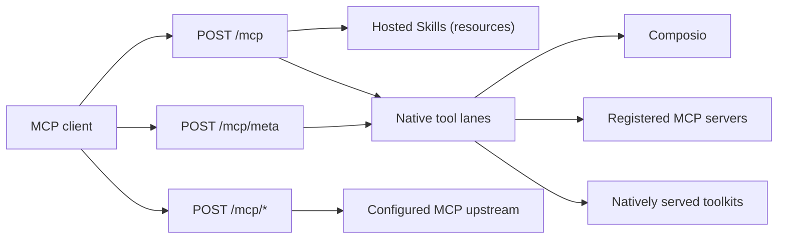

This reference covers the shared Skill catalog, the Connect-owned MCP endpoint,
native MCP registrations, tool search, and credential masking. For bearers,
Composio execution, and error codes, see the
[Connect API](/docs/standalone/connect-api).

## Skills

Replace the example host and bearer placeholder with the URL and token for your Connect
deployment:

```sh
curl -fsS https://connect.example/v1/skills \
  -H 'Authorization: Bearer <connect-api-token>'

curl -fsS https://connect.example/v1/skills/passport-review \
  -H 'Authorization: Bearer <connect-api-token>'
```

Skill responses contain frontmatter metadata and the hosted `SKILL.md` body;
they do not contain provider credentials.

The catalog is one directory shared by every tenant of the deployment. Any
valid runtime bearer can list and read every Skill, so keep tenant-private
material out of it.

| Status | `code` | When |
|---|---|---|
| `503` | `skills_unavailable` | The Skill directory is missing |
| `400` | `invalid_skill_id` | The Skill ID is malformed |

The catalog Ryu ships includes `ryu-connect`, an operating guide for agents
that call tools through Connect. It covers:

- finding and calling tools;
- money rules and the caller's maximum cost;
- a failure table with what to do for each code;
- retries with `Idempotency-Key`;
- connection prompts and masked credentials.

Read it with `GET /v1/skills/ryu-connect` or as the MCP resource
`ryu-skill:///ryu-connect/SKILL.md`.

## Hosted MCP

`POST /mcp` is the Connect-owned MCP server. It runs without an upstream and
supports:

- initialization;
- `resources/list` and `resources/read` for the same hosted Skills available
  through REST, with URIs of the form `ryu-skill:///<id>/SKILL.md`;
- native `tools/list` and `tools/call` when native tool lanes are configured.

Send `Accept: application/json, text/event-stream` and the Connect bearer; a
request that does not accept both media types gets `406`. The endpoint uses
stateless Streamable HTTP and does not allocate persistent sessions.



### Response format

Responses are not always bare JSON:

- The plain `initialize` handshake and other 2025-era requests receive
  `Content-Type: text/event-stream` with one `event: message` frame whose
  `data:` line holds the JSON-RPC response.
- Requests in the 2026-07-28 protocol envelope can receive `application/json`.

Official MCP SDK clients handle both. Raw HTTP clients should check
`Content-Type` and parse the `data:` payload of the SSE frame instead of
calling a JSON parser on the whole body.

Connect forwards `POST /mcp/*` JSON-RPC requests to the configured MCP upstream,
preserving only protocol/session headers and replacing the caller bearer with
the configured upstream credential when one is set. Bodies are bounded at 2 MiB
and redirects are not followed.

### Constant-size MCP

`POST /mcp/meta` serves five fixed tools (`search`, `describe`, `call`,
`balance`, `request_missing_tool`) however many tools the tenant is granted,
and `POST /mcp/meta/read` the three read-only ones. See
[constant-size MCP](/docs/standalone/connect-api-discovery#constant-size-mcp).

## Native MCP and upstream tools

When the operator configures Connect's native MCP registrations, Connect owns
tool discovery and execution. Each registration binds a server ID, endpoint,
tenant, exact tool-name allowlist, and optional credential environment name.

- Callers see qualified names such as `workspace.search`.
- The same grants apply to MCP `tools/list`/`tools/call` and REST
  search/describe/execute. A different tenant cannot discover or execute
  those tools.
- Native execution supports `kind: "tool"`; code execution and resume remain
  outside this native path.

### Partial availability

Discovery lists each registered server and the Composio lane independently. If
one server or the Composio provider is unavailable, the other tools are still
returned and a REST search adds `partial: true`.

- `kind=mcp` and `kind=composio` list only that lane.
- Describe contacts only the server named by the tool ID prefix.
- When every requested lane is unavailable, REST search and describe return
  `503` with `code: "tool_unavailable"`, and MCP `tools/list` returns a
  generic `Tool catalog unavailable` error.

Each response from a registered server is limited to 2 MiB, and each server's
granted tool metadata to 1 MiB. A larger result fails that call with `503` and
`code: "tool_unavailable"` (an `isError` result over MCP) instead of being
buffered.

An empty native registry exposes no tools and does not fall back.

### Shared upstream proxy mode

This mode applies when native registrations are absent. It is limited to one
tenant and cannot be combined with native MCP or Composio grants.

Invalid combinations refuse startup, as do upstream URLs that are neither HTTPS
nor loopback HTTP. Use native registrations for tenant-bound tool access; every
registration must reference a configured tenant.

## Search and describe

`GET /v1/tools/search` ranks the tenant's tools and `GET /v1/tools/describe`
describes one, with its provider, tier, price, curated-catalog verdict, and
lifecycle and pin; `POST /v1/tools/requests` asks for a tool Connect does not
serve yet. See [tool search and discovery](/docs/standalone/connect-api-discovery).

## Credentials in answers

Connect never returns a credential it sent upstream, even when the provider
quotes it back in a result, an error message, or a tool listing. Every
occurrence is replaced with `[REDACTED]`; adjacent occurrences become one
marker. This covers:

| Lane | Masked |
|---|---|
| Natively served toolkits | The account's access token, its refresh token, and the operator's OAuth client secret |
| Composio | The project API key, in executions, descriptions, and catalogs |
| Registered MCP servers | The server's bearer, in `tools/call` results and in `tools/list` |
| Compatibility mode | The Gateway, Core, or MCP upstream bearer |

The whole header value (`Bearer …`), the credential alone, and their
JSON-escaped forms are all masked. Masking is exact and case-sensitive, so it
never rewrites other text. A replayed `Idempotency-Key` answer is the masked
one.

In compatibility mode the MCP stream is masked as it flows. A forwarded
`content-type`, `mcp-session-id`, or `mcp-protocol-version` header that quotes
the credential is dropped rather than rewritten.

`[REDACTED]` in a result is not provider data: do not retry a call to remove
it.

<Cards>
  <DocCard href="/docs/standalone/connect-api" />
  <DocCard href="/docs/standalone/connect-api-discovery" />
  <DocCard href="/docs/standalone/connect" />
</Cards>
