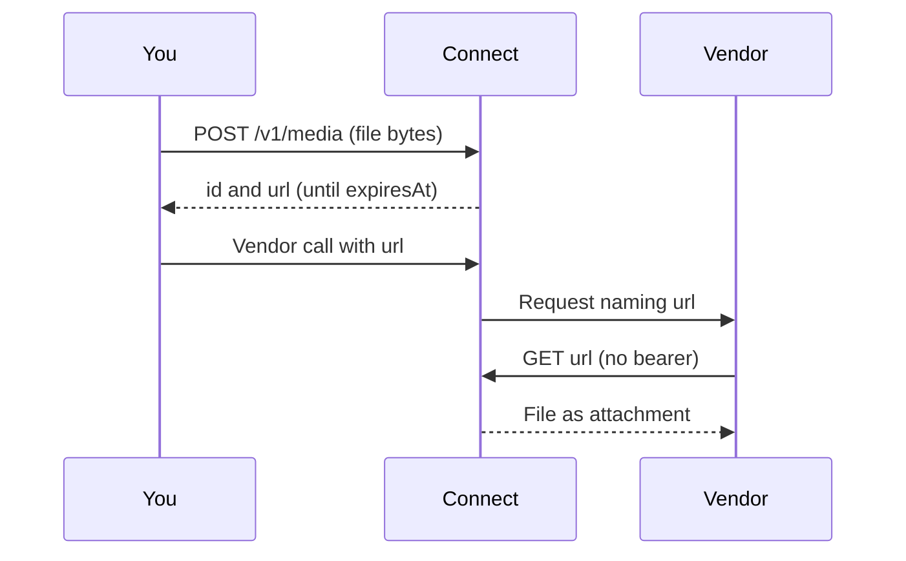

Some vendor calls take a file by URL (a reference image, a voice sample, a
PDF to read) or create an object the vendor keeps (a voice, a dataset, a long
research job). Ryu Connect hosts the file for you and keeps track of the
objects, so you never need a public bucket of your own and no other
organization can reach what you create through Ryu's shared vendor accounts.

## Reference media

Upload the file's bytes with their `Content-Type` header.

```sh
curl -fsS https://connect.example/v1/media \
  -H 'Authorization: Bearer <connect-api-token>' \
  -H 'Content-Type: image/png' \
  -H 'x-ryu-media-ttl: 900' \
  --data-binary @reference.png
```

```json
{
  "object": "reference_media",
  "ok": true,
  "id": "med_4c1e…",
  "contentType": "image/png",
  "bytes": 482113,
  "sha256": "…",
  "createdAt": "2026-10-21T12:00:00.000Z",
  "expiresAt": "2026-10-21T12:15:00.000Z",
  "url": "https://connect.example/v1/media/files/mda_…"
}
```

Pass `url` to the vendor call. Anyone holding it can fetch the file without a
bearer until `expiresAt`, so treat it like a secret: it is shown only in this
answer and never listed again.



The file is served as an attachment with `X-Content-Type-Options: nosniff`, a
sandbox content security policy and Range support.

- **Types**: `image/png`, `image/jpeg`, `image/gif`, `image/webp`,
  `audio/mpeg`, `audio/wav`, `audio/ogg`, `audio/flac`, `video/mp4` and
  `application/pdf`. Any other type is refused with
  `415 unsupported_media_type`. SVG, HTML and other types that can carry
  script are never hosted.
- **Content check**: the file's first bytes must match the type you declare,
  or the upload is refused with `415 media_type_mismatch`.
- **Life**: `x-ryu-media-ttl` in seconds, from 60 to the deployment's maximum
  (six hours by default); without it, one hour. A value out of range is
  `400 invalid_media_ttl`.
- **Size**: 25 MiB per file by default (`413 media_too_large`).
- **Quota**: each organization, with its team keys, may keep 100 live files
  and 128 MiB at once (`429 media_quota_exceeded`). When the deployment's
  storage is full the upload answers `503 media_store_full`. Every limit is
  checked before a byte is stored.
- **Upload time**: the body must arrive within two minutes
  (`408 media_upload_timeout`); send `Content-Length` so only the file's own
  size is set aside while it arrives.

`GET /v1/media` lists your live files (without their URLs) and
`DELETE /v1/media/<id>` removes one early. Expired files are deleted within a
minute. Hosting is free: it adds no charge and no usage line.

## Vendor resources on Ryu's key

When a call runs on [Ryu's key](/docs/standalone/connect-api-relay#the-credential-ladder)
and creates an object the vendor keeps, Connect records the object as your
organization's. Only vendor object kinds that Ryu's vendor table describes are
tracked.

<Callout type="warn">
  No built-in vendor declares a tracked object kind, so the rules below do not
  apply to any built-in vendor call yet.
</Callout>

For a tracked kind, on Ryu's key:

- The call that creates the object must be answered in full (no
  `x-ryu-response: stream` or `spool`, else `400 resource_answer_must_buffer`).
  Its success answer carries `x-ryu-resource-id`, Ryu's id for the object, and
  `x-ryu-resource-tracked: true`.
- A call that names an object (to use or delete it) runs only if your
  organization created it and it is not deleted. Otherwise it is refused before
  anything is sent or charged: `403 resource_not_owned` (whether the object
  belongs to someone else or does not exist), or `410 resource_deleted`.
- A call that names an object runs on the Ryu account that holds it, with no
  [overflow](/docs/standalone/connect-api-relay#ryus-accounts-and-overflow) to
  another account. If that account is no longer available the call answers
  `409 resource_account_unavailable`.
- A successful delete marks the object deleted.

`GET /v1/resources` lists your organization's objects (filter with `vendor` and
`state=active|deleted`), and `GET /v1/resources/<id>` reads one.

```json
{
  "object": "provider_resource",
  "id": "rsc_7d0a…",
  "vendor": "example",
  "kind": "voice",
  "vendorResourceId": "voice_123",
  "operatorAccount": "example-a",
  "state": "active",
  "createdAt": "2026-10-21T12:00:00.000Z",
  "lastUsedAt": "2026-10-21T12:05:00.000Z",
  "deletedAt": null
}
```

Calls on your own vendor key reach your own vendor account, so nothing is
tracked or checked there. Tracking adds no charge: each call is priced and
charged like any other call on Ryu's key.
