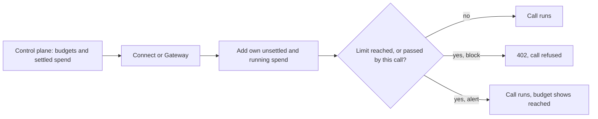

A builder tag is a short label you put on a call to say what it was for: the
agent, feature, customer or environment that made it. Tags ride on the call's
charge, so you can see and export spend per tag, and your organization's admins
can give a tag a daily or monthly budget.

Tags work the same way on [Ryu Connect](/docs/standalone/connect-api) and
[Ryu Gateway](/docs/standalone/gateway-api) calls, and one budget covers both.

## Tagging a call

Send the `x-ryu-tags` header with up to eight comma-separated tags.

```sh
curl -fsS 'https://connect.example/v1/vendors/brave/res/v1/web/search?q=ryu' \
  -H 'Authorization: Bearer <connect-api-token>' \
  -H 'x-ryu-tags: checkout-agent, eu'
```

- A tag is 1 to 64 characters: lowercase letters, digits, and `.` `_` `:` `-`,
  starting with a letter or digit. Uppercase is lowercased, spaces around commas
  are ignored, and repeated tags count once.
- An empty item (`a,,b`), a tag with any other character, more than eight tags,
  or a header longer than 600 characters is refused with `400 invalid_tags`
  (Connect) or `400` (Gateway) before anything runs.
- The header applies to every route, including MCP requests and
  [async tasks](/docs/standalone/connect-api-tasks): a task keeps the tags it
  was submitted with.
- A [routed capability call](/docs/standalone/connect-api-routing) passes its
  tags on to the Gateway when it chooses a Treg endpoint.

Tags are your own attribution. Ryu does not check that a call really belongs to
the agent or customer its tags name, and an untagged call is never counted
against a tag.

## Where tags show up

- **Connect usage report**: a tagged receipt in [`GET /v1/usage`](/docs/standalone/connect-api-usage)
  carries `tags`.
- **Charges**: the debit written for a tagged call carries its tags, whichever
  service charged it.
- **Spend per tag**: admins with the audit or billing permission can read spend
  per tag and UTC day for up to 92 days, or download it as CSV:

```sh
curl -fsS 'https://<control-plane>/api/control-plane/orgs/<orgId>/tag-spend?from=2026-10-01T00:00:00Z&to=2026-10-08T00:00:00Z&format=csv' \
  -H 'Cookie: <console session>'
```

Calls on your own vendor keys cost Ryu nothing and are not charged, so they add
no tag spend.

## Tag budgets

Admins with the billing permission set budgets in the organization console
under **Tag budgets**, or with
`PUT /api/control-plane/orgs/<orgId>/tag-budgets`. Each budget names a tag, a
UTC window (`daily` or `monthly`), a limit in dollars (micro-USD on the API)
and what happens when it is reached:

| Action | When the tag's spend in the window reaches the limit |
|---|---|
| **Refuse tagged calls** (`block`) | A charged call carrying the tag is refused before it runs |
| **Report only** (`alert`) | Nothing is refused; the budget shows as reached |

- A tag may have one daily and one monthly budget, and an organization up to
  100 budgets.
- A limit of `0` refuses every charged call carrying the tag.
- Saving budgets is refused with `409` if someone else saved them since you
  read them.
- Connect picks a change up on its next policy refresh (about a minute), and
  the Gateway when it next refreshes your organization's limits.

```json
{
  "budgets": [
    { "tag": "checkout-agent", "window": "monthly", "limitMicroUsd": 50000000, "action": "block" },
    { "tag": "eu", "window": "daily", "limitMicroUsd": 2000000, "action": "alert" }
  ],
  "revision": 3
}
```

### How a budget is counted

A tag's spend in a window is every charged call carrying the tag, on Connect
and on the Gateway.

1. Ryu's control plane keeps the settled total and sends it to each service
   with the budgets.
2. Each service adds its own tagged charges that are not settled yet, and the
   estimates of tagged calls still running.
3. A call is refused when the counted spend has reached the limit, or when the
   call's price would take it past the limit.



<Callout type="warn">
  Each service adds only its own unsettled spend. Two services charging the
  same tag at the same moment can each admit a call the other is about to
  count, so a budget can be passed by about one refresh interval of traffic.
  Treat a `block` budget as a firm guard, not an exact meter.
</Callout>

### Refusals

On Connect, a refused call answers `402` with the
[typed payment fields](/docs/standalone/connect-api-billing#call-cost-and-the-callers-maximum)
and the budget that refused it:

```json
{
  "code": "tag_budget_exceeded",
  "ok": false,
  "estimate_micro_usd": 5000,
  "tag": "checkout-agent",
  "tag_budget_id": "tbg_9f2c…",
  "tag_budget_window": "monthly",
  "tag_budget_limit_micro_usd": 50000000,
  "tag_budget_used_micro_usd": 49998000,
  "tag_budget_resets_at": "2026-11-01T00:00:00.000Z"
}
```

Nothing was held, sent or charged. On the Gateway, a refused request answers
`402 budget_exceeded`, like any other spend cap, with the `tag` scope in its
policy alert.

`GET /v1/balance` on Connect lists each of your organization's tag budgets with
the spend Connect counts now, whether it is reached, and when its window resets.

Calls that cost nothing (on your own keys, or [free routes](/docs/standalone/connect-api-catalog#free-routes))
are never refused by a tag budget.
