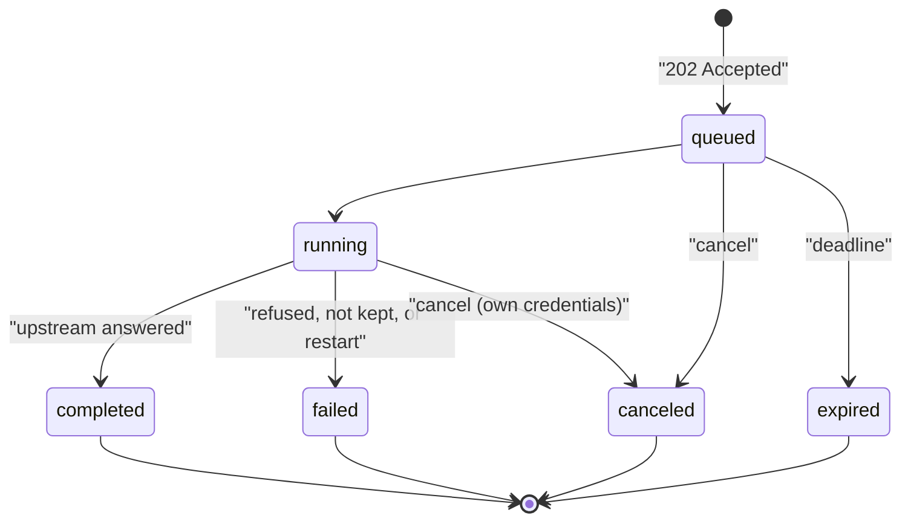

Every [relay tool and built-in vendor call](/docs/standalone/connect-api-relay)
can come back three ways besides the default buffered answer:

- **As a task**: send `Prefer: respond-async` and Connect answers `202` at
  once with a task id. Poll the task, or receive a signed webhook when it
  finishes.
- **Streamed**: send `x-ryu-response: stream` and the answer is passed on as
  it arrives, including event streams and binary bodies.
- **Spooled**: send `x-ryu-response: spool` and the answer's body is stored
  for a limited time behind a download URL, and you get a small JSON envelope.

None of these change the price of a call, which key pays for it, or the
[credential ladder](/docs/standalone/connect-api-relay#the-credential-ladder).

## Answer modes

`x-ryu-response` takes `buffer` (the default), `stream` or `spool`. Any other
value returns `400 invalid_request` and nothing is sent.

| | `buffer` | `stream` | `spool` |
|---|---|---|---|
| When you get the answer | When it has fully arrived | As it arrives | When it has been stored |
| Content types | Text only (JSON, XML, text, form, NDJSON) | Any, binary included | Any, binary included |
| Size limit | The tool's `maxResponseBytes` (vendors: 2 MiB) | 32 MiB | 64 MiB per answer by default |
| Larger than the limit | `502 upstream_response_too_large`, nothing passed on | The stream is cut at the limit | `502 upstream_response_too_large`, nothing kept |

In every mode, a credential Connect added is replaced with `[REDACTED]`
wherever the upstream quotes it, in the headers and the body.

- In `stream` and `spool` modes this happens byte for byte as the answer
  flows, including a credential split across two chunks.
- Connect holds back only the last few bytes of a chunk when they could be the
  start of a credential, so an event stream is not delayed.
- A compressed answer is still refused (`502 upstream_encoding_refused`)
  because it cannot be checked.

A streamed answer adds `x-ryu-response: stream` and `x-ryu-stream-max-bytes`.
If the upstream stops sending for 60 seconds, or the answer grows past the
limit, the stream ends early.

### Spooled answers

A spooled call answers with the upstream's status and this body.

```json
{
  "object": "spooled_response",
  "ok": true,
  "status": 200,
  "contentType": "image/png",
  "bytes": 482113,
  "sha256": "…",
  "ryuCallId": "call_…",
  "download": {
    "path": "/v1/spool/spl_…",
    "url": "https://connect.example/v1/spool/spl_…",
    "expiresAt": "2026-10-21T15:04:05.000Z"
  }
}
```

The download URL needs no bearer, so you can hand it to another tool. Treat it
as a secret until it expires (one hour by default).

- It serves the stored body as an attachment with its original content type,
  under the same sandbox headers as a relayed answer.
- It supports one `Range` per request.
- `DELETE /v1/spool/:token` with your runtime bearer removes it early.

Connect checks for room before it sends the call. If the spool is full, or your
share of it is, the call returns `503 spool_full` and nothing is sent or
charged. An organization and its team keys share one allowance. A deployment
without a spool returns `404 spool_not_configured`.

The answer must be written within two minutes of its headers, or the call
returns `504 upstream_timeout`. If you disconnect while it is written, the
write stops (`409 canceled`). Nothing is kept either way, and a call the
vendor ran is still charged.

## Async tasks

Add `Prefer: respond-async` to any relay or vendor call.

```sh
curl -sS -X POST https://connect.example/v1/vendors/tavily/search \
  -H 'Authorization: Bearer <connect-api-token>' \
  -H 'Prefer: respond-async' \
  -H 'Content-Type: application/json' \
  -d '{ "query": "ryu connect", "search_depth": "advanced" }'
```

Connect first runs every check the call would run now:

- the provider and overflow headers;
- the path;
- your organization's tool policy;
- the credential ladder;
- for a call on Ryu's key, the published price.

If the call would be refused now, the submission is refused the same way and
nothing is queued. Otherwise you get `202 Accepted` with
`Location: /v1/tasks/<id>` and the task.

```json
{
  "ok": true,
  "object": "task",
  "id": "task_…",
  "status": "queued",
  "ryuCallId": "call_…",
  "rung": "operator",
  "request": { "method": "POST", "path": "/v1/vendors/tavily/search" },
  "money": {
    "metered": true,
    "endpoint": "tavily.search.advanced",
    "perCallMicroUsd": 16000,
    "reservedMicroUsd": 16000,
    "costMicroUsd": null,
    "chargedMicroUsd": null
  },
  "pollUrl": "/v1/tasks/task_…",
  "resultUrl": "/v1/tasks/task_…/result",
  "expiresAt": "…"
}
```

Optional submission headers:

| Header | Meaning |
|---|---|
| `x-ryu-task-ttl` | How long the task may wait and run, in seconds (60 to 86400; default 3600) |
| `x-ryu-task-webhook` | An HTTPS URL to notify when the task finishes (see [webhooks](#webhooks)) |
| `Idempotency-Key` | Submit at most once: the same key and request return the first task again (with `idempotent-replayed: true`); the same key with a different request is `409 idempotency_conflict` |
| `x-ryu-response: spool` | Keep a spooled answer. `stream` is refused for tasks |

A task moves from `queued` to `running` to one of these states.

- `completed` - the upstream answered, whatever its status.
- `failed` - Connect refused the call when it ran (for example
  `operator_capacity_exhausted`, `upstream_timeout`) or could not keep the
  answer. `error.code` says why.
- `canceled` - you canceled it.
- `expired` - it was still queued at its deadline.



### Polling and results

`GET /v1/tasks/:id` returns the task. Polling is free and only your tenant
sees your tasks. `GET /v1/tasks` lists your recent tasks (`status` and
`limit`, up to 200, filter it).

`GET /v1/tasks/:id/result` returns the call's answer exactly as the call would
have answered (status, headers, body) once the task is `completed` or
`failed`, with `x-ryu-task-id` and `x-ryu-task-status`.

- Before then it returns `409 task_pending` with `Retry-After`.
- A canceled or expired task returns `409 task_canceled` or
  `409 task_expired`.

Finished tasks and their answers are kept for a day, then deleted.

### Money

- **Reserved on submit.** A call on Ryu's key holds its published per-call
  price against your balance when you submit it (`402 insufficient_credits` or
  `402 max_cost_exceeded` if it does not fit). The price is fixed at
  submission.
- **Charged once, on completion.** The task runs once and is charged under
  its own call id, only when the vendor answers 2xx, exactly as a direct call
  would be. A canceled or expired task, a vendor error, a timeout or an
  unreachable vendor is not charged, and the hold is released.
- Calls on your own keys and relay tools are never metered, as usual.

### Cancellation

`POST /v1/tasks/:id/cancel` behaves by task state:

| Task | Result |
|---|---|
| Queued | Canceled at once |
| Running on your own credentials (a relay tool, or your team's or organization's vendor key) | Aborted |
| Running on Ryu's key | `409 task_running_metered`. The vendor may already be running it, so it is charged only if the vendor answers 2xx |
| Finished | `409 task_finished` |

### If Connect restarts

Queued tasks survive a restart, and their credit is held again. A task that
was running when Connect stopped is marked `failed` with
`error.code: "outcome_unknown"`. The upstream may have run it, so it is never
run again. Submit it again (with a new `Idempotency-Key`) if you want it rerun.

### Webhooks

With `x-ryu-task-webhook`, Connect posts to that URL when the task finishes
(`task.completed`, `task.failed`, `task.canceled` or `task.expired`). The body
is the task as `GET /v1/tasks/:id` returns it, never the answer body.

```json
{ "id": "evt_task_…", "type": "task.completed", "timestamp": "…", "data": { "object": "task", "…": "…" } }
```

Deliveries are signed with [Standard Webhooks](https://www.standardwebhooks.com/)
headers:

- `webhook-id` - the same on every retry, for de-duplication;
- `webhook-timestamp` - Unix seconds;
- `webhook-signature: v1,<signature>` - the base64 HMAC-SHA256 of
  `<webhook-id>.<webhook-timestamp>.<body>`, keyed by your secret's decoded
  bytes.

Read the secret with your **management** bearer.

```sh
curl -fsS https://connect.example/v1/tasks/webhook-secret \
  -H 'Authorization: Bearer <management-token>'
# { "secret": "whsec_…", "scheme": "standard-webhooks", … }
```

Any 2xx answer counts as delivered. Otherwise Connect retries after 30 seconds,
2 minutes, 10 minutes and an hour, then gives up. The task shows `webhook`
`status`, `attempts` and `lastStatus`.

Webhooks are sent only to public HTTPS addresses, like every relayed request.
A deployment without a signing key refuses `x-ryu-task-webhook` with
`400 task_webhooks_unavailable`; poll instead.

## Limits

| Limit | Default |
|---|---|
| Tasks running at once per deployment | 8 |
| Tasks running at once per tenant | 2 |
| Queued and running tasks per tenant | 100 (more is `429 task_limit`) |
| One task's upstream call | 5 minutes, and never past the task's deadline |
| Spooled answer | 64 MiB each, 128 MiB per organization or tenant, 1 GiB in all, written within 2 minutes, kept for an hour |
| Streamed answer | 32 MiB, 60 seconds without data |

Operators can change these (see [Connect configuration](/docs/standalone/connect-configuration#settings)).

## Routes

| Method | Path | Bearer | Purpose |
|---|---|---|---|
| any | `/v1/relay/:id/*`, `/v1/vendors/:vendor/*` with `Prefer: respond-async` | Runtime | Submit a task |
| `GET` | `/v1/tasks` | Runtime | Your recent tasks |
| `GET` | `/v1/tasks/:id` | Runtime | One task |
| `GET` | `/v1/tasks/:id/result` | Runtime | The finished task's answer |
| `POST` | `/v1/tasks/:id/cancel` | Runtime | Cancel a task |
| `GET` | `/v1/tasks/webhook-secret` | Management | Your webhook signing secret |
| `GET`, `HEAD` | `/v1/spool/:token` | None (the URL is the credential) | Download a spooled answer |
| `DELETE` | `/v1/spool/:token` | Runtime | Delete a spooled answer early |

<Cards>
  <DocCard href="/docs/standalone/connect-api-relay" />
  <DocCard href="/docs/standalone/connect-api" />
</Cards>
