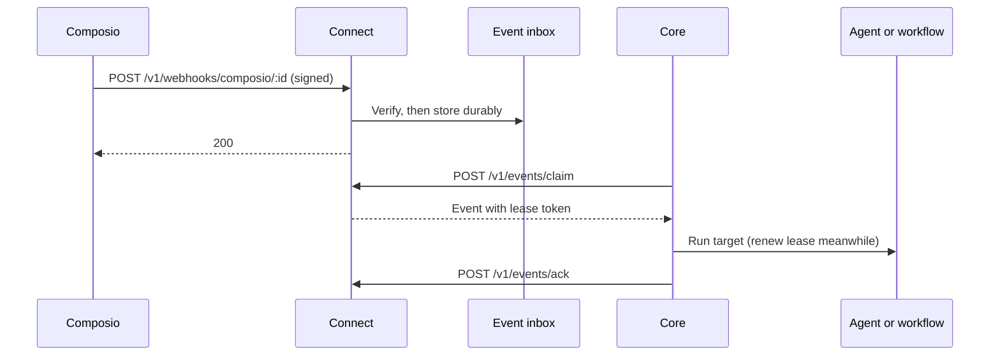

Connect verifies signed Composio deliveries, queues them durably, and hands
them to Core agent or workflow targets. To create provider subscriptions, use
[trigger management](/docs/standalone/connect-api-triggers).



## Signed trigger delivery

Connect can receive Composio V3 trigger events directly, without Core running.
The operator configures a binding with:

- the existing Composio trigger and account identifiers;
- the tenant and user IDs;
- the auth-config ID;
- a reference to the webhook signing secret.

Configure `RYU_CONNECT_TRIGGER_BINDINGS` as an array of these operator-owned
bindings:

```json
[
  {
    "id": "github-updates",
    "tenantId": "demo",
    "secretEnv": "COMPOSIO_WEBHOOK_SECRET",
    "triggerId": "ti_example",
    "triggerSlug": "GITHUB_COMMIT_EVENT",
    "connectedAccountId": "ca_example",
    "userId": "user-example",
    "authConfigId": "ac_example"
  }
]
```

To set it up:

1. Use real IDs from the existing Composio trigger and account.
2. Keep the secret itself in deployment secret storage and expose it through
   the environment variable named by `secretEnv`.
3. Point the subscription at the public HTTPS origin plus
   `/v1/webhooks/composio/github-updates`.
4. Select V3 payloads.

This setup does not create provider trigger instances or automatically migrate
Core subscriptions.

Binding rules:

- Bindings must refer to configured Connect tenants, and a trigger instance can
  appear only once.
- Multiple bindings can share the same endpoint `id` when they use the same
  `secretEnv`. One project-wide webhook subscription can then route several
  triggers to their assigned tenants.
- Conflicting secrets for one endpoint are rejected.
- Native trigger delivery cannot be mixed with shared upstream compatibility
  proxies.

### Verify and queue events

The webhook route authenticates the delivery ID, timestamp, and raw body using
Composio's HMAC signature. Only configured `composio.trigger.message` V3 events
enter the inbox. The payload cannot choose its tenant or the agent that will
run.

| Delivery | Result |
|---|---|
| Outside a five-minute window, or body over 512 KiB | Rejected |
| Invalid signature | `401` |
| Configured trigger with mismatched trigger, account, user or auth-config metadata | `403` |
| Signing secret missing | `503` |
| Signed event for an unconfigured trigger or another project event type | `200` with `outcome: "ignored"`, not stored or dispatched |
| Accepted | Stored durably, then `200` |
| Repeated delivery ID with an identical raw body | `outcome: "duplicate"` |
| Repeated delivery ID with different content | `409` |
| Inbox full | `503`, so the provider retries instead of losing the delivery |

### Claim and acknowledge events

An authenticated consumer uses these routes.

| Endpoint | JSON body | Result |
|---|---|---|
| `POST /v1/events/claim` | `{ "limit": 10 }` | Up to ten events, each with `deliveryId`, `leaseToken`, and `payload` |
| `POST /v1/events/renew` | `{ "deliveryId": "...", "leaseToken": "..." }` | `{ "renewed": true }` when the current lease is extended |
| `POST /v1/events/ack` | `{ "deliveryId": "...", "leaseToken": "..." }` | `{ "acknowledged": true }` when the lease is valid |

The bearer selects the tenant; tenant fields in these requests are rejected.

- Claims lease events for 30 seconds. Renew before expiry during longer
  handling. A successful renewal extends ownership to at least 30 seconds from
  that request.
- Expired, replaced, acknowledged, and foreign-tenant leases cannot renew. A
  failed renewal is not permission to continue consuming the event.
- An expired lease can be retried, and its old token cannot acknowledge a
  newer lease.
- No Core agent or workflow is started by these endpoints automatically.

<Callout type="warn">
  Delivery is at least once, not exactly once. Process events idempotently and
  acknowledge only after durable handling.
</Callout>

### Retention and data handling

Connect stores the inbox in a SQLite database (`events.db`) under its
configured data directory.

- The default limits are 256 pending events and 25,600 retained records per
  tenant. Retention does not discard pending events.
- Acknowledgment clears the live payload. Deduplication records remain for 24
  hours and are pruned during later ingestion.
- Pending payloads are encrypted with AES-256-GCM under `RYU_CONNECT_DATA_KEY`,
  which trigger delivery requires (see
  [Ryu Connect configuration](/docs/standalone/connect-configuration#settings)).

Protect the data directory and backups anyway. Clearing a row is not secure
erasure of SQLite pages or backups.

## Core target bindings and consumption

`GET /v1/composio/trigger-types?toolkit=gmail` supplies the authenticated
tenant's operator-granted trigger types and configuration schemas.

- It uses the assigned toolkit and configured toolkit version.
- It omits ungranted types and provider-private fields.
- It rejects malformed or oversized catalog responses.

Core's existing trigger picker delegates to this endpoint in remote mode and
does not require a local Composio provider key.

### Bind an event to an agent or workflow

When Core is configured for Connect, its
`POST /api/composio/triggers/subscribe` endpoint creates the provider instance
through Connect and saves an owner-scoped agent binding locally.

- Its existing request fields remain `agent_id`, `toolkit`, `trigger_slug`,
  `connected_account_id`, and `config`.
- The account is a constraint on the tenant's assigned account, not an
  override.
- Core checks the caller's agent-run permission before provider creation.

To attach an already-created Connect trigger, use
`POST /api/composio/targets` with the Connect management record's `id` (not its
provider `triggerId`):

```json
{
  "connectTriggerId": "00000000-0000-4000-8000-000000000001",
  "target": { "kind": "workflow", "id": "your-workflow-id" }
}
```

Use `kind: "agent"` for an agent target.

- Core verifies target run permission, ownership of the Connect trigger, and
  the current bound account before saving the mapping.
- Provider user and auth-config identities come from Connect, never from the
  binding request.
- Repeating the same active binding returns its existing Core subscription ID.

Core maps authenticated users to Connect management and runtime credentials.
The authenticated Core user selects the mapping; request bodies do not select a
user. A personal node can use the explicit `local` mapping. Unresolved users on
shared nodes are refused.

#### List and remove bindings

`GET /api/composio/trigger-subscriptions` lists only the caller's Connect-backed
targets in remote mode.

- Deleting one of these Core subscriptions detaches that local target and
  records its removal. It does not delete the independently owned provider
  instance; use Connect's management API to delete that instance when it is no
  longer needed.
- Legacy Core rows with unknown ownership are not adopted into Connect
  consumption. Recreate the authorized binding.

Connect bindings are managed separately from the workflow definition. Editing
or resaving a workflow preserves them. Removing the binding or deleting the
workflow disables its local target.

#### Consume one event

An authenticated caller can request one consumption attempt with
`POST /api/composio/events/consume` and JSON body `{}`. Core then:

1. claims one event;
2. checks its exact trigger, account, user and auth-config identity against
   the caller's saved targets;
3. checks each target's run permission;
4. renews its lease while handling it;
5. acknowledges the delivery only after durable completion or a persisted
   human-approval checkpoint.

An unknown binding is retained for retry. A previously removed binding is
acknowledged without starting work.

Retries use stable user, delivery and target execution IDs and existing
workflow checkpoints. Completed work is not restarted, and awaiting-input work
remains in the normal approval flow. Changed or unreadable checkpoints are
refused.

<Callout type="warn">
  This does not guarantee exactly-once external side effects if a process
  fails between an external action and its checkpoint. Handlers and downstream
  APIs should use idempotency keys where available.
</Callout>

This endpoint is an explicit consumption API; background consumption is
configured separately (see [automatic Core consumption](#automatic-core-consumption)).

#### Legacy Core Composio triggers in Connect mode

- Core does not create or delete provider triggers through its legacy Composio
  client.
- Core project-webhook reconciliation is disabled.
- The legacy Core Composio webhook endpoint returns `410` instead of executing
  deliveries outside Connect.
- Existing embedded Composio trigger declarations are not automatically
  migrated. Create the provider trigger in Connect and bind its identifier
  through the target API.

#### Bind from the Workflows editor

1. On a Core configured for Connect, open the Workflows editor and select
   **Composio event**.
2. Save the workflow.
3. Enter the existing Connect trigger's ID and choose **Bind trigger**.

The panel lists this workflow's bindings and lets you remove a binding without
deleting the provider trigger. A failed request stays visible; use
**Refresh bindings** to confirm the current state before retrying. Hosts
without the binding capability report it as unavailable.

The Companion uses the shared `workflows.connectBindings` read operation and
the `workflows.bindConnectTrigger` / `workflows.removeConnectBinding`
operations. Reads require the catalog grant; mutations require the workflow
run-state grant. Core still verifies user ownership and target permissions.
Service credentials and addresses never enter the Companion frame.

### Island suggestions and channel workflows

In the desktop agent editor, choose an exact provider event and connected
account under **Event triggers**. That selection is the event allowlist: only
deliveries from the selected trigger and account reach the target.

For an agent target, Core works like this:

1. It redacts sensitive event fields and code-like values before analysis.
2. It uses the node's default model and the saved agent instructions to decide
   whether to create a private Island suggestion. The analysis does not start
   the agent's ACP runtime or expose tools.
3. `NO_SUGGESTION` and malformed model output produce no notification.
4. The generated title and body are checked and redacted again before they
   enter the recipient's Core inbox.

For a password reset, the suggestion can explain that the request arrived
without showing the code or reset link. If it was unexpected, it should advise
ignoring it and changing the password in the source app.

Island needs the **Proactive suggestions** consent. Connection suggestions do
not require screen-capture consent.

- Island reads only its own `@ryu/island` notifications.
- On a shared Core it needs the verified local account identity, and it does
  not fall back to another member's inbox when that identity is unavailable.
- The suggestion notification is private and does not generate a mobile push.

If Streaming is active, Core does not send an agent-target event to a model.
Island shows only a generic private-activity suggestion, including for events
already in its inbox, without the source app, event title, message, or payload
details.

Streaming can be selected manually or detected from a configured local process
name. This privacy mode does not rewrite actions in an explicitly configured
workflow target.

To route an event into a messaging channel, bind the same Connect trigger to a
workflow and add the desired agent, condition, and channel-send nodes. That is
an explicit workflow: it receives the original provider payload and runs only
the actions authored in that workflow.

<Callout type="warn">
  The agent-target redaction and suggestion-only restrictions above do not
  apply to workflow targets. Avoid forwarding raw event fields that may contain
  codes, tokens, or other secrets.
</Callout>

### Automatic Core consumption

Configure background Connect event consumption in Core's
`RYU_CONNECT_EVENT_WORKERS` environment variable as a JSON array of owner
bindings. It is off when the variable is unset.

- Each configured owner has one serial worker; different owners progress
  independently.
- The existing Connect runtime-token mapping must contain that owner.
- Configuration rejects duplicate owners and unknown fields, and supports at
  most 32 workers.

For an unbound personal Core, select its local owner:

```json
[{ "ownerUserId": "local" }]
```

For a verified user, provide an absolute path to a mounted, short-lived Core
user JWT.

- Core rereads and verifies the file before each delivery and requires its
  verified subject to match `ownerUserId`. The file is limited to 16 KiB.
- Your identity system must rotate it before expiry. This worker does not
  mint, refresh, store, or log user credentials.
- A missing, invalid, expired, or wrong-subject JWT pauses consumption without
  falling back to the local owner.
- Managed or organization-bound nodes reject credential-free local workers.

```json
[{ "ownerUserId": "user-id", "jwtFile": "<path-to-worker-jwt>" }]
```

Workers retain Core's tool-execution and per-target run permissions. Disabled
Workflows apps and missing agents do not run. Organization policy and target
permissions are still enforced by Core.

| Worker timing | Value |
|---|---|
| Empty inbox checked every | 5 seconds |
| Pause after a failure | 30 seconds |
| Spacing between successful deliveries | At least 500 milliseconds |

Permission or configuration failures retain the event for retry. Manual
consumption may run alongside workers: Connect leases prevent simultaneous
ownership, and Core's durable execution IDs protect completed work from
replay.
