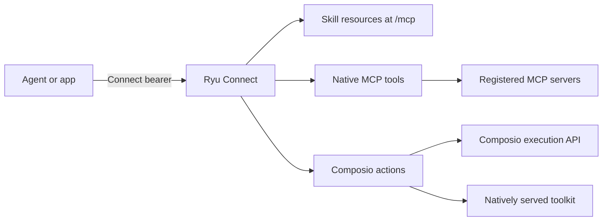
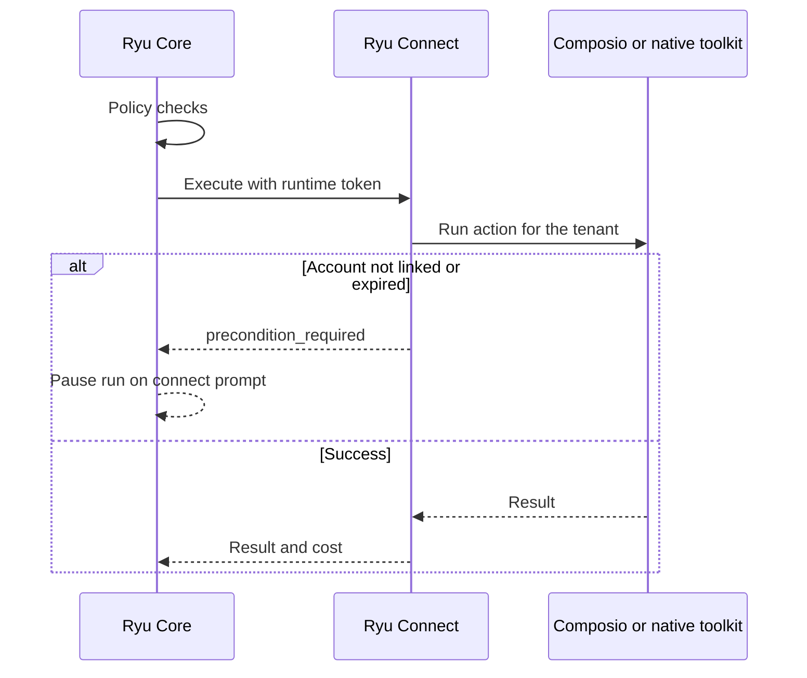

<Callout type="warn">
  Hosted Ryu Connect is in **early access** and is not open for new
  organizations yet. Ryu enables it one organization at a time. Composio tools
  that your plan runs through Ryu Gateway are separate and keep working.
</Callout>

Ryu Connect is the standalone integration edge for developers whose products
or agents need MCP hosting, `SKILL.md` content, governed tool calls, and Composio actions. It gives
those lanes one tenant-scoped bearer boundary and keeps each lane's existing
owner:

| Lane | Connect owns | Execution owner |
|---|---|---|
| MCP | Native Skill resource server at `/mcp`, with optional forwarding below `/mcp/` | Connect for Skill resources; configured upstream for forwarded requests |
| Skills | One shared catalog and `SKILL.md` hosting | The configured Skill source directory |
| Tools | Native tenant-bound registry and exact tool grants | Connect calls registered MCP servers directly |
| Composio | Tenant-bound account, version, credential, and tool grants | Connect calls the Composio execution API directly, or serves a toolkit itself when the operator moves it (see [natively served toolkits](#natively-served-toolkits)) |

<Figure name="connect" />

## How the lanes work

Connect serves Skill resources directly over MCP without Core or Gateway.
Initialize the server, list resources, and read a `ryu-skill:///` resource
using your Connect bearer. See [Hosted MCP](/docs/standalone/connect-api-mcp#hosted-mcp).

The endpoint uses stateless Streamable HTTP. Send
`Accept: application/json, text/event-stream` and read the response's
`Content-Type`. The plain `initialize` handshake and other 2025-era requests
are answered as a single server-sent `message` event, not a bare JSON body.

Native MCP tools and Composio actions use one discovery and execution surface.

- A separate single-tenant compatibility mode forwards to existing Core and
  Gateway upstreams instead. It cannot be combined with native registrations.
- When a lane is not configured, its route returns an explicit `503` code, such
  as `skills_unavailable` or `native_composio_unavailable`, and `/health`
  reports that state.

The Skill catalog is shared: every tenant of a deployment can list and read
every Skill in the configured directory. Put only content that all tenants may
see there.

Ryu's catalog includes `ryu-connect`, the operating guide for agents that call
tools through Connect: what calls cost, the caller's maximum, the failure codes
and which to retry, `Idempotency-Key`, and connection prompts. Point an agent at
`GET /v1/skills/ryu-connect` or the `ryu-skill:///ryu-connect/SKILL.md`
resource before it starts calling tools.

Connect masks the credentials it sends to a provider out of every answer it
returns, so a provider that quotes its `Authorization` header or API key back
does not hand it to the caller. See
[credentials in answers](/docs/standalone/connect-api-mcp#credentials-in-answers).

Composio trigger delivery is described in
[trigger management](/docs/standalone/connect-api-triggers) and
[trigger events](/docs/standalone/connect-api-trigger-events). Signed webhook
ingress resolves a configured endpoint and verifies the payload before reading
its trigger record, and removed triggers and revoked accounts stay excluded.

## Availability

<Callout type="warn">
Connect is not distributed for self-hosting yet. There is no published source
tree, package, container image, or release binary for the service, and the
hosted product is in early access.

Where an organization has Ryu-hosted Connect, its members create their own
keys in the Ryu console (see [Connect keys](#connect-keys)). The settings in
[Connect configuration](/docs/standalone/connect-configuration) document the
service contract for early-access deployments; they are not a download or
install path.
</Callout>

[Connect configuration](/docs/standalone/connect-configuration) lists every
environment setting, the trigger data key and rollback rules, the bind address,
and the compatibility-mode upstreams.

## Connect keys

On Ryu-hosted Connect, members create Connect keys in the Ryu console under
**Connect keys** in their organization. A key starts with `ryu_connect_` and
is sent as `Authorization: Bearer <key>`, like any runtime bearer.

- **Organization keys** are created, rotated, and revoked by organization
  admins.
- **Member keys** belong to the member who created them. Only that member can
  rotate one, and the member or an admin can revoke it. A member key stops
  working when its member leaves the organization or is changed to the viewer
  role, and a viewer cannot rotate one.
- A key is shown once, when it is created or rotated. Ryu stores only a hash
  of it, so a lost key cannot be shown again; rotate or revoke it instead.
- Every key of an organization calls Connect as the same tenant. Usage,
  credit holds, and refusals for exhausted credit apply to the organization,
  whichever key made the call, and every call is charged to the
  organization's credits.
- Creating a key needs credit on the organization. There is no free starter
  credit.
- A new key starts working, and a revoked or expired key stops working,
  within about a minute.
- Rotation replaces a key with a new one of the same name and scope. The old
  key stops at once, or after a grace period of 1 or 24 hours so you can move
  your deployments over.
- An organization whose Connect access Ryu set up directly keeps the keys it
  was given and cannot create keys in the console.

Each change in the console may ask you to confirm your identity again and is
recorded in the organization's audit log. `/health` reports `selfServeKeys`
as configured on deployments that accept console keys.

Instead of a long-lived key, a member or an OAuth client can get a
10-minute [access token](/docs/standalone/connect-api-access-policy#access-tokens)
for the same tenant, optionally for one team. `/health` reports
`accessTokens` and `toolPolicy` on deployments that accept tokens and apply
[tool policy](/docs/standalone/connect-api-access-policy#tool-policy).

## Natively served toolkits

Connect can serve a toolkit with your own OAuth app instead of through
Composio, one toolkit at a time. Connect serves GitHub, Linear, Notion and
Slack natively.

- Composio stays the default. Nothing changes until you set a toolkit to
  `native` in `RYU_CONNECT_TOOLKIT_PROVIDERS`, and only tenants with a native
  grant for that toolkit move.
- Tools keep their `composio.<SLUG>` IDs and every route keeps its shape, so
  callers need no change.
- Setting the toolkit back to `composio` moves every tenant back at once.
- A tenant can also link through its own OAuth app instead of yours (see
  [native toolkits](/docs/standalone/connect-api-native-toolkits)).

Users authorize the toolkit again when it moves, because tokens held by
Composio cannot be transferred. Connect stores the new tokens encrypted with
`RYU_CONNECT_TOKEN_KEY`. Keep that key with your backups, because without it
every user must reconnect.

The link, callback, and action list are in
[natively served toolkits](/docs/standalone/connect-api-composio#natively-served-toolkits).

## Health and readiness

`GET /health` is public. Each lane reports `configured`. The Composio,
`nativeToolkits`, and trigger-delivery lanes also report `ready`, which stays
`false` while a required provider key, OAuth client secret, or webhook signing
secret is missing from the environment. Neither flag proves that a provider or
upstream is reachable. The `version` field is the running service's release version.

## Pricing

There is no separate Connect platform fee. Ryu-hosted Connect charges each
call to the organization's Ryu credits, hourly, spending the plan's
[included pool](/docs/billing/credits#included-pool) first.

| Call | Charge |
|---|---|
| Composio execution | The published Composio rates, the same as calls made through Ryu Core (see [Composio usage](/docs/billing/credits#composio-usage-and-zero-data-retention)) |
| Natively served toolkit, called directly with a Connect key | **$0.40** per 1,000 calls, with no Composio add-ons, as its own Connect tool-call line on the organization's ledger |
| Natively served toolkit, called by Ryu Core through Connect | Charged by Ryu Gateway as a Composio tool call under **Tool calls**, at the Composio own-app rate plus the project's Composio add-ons |
| Failed by a provider outage, a rate limit, or an expired authorization | Not charged |

- A call that Core made through Connect and already charged is never charged a
  second time.
- For a native call that Core makes, Connect's response reports the native
  price, but the Gateway's charge is the one on the ledger.

### Cost limits and refusals

Every execution response says what the call cost and what Ryu charges for it.

- Send `x-ryu-max-cost-micro-usd` to refuse a call estimated above your
  maximum, as on the Ryu Gateway. See
  [call cost and the caller's maximum](/docs/standalone/connect-api-billing#call-cost-and-the-callers-maximum).
- A Ryu-hosted Connect holds each call's estimate against the organization's
  remaining credit before running it.
- When the organization's credits are exhausted, a Ryu-hosted Connect refuses
  tool execution with `402` and `code: "insufficient_credits"` until credits
  are added. Listing tools, reads, and the usage report keep working, so the
  organization can still see what it used. See
  [the Connect API](/docs/standalone/connect-api#tools-and-composio) for the
  refusal on each execution path.

Connect enforces exact tool grants. It applies a quota only where a binding
sets `limits` - a per-minute call limit, a cap on Composio premium charges per
period, or both. See [call limits](/docs/standalone/connect-api-composio#call-limits).

### Self-hosted Connect

A self-hosted Connect is never billed by Ryu and never refuses calls for
credits. Its Composio usage is billed to the configured Composio project.
Connect only lists it in its own [usage report](/docs/standalone/connect-api-usage),
one line for each execution that returned a billing receipt.

For other Ryu-managed usage, see [Metering Rates](/docs/billing/metering) and
[Credits & AI pools](/docs/billing/credits).

## Use Connect with Core and Passport

### Core Composio execution

Core can hand Composio action execution to a native Connect service. Configure
Core's `RYU_CONNECT_URL` and `RYU_CONNECT_USER_TOKENS`, mapping verified Core user
IDs to their Connect runtime tokens.

- Local calls require an explicit `local` mapping.
- Provider project keys and Connect management keys are not runtime tokens.

How Core and Connect divide the work:

- Core keeps its policy checks and sends a selected account only as a
  constraint. Connect cannot use that constraint to switch the tenant's
  assigned account.
- Remote errors never fall back to Core's provider credential.
- Native execution and catalog endpoints do not forward through compatibility
  mode.
- Core's unified tool search uses Connect's tenant-filtered Composio catalog
  with the verified caller identity. Local discovery requires the same explicit
  `local` mapping as local execution.
- When Connect refuses a call with `precondition_required` because the
  toolkit's account is not linked or has expired, Core pauses the run on the
  same connect prompt its embedded Composio path shows. The prompt names the
  toolkit to connect in Integrations, instead of failing the call.

### Connections and triggers

Core's connection, callback, and workflow-trigger surfaces use the same Connect
management and target-binding contracts. Connect remains the owner of provider
accounts, signed ingress, and leased event delivery.

- An agent with its own identity gets its own account inside its owner's
  tenant when the binding enables
  [agent accounts](/docs/standalone/connect-api-composio#agent-accounts-inside-a-tenant).
  Triggers on those accounts are not available through Connect.
- Legacy Core provider webhook routes fail closed in remote mode instead of
  executing outside Connect.

### Identity service

Passport owns durable identity state; Connect owns the integration edge. A
governed runtime can use Passport for a connection lifecycle and Connect for
the MCP/tool/Composio call path without copying credential material between
services.

<Cards>
  <DocCard href="/docs/standalone/connect-api" />
  <DocCard href="/docs/standalone/connect-configuration" />
  <DocCard href="/docs/standalone/passport" />
</Cards>
