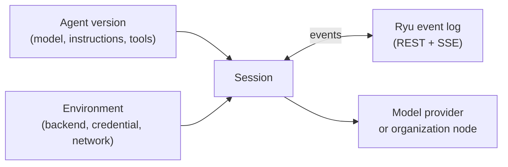

<Callout type="warn">
Ryu Managed Agents is a preview. It is off for every organization until an
organization owner or feature manager turns on **Managed Agents** in
**Organization → Features**, and the Ryu deployment must also offer it. When a
deployment does not offer it, every route returns `503 managed_agents_disabled`.
The contract is versioned, but backends, limits, and pricing can change during
the preview.
</Callout>

Ryu Managed Agents is a hosted API on the Ryu control plane. You define a
versioned agent, choose an environment that says where the agent runs, start a
session, and exchange events with that session over REST and a resumable
Server-Sent Events (SSE) stream.

A model provider or your organization's own Ryu node does the work. Ryu keeps
the durable, normalized event log of each session and its position at the
provider. Ryu does not keep a long-lived process for each tenant. A client can
disconnect and resume from the log at any time.

## Concepts

| Concept | Id | What it is |
|---|---|---|
| Agent | `magt_…` | A named configuration. It holds the model, instructions, tools, MCP servers, reasoning effort, and metadata. An agent does nothing until a session uses it. |
| Version | integer from 1 | Each accepted agent change creates a new immutable version. A session pins one version. Archiving an agent blocks new sessions; its versions stay. |
| Environment | `menv_…` | The backend, the credential source, and the backend settings, such as network access and packages. Each accepted change increments `revision` and affects only new sessions. |
| Credential | `mcred_…` | A provider API key that the organization stores sealed. Reads return only a label, the last four characters, and a fingerprint. |
| Session | `msess_…` | One run of a pinned agent version in an environment. A session has a status, a cumulative usage total, and an event log. |
| Event | `mevt_…` | One entry in the session log. Each event has a `seq` number that starts at 1, has no gaps, and only increases. |

An MCP (Model Context Protocol) server is a service that provides tools to an
agent. The provider connects to the MCP servers that the agent declares.

## Backends

An environment chooses one backend. Backend compatibility is checked when a
session is created. An agent or input that uses something the backend cannot
do gets `422 unsupported_for_backend`, and `details.field` names the field.

| Backend | Runs on | Builtin tools | Custom tools and MCP servers | Interrupt | Credential sources |
|---|---|---|---|---|---|
| `anthropic` | Claude Managed Agents | Web search, web fetch, and code execution | Yes | Yes | BYOK, or Ryu-provided where enabled |
| `openai` | OpenAI Responses API background runs with Conversations | Web search, code execution (code interpreter or shell), and file search with your own vector stores | Yes | Yes | BYOK, or Ryu-provided where enabled |
| `gemini` | Gemini Interactions API managed agents | Web search and web fetch without domain filters, and code execution | Yes | Yes | BYOK, or Ryu-provided where enabled |
| `ryu_node` | An organization-scope Ryu node | None | No | No | None |
| `ryu_serverless` | Not yet available | None | No | No | None |

The `ryu_serverless` backend is declared in the contract but is not yet
available. Creating an environment for it returns
`501 backend_not_implemented`.

Each backend has its own model rule. The `anthropic` and `openai` backends need
a model. The `gemini` backend needs one of `gemini-3.8-flash`,
`gemini-3.6-flash`, or `gemini-3.5-flash-lite`. The `ryu_node` backend uses the
node's default agent, so the agent version must not set a model. Reasoning
effort applies only to `anthropic` and `openai`.

Content is text only. Images and documents in user content are rejected with
`422 unsupported_content`. Each backend enables only the tools that the agent
declares and allows them without asking, unless a builtin tool or MCP server
sets `requireApproval`. On the `anthropic` backend such a tool waits for your
decision: Ryu appends an `agent.tool_approval_request` and you answer with a
`user.tool_approval` event (see
[tool approvals](/docs/standalone/managed-agents-events#tool-approvals)). Other
backends reject an agent that requires approval. If a provider still asks for
an approval the agent did not request, Ryu denies the call and records a
`session.error` event with the code `tool_approval_unsupported`.

## Credentials

An environment uses one of three credential sources.

- **BYOK** (`byok`) uses a provider key that your organization stores as a
  Managed Agents credential. The provider bills your provider account. Rotate a
  key between sessions: a new key can belong to a different provider
  workspace, so a session that started under the old key can fail. Revoking a
  credential always succeeds. New sessions in its environments then get
  `422 credential_unavailable`, and running sessions fail at their next
  provider call.
- **Ryu-provided** (`platform`) uses Ryu's own provider accounts, where the
  deployment enables them. Usage draws from your organization's credit wallet.
- **None** (`none`) is the only source for `ryu_node`, because the node uses its
  own Gateway configuration.

Every network allowlist entry must be a hostname or a `*.` wildcard below a
registrable domain. A bare `*`, an IP address, `localhost`, and a wildcard on a
public suffix such as `*.com` are rejected for every credential source.

Ryu-provided credentials accept no setting that widens Ryu's provider exposure.
Unrestricted network access is rejected. OpenAI vector stores and Gemini agent
ids outside Ryu's allowlist are BYOK only. Provider error text is replaced with
a Ryu-authored message, so error events never show details of Ryu's provider
accounts.

## Who can configure what

Managed Agents reuses your organization's roles and API key scopes. See
[Permissions](/docs/security/permissions) for the role model and
[Organization admin controls](/docs/security/organization-admin-controls) for
organization API keys.

| Resource | People (console session or personal API key) | Organization API keys |
|---|---|---|
| Agents | Members with `agent.run` create agents. The creator changes or archives an agent with `agent.run`; others need `agent.edit` or `agent.delete`. | Create agents, and change or archive only the agents that the key created. |
| Environments | Only people with `gateway.configure` create, change, or archive environments. | Read only. |
| Credentials | Members with `gateway.view` read the redacted list. Only a console session with `gateway.configure` and a fresh identity confirmation adds, rotates, or revokes a key. | Read the redacted list with the `gateway:route` scope. |
| Sessions | A person sees and changes only their own sessions, unless they have `agent.edit`. | See and change only the sessions that the key started. |

Agents and environments are readable by the whole organization with
`agent.view`, or with the `agents:read` scope for API keys. An environment
decides where work runs and who pays for it. That is why only people configure
environments. An organization API key can start sessions only in environments
that a person configured.

## Sessions on your organization's node

The `ryu_node` backend sends each session turn to one of your organization's
Ryu nodes. Only organization-scope nodes qualify. A personal node or a team
node is rejected with `422 node_forbidden`. See
[Access hierarchy](/docs/security/access-hierarchy) for node scopes.

A node session runs as the session's own user. When a person starts the
session, the node records the turn under that person's identity. When an
organization API key starts the session, the node records the turn under the
person who created the environment or last changed its configuration. That
person is shown as `runAsUserId` on the environment. Before each turn, Ryu
checks again that the user is an active member with `agent.run`. Only the
person or organization API key that started a node session can send it
messages; anyone else gets `403 forbidden`, so nobody can run a prompt as
another member. People with `agent.edit` can still read, cancel, complete, and
delete the session.

The node runs its default agent with text in and text out. Tools, MCP servers,
interrupts, and session budgets are not available on this backend. Each call to
the node is bounded by the environment's `timeoutSeconds` (30 to 120, default
60). A longer turn continues on the node, and Ryu collects the reply later.

## Billing

The credential source decides who bills the usage.

| Credential source | Who bills | What `session.usage` reports |
|---|---|---|
| BYOK | The provider bills your provider account. Ryu adds no charge. | The list cost, where known, with `billing.amountMicroUsd` set to 0. |
| Ryu-provided | Usage draws from your organization's credit wallet at the vendor list price plus any Ryu service fee. | The exact amount charged, in `billing.amountMicroUsd`. |
| None (`ryu_node`) | Managed Agents adds no charge. The node's Gateway meters model usage. | No usage events. |

Ryu-provided sessions pass an admission check when a session is created and
before each user message. The wallet must hold at least a minimum balance for
one turn, and no `stop` spend limit for the organization, the member, or the API key can be
exceeded. A refused check returns `402 insufficient_credits`. See
[Spend limits](/docs/billing/usage-limits) for those limits and
[Credits](/docs/billing/credits) for the wallet.

Each Ryu-provided `openai` turn is also limited to its share of the wallet. Ryu
estimates what the turn can cost from the conversation's length and lowers the
number of built-in tool calls it can make (never above `maxToolCalls`). A turn
that cannot fit, such as a long conversation on a nearly empty wallet, is not
sent: the session reports a `session.error` with code `insufficient_credits`
for that message and goes idle with that stop reason.

A session can also carry its own budget in micro-USD. The budget applies to the
session's cumulative list cost with BYOK and Ryu-provided credentials alike.
For `openai` and `gemini`, a budget needs a model that Ryu prices; otherwise
the session gets `422 model_not_priced`. The `ryu_node` backend rejects session
budgets because it reports no usage.

## Read next

<Cards>
  <DocCard href="/docs/standalone/managed-agents-api" />
  <DocCard href="/docs/standalone/managed-agents-events" />
  <DocCard href="/docs/extend/develop/sdk/client" />
</Cards>
