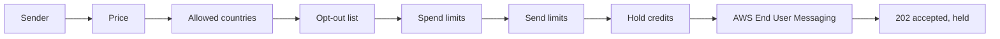

This reference is for backend developers who send SMS, MMS, WhatsApp, and
voice messages through the hosted Ryu Messaging API, an HTTP contract on the
Ryu control plane. For the concepts, pricing, and holds behind these routes,
see [Ryu Messaging](/docs/standalone/messaging).

Every path on this page is relative to `/api/messaging`, and organization
routes name the organization in the path as `/orgs/:orgId`. `GET /status`
reports `apiVersion: "v1"`.

Wire conventions:

- JSON bodies use camelCase field names. Request bodies are closed: an unknown
  field gets `400 invalid_request`.
- Phone numbers are E.164 strings such as `+6591234567`, and countries are
  ISO 3166-1 alpha-2 codes such as `US`.
- Money is an integer number of micro-USD in fields that end in `MicroUsd`.
- Timestamps are ISO 8601 UTC strings. Ids are opaque strings; do not parse them.

## Authentication

Send an API key in the `x-api-key` header. A signed-in Ryu console session also
works for organization members.

| Credential | Requirements |
|---|---|
| Organization API key | Must belong to the organization in the path, otherwise `403 forbidden`. Its scopes are the grant: `messaging:read` for reads, `messaging:manage` for sends, number purchases, and settings. A member can only create an organization key with a Messaging scope their own organization permissions grant. |
| Personal API key | Needs `X-Ryu-Organization` naming the organization in the path, the matching scope, and its owner's `messaging.read` or `messaging.manage` permission. The organization's access policy applies. |
| Console session | The member's `messaging.read` or `messaging.manage` permission. The organization's access policy applies. Support access sessions are refused. |

The scopes exist only on the hosted control plane and are never delegated to a
node. Every organization route also checks, in order:

1. that Ryu Messaging is available for the organization (`404 not_found` while
   it is not);
2. that the organization's **Ryu Messaging** feature is on
   (`403 feature_disabled`).

See [Tokens, OAuth apps, and revocation](/docs/security/authentication-tokens)
for API keys and [Permissions](/docs/security/permissions) for the role sets.

## Errors

Every error is a JSON object with a stable `error` code and a readable
`message`. Some errors add fields beside them, such as `requiredMicroUsd`.

```json
{
  "error": "insufficient_credits",
  "message": "This organization's available credit does not cover this charge. Add credits and retry.",
  "availableMicroUsd": 1200,
  "requiredMicroUsd": 8400
}
```

Branch on `error`, and treat an unknown code by its HTTP status. A route that is
not configured on the server answers `503 not_configured`.

| Status | `error` | Meaning |
|---|---|---|
| 400 | `invalid_request`, `idempotency_key_required` | The body, query, or `Idempotency-Key` is missing or malformed |
| 402 | `insufficient_credits` | The available balance does not cover the hold. Nothing was sent or charged. |
| 402 | `spend_limit_reached` | The charge would pass a spend limit whose action is stop; see [Spend limits](#spend-limits) |
| 403 | `forbidden`, `feature_disabled`, `country_not_allowed` | Wrong organization, missing scope or permission, the feature is off, or the destination country is not allowed |
| 404 | `not_found` | Unknown id, or Messaging is not available for the organization |
| 409 | `number_suspended`, `number_not_active`, `registration_required`, `price_changed`, `conflict` | The number cannot send yet, AWS quoted a higher lease price, or a purchase, release, or renewal is in progress |
| 409 | `number_limit_reached`, `purchase_unconfirmed`, `purchase_not_completed` | See [Numbers and senders](/docs/standalone/messaging-numbers) |
| 409 | `idempotency_key_reused`, `idempotency_in_progress`, `outcome_unknown` | See [Idempotency](#idempotency) |
| 413 | `payload_too_large` | The body or MMS media is over its limit |
| 422 | `destination_not_priced`, `invalid_destination`, `invalid_body`, `capability_missing`, `recipient_opted_out`, `window_closed`, `number_not_available`, `invalid_webhook_url` | The send or purchase cannot be priced or delivered as asked |
| 429 | `send_rate_limited`, `purchase_rate_limited` | A send or number-purchase cap was reached; see [Send limits](#send-limits) |
| 502 | `provider_refused` | AWS End User Messaging refused the request. Nothing was charged. |
| 502 | `outcome_unknown`, `provider_error`, `media_upload_failed` | AWS did not answer, or MMS media could not be staged |
| 503 | `not_configured`, `messaging_capacity` | The route is not configured on this server, or Ryu Messaging cannot set up the organization right now |

A `502 outcome_unknown` on a send means AWS may have sent it. The send's hold
stays until the message settles. The body carries the stored message as
`messageRecord`, so you can follow it with `GET /orgs/:orgId/messages/:id`
before you send again with a new key.

A `502 provider_refused` on a send also carries `messageRecord`. A
`502 outcome_unknown` on a number purchase is different: retry it with the same
`Idempotency-Key` to finish that purchase.

## Idempotency

Every send and every number purchase needs an `Idempotency-Key` header of up to
255 characters, or the request gets `400 idempotency_key_required`. A key is
scoped to the organization and the operation, and it is kept for 24 hours.

| Case | Result |
|---|---|
| Same key, same body, first request finished | The first response is replayed with its status, and nothing is charged again |
| Same key, different body | `409 idempotency_key_reused` |
| Same key while the first request is running | `409 idempotency_in_progress`; retry shortly |
| A send may have reached AWS without a confirmed answer | `409 outcome_unknown`; check the message log, then send again with a new key |
| A number purchase may have reached AWS without a confirmed answer | The purchase is finished with the same number row and the same AWS request, so no second number is leased |
| The first request was refused before AWS sent anything | The key is released, so a retry with the same key runs again |

## Endpoints

| Method | Path | Permission | Purpose |
|---|---|---|---|
| `GET` | `/status` | None | Whether the service is configured and which channels can send |
| `GET` | `/orgs/:orgId/quote` | read | The hold a send would place, and the organization's credit |
| `GET` | `/orgs/:orgId/numbers` | read | The numbers the organization holds, newest first; `?status=all` adds released and failed numbers (at most 200) |
| `GET` | `/orgs/:orgId/numbers/quote` | read | The first charge for a country and number type |
| `POST` | `/orgs/:orgId/numbers` | manage, **Key** | Lease a number |
| `PATCH` | `/orgs/:orgId/numbers/:id` | manage | Change a number's `label` |
| `DELETE` | `/orgs/:orgId/numbers/:id` | manage | Release a number |
| `POST` | `/orgs/:orgId/sms` | manage, **Key** | Send an SMS |
| `POST` | `/orgs/:orgId/mms` | manage, **Key** | Send an MMS |
| `POST` | `/orgs/:orgId/voice` | manage, **Key** | Send a voice message |
| `POST` | `/orgs/:orgId/whatsapp` | manage, **Key** | Send a WhatsApp message |
| `GET` | `/orgs/:orgId/messages` | read | The message log, newest first |
| `GET` | `/orgs/:orgId/messages/:id` | read | One message |
| `GET` | `/orgs/:orgId/opt-outs` | read | The organization's opt-out list |
| `POST` | `/orgs/:orgId/opt-outs` | manage | Add a phone number to the opt-out list |
| `DELETE` | `/orgs/:orgId/opt-outs/:phoneNumber` | manage | Remove a phone number from the opt-out list |
| `GET` | `/orgs/:orgId/whatsapp/senders` | read | The WhatsApp senders assigned to the organization |
| `GET` | `/orgs/:orgId/whatsapp/senders/:senderId/templates` | read | A dedicated sender's templates |
| `POST` | `/orgs/:orgId/whatsapp/senders/:senderId/templates` | manage | Submit a template for Meta review |
| `GET` | `/orgs/:orgId/settings` | read | Webhook, allowed countries, and daily limit |
| `PUT` | `/orgs/:orgId/settings` | manage | Change settings |
| `POST` | `/orgs/:orgId/settings/webhook-secret/rotate` | manage | Replace the webhook signing secret |

**Key** marks a route that requires `Idempotency-Key`. Number, opt-out, and
WhatsApp routes are described in
[Numbers and senders](/docs/standalone/messaging-numbers).

## Quote a send

`GET /orgs/:orgId/quote` takes the same inputs a send would, as query
parameters, and returns the ceiling Ryu would hold plus the organization's
`credit` (`availableMicroUsd` and `heldMicroUsd`). It sends nothing.

| `channel` | Other parameters | Quote fields |
|---|---|---|
| `sms` | `to`, `body` | `ceilingMicroUsd`, `segments`, `encoding` (`GSM` or `UCS2`), `isoCountryCode` |
| `mms` | `to`, optional `body` | Same as SMS |
| `voice` | `to`, `body`, optional `bodyType` (`text` or `ssml`) | `ceilingMicroUsd`, `perMinuteMicroUsd`, `estimatedMinutes`, `isoCountryCode` |
| `whatsapp` | `to`, optional `mode` (`template`, the default, or `text`) | `ceilingMicroUsd`, `awsFeeMicroUsd`, `isoCountryCode` |

The quote is a ceiling, not the final price. The settled amount is never higher.

## Send messages

Each send is checked in this order: the sender, the price, the organization's
allowed destination countries, its opt-out list, its spend limits, and its send
limits. The hold is taken only after all of them pass. A send returns `202`
with `{ "message": … }` once AWS has accepted it, with `status: "accepted"` and
`chargeState: "held"`.



| Route | Required fields | Optional fields |
|---|---|---|
| `POST /orgs/:orgId/sms` | `from` (a number id), `to`, `body` (1 to 1,600 characters, not only whitespace) | `messageType` (`TRANSACTIONAL` or `PROMOTIONAL`; defaults to the number's), `ttlSeconds`, `metadata` |
| `POST /orgs/:orgId/mms` | `from`, `to`, `media` (`contentType` and `base64`) | `body` (up to 1,600 characters), `ttlSeconds`, `metadata` |
| `POST /orgs/:orgId/voice` | `from`, `to`, and exactly one of `text` (up to 3,000 characters) or `ssml` (up to 6,000) | `voiceId` (an Amazon Polly voice id such as `JOANNA`), `ttlSeconds`, `metadata` |
| `POST /orgs/:orgId/whatsapp` | `senderId`, `to`, and exactly one of `template` (`name`, `language`, optional `components`) or `text` (up to 4,096 characters) | `previewUrl` (with `text`), `metadata` |

Field rules:

- `from` is the id of one of the organization's active numbers with the
  matching capability, not the phone number itself.
- `ttlSeconds` is 5 to 259,200 seconds; an SMS or MMS defaults to 14,400 and a
  voice message to 3,600.
- MMS media is JPEG, PNG, GIF, or MP4, at most 600 KiB decoded, and the whole
  MMS body is at most 1 MiB.
- `metadata` is up to 16 string entries (keys up to 64 characters, values up to 512), returned on the message and its webhooks.

A voice hold covers the spoken length of the text at a slow speaking rate plus
one minute, at most 10 minutes. Free-form WhatsApp `text` is accepted only
within 24 hours of the contact's last message; otherwise it gets
`422 window_closed` and you send a template instead.

`RYU_API_URL` is the control-plane origin, `https://api.ryuhq.com` on Ryu's
hosted service. Leave out `X-Ryu-Organization` for an organization key; a
personal key needs it:

```sh
RYU_API_URL="${RYU_API_URL:-https://api.ryuhq.com}"

curl -X POST "$RYU_API_URL/api/messaging/orgs/$ORG_ID/sms" \
  -H "x-api-key: $RYU_API_KEY" \
  -H "X-Ryu-Organization: $ORG_ID" \
  -H "Content-Type: application/json" \
  -H "Idempotency-Key: order-1842-shipped" \
  -d '{"from":"<number id>","to":"+6591234567","body":"Your order has shipped."}'
```

## Messages and charges

`GET /orgs/:orgId/messages` returns `{ messages, nextCursor }`, newest first. It
accepts `channel`, `direction` (`outbound` or `inbound`), `status`, `limit` (1
to 200, default 50), and `cursor` (the previous page's `nextCursor`). Inbound
SMS and WhatsApp replies appear here with `direction: "inbound"`.

| `status` | Meaning |
|---|---|
| `queued`, `sending` | Stored, not yet accepted by AWS |
| `accepted` | AWS returned a message id |
| `delivered`, `failed` | AWS reported the final outcome |
| `unresolved` | The send ended without a definite answer and may have been sent |
| `refused` | Ryu declined it before AWS, for example for insufficient credits |
| `received` | An inbound message |

| `chargeState` | Meaning |
|---|---|
| `held` | The ceiling is held (`heldMicroUsd`) |
| `settling`, `settled` | The final price (`priceMicroUsd`) is being, or has been, charged (`chargedMicroUsd`) |
| `released` | The hold was released with no charge |
| `absorbed` | Ryu absorbed the whole charge, for example an inbound fee the balance could not cover |
| `none` | Nothing was or will be charged |

`absorbedMicroUsd` is any part of the price that Ryu absorbed, above the hold
or beyond what the balance could cover. `estimated: true` means no final
provider price arrived, so the charge settled at the price-list estimate.

| Channel | Settles at |
|---|---|
| SMS, MMS, voice | AWS's final event, or the estimate once the message's time to live plus 72 hours has passed |
| WhatsApp | The first status that carries Meta's pricing, or AWS's fee alone after 72 hours |

## Send limits

| Limit | Value |
|---|---|
| Per organization per minute | 60 sends |
| Per organization per hour | 1,000 sends |
| Per organization per UTC day | 1,000 sends, or the organization's `dailySendLimit` (0 to 100,000) |

Every send attempt that reaches the limits counts, delivered or not. A
throttled send gets `429 send_rate_limited` with `limit` and `window` fields and
a `Retry-After` header. Number purchases have their own limits, described in
[Numbers and senders](/docs/standalone/messaging-numbers).

## Spend limits

Messaging charges count toward the organization's spend limits. Before each
hold, Ryu checks every limit whose action is stop that applies to the request:

- the API key's;
- the acting member's, or the default member limit;
- the organization's.

A send or number purchase whose ceiling would take any of them past its budget
gets `402 spend_limit_reached` with `scope` (`key`, `member`, or `org`),
`budgetMicroUsd`, `spentMicroUsd`, and `requiredMicroUsd`.

A key's Messaging spend is what its sent messages were charged plus the lease
and renewal charges of the numbers it bought. Charges still on hold count as
spent, so a burst of sends cannot each pass a limit on the settled spend alone.
Two requests that arrive at the same instant can still pass a limit by their
own holds.

## Settings and webhooks

`PUT /orgs/:orgId/settings` accepts:

| Field | Meaning |
|---|---|
| `webhookUrl` | A public HTTPS URL, or `null` to remove it |
| `allowedCountries` | Destination countries beyond those of the organization's own numbers and WhatsApp senders, up to 250 |
| `dailySendLimit` | The daily send cap; `null` restores the default |

A send to a country outside those gets `403 country_not_allowed`.

The first webhook URL mints a signing secret (`whsec_…`), returned only in that
reply as `webhookSecret`. `POST /orgs/:orgId/settings/webhook-secret/rotate`
replaces it; the old secret stops verifying at once.

Deliveries are signed with [Standard Webhooks](https://www.standardwebhooks.com/)
headers (`webhook-id`, `webhook-timestamp`, `webhook-signature`, repeated as
`svix-*`) over `id.timestamp.body`.

| `event_type` | `data` |
|---|---|
| `message.received` | `{ message }` - an inbound SMS or WhatsApp message |
| `message.delivered` | `{ message }` - AWS reported delivery |
| `message.failed` | `{ message }` - AWS reported a failure |
| `number.suspended` | `{ number }` - a renewal could not be paid |
| `number.released` | `{ number }` - the number was released |

The body is `{ "type": "event", "event_type", "event_id", "data" }`.
Deduplicate on `event_id`, which equals `webhook-id`. Each event is delivered to
an organization at most once, with up to three attempts a few hundred
milliseconds apart. There is no durable retry queue, so read
`GET /orgs/:orgId/messages` to reconcile after an outage.

## TypeScript client

The [`@ryuhq/services` SDK](/docs/standalone/sdk/messaging) adds retries,
typed errors and webhook verification on top of this client. The OpenAPI
document is [`openapi/messaging.json`](https://ryuhq.com/openapi/messaging.json), rendered in
the [Messaging API reference](/docs/standalone/sdk/reference/messaging).

`createMessagingClient` in [`@ryuhq/client`](/docs/extend/develop/sdk/client#separate-service-clients)
wraps these routes. Pass the control-plane origin as `baseUrl`, an API key as
`apiKey`, and the `organizationId`; the client sends the key as `x-api-key` and
the organization as `X-Ryu-Organization`, and never follows a redirect.

```typescript
import { createMessagingClient, MessagingError } from "@ryuhq/client";

const messaging = createMessagingClient({
  baseUrl: "https://api.ryuhq.com", // the control-plane origin
  apiKey: ryuApiKey,
  organizationId,
});

try {
  const message = await messaging.sms.send(
    { from: numberId, to: "+6591234567", body: "Your order has shipped." },
    { idempotencyKey: "order-1842-shipped" },
  );
  console.log(message.status, message.heldMicroUsd);
} catch (error) {
  if (!(error instanceof MessagingError && error.code === "insufficient_credits")) {
    throw error;
  }
  // Add credits, then retry with the same idempotency key.
}
```

| Namespace | Methods |
|---|---|
| (root) | `status()`, `quote(input)` |
| `numbers` | `list({ status }?)`, `quote({ country, type })`, `buy(input, options?)`, `update(id, { label })`, `release(id)` |
| `sms`, `mms`, `voice`, `whatsapp` | `send(input, options?)` |
| `whatsapp` | `senders()`, `templates.list(senderId)`, `templates.create(senderId, definition)` |
| `messages` | `list(query?)`, `get(id)` |
| `optOuts` | `list(query?)`, `add(phoneNumber)`, `remove(phoneNumber)` |
| `settings` | `get()`, `update(input)`, `rotateWebhookSecret()` |

- When `idempotencyKey` is omitted, the client generates one per call, so pass
  your own to retry a send or purchase safely.
- A failed request throws `MessagingError` with `status`, `code`, `details`,
  and `retryAfterSeconds`.
- `messagingErrorMessageRecord(error)` returns the `messageRecord` of an
  unconfirmed or refused send, or `null`.
- `verifyMessagingWebhook(secret, headers, rawBody)` checks a delivery's
  signature and timestamp (300 seconds of tolerance by default) and returns the
  event; pass the raw body exactly as received.
