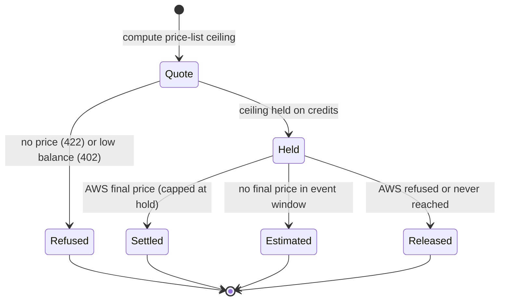

Ryu Messaging is a Ryu-hosted service on the Ryu control plane. It lets an
organization:

- lease phone numbers;
- send SMS, MMS, WhatsApp, and voice messages through **AWS End User Messaging**,
  with every provider charge passed through to the organization's credits at cost;
- store inbound SMS and WhatsApp replies;
- report delivery to a signed webhook.

<Figure name="messaging" />

<Callout type="warn">
Ryu Messaging is in **early access**. Ryu enables it for each organization, and
the organization must also turn on the **Ryu Messaging** feature, which is off
by default. Until both are on, its organization routes answer `404 not_found`
or `403 feature_disabled`. There is no self-hosted Messaging service;
self-hosters use their own AWS account directly.
</Callout>

## Channels

| Channel | What it sends | Sender |
|---|---|---|
| SMS | Text messages up to 1,600 characters, split into parts by AWS | A number the organization leases with the `SMS` capability |
| MMS | One image or video (JPEG, PNG, GIF, or MP4, up to 600 KiB) with optional text | A number with the `MMS` capability |
| Voice message | Text or SSML read aloud by an Amazon Polly voice on an outbound call | A number with the `VOICE` capability |
| WhatsApp | Approved templates, or free-form text within 24 hours of the contact's last message | A WhatsApp sender that Ryu assigns to the organization |

Voice is outbound text-to-speech only. Ryu Messaging does not place live,
inbound, or interactive calls; use the Gateway
[phone assistant](/docs/gateway/phone-assistant) for those. Messaging is also
separate from the bring-your-own WhatsApp and other bot
[channels](/docs/gateway/channels) that the Gateway runs with your own
credentials.

`GET /api/messaging/status` needs no credentials and reports whether the
service is configured and which channels can send right now.

## Pricing

Ryu Messaging has no Ryu price of its own. Each SMS, MMS, voice message,
WhatsApp message, and phone number lease costs what AWS End User Messaging
charges for it, passed through with **no markup**.

Prices depend on the destination country, the carrier, the number type, the
message encoding, and, for WhatsApp, Meta's conversation category. See the
[AWS End User Messaging pricing](https://aws.amazon.com/end-user-messaging/pricing/)
page for current rates. The deposit fee on credit top-ups still applies as
described in [Credits & AI Pools](/docs/billing/credits).

### Holds

Because AWS reports the real price only after a message is sent, every charge
uses a hold:

1. **Quote.** Ryu computes the most the message can cost from AWS's published
   price list. A destination with no published price is refused with
   `422 destination_not_priced`; Ryu never guesses.
2. **Hold.** That ceiling is held on the organization's credits before AWS is
   asked. Open holds count against the balance that other sends can use. When
   the available balance (credits minus open holds) does not cover the ceiling, the
   send is refused with `402 insufficient_credits` and nothing is sent.
3. **Settle.** When AWS reports the final price, Ryu charges that price, never
   more than the hold, and releases the rest. If the real price is higher than
   the hold, Ryu absorbs the difference.
4. **Release.** A send that AWS refused, or that never reached AWS, releases
   its hold with no charge.

A Messaging charge never takes the balance below zero:

- If credits leave the balance while a hold is open, such as a gift credit that
  expires, the charge is capped at what remains and Ryu absorbs the rest.
- When AWS reports no final price within its event window, the message settles
  at the price-list estimate and is marked `estimated`.

Charges appear in organization usage as **Messaging (SMS, WhatsApp, voice)**.
[Metering Rates](/docs/billing/metering#ryu-hosted-services) lists Messaging
beside the other hosted services.

Phone numbers are leased every 30 days at the AWS monthly price, with the same
hold. A number whose renewal cannot be paid is suspended for 7 days and then
released. [Numbers and senders](/docs/standalone/messaging-numbers) explains
leases, registration, WhatsApp onboarding, and opt-outs.

## Access and permissions

| Role | Permission | Allows |
|---|---|---|
| Owner, admin | `messaging.manage` | Sends, number purchases, and settings changes |
| Member, viewer | `messaging.read` | Quotes, numbers, the message log, and the opt-out list |

An API key needs the matching `messaging:read` or `messaging:manage` scope. See
[Permissions](/docs/security/permissions) and the
[Messaging API](/docs/standalone/messaging-api#authentication) for the full
rules. Support access sessions cannot use Ryu Messaging.

### Limits

- Sends are capped per organization: 60 a minute, 1,000 an hour, and 1,000 a
  day by default. See [Send limits](/docs/standalone/messaging-api#send-limits).
- An organization can set its own daily limit and the destination countries it
  sends to.
- An organization holds at most 25 numbers by default.
- Spend limits whose action is stop, on the API key, the member, or the
  organization, refuse a charge that would pass them.
- Recipients on the organization's opt-out list are refused before any hold is
  taken.

## Organization entry point

Members with access see a **Ryu Messaging** card in the Ryu dashboard's
**Products** view. It lists the organization's numbers, quotes the monthly
lease for a country and number type, gets a new number, and releases one. Sends
and the message log use the API.

<Cards>
  <DocCard href="/docs/standalone/messaging-api" />
  <DocCard href="/docs/standalone/messaging-numbers" />
  <DocCard href="/docs/extend/develop/sdk/client" />
  <DocCard href="/docs/standalone/sdk/messaging" />
  <DocCard href="/docs/standalone/sdk/reference/messaging" />
</Cards>
