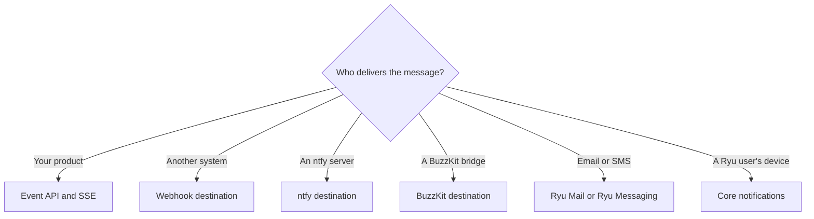

Ryu Notify is its own event and delivery contract. This page maps it to other
notification products. Common primitives are available through one
tenant-scoped API. Provider-specific transports and identities stay behind
explicit adapters.

## Capability map

| Reference pattern | Ryu Notify surface | Boundary |
|---|---|---|
| [Boop](https://github.com/chrisgreg/boop) event inbox, grouping, actions, and redaction | Rich events, fingerprints, actions, redaction, archive and acknowledgement, groups, and SQLite history | Notify does not implement Boop's native device management or MCP server |
| [ntfy](https://ntfy.sh/) topic publishing, priorities, tags, and action headers | `POST /v1/topics/:topic` accepts JSON or plain text and maps priority, tags, click, and actions | An ntfy destination is an outbound adapter; Notify is not an ntfy server or account |
| [Hark](https://hark.ryan.ceo/docs) approvals, callbacks, retries, and Live Activities | Single-use interactive responses with optionally signed callbacks, signed durable deliveries, and start/update/end activities | Notify does not provide Hark's native iOS device routing or Live Activity extension |
| [Novu](https://novu.co/) preferences and multi-channel workflows | Recipient mute and quiet hours, destinations, delivery attempts, and explicit service composition | Workflow DAGs, digests, and provider-specific push and email are not part of Notify |
| [LogSnag](https://logsnag.com/) event tracking and product analytics | Topic/source/level aggregates and fingerprint groups | The API returns bounded aggregates; it is not a hosted analytics dashboard |
| [BuzzKit](https://buzzkit.dev/buzz?t=6) human/agent realtime workspace | `buzzkit` HTTP bridge destination plus the same SSE event edge | Notify does not claim Buzz's Nostr signing, workspace identity, voice, or channel protocol |

## The durable contract

Every event is tenant-scoped and has an opaque id, source, type, project/topic
labels, priority, tags, optional actions and click-through URL, redacted data,
and acknowledgement/archive state. Event creation is safe to retry with an
`Idempotency-Key`.

A consumer recovers from a disconnect by reopening the live SSE stream and then
reading history since the newest event it processed, as described in
[Notify streams](/docs/standalone/notify-streams).

Destinations are also durable resources. Each enabled destination gets at most
one delivery row per event. Attempts are claimed from SQLite, retried with
bounded exponential backoff, and exposed through the delivery API.

Webhooks can be verified with the
[signature headers](/docs/standalone/notify-api#destinations-and-delivery-history);
destination URLs and custom header values are redacted from read projections.

## Interactive and live work

An event can carry one pending `approval`, `yes_no`, or `text` response. The
first valid response wins: a later answer or cancel returns `409 conflict`. An
expiry is enforced when the event is read or answered.

An optional HTTPS callback is invoked once, after the winning answer is stored.
With a `callbackSecret`, the callback is HMAC-signed so the receiver can reject
a forged approval.

Long-running work belongs in an activity resource: create it once, update it
with its sequence, and end it explicitly. Activity changes and notification
changes share the SSE connection but remain separate resource types.

## Choosing the adapter

| Situation | Use |
|---|---|
| Your product already owns delivery | The direct event API and [streams](/docs/standalone/notify-streams) |
| Another system owns the channel | A webhook destination |
| You run a compatible topic server | An ntfy destination |
| Your bridge endpoint owns BuzzKit authentication and protocol translation | The BuzzKit bridge destination |
| Email | [Ryu Mail](/docs/standalone/mail) |
| SMS, WhatsApp, or voice messages | [Ryu Messaging](/docs/standalone/messaging) |
| Ryu user inboxes, workflow acknowledgements, desktop notifications, native push | Core |

## What Notify does not do

Notify does not provide native Apple or Expo push, email or SMS transports,
workflow orchestration, action execution, or native Buzz or Nostr identity.
Its webhook, ntfy, and BuzzKit HTTP-bridge adapters are delivery targets that
Notify retries independently.

The comparison links describe the referenced products' own behavior. The
[Notify API](/docs/standalone/notify-api) and the
[health feature report](/docs/standalone/notify#health-and-capabilities)
define what Ryu Notify supports.

<Cards>
  <DocCard href="/docs/standalone/notify" />
  <DocCard href="/docs/standalone/notify-api" />
  <DocCard href="/docs/standalone/notify-streams" />
</Cards>

