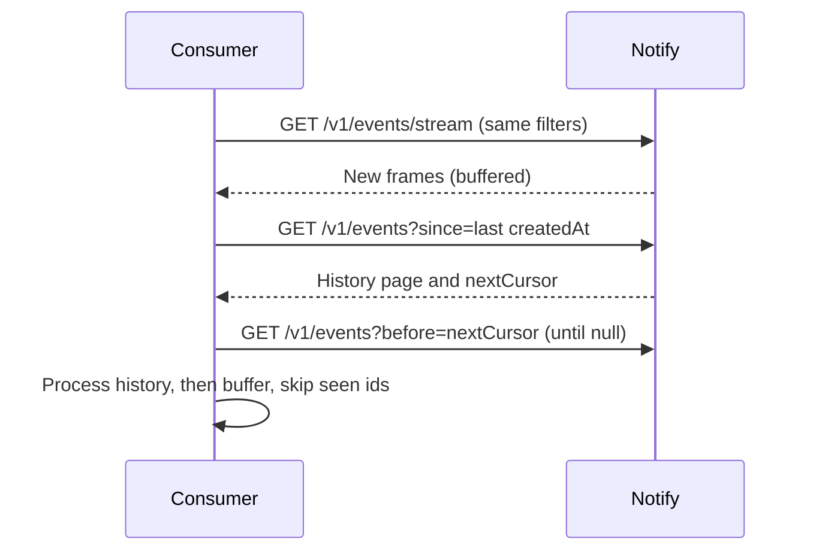

This guide shows how to consume Ryu Notify's live Server-Sent Events (SSE)
stream and recover without gaps after a disconnect. Streams send only new
events. To recover events created while a consumer was disconnected, read the
durable event list.

## Open a stream

```sh
curl -N "$NOTIFY_URL/v1/events/stream?source=github-actions" \
  -H "Authorization: Bearer ${RYU_NOTIFY_API_TOKEN}"
```

The stream sends an initial `: ryu-notify` comment, then one frame for each
matching event:

```text
event: notification
id: evt_...
data: {"id":"evt_...","title":"Deploy complete",...}
```

Activity updates use the same connection with `event: activity` and carry an
opaque activity id plus its current `sequence`. Use the sequence on
`PATCH /v1/activities/:id` when more than one worker may update the same live
activity; a stale sequence returns `409 conflict`.

The optional `source`, `recipient`, and `topic` query parameters filter the
stream.

### Keepalive and limits

The service sends a `: ping` comment every 10 seconds, inside its 30-second
idle timeout, and removes a subscriber when the client disconnects. Any proxy
in front of Notify must allow at least that much idle time on a streaming
response.

| Limit | Value |
|---|---|
| Open streams per tenant | 64 |
| Open streams per process | 1,024 |
| Frames queued for a slow reader before the stream closes | 128 |
| Idle time with no progress before the stream closes | 30 seconds |

Opening a stream over a limit returns `429 too_many_streams`. When a stream
closes, reconnect and recover from history as described below.

## Reconnect without gaps

The service does not replay history over SSE, and `nextCursor` only pages
backward into older events. Recover with a timestamp instead:

1. While the stream is live, remember the `createdAt` of the newest event you
   have processed.
2. On reconnect, open `/v1/events/stream` (or `/v1/topics/:topic/stream`) first,
   with the same bearer key and filters, and buffer the frames it delivers.
3. Read [`GET /v1/events`](/docs/standalone/notify-api#history-and-acknowledgement)
   with `since=<that createdAt>` and the same filters. Pages are
   newest-first and bounded, so follow `before=<nextCursor>` until `nextCursor`
   is `null`.
4. Process the history, then the buffered frames, and skip any event id you
   have already handled. `since` is inclusive, so the last processed event
   comes back once.

Opening the stream before reading history leaves no window in which a new
event is in neither result.



## Compose with Box and Mail

To notify on another service's activity, call that service first and publish
to Notify second. For Ryu Mail, publish an event once Mail accepts a message
for transport. For Ryu Box, publish its lifecycle status. Keep message bodies,
raw MIME, attachments, command output, provider credentials, and inbound HMAC
secrets out of the published event.

## Delivery, controls, and analytics

An open SSE connection does not prove that a third-party channel received a
message. For downstream delivery, configure a destination and inspect its
durable attempts. Use recipient preferences to mute a recipient or set quiet
hours. Use silences to suppress a source, project, topic, or fingerprint for a
time. Groups and analytics are bounded reads over the same tenant event store.

## What Notify does not do

Notify has no native push, email, or SMS transport of its own.
[Ryu Mail](/docs/standalone/mail) owns email,
[Ryu Messaging](/docs/standalone/messaging) owns SMS, WhatsApp, and voice
messages, and Core owns users, workflows, and desktop and native notifications.
See [Notify parity and adapters](/docs/standalone/notify-parity#what-notify-does-not-do)
for the full boundary.

<Cards>
  <DocCard href="/docs/standalone/notify" />
  <DocCard href="/docs/standalone/notify-api" />
  <DocCard href="/docs/standalone/notify-parity" />
  <DocCard href="/docs/standalone/mail-delivery" />
  <DocCard href="/docs/standalone/box-lifecycle" />
</Cards>

