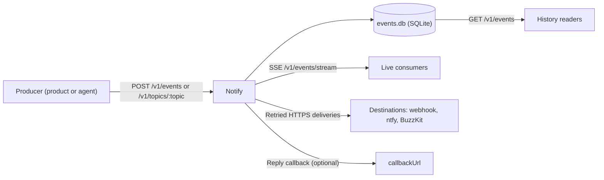

Ryu Notify is a standalone notification and event API for products and agents.
It does four things for each tenant:

- stores bounded JSON events in SQLite, with history and aggregates;
- streams new events and live activities over Server-Sent Events (SSE);
- delivers events to durable, retrying HTTP destinations;
- collects interactive replies such as approvals.

<Figure name="notify" />

<Callout type="warn">
Hosted Ryu Notify is in **early access**. Ryu enables it one organization at a
time, and it is not open for new organizations yet. Notify is also not
published: there is no public source repository, package, or container image.

The self-hosting commands below apply to a Ryu source checkout that contains
the service. Organization billing and account notifications in the Ryu
dashboard are a separate feature and are not affected.
</Callout>

Notify does not replace Core's user-scoped `/api/notifications/*` feed. Core
owns Ryu users, workflow gates, desktop and native notifications, and Expo
push. Notify owns this external product API. See
[Notify parity and adapters](/docs/standalone/notify-parity) for the supported
channel boundaries and the comparison with other notification services.



## Start the service

```sh
RYU_NOTIFY_API_TOKEN="$(openssl rand -hex 32)" \
RYU_NOTIFY_TENANT_ID=demo \
RYU_NOTIFY_SECRETS_KEY="<64 hex characters, kept outside the data directory>" \
RYU_NOTIFY_DATA_DIR=/var/lib/ryu-notify \
bun run apps/notify/src/index.ts
```

For more than one tenant, map each tenant to a distinct bearer key:

```sh
RYU_NOTIFY_API_TOKENS='{"acme":"<long random key>","beta":"<another long random key>"}' \
RYU_NOTIFY_SECRETS_KEY="<64 hex characters, kept outside the data directory>" \
RYU_NOTIFY_DATA_DIR=/var/lib/ryu-notify \
bun run apps/notify/src/index.ts
```

Use long random keys. The service starts with a key shorter than 24 characters
but logs a warning for it. With only `RYU_NOTIFY_API_TOKEN` set and no
`RYU_NOTIFY_TENANT_ID`, the tenant id is `default`.

### Network binding

The default bind is `127.0.0.1:8092`. Set `RYU_NOTIFY_HOSTNAME` and
`RYU_NOTIFY_PORT` when the service has an authenticated network boundary.

The service's container build binds `0.0.0.0:8092` inside the container, so
publish that port only behind TLS. Notify caps concurrent live streams, limits
publish rates per tenant, and backs off addresses that present invalid keys (see
[Abuse limits](/docs/standalone/notify#abuse-limits)).

### Data directory

API keys stay in process memory and are never written to the Notify database or
returned in responses. The service stores its state in `events.db` below
`RYU_NOTIFY_DATA_DIR`.

When that variable is unset, the directory is `$XDG_DATA_HOME/ryu-notify`, or
`~/.local/share/ryu-notify`. Notify never defaults into a Core data directory.

The database holds destination signing secrets, custom header values, and
callback secrets. Notify creates the directory owner-only and the database files
with mode `0600`. Keep it private and back it up like any other credential store.

### Secrets key

Notify requires `RYU_NOTIFY_SECRETS_KEY`, a random 32-byte key (64 hex
characters or base64, for example `openssl rand -hex 32`), and does not start
without it. With AES-256-GCM, it encrypts these values in the database:

- each destination's URL, signing secret, and custom header values;
- each interactive event's callback URL and callback secret.

Values an older build stored unencrypted are still read and are encrypted the
next time the service starts.

<Callout type="warn">
Keep the key outside the data directory and keep a copy. Without it, encrypted
values cannot be read, and deliveries and callbacks for them fail.
</Callout>

### Root path

`GET /` returns a short JSON description of the service: its name, version,
and the `/health` path. It redirects browsers only when
`RYU_PRODUCT_DASHBOARD_URL` is set to a non-empty URL, such as your own console
or landing page. Ryu's hosted deployment sets it to the Ryu dashboard.

## Abuse limits

Notify limits how fast each tenant publishes and backs off client addresses
that keep presenting invalid API keys. Both limits live in process memory and
reset when the service restarts, so keep an edge rate limit in front of a public instance too.

| Limit | Value |
|---|---|
| Sustained publishes per tenant, shared by `POST /v1/events` and `POST /v1/topics/:topic` | 10 per second |
| Publishes a tenant can send at once before the sustained rate applies | 200 |
| Invalid API keys one client address may present per window before it is blocked | 30 |
| The counting window, and the length of the first block | 60 seconds |
| The longest block; each further block for the same address doubles up to this | 900 seconds |

These limits are fixed and cannot be changed through the environment. To tell
Notify which client address to count when it runs behind your own reverse
proxies, set `RYU_NOTIFY_TRUSTED_PROXIES`: IP addresses or CIDR ranges,
separated by commas (empty by default). An invalid value stops startup.

Over a limit, Notify returns `429 rate_limited` with a `Retry-After` header in
seconds. A blocked address is refused before its key is checked, so even a
correct key from that address waits until the block ends.

Requests that send no bearer key are not counted, and `/health` is never
blocked. IPv6 clients are grouped by their `/64`.

### Behind a reverse proxy

The client address is the TCP peer, and `X-Forwarded-For` is ignored by
default. Behind a reverse proxy such as Traefik, Caddy, or nginx, add the
proxy's address or network to `RYU_NOTIFY_TRUSTED_PROXIES` (for example
`172.16.0.0/12` for a Docker bridge network). Otherwise one client retrying a
stale key could block every client.

Notify then picks the client address from `X-Forwarded-For` by the same rule as
Passport. See
[Failed authentication backoff](/docs/standalone/passport#failed-authentication-backoff)
for which hop it trusts and which proxies to list.

## Pricing

Ryu-hosted Notify costs **$0.10 per 1,000 accepted events**. The first 10,000
accepted events per organization each calendar month (UTC) are free.

- An accepted event is one stored by `POST /v1/events` or `POST /v1/topics/:topic`.
- Idempotent replays and refused requests are not counted.
- Usage is charged hourly to the organization's Ryu credits, drawing on the
  plan's included pool first.

### When credits run out

Once the organization's Ryu credits are exhausted, Ryu-hosted Notify refuses
publishing on both routes with `402 insufficient_credits` until credits are
added. Everything else keeps working: reading history, acknowledging and
archiving events, open streams, removing destinations, and the usage report.

Notify learns about exhausted credits within about a minute. If it cannot
check, it keeps accepting publishes rather than refusing them.

### Self-hosted

Self-hosted Notify is never billed by Ryu and never refuses publishing for
credits. It does not contact Ryu billing; it only serves the same usage
report, `GET /v1/usage`, to its own tenants. See
[Usage reports](/docs/standalone/notify-api#usage-reports).

## Health and capabilities

`GET /health` is unauthenticated and returns the service name, API version,
service version, and the features available in this process:

| Feature | Meaning |
|---|---|
| `events` | Create and read durable events, including acknowledgement and archive state |
| `activities` | Start, update, end, and stream progress activities |
| `analytics` | Read bounded level, source, topic, and acknowledgement aggregates |
| `destinations` | Deliver to signed webhooks, ntfy, or a BuzzKit HTTP bridge |
| `deliveries` | Read durable delivery attempts and requeue a failed or suppressed one |
| `filters` | Filter history by level, source, recipient, topic, priority, tags, time, and state |
| `groups` | Read events grouped by fingerprint |
| `idempotency` | Safely retry event and activity creation with an idempotency key |
| `interactive-responses` | Collect approval, yes/no, and text replies with optional signed callbacks |
| `preferences` | Mute recipients or defer delivery during quiet hours |
| `silences` | Temporarily suppress matching source, project, topic, or fingerprint events |
| `sse` | Receive newly created matching events live |
| `topics` | Publish plain text or JSON events to ntfy-style topic paths |
| `usage` | Read accepted-event counts per whole UTC hour |

## Read next

<Cards>
  <DocCard href="/docs/standalone/notify-api" />
  <DocCard href="/docs/standalone/notify-streams" />
  <DocCard href="/docs/standalone/notify-parity" />
  <DocCard href="/docs/standalone/mail-delivery" />
</Cards>

