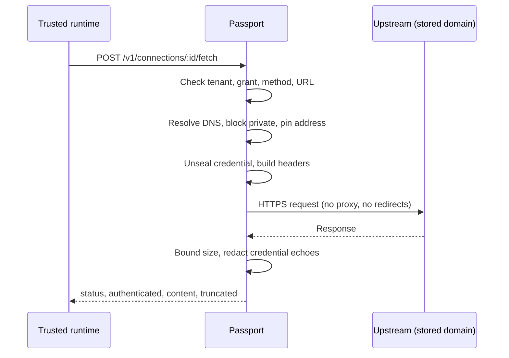

A trusted runtime can send an authenticated HTTPS request through an imported
Passport connection. Passport keeps the credential sealed and applies
destination, method, size, and redaction limits. Related contracts are in the
[Passport API](/docs/standalone/passport-api), [Ryu Passport](/docs/standalone/passport),
and [Passport MCP OAuth API](/docs/standalone/passport-mcp-api) pages.

## Use an imported connection

Send `{ "url": "https://app.example.com/page" }` to the connection's `fetch`
route (`POST /v1/connections/:id/fetch`). Passport resolves that connection in
the bearer token's tenant, opens its credential internally, and performs the
request.

The destination is screened:

- the URL must match the stored domain exactly, use HTTPS on port 443, and omit
  user information and fragments;
- private addresses are blocked, DNS results are pinned, and redirects are not
  followed;
- credential-bearing requests connect directly to the pinned address.
  `HTTPS_PROXY`, `HTTP_PROXY`, and `ALL_PROXY` are not used for them, because a
  proxy would resolve the hostname again outside that screen.

### Bounded responses and redaction

Fetch accepts raw cookie strings or imported JSON containing `cookies` and
`headers`. Only `Cookie` and `Authorization` header names are supported. The
response contains `status`, `authenticated`, `content`, and `truncated`.

`authenticated` reports whether Passport attached a credential to the request.
It is `false` only when an empty `headerTemplates` map suppressed injection. It
does not mean the provider accepted the credential. Check `status`, because a
connection stays `AUTHENTICATED` after its provider session expires until you
import fresh state.

Upstream response headers are omitted, except that HTTP 402 responses may
include a `wwwAuthenticate` array for payment-challenge handling. That array:

- permits at most eight challenge values totaling 16 KiB;
- rejects control characters and reflected credential material;
- never forwards `Set-Cookie`.

A rejected challenge returns HTTP 502 rather than a modified payment
instruction. Response bodies are bounded to 1 MiB and returned text to 20,000
characters.

Redaction covers literal echoes of imported header values. It also covers
individual cookie values and the credential after an `Authorization` scheme
(including a Basic password) when they are at least eight characters long.
Shorter values are redacted only as part of the whole header.

<Callout type="warn">
Redaction matches literal text, so an upstream that encodes or transforms a
credential before echoing it is not covered. Treat provider content as
untrusted.
</Callout>

### Compose credential headers

For raw token imports, `credentialHeaders` can compose the stored value inside
Passport, for example `{ "Authorization": "Bearer vault:api.example.com" }`.
Each template must reference the connection's exact domain. Other secret sources
and cross-domain references are rejected. No decrypted state is returned by
this template operation.

An optional `headers` object carries non-credential request headers. The
combined header budget is 32 headers and 16 KiB. These headers are rejected:

- authentication overrides and duplicate credential headers;
- routing, framing, and method-override headers;
- client-IP and virtual-host override headers such as `X-Real-IP`,
  `True-Client-IP`, `CF-Connecting-IP`, `X-Host`, `X-Original-Host`, and `Via`;
- `Expect`.

Passport sends no `User-Agent` of its own. Some APIs refuse a request without
one; GitHub's API, for example, answers `403` with "Please make sure your
request has a User-Agent header". Send one in `headers`, such as
`{ "User-Agent": "my-agent" }`.

Trusted runtimes can instead provide `headerTemplates`, a map from header names
to ordered parts, for example
`{ "Authorization": [{ "literal": "Bearer " }, { "vault": "api.example.com" }] }`.
A `sensitive` part supplies a secret already resolved by the calling runtime.
Passport never interprets its contents as another template or environment lookup.

- Each header must contain a `vault` or `sensitive` part, with at most 128 parts.
- The same domain, header-name, and size restrictions apply.
- Sensitive parts and composed credential values are included in response redaction.
- Do not combine `headerTemplates` with `credentialHeaders`.
- An empty `headerTemplates` map explicitly suppresses automatic cookie/header
  injection.

`maxContentChars` optionally raises the returned text ceiling from its 20,000
character default up to 1,048,576 characters. The upstream body stays capped
at 1 MiB. Both literal and JSON-escaped credential echoes are redacted in one
pass. Ordinary request-header values are not treated as secret patterns.

### Choose runtime methods

Runtime grants optionally include `allowedMethods`, an array drawn from `GET`,
`HEAD`, `POST`, `PUT`, `PATCH`, `DELETE`, and `OPTIONS`.

| Credential | Fetch methods |
|---|---|
| Runtime grant without `allowedMethods` | `GET` only |
| Runtime grant with an empty `allowedMethods` array | None; metadata reads only |
| Runtime grant with `allowedMethods` | The listed methods |
| Management credential | `GET` only; no write methods |

To send a JSON request, supply `method` and `body` to `fetch` using a runtime
credential explicitly granted that method. JSON bodies are capped at 256 KiB.
`GET` and `HEAD` requests must have no body. An explicit JSON `null` body is
sent as `null`, not treated as an omitted body. The same destination and
redaction restrictions apply.

### Use Passport through Core

When Passport remote mode is configured, Core HTTP tools with `vault:` header
references delegate execution to Passport only after Core screens the target
through the shared HTTPS/private-address egress guard. Passport repeats that
screen, pins the resolved address, and refuses redirects before it opens a
credential-bearing request.

Core resolves `env:` and `secret:` parts under the owning plugin's existing
policy and sends structured parts. Vault values are resolved only inside
Passport. The caller must have an installed-agent runtime credential and bound
profile containing the destination's exact domain.

- Cross-domain vault references are rejected, even when the older embedded
  consumer permitted them.
- Missing configuration or a remote failure never falls back to local vault
  decryption.
- Method grants, response limits, and destination restrictions remain enforced
  by Passport.
- Core retains its HTTP result wrapping, fail-open error envelope, audit
  attribution, and payment-challenge handling.

Core's authenticated `/api/mcp/tools/call` route accepts an exact built-in or
stored agent ID and uses that agent's saved profile bindings. It does not treat
an ID prefix as an agent. A failed agent-store lookup refuses the call instead
of dropping its identity binding. The caller's existing permissions, tool
allowlist, and approval policy still apply.

### Separate administration and runtime access

| Credential | Can do |
|---|---|
| Administration bearer | Access all connections in its tenant (fetch stays `GET` only) |
| Runtime credential | List its profiles' connections through `/v1/runtime/connections` and fetch through them; cannot create, import, delete, or list unrestricted connection state |

The operator binds each runtime credential to one tenant and an explicit list
of profile IDs through `RYU_PASSPORT_RUNTIME_GRANTS` (see
[Start Passport](/docs/standalone/passport#start-passport)). A fetch for a
connection outside its profiles returns `404`.

Core can route `web_fetch.get` calls for agents with bound identity profiles
to Passport. For each call, Core:

1. selects the runtime credential by the installed agent ID;
2. intersects Passport's visible connections with the agent's bound profiles;
3. checks the Gateway identity grant;
4. screens the requested URL before forwarding;
5. records audit attribution.

A Passport failure does not fall back to a local credential. Other identity
consumers and existing local data are not automatically migrated by this
configuration.

In remote mode, Core's existing identity management UI uses Passport for
listing, creating, starting login, importing, polling, and deleting connections.
Core uses a separate operator-configured administration credential for these
node-authorized management operations. Runtime credentials cannot perform them.
Management errors do not switch to Core's local store.

Profiles are isolated by the bearer token's tenant mapping. A connection id
from another tenant therefore cannot be read, imported, or deleted.

