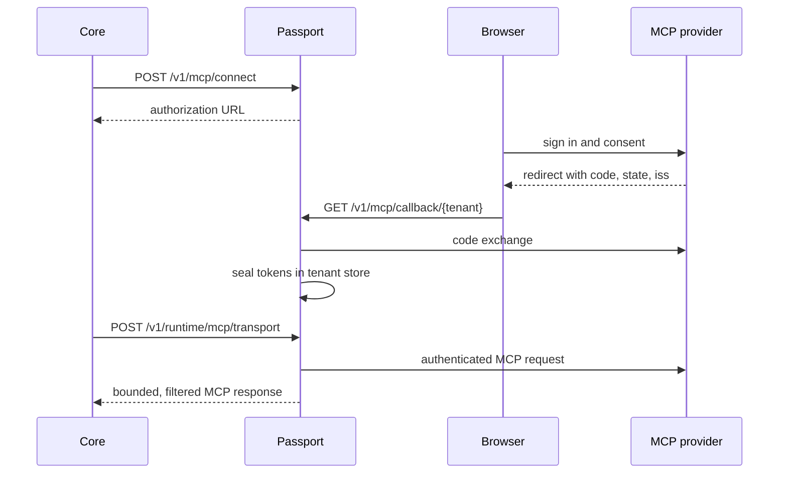

Passport can hold the OAuth tokens that bind an installed agent to an MCP
(Model Context Protocol) server. Passport performs OAuth and keeps the provider
tokens. Core keeps agent identity and policy decisions.

Related contracts are in the [Passport API](/docs/standalone/passport-api),
[Ryu Passport](/docs/standalone/passport), and
[Fetch through a Passport connection](/docs/standalone/passport-fetch-api)
pages.

## MCP OAuth custody

With Passport remote mode configured, the work splits like this. No
provider-token export route exists.

| Passport performs | Core retains |
|---|---|
| MCP OAuth discovery, PKCE, and code exchange | Caller ownership and installed-agent selection |
| Token refresh and revocation | Tool authorization and connection access-level decisions |
| Authenticated Streamable HTTP requests | Gateway identity grants and audit attribution |



### Register callbacks and client metadata

Set `RYU_PASSPORT_PUBLIC_URL` to Passport's public HTTPS origin, with no path,
query, or credentials (for example `https://passport.example.com`), before
starting it. Without it, MCP OAuth connect requests are refused.

- Register the tenant's callback `/v1/mcp/callback/{tenant}` with providers
  that require preregistration.
- Passport also publishes `/v1/mcp/client-metadata/{tenant}`.
- Callback URLs come from service configuration. Runtime requests cannot
  supply a callback.
- Remote connections use hosted callbacks, and explicit loopback mode is
  refused.
- The callback ignores extra authorization-response parameters that providers
  commonly add, such as `scope`, `session_state`, and `error_description`.

Every hosted callback must carry the RFC 9207 `iss` parameter, and it must
match the issuer Passport discovered for that flow. A response without `iss`
fails before Passport exchanges the code, even when the authorization server's
metadata does not advertise `iss` support. Providers that cannot return it
cannot be connected through Passport.

Passport chooses the scopes to request in this order:

1. The scopes named in the server's authentication challenge.
2. Without a challenge scope, the protected resource's published
   `scopes_supported`.
3. The authorization server's list, only when the resource publishes none.

Outside a challenge it also requests `offline_access` when the authorization
server lists it, so providers that issue refresh tokens only for that scope
still return one.

### Bind an agent to an MCP server

Extend each agent's runtime grant configuration with explicit MCP bindings. This
illustrative grant uses a placeholder runtime credential.

```json
{
  "token": "replace-with-a-distinct-runtime-secret",
  "tenantId": "demo",
  "profileIds": ["personal"],
  "allowedMethods": [],
  "mcpBindings": [{
    "binding": {
      "ownerUserId": "local",
      "profileId": "personal",
      "pluginId": "com.example.mail",
      "serverName": "mail",
      "resourceUrl": "https://mcp.example.com/mcp",
      "clientId": null
    },
    "allowedTools": ["mail.read"],
    "allowedResourceUris": [],
    "allowedActions": ["read"],
    "toolActions": { "mail.read": "read" },
    "allowRiskApproval": false,
    "configuration": {
      "transport": "streamable-http",
      "staticHeaders": { "X-Workspace": "workspace-example" }
    }
  }]
}
```

- Use the verified user's ID instead of `local` on shared nodes.
- `clientId` must exactly match the manifest's declared public client ID, or be
  null when none is declared.
- The resource is the exact manifest endpoint, including its path and query.
- Wildcard tool and resource grants are not accepted.

### Classify tool actions and approval

`allowedActions` permits `read`, `write`, and `delete`. Every entry in
`allowedTools` must have exactly one matching `toolActions` entry with one of
those action classes, also included in `allowedActions`. Missing, extra, or
invalid classifications refuse startup.

Passport derives a tool's action from this operator configuration and rejects a
caller's mismatched `action` claim, so a write or delete cannot be relabeled as
a read. The connection's current stored access level is enforced on every call,
including after it is narrowed. Classify parameter-dependent tools by their
strongest permitted effect, or omit them from the grant.

Other grant rules:

- Protocol discovery, initialization, tool and resource listing, and ping
  require read permission.
- Missing `mcpBindings` grants no MCP access. HTTP `allowedMethods` does not
  grant MCP.
- Unknown grant fields, duplicate bindings, or bindings outside `profileIds`
  refuse startup.

#### Risk approval delegation

`allowRiskApproval` defaults to false. A runtime that sends
`riskApproved: true` without this explicit delegation is rejected. Enable
delegation only for a trusted runtime, such as Core with its existing approval
and Gateway checks, that is authorized to assert approval for this binding.

This delegates that assertion to the bearer holder; it does not independently
verify an approval receipt. Even with delegation, approval cannot override a
`read_only` ceiling or permit delete under a `write` ceiling. Core sends no
approval assertion for protocol setup or read calls.

#### How Core applies the policy

Runtime connection metadata includes the granted `toolActions`,
`allowedResourceUris`, and `allowRiskApproval` policy, without credentials.
Core resolves effects from that operator policy using the calling agent's saved
profile scope and the server-verified conversation owner. It refreshes this
metadata for gated calls and approved re-dispatch.

Another account's discovered tools, provider annotations, and tool-name
heuristics do not classify OAuth calls. A requested profile outside the saved
agent bindings is refused.

<Callout type="warn">
Before upgrading an existing grant with callable tools, add explicit
`toolActions` entries. Older grants do not infer actions from tool names or
caller-supplied labels, even when `allowedActions` contains only one action.
Grants without callable tools may retain an empty mapping.
</Callout>

### Pin transport configuration

`configuration` is operator-pinned service configuration, not a runtime frame
argument. Its `staticHeaders` must match the resolved headers in the trusted
MCP server configuration on Core. Core sends only a SHA-256 fingerprint of the
configuration, and Passport applies the pinned values internally after checking
that fingerprint.

Static header rules:

- Header names are normalized case-insensitively; duplicate names are refused.
- At most 32 static headers, totaling 16 KiB.
- Authentication, cookies, host/routing, framing, session, protocol,
  forwarding, and method-override headers are refused, because Passport and the
  transport own those headers.
- Treat static header values as secrets. A literal or JSON-escaped echo of one
  causes the response to be rejected, and the values never appear in
  connection metadata.

The sealed OAuth bundle also binds the static-header fingerprint, so changing
static values requires reconnecting the account. A prior import without this
binding remains usable with empty static headers. Omitted `configuration`
defaults to Streamable HTTP with no static headers.

### Connect the trusted runtime

Configure the node with the Passport service URL, a separate administration
credential, and distinct runtime credentials for installed agents. Bind the same
profile IDs to the installed agent.

Runtime calls require an exact agent, owner, profile, plugin, server endpoint,
and declared client match. A missing grant or unavailable Passport fails the
call without local token decryption.

### MCP routes

| Method | Path | Credential and response |
|---|---|---|
| `POST` | `/v1/mcp/connect` | Tenant administration; authorization URL and flow metadata |
| `POST` | `/v1/mcp/flow` | Tenant administration; owner-scoped flow metadata |
| `POST` | `/v1/mcp/callback` | Tenant administration; complete a flow from a relayed `code`, `state`, `iss`, or `error` |
| `POST` | `/v1/mcp/connections` | Tenant administration; owner/plugin-scoped metadata |
| `POST` | `/v1/mcp/disconnect` | Tenant administration; deletion and revocation booleans |
| `POST` | `/v1/mcp/disconnect-plugin` | Tenant administration; bindings with unconfirmed revocation |
| `POST` | `/v1/runtime/mcp/metadata` | Runtime; exact granted binding metadata or null |
| `POST` | `/v1/runtime/mcp/policy` | Runtime; pinned tool actions and access ceiling, available before login |
| `POST` | `/v1/runtime/mcp/transport` | Runtime; bounded MCP status, protocol headers, and content |
| `POST` | `/v1/runtime/mcp/close` | Runtime; cancel and close only that runtime's bound client session |
| `GET` | `/v1/mcp/callback/{tenant}` | Public; state-bound browser redirect target |
| `GET` | `/v1/mcp/client-metadata/{tenant}` | Public; OAuth client metadata document |

### Transport, sessions, and response limits

Transport is a trusted-runtime operation, not a model-facing tool. It accepts
one JSON-RPC frame and protocol headers for the granted binding. It cannot
choose a tenant, credential, alternate destination, or account.

Passport consumes the provider token internally and returns JSON or
request-scoped SSE content.

| Limit or rule | Value |
|---|---|
| Upstream body | At most 1 MiB |
| Upstream deadline | 30 seconds |
| Passport MCP session lifetime | 30 minutes; does not survive a restart |
| Core transport handle lifetime | Five minutes |
| Provider HTTPS requests, including OAuth discovery and token calls | DNS-pinned, connect directly rather than through environment proxy settings, never follow redirects |

Reflected credential values are rejected. Cookies and redirect locations are not
returned. Passport keeps only the content type, MCP session and protocol
headers, and authentication challenges. Sessions are opaque Passport handles
bound to the same runtime credential and full MCP binding.

### Filter discovery results

Discovery replies (`tools/list`, `resources/list`, and catalog collections in
`server/discover`) expose only granted tool names and exact resource URIs.

- Tools blocked by the current account ceiling are omitted.
- Under the `risk_based` ceiling, a write tool is discoverable only when the
  runtime has approval delegation.
- Tool annotations are projected from the operator-pinned action.
- Pagination cursors remain available even when a filtered page is empty.

JSON and SSE discovery responses retain only the correlated reply and supported
catalog fields. Unrelated response IDs, notifications, and arbitrary extra
inventory fields are not forwarded. Malformed or ambiguous discovery responses
are rejected. Protocol error codes remain intact, with generic error text.

### Use legacy SSE when required

For a legacy HTTP+SSE server, set `configuration.transport` to `sse` and use
the corresponding legacy SSE transport in the trusted Core server configuration.
Passport owns the long-lived authenticated GET and posts frames to the endpoint
announced on that stream.

The announced endpoint must stay on the bound HTTPS origin, and every POST
receives a fresh DNS-pinned egress check. Cross-origin message endpoints and
redirects are refused. Core never receives the upstream message endpoint or the
provider credentials.

The shared incremental SSE parser handles fragmented events, multiline data,
notifications, and response correlation. Individual exchanges have a 30-second
deadline and 1 MiB limit, while the GET may remain open between exchanges.

Normal shutdown and cancellation use the idempotent close route. Close,
reconnect, disconnect, uninstall, and expiry cancel the matching stream and
release its session state. Cancellation can interrupt an in-flight exchange.

### Input and redaction limits

- MCP client handles are limited to 256 bytes in their original
  representation, including surrounding whitespace.
- Credential fetch headers are limited to 32 headers and 16 KiB in total.
- Templates are checked before credential expansion.
- Overlapping response-redaction matches are combined so partial matches cannot
  expose a credential suffix.

### Handle lifecycle and migration

Outstanding OAuth flows expire after ten minutes and must restart after a
Passport restart. Disconnect and uninstall serialize against refresh and
consumption, so a callback that races an uninstall cannot restore deleted
state.

Before switching an existing node, stop its OAuth activity and use Passport's
offline vault import described in
[Import an existing vault](/docs/standalone/passport#import-an-existing-vault).
The import preserves MCP connection IDs, owner/profile bindings, access levels,
and sealed state while resealing credentials for the destination.

- It does not copy pending browser flows.
- Older rows without an exact endpoint/client binding require reconnection.
- Remote mode never automatically imports or reads the retained local token
  copy.
- Rollback requires explicitly switching configuration and does not include
  later Passport changes.

<Cards>
  <DocCard href="/docs/standalone/passport" />
  <DocCard href="/docs/standalone/passport-api" />
  <DocCard href="/docs/standalone/passport-fetch-api" />
</Cards>
