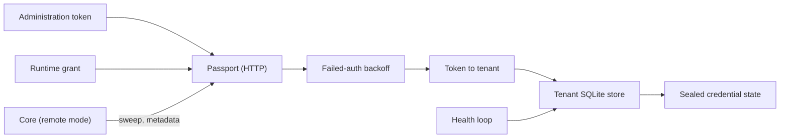
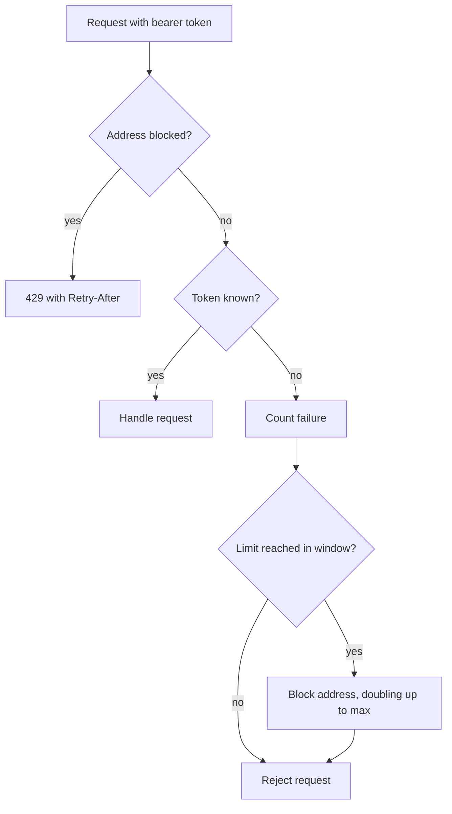

Ryu Passport is the standalone identity service for agent connections. It stores
per-domain cookies, tokens, or session state with the same `ryu-vault` crate
that Core uses. The HTTP boundary and tenant authentication run in Passport's
own process.

Passport is not a browser engine, and it does not give credentials to a model.
Its API returns profile and connection metadata only. Credential state is
sealed before storage, and only a governed runtime with an explicit
identity-read path can use it.

<Figure name="passport" />

<Callout type="warn">
Hosted Ryu Passport is in **early access**. Ryu enables it one organization at
a time, and it is not open for new organizations yet.

Its source and builds are not published in the public Ryu repository, as
crates, or as a binary or container image, so the self-hosting steps on this
page apply only to an early-access source checkout. The agent passport and identity vault built into
Ryu Core are separate and keep working.
</Callout>

Every management and runtime request passes the failed-authentication backoff
and the bearer-token check before it reaches the caller's tenant store.



## Start Passport

A local headless run provides a master key explicitly and keeps the data
directory isolated.

```sh
RYU_PASSPORT_API_TOKEN="$(openssl rand -base64 32)" \
RYU_PASSPORT_TENANT_ID=demo \
RYU_PASSPORT_DATA_DIR=/var/lib/ryu-passport \
RYU_MASTER_KEY=base64-32-byte-key \
RYU_KEYCHAIN=off \
cargo run --manifest-path apps/passport/Cargo.toml
```

The default bind is `127.0.0.1:8093`. Set `RYU_PASSPORT_HOSTNAME` and
`RYU_PASSPORT_PORT` only when the service has an authenticated network boundary
and TLS in front of it.

On a non-loopback bind, Passport refuses to start unless every administration
and runtime token is at least 32 characters long with at least eight distinct
characters. Generate tokens with `openssl rand -base64 32`.

Passport also backs off client addresses that keep presenting unknown bearer
tokens (see
[Failed authentication backoff](/docs/standalone/passport#failed-authentication-backoff)),
but keep a request rate limit at the TLS proxy in front of it as well.

| Variable | Purpose |
|---|---|
| `RYU_PASSPORT_API_TOKEN`, `RYU_PASSPORT_TENANT_ID` | One tenant administration token and its tenant id (`default` when unset) |
| `RYU_PASSPORT_API_TOKENS` | Several tenants: a JSON object mapping tenant ids to distinct tokens, used instead of the pair above |
| `RYU_PASSPORT_RUNTIME_GRANTS` | Profile-scoped runtime credentials: a JSON array of grants, each with `token`, `tenantId`, `profileIds`, and optional `allowedMethods` and `mcpBindings` |
| `RYU_PASSPORT_PUBLIC_URL` | Passport's public HTTPS origin; required for [MCP OAuth](/docs/standalone/passport-mcp-api) |
| `RYU_PASSPORT_DATA_DIR` | Data directory; one SQLite store per tenant is created below it |
| `RYU_PASSPORT_HEALTH_INTERVAL` | A `humantime` duration such as `15m` replacing the hourly sweep |
| `RYU_PASSPORT_TRUSTED_PROXIES` | IP addresses or CIDR ranges of the reverse proxies in front of Passport; empty by default |
| `RYU_PASSPORT_AUTH_FAILURE_LIMIT` | Unknown bearer tokens one client address may present per window before it is blocked (default `30`; `0` turns the backoff off) |
| `RYU_PASSPORT_AUTH_FAILURE_WINDOW_SECONDS` | The counting window, and the first block's length (default `60`) |
| `RYU_PASSPORT_AUTH_FAILURE_MAX_BLOCK_SECONDS` | The longest block (default `900`) |
| `RYU_PRODUCT_DASHBOARD_URL` | Optional; when set, `GET /` redirects browsers there |

Give agents runtime grants rather than the tenant administration token. A
minimal grant that may only read through one profile's connections is
`[{"token":"…","tenantId":"demo","profileIds":["personal"]}]`. The
[fetch guide](/docs/standalone/passport-fetch-api) and
[MCP guide](/docs/standalone/passport-mcp-api) describe `allowedMethods` and
`mcpBindings`.

When `RYU_PRODUCT_DASHBOARD_URL` is unset or empty, `GET /` returns a short
JSON description with the service name, version, and the `/health` path. Set it
to your own console or landing page to redirect browsers there instead. Ryu's
hosted deployment sets it to the Ryu dashboard.

### Failed authentication backoff

Management and runtime routes count bearer tokens that match no configured
administration token or runtime grant. With the defaults:

- A client address that presents 30 unknown tokens within a minute is blocked
  for a minute.
- Each further block for that address doubles, up to 15 minutes.
- While blocked, the address gets `429 Too Many Requests` with a `Retry-After`
  header in seconds. Passport refuses the request before comparing its token,
  so even a valid token from that address waits.
- IPv6 clients are grouped by their `/64`.

Requests without a bearer token, and valid tokens sent to a route they are not
allowed to use, are not counted. Health, the redirect, and the public MCP OAuth
callback and client-metadata routes are never blocked.

The counts live in process memory and reset on restart. The backoff slows
online guessing, but it does not replace long random tokens.



#### Clients behind a reverse proxy

The client address is the TCP peer, and `X-Forwarded-For` is ignored by
default. Behind a reverse proxy, every request arrives from the proxy, so one
client retrying a stale token could block every client.

Add the proxy's address or network to `RYU_PASSPORT_TRUSTED_PROXIES`, for
example `127.0.0.1` for a proxy on the same host or `172.16.0.0/12` for a
Docker bridge network. Passport then uses the nearest `X-Forwarded-For` hop
that is not itself a trusted proxy. It ignores anything further left, because
the client wrote it.

List only proxies that append the connecting address to `X-Forwarded-For` or
overwrite it. An invalid entry or setting stops startup. Passport logs one
warning when `X-Forwarded-For` arrives from a peer that is not trusted.

### Master-key custody

Passport takes its master key from `RYU_MASTER_KEY` or, when available, the OS
keychain. When neither is available, it refuses to start or to run
`--import-vault`, instead of generating a `master.key` file inside the data
directory.

A key file stored beside the tenant stores means any copy or backup of that
directory can decrypt them. If you accept that trade-off, for example on a
disposable test host, set `RYU_PASSPORT_ALLOW_FILE_KEY=1`. Passport then logs a
warning naming the key file at startup.

New data directories are created owner-only. Passport restricts each tenant
directory to the service user and its SQLite files to owner read and write,
because tenant stores also hold plaintext metadata such as domains and profile
ids.

### Sealed state is bound to its tenant and connection

All tenants in one process share the master key, but each sealed value is bound
to the tenant and connection it was written for. Passport derives a separate
encryption key for each tenant from the master key, and the encryption also
authenticates:

- for connection state, the tenant id, the connection id, its profile, and the
  domain the credentials are sent to;
- for MCP OAuth tokens, the owner, profile, plugin, server, resource, and
  issuer.

Sealed state copied into another tenant's store or another connection, or left
in a row whose domain was edited, does not decrypt. Passport refuses to use it,
and the [fetch route](/docs/standalone/passport-fetch-api) returns `409` asking
for the state to be imported again. A tenant database moved into another
tenant's directory stops startup.

Passport never accepts credential state in the earlier, unbound format while it
runs. A tenant store with any such value refuses to start until an operator
converts it. Anything the store records about its own conversion could be
erased by the same person who plants a value.

The tenant id is part of every binding. Keep it stable, because a store does
not open under a different tenant id.

### Upgrade an existing tenant store

Tenant stores written by an earlier Passport release need a one-time conversion
after the upgrade. Passport refuses to start with such a store and names the
command. Stop Passport, then run this once per tenant, with the same master key
and data directory the service uses:

```sh
ryu-passport --migrate-legacy-state --tenant demo
```

The command re-encrypts every stored value with its binding in one transaction
and records the conversion. It handles damaged values like this:

- A value it cannot open, or one that is not encrypted at all, is never
  converted. It is cleared, its connection returns to `NEEDS_AUTH` (or
  reconnect for MCP OAuth), and the command logs the connection id, so one
  damaged row does not keep the tenant from starting.
- If no value opens at all, the master key is almost certainly wrong, and the
  command changes nothing.
- Running it again on a converted store does nothing.

An earlier Passport release cannot read a converted store, so keep a backup
from before the upgrade if you might downgrade.

<Callout type="warn">
Run the conversion only right after an upgrade. If Passport later reports
unconverted state in a store you already converted, someone changed the store.
Do not run the command, because it would accept whatever was planted. Restore a
trusted backup or import the source vault again instead. The command also
refuses a store that still holds converted values but has lost its conversion
record.
</Callout>

The binding stops sealed state from being moved. It does not make the data
directory safe to expose:

- Anyone with the master key can still decrypt every tenant. Run separate
  Passport processes with separate master keys when tenants must not share key
  custody.
- Someone who can write a tenant store can delete rows, edit plaintext metadata,
  or roll a connection back to an older value sealed for that same connection,
  such as a credential you have since replaced.
- A backup taken before the upgrade holds unbound values. Someone who can
  replace a tenant store with such a copy, or with a store built from it, and
  then get an operator to run the conversion, can move those older values
  between connections. Protect such backups like the credentials they contain
  and delete them once you no longer need to downgrade.

Keep write access to the data directory, its backups, and restore pipelines
limited to the Passport service and its operators.

## Import an existing vault

Passport provides an offline `--import-vault SOURCE_DB --tenant TENANT_ID`
command. Run it before starting the destination tenant, with the source vault's
matching master key and the destination Passport data directory configured.

The import:

- takes a consistent SQLite snapshot and keeps the source for recovery;
- preserves connection IDs;
- verifies and reseals stored credentials, binding each one to the destination
  tenant, so the tenant starts without a separate conversion;
- refuses to overwrite an existing tenant store;
- is all or nothing. A wrong encryption key, a credential that does not open
  with the key, or one that is not encrypted at all stops the import before
  anything is published.

The source must be a Core vault or a store from an earlier Passport release. A
converted Passport store is refused.

After import, configure runtime credentials and the Core Passport handoff.
Import does not migrate every Core identity consumer automatically. Keep the
source backup until the required consumers have switched; reverting to it will
not include later Passport writes.

## What Passport owns

| Concern | Passport behavior |
|---|---|
| Identity state | Per-profile, per-domain connections and login lifecycle |
| At-rest protection | `ryu-crypto` envelope under a per-tenant key, bound to the tenant and connection, before SQLite writes |
| Tenant boundary | Bearer token mapped to an isolated tenant store |
| Re-authentication | `NEEDS_AUTH` state plus a manual login/import flow |
| Health | Scheduled check that manual connections still have stored credential state; it does not detect upstream expiry |

Manual-import health checks read the connection's own tenant store. They do
not contact the provider, so they cannot detect a cookie expiring or a token
being revoked upstream. An authenticated status records imported state; it is
not proof that the provider still accepts that state.

## Core in remote mode

Passport can run beside Core, Connect, or another agent runtime. The owning
runtime decides when an identity read is allowed and how that read is audited;
Passport remains the durable identity store.

When Core is configured to use Passport, Core changes in three places:

| Core path | Remote-mode behavior |
|---|---|
| Identity-health scheduler job | Requests a sweep of the configured Passport tenant with the administration credential. A rejected or unavailable sweep fails the job; it does not fall back to Core's older local store. |
| Domain-based connection-needed signal | Reads Passport metadata. A missing login requests human action; an unavailable identity service pauses the action instead of consulting an older local vault. It does not export credential state or start a login. |
| Tools that only consult login state | Use the calling agent's Passport runtime credential and bound profile order, without decrypting a local copy. Missing runtime configuration or a failed lookup pauses the action. |

Passport also runs its own periodic health loop, so Core does not need to stay
running. Credential-consuming calls require the Passport execution adapter; the
metadata path never returns credential material.

## Pricing

Ryu-hosted Passport is charged hourly to the organization's Ryu credits,
spending the plan's included credit pool first.

| Meter | Price | Free each month |
|---|---|---|
| Stored credentials: connections and MCP OAuth credentials | $0.10 per connection-month (30 days) | 5 connection-months per organization |
| Upstream fetches | $0.10 per 1,000 fetches | 10,000 fetches per organization |

A connection-month is one stored credential kept for 30 days, so a credential
kept for half of that counts as half a connection-month. Upstream fetches are
authenticated fetches and runtime MCP calls that got a response from the
provider. The free amounts reset at the start of each calendar month (UTC).

The [usage report](/docs/standalone/passport-api#usage-report) shows exactly
what is counted. A self-hosted Passport serves the same report but is never
billed by Ryu.

### When credits run out

When an organization runs out of Ryu credits, a Ryu-hosted Passport refuses
upstream calls and new connections with `402` and
`"code": "insufficient_credits"`, for administration and runtime tokens alike.
That covers:

- authenticated fetches and runtime MCP calls;
- creating connections;
- starting or completing an MCP OAuth connection.

Listing, reading, and deleting connections, the usage report, and health checks
keep working, so you can review and clean up. Calls are accepted again shortly
after credits are added.

If Passport cannot reach Ryu's billing service, it keeps serving, and after 15
minutes it stops refusing until it hears back. A self-hosted Passport never
refuses calls for credits.

If Passport cannot store usage, for example because its disk is full, it
refuses the same calls with `503` and `"code": "metering_unavailable"` until it
can, rather than run calls it cannot count. See
[usage cannot be recorded](/docs/standalone/passport-api#usage-cannot-be-recorded).

<Cards>
  <DocCard href="/docs/standalone/passport-api" />
  <DocCard href="/docs/standalone/passport-fetch-api" />
  <DocCard href="/docs/standalone/passport-mcp-api" />
  <DocCard href="/docs/standalone/connect" />
</Cards>
