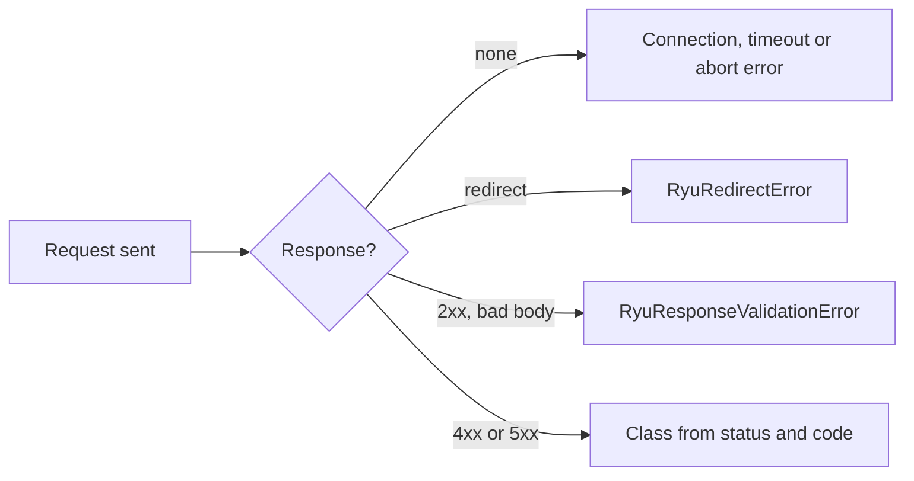

The standalone services answer errors in several body shapes. `@ryuhq/services`
reads all of them and gives you one class, `RyuError`. Branch on `code`,
which is stable; fall back to `status` for a code you do not recognize.

<Callout type="info">
@ryuhq/services is not yet published to npm; it requires @ryuhq/client 0.4 or later, which is also not yet on npm (latest is 0.3.0).
</Callout>

<Callout type="info">
The `ryu-sdk` Python package is not yet published to PyPI, so the Python client cannot be installed outside Ryu either.
</Callout>

```ts tab="Node"
import { isRyuError, Ryu, RyuRateLimitError } from "@ryuhq/services";

const ryu = new Ryu();

try {
  await ryu.box.list();
} catch (error) {
  if (error instanceof RyuRateLimitError) {
    console.error("slow down for", error.retryAfterSeconds, "seconds");
  } else if (isRyuError(error)) {
    console.error(error.service, error.status, error.code, error.requestId);
  }
}
```

```python tab="Python"
from ryu_sdk.services import Ryu, RyuError, RyuRateLimitError

ryu = Ryu()

try:
    ryu.box.list()
except RyuRateLimitError as error:
    print("slow down for", error.retry_after_seconds, "seconds")
except RyuError as error:
    print(error.service, error.status, error.code, error.request_id)
```

With `new Ryu({ result: "object" })`, the same `RyuError` arrives as `error`
in `{ data, error, meta }` instead of being thrown:

- A failed `ryu.webhooks.verify()` resolves to `{ data, error, meta }` with a
  `RyuWebhookVerificationError` as `error`.
- Iterators and streams throw in both modes.
- The standalone verifiers from `@ryuhq/services/webhooks` always throw.

## Python differences

- Fields are snake_case: `retry_after_seconds`, `request_id`, `rate_limit`,
  `auth_challenge`, `idempotency_key`.
- Every class below is an exception class with the same name.
- `error.to_dict()` returns the same camelCase object as `toJSON()`, so logs
  from both SDKs line up.
- A `RyuError` keeps every field through `pickle` and `copy`, so it reaches
  you intact from a process pool or a task queue worker.
- A request body that JSON cannot hold fails before anything is sent, as
  `RyuInvalidRequestError` with the code `invalid_request_body`. `datetime`
  and `date` values are sent as ISO 8601 strings.
- A header value that `fetch` would refuse (a character outside Latin-1, or a
  carriage return, line feed or NUL) fails before anything is sent, with the
  code `invalid_request_header`. Other Latin-1 text is sent as Latin-1 bytes.

## Unsafe ids

Before sending, both SDKs refuse an id that would change which route a
request reaches. An empty id, or `.` or `..` in a path (for example
`ryu.box.previews.delete("b", "..")`), is a `RyuInvalidRequestError` with the
code `invalid_id` and `status` `0`.

If you use `@ryuhq/client` directly, the same refusal is a `RyuPathIdError`
(Box, Notify and Mail), a `MessagingError` or a `ManagedAgentsError`, each with
the code `invalid_id` and `status` `0`.

To check a path yourself, `@ryuhq/client` exports the scan both TypeScript
packages run (`@ryuhq/services` runs it on every request):

- `isSafeRequestPath("/v1/boxes/b/previews/..")` returns `false`.
- Pass the request path, such as `/v1/boxes/b?x=1`, not a full URL.
- A trailing slash counts as an empty segment, so `/v1/boxes/` returns `false`.

Both SDKs read at most 64 KiB of an error response's body.

## Fields

| Field | Meaning |
|---|---|
| `code` | A stable machine code: the service's own code when it sent one, otherwise the default for the status. |
| `status` | The HTTP status. `0` when no response arrived: configuration, connection, timeout, or abort. |
| `message` | The service's human-readable message, followed by ` Hint: ` and the hint when the error has one. See [Messages end with the hint](/docs/standalone/sdk/errors#messages-end-with-the-hint). |
| `service` | Which namespace failed, such as `notify` or `managedAgents`. |
| `requestId` | `X-Request-ID`, or the request id in the body; `null` when the service sends neither. Quote it when you contact support. See [Request ids](/docs/standalone/sdk/errors#request-ids). |
| `retryable` | Whether repeating the same request could succeed. The SDK already retried when that was safe. |
| `retryAfterSeconds` | The wait the server asked for, from `Retry-After` or a body hint. |
| `rateLimit` | The parsed `RateLimit` and `RateLimit-Policy` headers, when sent. |
| `deprecation` | The parsed `Deprecation`, `Sunset`, and `Link` headers, when sent. |
| `details` | Service-specific extras, such as validation `fields`. |
| `title`, `type`, `docs`, `hint` | Problem details fields, or the service's envelope type such as `notify.error`. |
| `authChallenge` | `WWW-Authenticate` from a `401`. |
| `envelope` | Which body shape the service used, or `client` when no server was involved. |
| `method`, `url` | The request, with the query string removed. |
| `idempotencyKey` | The `Idempotency-Key` the request carried, if any. |
| `attempts` | How many HTTP attempts the call made. |

### Request ids

The Ryu control plane (Mail, Messaging, Managed Agents) sends `X-Request-ID`
on every response. A direct HTTP call can send its own id, except to Managed
Agents, which always assigns its own:

- An `X-Request-ID` of up to 128 characters, starting with a letter or digit
  and made of letters, digits, `.`, `_`, `:` or `-`, comes back unchanged.
- An id that starts with `req_` is replaced with a new one, because that
  prefix is reserved for ids the server assigns.

### Default hints

When the service sent no `hint`, the SDK fills in a default for the cases
below. A default hint never contains a key, a path, or a query string.

One case replaces a hint the service did send. When the error's problem `type`
(or its `docs` link) names a different service's standalone API page, the
reply came from that other service. Its own hint and docs link, which name its
settings, are replaced as well.

| Failure | Default `hint` |
|---|---|
| `401` | The service did not accept the credentials, naming every credential variable the call sends with the matching `new Ryu()` option, such as `RYU_NOTIFY_API_KEY` (`notify.apiKey`). Managed Agents and Messaging name `RYU_API_KEY` and `RYU_ORGANIZATION_ID` (`apiKey` and `organizationId`). When no credential was sent at all, such as Ryu Gateway without `RYU_GATEWAY_TOKEN`, the hint says so and names the variable to set. |
| `403` | The key was accepted but is not allowed to do this; check its scopes or tenant, and the key variable it names. Managed Agents gets no default `403` hint, because its `ryu_` key is account-wide, and neither does Ryu Connect, because a Connect runtime key carries no scopes. |
| Connect `403` for a grant the operator has not given | The Connect has not granted that tool (or its account), toolkit or Composio connection to your tenant (codes `tool_denied`, `toolkit_denied`, `connection_denied`). `tools.search` lists the tools it grants. The operator sets grants where Connect runs, with `allowedTools` in `RYU_CONNECT_MCP_SERVERS` or with `RYU_CONNECT_COMPOSIO_BINDINGS`, and a different key will not help. |
| `connection_error` | The service could not be reached at its origin (scheme, host, and port only); check its URL variable, such as `RYU_NOTIFY_URL`, or run `ryu-services doctor --check`. The Python hint names the URL variable only and leaves out the `ryu-services doctor` sentence. |
| `timeout` | The service at its origin did not respond in time; raise `timeoutMs` if the call is slow, check its URL variable, or run `ryu-services doctor --check`. The Python hint suggests raising `timeout` and names the URL variable, and leaves out the `ryu-services doctor` sentence. |
| An error from a different service | `<VAR>_URL points at Ryu <Other>, not Ryu <This>`. The URL variable, such as `RYU_NOTIFY_URL`, holds another Ryu service's URL (for example Box's), so set it to this service's server. Managed Agents, Messaging and Mail share the control-plane URL, so an error from one of them naming another is not treated as a wrong URL. |
| Connect `503` for a lane the operator has not configured | The Connect has no tool lane, MCP upstream, Composio lane or skill catalog configured (codes `upstream_unconfigured`, `upstream_invalid`, `mcp_unconfigured`, `native_composio_unavailable`, `skills_unavailable`). The hint names the setting the operator sets where Connect runs; for `upstream_unconfigured` it names the native settings first (`RYU_CONNECT_MCP_SERVERS` or `RYU_CONNECT_COMPOSIO_BINDINGS`), then the single-tenant compatibility-mode ones (`RYU_CONNECT_CORE_URL` for search, `RYU_CONNECT_GATEWAY_URL` for execution), and says that another key or URL, or a retry, will not help. |
| `429` after failed authentication | The service blocks an address for a while after repeated failed authentication, and refuses even a correct key until the block ends. Wait for the `Retry-After` delay, then fix the key before you retry. The Notify service does this; its message says "Too many failed authentication attempts". |

Configuration errors get hints too:

- A missing value gives a `RyuConfigurationError` whose hint names every
  variable to set and the `new Ryu()` option for each.
- A URL variable that is not an absolute `http` or `https` URL gives a
  `RyuConfigurationError` with code `invalid_url`. It names the variable but
  not its value.
- When the value has no scheme, such as `127.0.0.1:8021` or `localhost:8021`,
  the hint says to add one, for example `http://127.0.0.1:8021`.
- The value must spell `http://` or `https://` in full, so
  `http:127.0.0.1:8021` and `http:/127.0.0.1:8021` are rejected too.

`knownServerHint(service, status, message, problem?)` (Python
`known_server_hint(service, status, message, problem=None)`) returns the
default hint and docs link for the server replies above, or `null` (`None`).
`problem` holds the error body's `code`, `docs` and `type`, which the
wrong-service and Connect hints read.

The message alone covers the Notify backoff `429` and the self-hosted Mail
server's `email transport is not configured`.

### Messages end with the hint

When an error has a hint, `error.message` ends with ` Hint: ` and the hint, so
the message alone says what to do next. That includes `String(error)`, a log
line, and an uncaught-error trace. In Python, `str(error)` and `error.message`
do the same.

- A period is added first when the message does not already end a sentence.
- The hint is not added again when the message already ends with it.
- Only the `hint` field is added, never the `docs` field, the URL, headers, or
  a key, though a hint's own text can link to a docs page.
- `error.code` and `error.hint` are unchanged.

`hint` is read-only in both SDKs. For another hint, make a copy with
`withRyuErrorFields(error, { hint })` (Python
`with_ryu_error_fields(error, hint=...)`), which rebuilds the message.
Import it from `@ryuhq/services/errors` (Python `ryu_sdk.services.errors`); the
package root does not export it.

```ts tab="Node"
import { messageWithoutHint, Ryu } from "@ryuhq/services";

const ryu = new Ryu({ result: "object", env: false });
const { error } = await ryu.notify.publish({ title: "Hello" });
if (error) {
  // error.message => "Ryu Notify is not configured: set RYU_NOTIFY_API_KEY. Hint: Set RYU_NOTIFY_API_KEY (or pass notify.apiKey to new Ryu()). See https://docs.ryuhq.com/docs/standalone/sdk/notify."
  // error.hint    => "Set RYU_NOTIFY_API_KEY (or pass notify.apiKey to new Ryu()). See https://docs.ryuhq.com/docs/standalone/sdk/notify."
  messageWithoutHint(error); // "Ryu Notify is not configured: set RYU_NOTIFY_API_KEY."
}
```

```python tab="Python"
from ryu_sdk.services import Ryu, message_without_hint

ryu = Ryu(result="object", env=False)
data, error, meta = ryu.notify.publish({"title": "Hello"})
if error:
    # str(error) == "Ryu Notify is not configured: set RYU_NOTIFY_API_KEY. Hint: Set RYU_NOTIFY_API_KEY (or pass notify.api_key to Ryu()). See https://docs.ryuhq.com/docs/standalone/sdk/notify."
    message_without_hint(error)  # "Ryu Notify is not configured: set RYU_NOTIFY_API_KEY."
```

Use `messageWithoutHint(error)` (Python `message_without_hint(error)`) when
you print the hint on its own line. `ryu-services` does that. It prints the
message without the hint, then a `hint:` line. The agent tools and the
`ryu-services` MCP tools return `message` without the hint and `hint` as its
own field.

`messageWithoutHint` gives back the exact original message only for the error
object itself. For a plain copy (a parsed `toJSON()` result, `structuredClone`,
or `postMessage`), it can only remove the ` Hint: …` suffix, so the period added
before the hint stays: `bad key` comes back as `bad key.`.

`error.toJSON()` returns these fields as a plain object, with `message`
ending in the hint as above. It never contains keys or request headers, so it
is safe to log.

## Classes

Each failure is a subclass of `RyuError`, chosen from the status and code.
`isRyuError(value)` also recognizes errors from another copy of the package.



| Class | When | Default code |
|---|---|---|
| `RyuConfigurationError` | A URL or key is missing or invalid, or a key was passed in a browser. | `configuration_error` |
| `RyuConnectionError` | No response: DNS, TCP, TLS, or a reset connection. | `connection_error` |
| `RyuTimeoutError` | `timeoutMs` passed before the response headers arrived. | `timeout` |
| `RyuAbortError` | Your `AbortSignal` fired. Never retried. | `aborted` |
| `RyuRedirectError` | The service answered with a redirect. The SDK never follows one, so a key never changes origin. | `redirect_refused` |
| `RyuInvalidRequestError` | `400`, `413`, `415`, or `422`. | the status default, such as `bad_request` |
| `RyuAuthenticationError` | `401`. The key is missing, malformed, or revoked. | `unauthenticated` |
| `RyuPaymentRequiredError` | `402`. Billing refused the request. Never retried. | the service's code, else `client_error` |
| `RyuPermissionError` | `403`. The key is valid but lacks a permission or feature. | `forbidden` |
| `RyuNotFoundError` | `404`. | `not_found` |
| `RyuConflictError` | `409`, including idempotency conflicts and stale revisions. | `conflict` |
| `RyuRateLimitError` | `429`. Slow down. | `rate_limited` |
| `RyuQuotaExceededError` | A persistent quota (`quota_exceeded`), not a burst limit. Extends `RyuRateLimitError`. Never retried. | `quota_exceeded` |
| `RyuUnavailableError` | `503`, or a feature that is off or not configured: `managed_agents_disabled`, `not_configured`, `metering_unavailable`. | `service_unavailable` |
| `RyuServerError` | Any other `5xx`. | the status default, such as `internal_error` |
| `RyuResponseValidationError` | A `2xx` whose body is not the JSON the SDK expects. | `invalid_response` |
| `RyuWebhookVerificationError` | A webhook delivery failed verification. | `webhook_invalid_signature` and the other `webhook_` codes |
| `RyuError` | Anything else, such as an unlisted `4xx`. | the status default |

Status defaults follow Ryu's problem details:

- `400 bad_request`, `401 unauthenticated`, `403 forbidden`, `404 not_found`,
  `405 method_not_allowed`, `409 conflict`, `410 gone`,
  `413 payload_too_large`, `415 unsupported_media_type`,
  `422 unprocessable_content`, and `429 rate_limited`;
- `500 internal_error`, `502 bad_gateway`, `503 service_unavailable`, and
  `504 gateway_timeout`;
- `client_error` and `server_error` for the rest.

## Where the fields come from

The SDK reads each service's error body once and maps it to the same fields.
The body shapes explain what `envelope` says.

Unless a call sets its own `Accept`, the SDK sends
`Accept: application/problem+json, application/json;q=0.9, */*;q=0.8`.
Services that negotiate RFC 9457 then answer errors as problem details, and
`envelope` is `problem+json`. The others, and older servers, keep the body
below.

Problem details from Notify, Box, Connect, Passport, and Sites keep their
service's own members (`code`, `requestId`, a nested `error` with `details` or
`fields`). So `code`, `requestId`, and `details` come out the same either way,
and `docs` links the code's documentation.

| Service | Error body without problem details | `code` from | `requestId` from |
|---|---|---|---|
| Managed Agents | `{ error: { code, message, requestId, details } }` | `error.code` | the body |
| Mail, hosted | Problem details, `{ error, code }`, or `{ message }` | `code`, else the status default | `X-Request-ID` |
| Mail, self-hosted | `{ error, code }` | `code`, else the status default | none |
| Notify, Box | `{ ok: false, type, code, message, requestId, error: { … } }` | `error.code` | the body or `X-Request-ID` |
| Gateway | `{ error: { message, type, code } }` | `error.code`, else `error.type` | `X-Request-ID` |
| Connect | `{ code, error }` | `code` | `X-Request-ID` |
| Passport | `{ error }`, `{ code, error, message }`, or text | `code`, else the status default | none |
| Sites | `{ error: { code, message, fields } }` | `error.code` | `X-Request-ID` on the management listener |
| Messaging | `{ error, message, … }`; the other members become `details` | `error` | `X-Request-ID` |

A body that is not JSON keeps its first 512 characters as the message, and an
empty body uses the status default. Each quickstart lists the codes its
service sends; start with [Managed Agents](/docs/standalone/sdk/managed-agents#errors),
[Mail](/docs/standalone/sdk/mail-errors#errors), or [Notify](/docs/standalone/sdk/notify-errors#errors).

## Retryable and final codes

The SDK retries a failure only when repeating the request is safe; see
[Retries and idempotency](/docs/standalone/sdk/retries-and-idempotency). These
codes are never retried, because waiting does not change them:

- quota and billing: `quota_exceeded`, `insufficient_credits`,
  `spend_limit_reached`, and any `402`;
- a feature that is off or not configured: `managed_agents_disabled`, `feature_disabled`,
  `not_configured`, `metering_unavailable`;
- deployment configuration: `backend_disabled`, `secrets_unavailable`,
  `driver_not_safe`, `upstream_unconfigured`, `upstream_invalid`,
  `skills_unavailable`;
- stream limits: `too_many_streams`, `stream_limit_reached`;
- others: `outcome_unknown`, `provider_refused`, `address_change_cooldown`,
  `idempotency_key_resource_deleted`.

When the SDK gives up, `error.attempts` says how many requests it sent, and
`error.retryAfterSeconds` keeps the wait the server asked for, so you can
schedule a later try yourself.

## Configuration errors

A missing URL or key fails the first call to that service, not `new Ryu()`.
The error's `details.missing` names the variables, `hint` says what to set,
and `docs` links the service's quickstart:

```ts tab="Node"
const ryu = new Ryu({ result: "object", env: false });
const { error } = await ryu.notify.publish({ title: "Hello" });
// error.code === "configuration_error"
// error.details => { missing: ["RYU_NOTIFY_API_KEY"] }
```

```python tab="Python"
ryu = Ryu(result="object", env=False)
data, error, meta = ryu.notify.publish({"title": "Hello"})
# error.code == "configuration_error"
# error.details == {"missing": ["RYU_NOTIFY_API_KEY"]}
```

[Configure](/docs/standalone/sdk#configure) lists each service's variables
and default URL.

## Read next

<Cards>
  <DocCard href="/docs/standalone/sdk/retries-and-idempotency" />
  <DocCard href="/docs/standalone/sdk/webhooks" />
</Cards>
