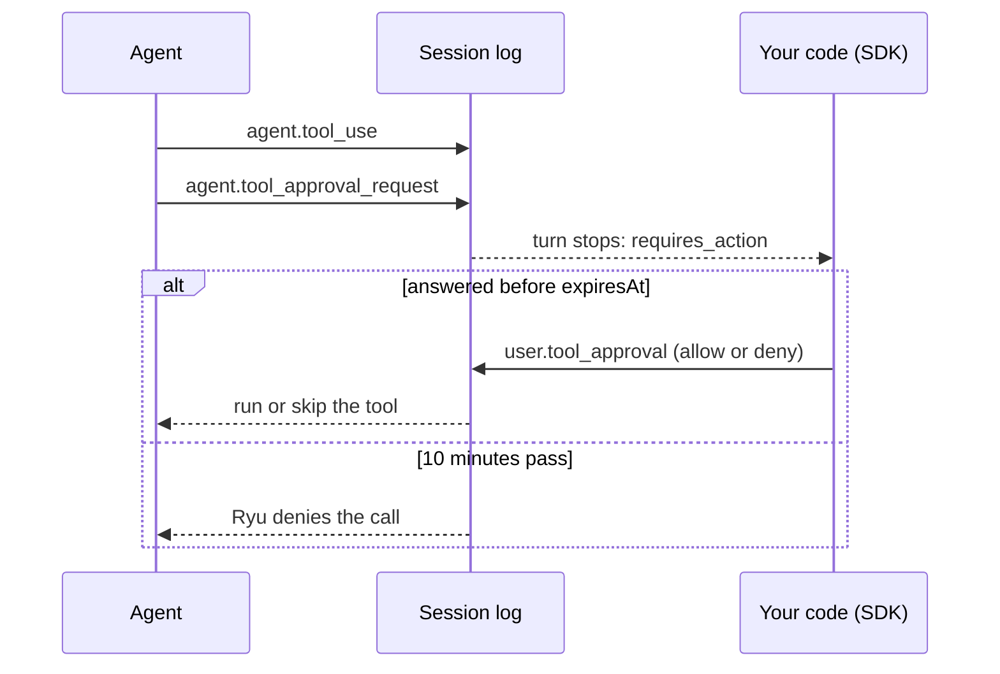

<Callout type="warn">
Preview: off until your organization turns on the Managed Agents feature.
</Callout>

This page answers the tool approval requests of a Managed Agents session from
code. The samples use the `ryu` client from the
[Managed Agents SDK quickstart](/docs/standalone/sdk/managed-agents#first-call-with-the-sdk).
To answer from a terminal or an MCP client, see
[Managed Agents CLI and MCP](/docs/standalone/sdk/managed-agents-cli-mcp).

<Callout type="info">
@ryuhq/services is not yet published to npm; it requires @ryuhq/client 0.4 or later, which is also not yet on npm (latest is 0.3.0).
</Callout>

<Callout type="info">
The `ryu-sdk` Python package is not yet published to PyPI, so the Python client cannot be installed outside Ryu either.
</Callout>

## Tool approvals

A builtin tool or an MCP server declared with `"requireApproval": true` asks
before each call.

- Any agent accepts the flag, but only the `anthropic` backend supports
  interactive approvals. Starting a session of such an agent in an environment
  on another backend gets `422 unsupported_for_backend`.
- On the `anthropic` and `openai` backends, a provider approval request for a
  tool that did not set `requireApproval` is denied by Ryu and recorded as a
  `session.error` with the code `tool_approval_unsupported`.

See [tool approvals](/docs/standalone/managed-agents-events#tool-approvals)
for the events.

When the agent wants to run such a tool, the log gets the `agent.tool_use`
with the call's input, then an `agent.tool_approval_request`, and the turn
stops with `requires_action`. Answer before the request's `expiresAt` (10
minutes after it was appended); after that Ryu denies the call.



## Answer with a handler

The SDK never answers for you. Pass `onToolApproval` to `sessions.run()` or
`sessions.follow()` to decide each request; the follow sends your answer and
keeps going until the turn really ends:

```ts tab="Node"
const { data } = await ryu.managedAgents.sessions.run(
  { agentId: "magt_<id>", environmentId: "menv_<id>", message: "Clean the build" },
  {
    onToolApproval: async ({ request, toolUse }) => {
      // toolUse.input is the call's input (null when the event was not seen).
      const ok = await askAHuman(request.name, toolUse?.input);
      return ok ? "allow" : { decision: "deny", message: "Not on this branch." };
    },
  },
);
```

```python tab="Python"
from ryu_sdk.services import ToolApprovalContext, ToolApprovalDecision


def decide(context: ToolApprovalContext) -> ToolApprovalDecision:
    # context.tool_use["input"] is the call's input (tool_use is None when the event was not seen).
    tool_input = context.tool_use["input"] if context.tool_use else None
    ok = ask_a_human(context.request["name"], tool_input)
    return "allow" if ok else {"decision": "deny", "message": "Not on this branch."}


data, error, meta = ryu.managed_agents.sessions.run(
    {"agentId": "magt_<id>", "environmentId": "menv_<id>", "message": "Clean the build"},
    on_tool_approval=decide,
)
```

On `AsyncRyu` the handler may also be an `async def`.

The handler returns `"allow"`, `"deny"`, or `{ decision, message }`, where
`message` is shown to the model with a denial.

- It is asked once per open request, after the follow has caught up with the
  head of the log.
- A request whose answer is already in the log (yours, another client's, or
  Ryu's timeout denial) is never asked about.
- `sessions.follow(id, { after, onToolApproval })` also asks about requests
  opened at or before `after`, and it reads them first.
- If the handler throws, the run fails with the code
  `tool_approval_handler_failed`, its `cause` is your error, and nothing is
  answered.

## Answer pending requests yourself

Returning `undefined`, or passing no handler, leaves the request open. The run
or follow then stops at the `requires_action` idle, also with
`until: "terminal"`, so it never sits waiting while the request runs into its
timeout.

`data.pendingApprovals` lists the open requests. Answer them yourself, then
follow the rest of the turn from your answer:

```ts tab="Node"
if (data) {
  for (const request of data.pendingApprovals) {
    const { data: answer, error } = await ryu.managedAgents.sessions.approveTool(
      data.session.id,
      request.toolUseId,
    );
    // or: sessions.denyTool(data.session.id, request.toolUseId, { message: "Why not" })
    if (error) {
      console.error(error.code, error.message);
      continue;
    }
    for await (const event of ryu.managedAgents.sessions.follow(data.session.id, {
      after: answer.seq - 1,
    })) {
      console.log(event.type);
    }
  }
}
```

```python tab="Python"
if data:
    session_id = data["session"]["id"]
    for request in data["pendingApprovals"]:
        answer, error, _meta = ryu.managed_agents.sessions.approve_tool(session_id, request["toolUseId"])
        # or: ryu.managed_agents.sessions.deny_tool(session_id, request["toolUseId"], message="Why not")
        if error:
            print(error.code, error.message)
        elif answer:
            for event in ryu.managed_agents.sessions.follow(session_id, after=answer["seq"] - 1):
                print(event["type"])
```

`approveTool` and `denyTool` (Python: `approve_tool` and `deny_tool`) append
one `user.tool_approval` event and resolve to it.
`respondToApproval(sessionId, toolUseId, decision, { message })` (Python:
`respond_to_approval(session_id, tool_use_id, decision, message=...)`) does
the same with the decision as an argument.

## Retries and conflicts

By default the `Idempotency-Key` is derived from the decision, the
`toolUseId`, and the message, so retrying the same answer replays the first
result. A retry must repeat the same message; a different message is a
different answer.

Ryu accepts one answer per request:

- `409 tool_result_already_submitted` - the request already has an answer. This
  includes a request that expired, because Ryu's timeout denial is the
  recorded answer.
- `409 unknown_tool_use` - the `toolUseId` is not pending and was never
  answered, for example a wrong id or a request an interrupt abandoned.

Both are `RyuConflictError`. Ryu stores a `4xx` answer under its key for 24
hours and replays it.

- When a derived key gets `409 unknown_tool_use`, for example because you
  answered a moment before the request was appended, the SDK asks once more
  with a fresh key.
- A key you pass yourself is never replaced.
- Inside `onToolApproval`, these codes mean the request is already settled,
  and the follow goes on.

## Python

The Python SDK follows the same rules. `on_tool_approval` on `sessions.run()`
and `sessions.follow()` gets a `ToolApprovalContext` (`request`, `session_id`,
`tool_use`) and returns the same decisions, with `None` for "leave it open".
It derives the same `Idempotency-Key`, and its `sessions.run()` returns the
same `pendingApprovals` key as the Node SDK.

## Read next

<Cards>
  <DocCard href="/docs/standalone/sdk/managed-agents" />
  <DocCard href="/docs/standalone/managed-agents-events" />
  <DocCard href="/docs/standalone/sdk/managed-agents-cli-mcp" />
</Cards>
