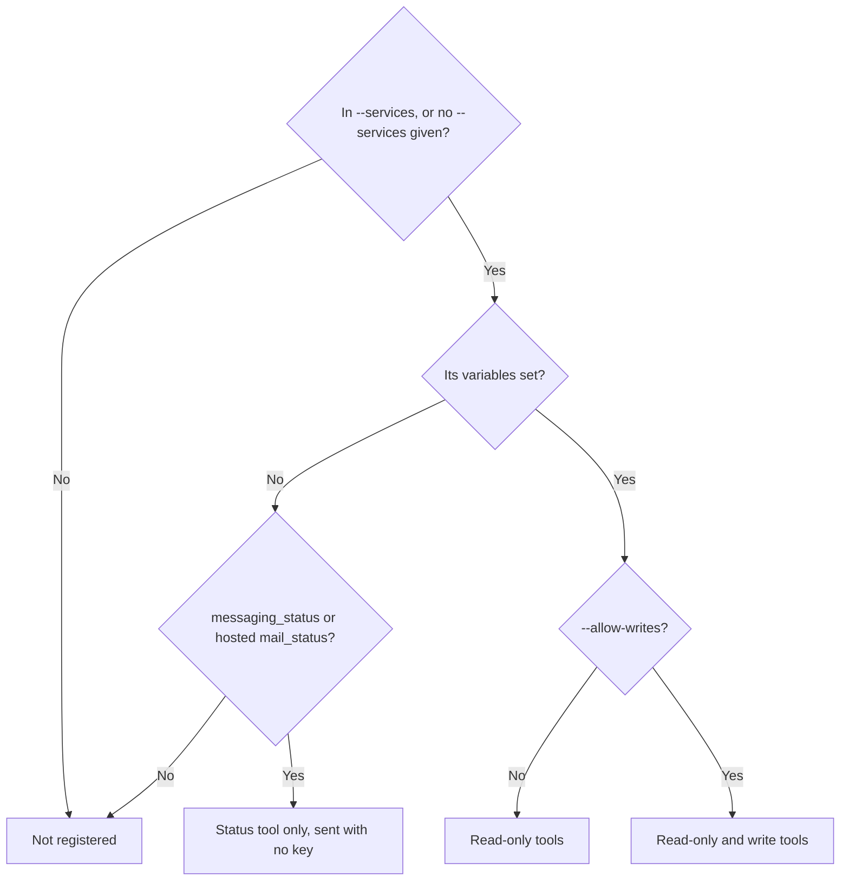

`ryu-services mcp` runs a stdio MCP server named `ryu-services`. It
registers the tools of every service whose environment variables are set,
and nothing for the rest, so an agent sees only what you configured.

By default it registers only the read-only tools; pass `--allow-writes` to
add the tools that write, send, charge, or delete. The tools call `@ryuhq/services`, so they keep its idempotency keys, retries,
and error codes.

<Callout type="info">
@ryuhq/services is not yet published to npm; it requires @ryuhq/client 0.4 or later, which is also not yet on npm (latest is 0.3.0).
</Callout>

The server ships in `@ryuhq/services-cli`, which is not on npm yet. Until it
is, run the same server through `ryu-cli`, whose `services` command arrives in a Ryu
release after 0.4.0 (until then neither the CLI nor the MCP server can be installed outside the Ryu repository).

With `ryu-cli`, use
`"command": "ryu-cli"` and put `services` first in `args`, as in
`"args": ["services", "mcp", "--services", "notify,box"]`. The entries below
name `ryu-services`, the binary `@ryuhq/services-cli` installs once it is
published.

## Add it to a client

Clients that read an `mcpServers` JSON file, such as Claude Desktop and
Cursor, take this entry. Set only the variables of the services you want; the
[SDK overview](/docs/standalone/sdk#configure) lists them all:

```json
{
  "mcpServers": {
    "ryu-services": {
      "command": "ryu-services",
      "args": ["mcp", "--services", "notify,box"],
      "env": {
        "RYU_NOTIFY_API_KEY": "<your tenant key>",
        "RYU_BOX_API_KEY": "<your Box key>"
      }
    }
  }
}
```

Notify and Box default to `https://notify.ryuhq.com` and `https://box.ryuhq.com`;
add `RYU_NOTIFY_URL` or `RYU_BOX_URL` only when Ryu issued you another URL.

Until `@ryuhq/services-cli` is on npm, the same entry through `ryu-cli` is:

```json
{
  "mcpServers": {
    "ryu-services": {
      "command": "ryu-cli",
      "args": ["services", "mcp", "--services", "notify,box"],
      "env": {
        "RYU_NOTIFY_API_KEY": "<your tenant key>",
        "RYU_BOX_API_KEY": "<your Box key>"
      }
    }
  }
}
```

In Claude Code, add the same server from a shell:

```sh
claude mcp add ryu-services --env RYU_NOTIFY_API_KEY="<tenant-key>" -- ryu-services mcp --services notify
claude mcp add ryu-services --env RYU_NOTIFY_API_KEY="<tenant-key>" -- ryu-cli services mcp --services notify
```

The second line is the `ryu-cli` form. `ryu-cli services mcp --help` prints
the `ryu-cli` entry and command line itself.

| Flag | What it does |
|---|---|
| `--services <a,b>` | Only these services, by CLI or SDK name, such as `notify,box` or `managedAgents`. |
| `--allow-writes` | Also registers the write and destructive tools. Without it, only the tools marked read-only are registered, which still includes `passport_fetch` (see below). With it, the host's approval prompt is what stands between the model and a write. |
| `--read-only` | Accepted so older configurations keep working; read-only is already the default. It cannot be combined with `--allow-writes`. |
| `--timeout <ms>` | Per-attempt timeout for every tool call. |
| `--max-retries <n>` | Retries after the first attempt (default 2). |

## Which tools it registers

A service's tools are registered only when `--services` picks it (or is not
passed) and its variables are set. `--allow-writes` decides whether the write
tools join the read-only ones.



Standard output carries only JSON-RPC. At startup the server writes one line
to standard error naming the mode (read-only, or writes allowed) and how many
tools it registered. A service that is not configured is
skipped with one line on standard error.

A service that is set only by a
built-in default, such as Gateway's local URL, counts as not configured; set
`RYU_GATEWAY_URL` or `RYU_GATEWAY_TOKEN` to expose the Gateway tools.

### Status tools without a key

Two read-only tools are the exception: `messaging_status` and `mail_status`
call status routes that need no key, so the server registers them even when
Messaging or Mail is not configured, and they then send no key or
organization.

Both report the deployment's configuration, not whether your key or
organization may use the service. `--services` still limits
them, so `--services notify` registers neither.

- `messaging_status` uses `RYU_API_URL`, or the SDK's default
  control-plane origin when it is unset.
- `mail_status` is registered this way
  only for hosted Mail: with `RYU_MAIL_URL` unset or on the control-plane
  origin. With `RYU_MAIL_URL` on the control-plane origin and no key, the
  skip reason asks for `RYU_API_KEY` or `RYU_MAIL_GATEWAY_KEY` (hosted Mail
  keys), never the self-hosted `RYU_MAIL_API_KEY`.
- A self-hosted `RYU_MAIL_URL` without `RYU_MAIL_API_KEY` registers no
  Mail tools, because a self-hosted server answers its status route only with
  its token.

To apply the same rule in your own MCP server or tool host, call
`credentialFreeRyuTools(ryu, service)` from `@ryuhq/services/tools` (Python
`credential_free_ryu_tools(ryu, service)` from `ryu_sdk.services.tools`).

It returns the read-only, credential-free tools of a service that is not
configured but whose status route `ryu` can reach without a key. It returns an empty
list when the service is configured or that route needs a key.

### What the model is told

Most hosts never show standard error to the model, so the server also sends
the same facts as `instructions` in its `initialize` result:

- the mode in effect, and how many write tools `--allow-writes` would add;
- the services it registered;
- each skipped service with the environment variables it needs
  (for Connect, which has no tools here, where to point an MCP client instead:
  `$RYU_CONNECT_URL/mcp` with `Authorization: Bearer $RYU_CONNECT_API_KEY`);
- a pointer to `ryu-services doctor`.

With nothing configured, the model sees
only `messaging_status` and `mail_status` (unless `--services` leaves them
out) and an explanation of what to set for the other tools. The
instructions name variables, never their values.

## Results and errors

- **Success.** A successful tool returns `{ data, meta }` as structured content and as JSON
  text. Every tool declares that shape as its MCP `outputSchema` in
  `tools/list`, with `data` typed per tool (a Box, a page of events, a Site)
  and open to fields a service adds later, so a client can validate the
  result or generate types from it.
- **Failure.** A failed tool returns a tool error carrying
  `RyuError.toJSON()`, with its `code`, `status`, and `requestId`; it never
  contains a key. A tool error is not checked against the `outputSchema`.
- **Bad arguments.** Arguments that do
  not match a tool's input schema come back the same way, as
  `{ error: { code: "invalid_arguments", details: { issues } } }`, without a
  request.
- **Cancel.** Cancelling a tool call from the client aborts the request it started.

Every tool declares the four MCP hints: read-only, destructive, idempotent,
and open world. Hosts should ask before running a tool that is not read-only.

<Callout type="warn">
Read-only does not mean the tool stays inside Ryu. `passport_fetch` is
read-only and open world: it sends a `GET` with the stored login to any path
or query on a connection's domain, and hosts that prompt only for writes run
it without asking.

Tools such as `mail_get_message`,
`messaging_get_message`, and `box_read_file` return text written by other
people, which can carry instructions aimed at the model. If the same agent
reads untrusted mail, messages, or files, leave Passport out with
`--services`, for example `--services mail,messaging`, or set your host to
ask before `passport_fetch`.
</Callout>

### Keys and limits

- `box_create`, `managed_agents_create_session`, and
  `managed_agents_send_message` take an optional `idempotencyKey`, so a call the
  model retries never creates a second Box, session, or message.
- `notify_request_approval` takes one too, but a retry with the same key gets
  `409 idempotency_conflict` instead of the first answer, because each call
  sets a new deadline. Read the first request with `notify_get_event` or
  `notify_list_events` instead.
- `managed_agents_list_events` returns 50 events per page by default. When it
  waits for the turn to end, it stops after `maxEvents` events (default 100).
- `box_read_file` returns
  `{ path, content, truncated, totalChars }`, cut to `maxChars` characters
  (default 20,000).

## Tools

| Tool | Service | What it does | Read-only |
|---|---|---|---|
| `managed_agents_list_agents` | Managed Agents | Lists the organization's agents, one page. | Yes |
| `managed_agents_list_environments` | Managed Agents | Lists the organization's environments, one page, with the id `managed_agents_create_session` takes. | Yes |
| `managed_agents_create_session` | Managed Agents | Starts a session, optionally with a first message. | No |
| `managed_agents_send_message` | Managed Agents | Appends a user message to a session. | No |
| `managed_agents_get_session` | Managed Agents | Returns a session's status, stop reason, pending tool calls, and usage. | Yes |
| `managed_agents_list_events` | Managed Agents | Reads a session's events; with `wait: true` it follows the stream until the turn ends, within `maxEvents` and `timeoutMs`. | Yes |
| `managed_agents_list_pending_approvals` | Managed Agents | Lists tool calls waiting for approval, with each call's input and `expiresAt`. | Yes |
| `managed_agents_answer_approval` | Managed Agents | Allows or denies one waiting tool call; only as the user decides. | No |
| `messaging_status` | Messaging | Reports whether the control plane has Messaging configured and which channels can send. It describes the deployment, not whether Messaging is on for your organization. Needs no credentials (see below). | Yes |
| `messaging_quote` | Messaging | Quotes the hold an SMS would place, and the available credit. | Yes |
| `messaging_send_sms` | Messaging | Sends a real SMS and holds its cost; `idempotencyKey` is required. Optional `messageType` (`TRANSACTIONAL` or `PROMOTIONAL`) and `ttlSeconds` (5 to 259200). Open world. | No |
| `messaging_list_messages` | Messaging | Lists the message log, one page, newest first. | Yes |
| `messaging_get_message` | Messaging | Reads one message with its status and charge. | Yes |
| `messaging_list_numbers` | Messaging | Lists the organization's numbers and their ids; `includeReleased: true` adds released and failed numbers (`all` is a deprecated alias). | Yes |
| `mail_status` | Mail | Reports whether the Mail server has Mail configured and can send. On hosted Mail it describes the deployment, not your key or organization, and needs no credentials (see below); a self-hosted server needs its token. | Yes |
| `mail_list_inboxes` | Mail | Lists the inboxes the key can see. With none yet, create one with `mail_create_inbox` (with `--allow-writes`) or have the person run the SDK's `mail.inboxes.create` or `ryu-services mail inboxes create`. | Yes |
| `mail_list_messages` | Mail | Lists one inbox's messages, newest first. | Yes |
| `mail_get_message` | Mail | Reads one message in full. | Yes |
| `mail_create_inbox` | Mail | Creates an inbox and returns its id and address. `clientId` is required: a retry with the same one gives back the inbox already made. Self-hosted Mail needs `address`; hosted Mail builds the address from `localPart`, else `name`, and its key needs the `mail:manage` scope. | No |
| `mail_send` | Mail | Sends an email to real recipients; `idempotencyKey` is required. It sends from an existing inbox (see `mail_create_inbox`). | No |
| `notify_publish` | Notify | Publishes an event to the tenant's streams and destinations. | No |
| `notify_request_approval` | Notify | Publishes an approval request and waits a bounded time for the answer. | No |
| `notify_list_events` | Notify | Lists events, newest first, with filters. | Yes |
| `notify_get_event` | Notify | Reads one event and its response state. | Yes |
| `notify_ack_event` | Notify | Marks one event acknowledged. | No |
| `notify_usage` | Notify | Counts accepted events for whole UTC hours. | Yes |
| `box_list` | Box | Lists the tenant's Boxes. | Yes |
| `box_get` | Box | Returns one Box and its status, to poll a provisioning Box. | Yes |
| `box_create` | Box | Creates a persistent Linux workspace. Open world. | No |
| `box_exec` | Box | Runs one command and returns its exit code and output; never retried. Destructive. | No |
| `box_read_file` | Box | Reads a file as UTF-8 text. | Yes |
| `box_write_file` | Box | Creates or replaces a file. Destructive. | No |
| `box_stop` | Box | Stops a Box and keeps its disk. Destructive. | No |
| `box_resume` | Box | Starts a stopped Box again and returns it. | No |
| `box_delete` | Box | Deletes a Box and its disk. Not reversible. Destructive. | No |
| `gateway_list_models` | Gateway | Lists the models the Gateway can route to. | Yes |
| `gateway_chat` | Gateway | Sends one chat completion; the provider may bill for it. | No |
| `passport_list_profiles` | Passport | Lists profiles and their connections' status, never credentials. | Yes |
| `passport_list_connections` | Passport | Lists connections with their domain, profile, and status. | Yes |
| `passport_fetch` | Passport | Sends one `GET` to an `https://` URL on a connection's exact domain with the stored login. Open world. | Yes |
| `sites_list` | Sites | Lists Sites on the configured Sites process. | Yes |
| `sites_get` | Sites | Reads one Site, its versions, and its deployed version. `siteId` takes the Site's id, not its slug, here and in the two tools below. | Yes |
| `sites_create` | Sites | Creates a private Site from a starter template and returns its id; publishes nothing. | No |
| `sites_deploy` | Sites | Saves HTML as a new version and serves it, or serves a saved version. Destructive. | No |
| `sites_update_settings` | Sites | Changes who can open a Site (audience, viewers, workspace) or its sign-in and remix options, and keeps the other settings. Never changes editors, who could deploy. Requires `expectedRevision`, so it is not idempotent. Not destructive, but `public` opens the Site to anyone. | No |

Each service's quickstart describes its tools in more detail, such as the
approval wait in [Notify](/docs/standalone/sdk/notify-cli-mcp#mcp) and the session
tools in [Managed Agents](/docs/standalone/sdk/managed-agents-cli-mcp#mcp).

The same tools, with the same names, schemas, and read-only defaults, are
also available to `@ryuhq/sdk` agents and the Vercel AI SDK without an MCP
server; see [Agent tools](/docs/standalone/sdk/agent-tools).

## Hosted Mail tools

Ryu's hosted MCP endpoint (`/mcp` on the control plane) also serves six Mail
tools itself, over OAuth, with no node and no install. Their scopes, consent
screen, organization allowlist, and limits are on
[Hosted Mail MCP tools](/docs/standalone/sdk/mcp-hosted-mail).

## Connect

Connect has no tools here, because Connect is an MCP server itself. Point
your MCP client at your Connect URL followed by `/mcp`, with
`Authorization: Bearer` and your Connect key. The
[Connect quickstart](/docs/standalone/sdk/connect) shows the configuration.

## Read next

<Cards>
  <DocCard href="/docs/standalone/sdk/agent-tools" />
  <DocCard href="/docs/standalone/sdk/mcp-hosted-mail" />
  <DocCard href="/docs/standalone/sdk/cli" />
  <DocCard href="/docs/standalone/sdk/errors" />
</Cards>
