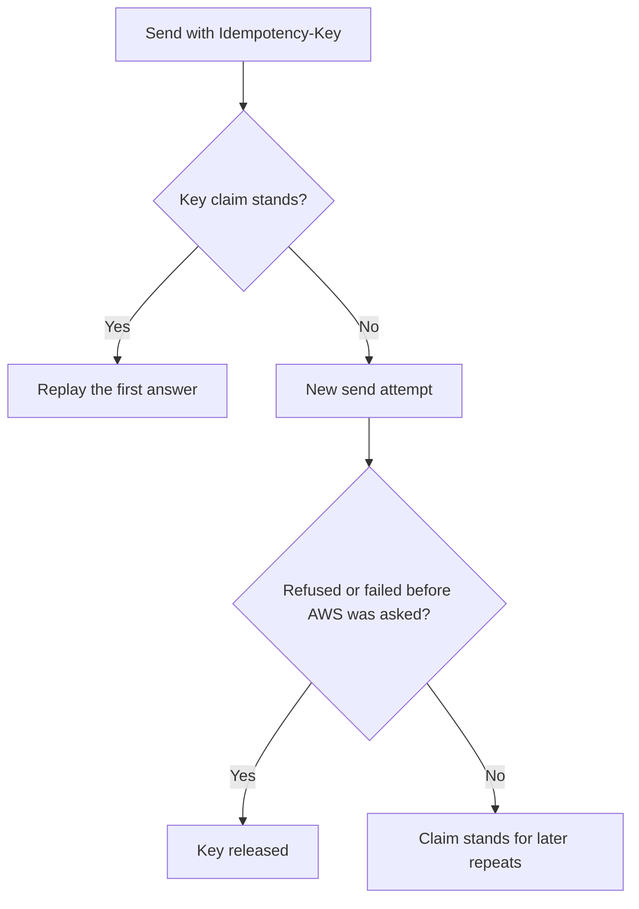

<Callout type="warn">
Early access: hosted on the Ryu control plane; Ryu enables it per organization, and the organization must also turn on its Ryu Messaging feature (off by default); there is no self-hosted service.
</Callout>

This page lists the errors the Messaging client raises and how it retries. The
samples use the `ryu` client from the
[Messaging SDK quickstart](/docs/standalone/sdk/messaging#first-call-with-the-sdk).

<Callout type="info">
@ryuhq/services is not yet published to npm; it requires @ryuhq/client 0.4 or later, which is also not yet on npm (latest is 0.3.0).
</Callout>

<Callout type="info">
The `ryu-sdk` Python package is not yet published to PyPI, so the Python client cannot be installed outside Ryu either.
</Callout>

## Errors

Every refusal is `{ "error": "<code>", "message": "..." }`, sometimes with
more fields beside them. The SDK turns it into a `RyuError` subclass:

- `code` is the `error` value.
- `details` holds the other fields, such
  as `availableMicroUsd` and `requiredMicroUsd` on `402 insufficient_credits`,
  or `limit` and `window` on a `429`.
- `cause` is the `@ryuhq/client` `MessagingError`.
- `requestId` comes from the
  `X-Request-ID` header that the control plane sends on every response, because
  the body carries no request id. Quote it when you contact support.

Branch on `error.code`, and
treat an unknown code by its status.

| Status and code | SDK error | Notes |
|---|---|---|
| `404 not_found` (Messaging not available) | `RyuNotFoundError` | Ryu has not enabled Messaging for the organization. Carries a `hint` and a `docs` link. |
| `403 feature_disabled` | `RyuPermissionError` | The organization's Ryu Messaging feature is off. Carries a `hint` and a `docs` link. |
| `403 forbidden` | `RyuPermissionError` | Wrong organization, or a missing scope or permission. |
| `402 insufficient_credits`, `402 spend_limit_reached` | `RyuPaymentRequiredError` | Nothing was sent or charged. Never retried. |
| `422` codes such as `recipient_opted_out` | `RyuInvalidRequestError` | The send cannot be priced or delivered as asked. |
| `429 send_rate_limited`, `429 purchase_rate_limited` | `RyuRateLimitError` | `details` has `limit` and `window`. Retried only when `Retry-After` is within `maxRetryDelayMs`. |
| `502 provider_refused` | `RyuServerError` | AWS refused the request; nothing was sent or charged. Never retried: on a send or number purchase the server releases the idempotency key, so a retry would be a new attempt. |
| `502 media_upload_failed` | `RyuServerError` | The MMS media could not be staged; nothing was sent or charged. Retried as a fresh send attempt. |
| `502 provider_error` | `RyuServerError` | AWS did not answer a number, opt-out, sender, or template call. Retried when the request is replay-safe. |
| `502 outcome_unknown` | `RyuServerError` | The send may have gone out. Never retried. |

A `502 outcome_unknown` or `502 provider_refused` on a send carries the stored
message. Read it with `messagingErrorRecord(error)`. After `outcome_unknown`,
check it with `messages.get()` before you send again with a new key:

```ts tab="Node"
import { messagingErrorRecord } from "@ryuhq/services";

const sent = await ryu.messaging.sms.send(
  { from: "<number-id>", to: "+6591234567", body: "Your order has shipped." },
  { idempotencyKey: "order-1842-shipped" },
);
if (sent.error?.code === "outcome_unknown") {
  const record = messagingErrorRecord(sent.error);
  if (record) {
    const latest = await ryu.messaging.messages.get(record.id);
    console.log(latest.data?.status);
  }
}
```

```python tab="Python"
from ryu_sdk.services import messaging_error_record

sent = ryu.messaging.sms.send(
    {"from": "<number-id>", "to": "+6591234567", "body": "Your order has shipped."},
    idempotency_key="order-1842-shipped",
)
if sent.error and sent.error.code == "outcome_unknown":
    record = messaging_error_record(sent.error)
    if record:
        latest = ryu.messaging.messages.get(record["id"])
        print(latest.data and latest.data["status"])
```

A number purchase's `502 outcome_unknown` is different: retry it with the
same idempotency key to finish that purchase. The full code table is on
[Ryu Messaging API](/docs/standalone/messaging-api#errors).

## Idempotency and retries

Every send and every number purchase carries an `Idempotency-Key`, and the
server refuses them without one. `send(input, { idempotencyKey })` and
`numbers.buy(input, { idempotencyKey })` send your key; without one, the
client generates a key for that call. Binding a key with `.with()` replaces
it:

```ts tab="Node"
await ryu.messaging
  .with({ idempotencyKey: "order-1842-voice" })
  .voice.send({ from: "<number-id>", to: "+6591234567", text: "Your order has shipped." });
```

```python tab="Python"
ryu.messaging.with_options(idempotency_key="order-1842-voice").voice.send(
    {"from": "<number-id>", "to": "+6591234567", "text": "Your order has shipped."}
)
```

| Method | Path |
|---|---|
| `POST` | `/orgs/{orgId}/numbers` |
| `POST` | `/orgs/{orgId}/sms` |
| `POST` | `/orgs/{orgId}/mms` |
| `POST` | `/orgs/{orgId}/voice` |
| `POST` | `/orgs/{orgId}/whatsapp` |

The SDK keeps the same key on every retry of a call. The server replays the
first answer for a repeat with the same key and body only while that key's
claim stands.

A send that is refused or fails before AWS is asked
(`provider_refused`, `media_upload_failed`, a `4xx` refusal) releases the key.
The next request with it then runs a new send attempt that counts against the
send limits. A send is still never charged twice for one message.



What the SDK retries on its own, up to `maxRetries` (default 2):

- Reads (`GET`), the keyed writes in the table above, and the `DELETE` write
  `optOuts.remove` are retried on network errors, timeouts, and `408`, `425`,
  `500`, `502`, `503`, and `504` responses. That includes `502 provider_error`, `502 media_upload_failed`
  (a fresh send attempt), and `503 messaging_capacity`.
- `409 idempotency_in_progress` (the first request with this key is still
  running, such as a number purchase being finished) is retried with the same
  key.
- A `429` is retried only when its `Retry-After` is within `maxRetryDelayMs`.
- `502 outcome_unknown`, `502 provider_refused`, every `402`, `403
  feature_disabled`, and `503 not_configured` are never retried.
- Label and template writes (`PATCH`, unkeyed `POST`), `optOuts.add`, and
  `settings.rotateWebhookSecret()` carry no key and are not retried on those
  failures.
- `settings.update` (`PUT`) is not retried on those failures either,
  although `PUT` is idempotent: the reply that first sets a webhook URL is the
  only one that carries the new webhook secret, so a replay after a lost reply
  would hide it. A `429` that names a wait is still retried.

Messaging sends no `Idempotent-Replayed` header, so `meta.replayed` stays
`false` for it.

`settings.update` returns the webhook secret only in the reply that creates
it. If that reply is lost, the call fails instead of being replayed; when you
repeat it yourself, or the webhook URL was already set, the reply has
`settings.webhookSecretSet: true` and no `webhookSecret`. Call
`settings.rotateWebhookSecret()` to get a secret you can read:

```ts tab="Node"
const updated = await ryu.messaging.settings.update({ webhookUrl: "https://example.com/hooks/messaging" });
if (updated.error) {
  throw updated.error; // never rotate after a failed update
}
let secret = updated.data.webhookSecret;
if (!secret) {
  const rotated = await ryu.messaging.settings.rotateWebhookSecret();
  if (rotated.error) {
    throw rotated.error;
  }
  secret = rotated.data.webhookSecret;
}
```

```python tab="Python"
# unwrap() raises the error, so a failed update never rotates the secret.
updated = ryu.messaging.settings.update({"webhookUrl": "https://example.com/hooks/messaging"}).unwrap()
secret = updated.get("webhookSecret") or ryu.messaging.settings.rotate_webhook_secret().unwrap()["webhookSecret"]
```

## Read next

<Cards>
  <DocCard href="/docs/standalone/sdk/messaging" />
  <DocCard href="/docs/standalone/sdk/messaging-cli-mcp" />
  <DocCard href="/docs/standalone/messaging-api" />
</Cards>
