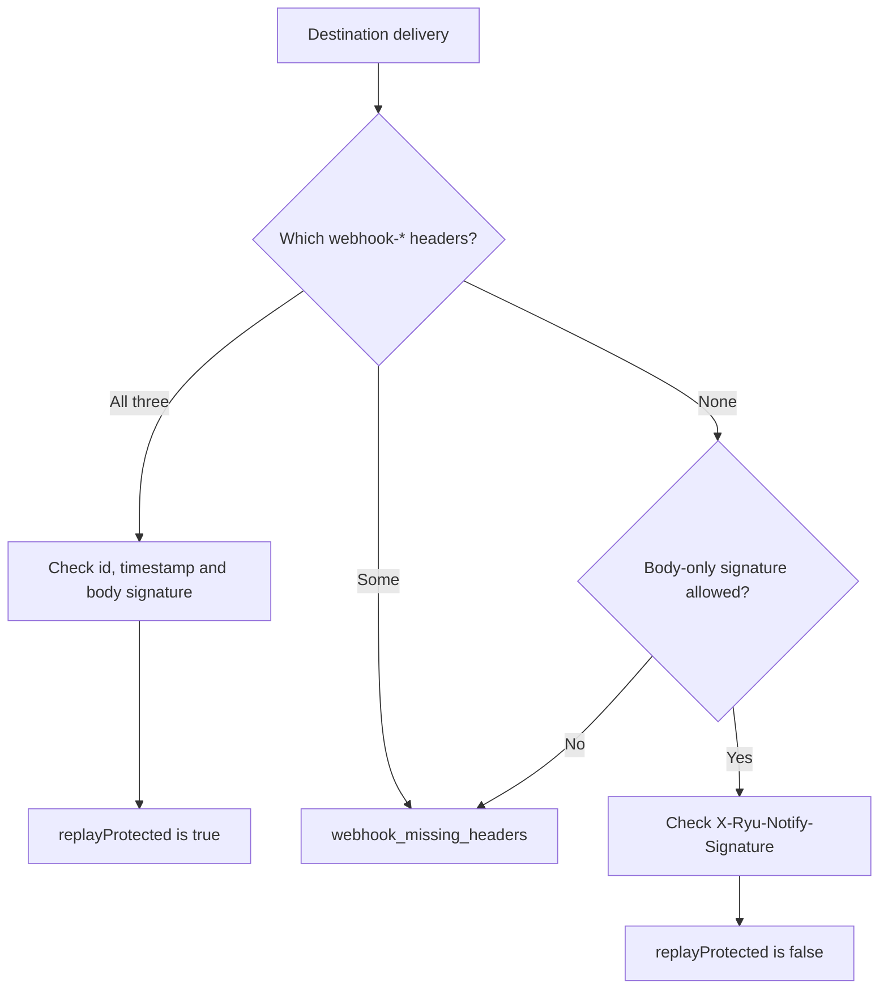

<Callout type="info">
Early access: hosted at https://notify.ryuhq.com with keys provisioned by Ryu; the self-hosted service is not yet published.
</Callout>

This page makes a first call to [Ryu Notify](/docs/standalone/notify) with
curl, with the `@ryuhq/services` TypeScript SDK, with the `ryu_sdk.services` Python client, with the `ryu-services`
command line, and with its MCP tools. The full route list, payload rules, and
stream format are on [Ryu Notify API](/docs/standalone/notify-api).

<Callout type="info">
@ryuhq/services is not yet published to npm; it requires @ryuhq/client 0.4 or later, which is also not yet on npm (latest is 0.3.0).
</Callout>

<Callout type="info">
The `ryu-sdk` Python package is not yet published to PyPI, so the Python client cannot be installed outside Ryu either.
</Callout>

## What you need

- **A tenant key.** Hosted Notify, at `https://notify.ryuhq.com`, is in early
  access: Ryu provisions the key for your organization, and there is no
  self-serve signup. The key is sent as `Authorization: Bearer`. Pricing and
  abuse limits are on [Ryu Notify](/docs/standalone/notify).
- The self-hosted Notify service is not yet published, so there is nothing to
  download and run today.

The SDK and the CLI use `https://notify.ryuhq.com` unless `RYU_NOTIFY_URL` (or
`notify.baseUrl`) names another origin, such as a URL Ryu issued with your
key. A call without a key fails before any request is sent.

## Configure

The SDK and the CLI read these environment variables. Options passed to
`new Ryu()` win over them, and `new Ryu({ env: false })` turns env reads off.

| Variable | Default | Description |
|---|---|---|
| `RYU_NOTIFY_URL` | `https://notify.ryuhq.com` | Notify origin; set it only when Ryu issued you another URL. |
| `RYU_NOTIFY_API_KEY` | none | Notify tenant bearer token (hosted keys are provisioned by Ryu). |

```sh
export RYU_NOTIFY_API_KEY="<your tenant key>"
# Only when Ryu issued you another URL:
export RYU_NOTIFY_URL="<the Notify URL Ryu issued>"
```

The SDK never sends `RYU_API_KEY` to Notify, and never sends the Notify key to
another origin.

## First call with curl

Publish an event. The `Idempotency-Key` makes a retry of the same request
safe. The URL falls back to `https://notify.ryuhq.com` when `RYU_NOTIFY_URL`
is not set:

```sh
curl -sS -X POST "${RYU_NOTIFY_URL:-https://notify.ryuhq.com}/v1/events" \
  -H "Authorization: Bearer $RYU_NOTIFY_API_KEY" \
  -H "Idempotency-Key: deploy-4821" \
  -H "Content-Type: application/json" \
  -d '{"title":"Deploy finished","level":"success","topic":"deployments"}'
```

Read the newest events:

```sh
curl -sS "${RYU_NOTIFY_URL:-https://notify.ryuhq.com}/v1/events?limit=20" \
  -H "Authorization: Bearer $RYU_NOTIFY_API_KEY"
```

## First call with the SDK

With `result: "object"`, every call resolves to `{ data, error, meta }` and
never throws for API or configuration errors:

```ts tab="Node"
import { Ryu } from "@ryuhq/services";

// Reads RYU_NOTIFY_API_KEY, and RYU_NOTIFY_URL when it is set.
const ryu = new Ryu({ result: "object" });

const { data, error, meta } = await ryu.notify.publish({
  title: "Deploy finished",
  level: "success",
  topic: "deployments",
});

if (error) {
  // error.message ends with error.hint, which names the fix for common setup mistakes such as a wrong URL.
  console.error(error.code, error.message, error.requestId);
} else {
  console.log(data.id, meta.idempotencyKey, meta.replayed);
}
```

```python tab="Python"
from ryu_sdk.services import Ryu

# Reads RYU_NOTIFY_API_KEY, and RYU_NOTIFY_URL when it is set.
ryu = Ryu(result="object")

data, error, meta = ryu.notify.publish({"title": "Deploy finished", "level": "success", "topic": "deployments"})

if error:
    # error.message ends with error.hint, which names the fix for common setup mistakes such as a wrong URL.
    print(error.code, error.message, error.request_id)
elif data and meta:
    print(data["id"], meta.idempotency_key, meta.replayed)
```

`ryu.notify` groups the API by resource, as `ryu.notify.<resource>.<verb>`.
`publish`, `requestApproval`, `analytics`, and `usage` stay at the top level,
because publishing is the main action and the other three have no resource
of their own.

| Namespace | Methods |
|---|---|
| `ryu.notify.events` | `list`, `get`, `iterate`, `acknowledge`, `archive`, `unarchive`, `respond`, `cancelResponse`, `stream` |
| `ryu.notify.topics` | `list`, `publish` (a plain-text publish to one topic) |
| `ryu.notify.activities` | `list`, `get`, `create`, `update`, `end` |
| `ryu.notify.destinations` | `list`, `create`, `update`, `delete`, `test` |
| `ryu.notify.deliveries` | `list`, `retry` |
| `ryu.notify.preferences` | `get`, `update` |
| `ryu.notify.silences` | `list`, `create`, `delete` |
| `ryu.notify.groups` | `list` |

```ts tab="Node"
await ryu.notify.events.acknowledge("evt_123");
await ryu.notify.topics.publish("deployments", "Canary is live", { priority: 4 });
const { data: destinations } = await ryu.notify.destinations.list();
```

```python tab="Python"
ryu.notify.events.acknowledge("evt_123")
ryu.notify.topics.publish("deployments", "Canary is live", {"priority": 4})
destinations = ryu.notify.destinations.list().data
```

The flat `@ryuhq/client` names, such as `listEvents`, `getEvent`,
`publishTopic`, and `createActivity`, still work and send the same requests.
They are deprecated: each one's type documentation names the method that
replaces it.

To read the whole history, newest first, use `events.iterate()`. It sends
each page's `nextCursor` back as `before`, and keeps your filters:

```ts tab="Node"
for await (const event of ryu.notify.events.iterate({ level: "error", limit: 100 })) {
  console.log(event.createdAt, event.title);
}
```

```python tab="Python"
for event in ryu.notify.events.iterate(level="error", limit=100):
    print(event["createdAt"], event["title"])
```

Iterators always throw a `RyuError` on failure, also in object mode.

### Ask a person for approval

`requestApproval()` publishes an event with an `approval` response and polls
it until someone answers in Notify, the request is canceled, or `timeoutMs`
passes (default 10 minutes). The event is published with `response.expiresAt`
set to the same deadline, so Notify refuses an answer that arrives later:

```ts tab="Node"
const { data: answer } = await ryu.notify.requestApproval(
  { title: "Ship v2?", prompt: "Ship build 184?", timeoutMs: 600_000 },
  { pollIntervalMs: 5000 }
);

if (answer?.approved) {
  console.log("approved", answer.value);
} else if (answer?.timedOut) {
  console.log("nobody answered in time");
}
```

```python tab="Python"
answer = ryu.notify.request_approval(
    {"title": "Ship v2?", "prompt": "Ship build 184?"}, timeout=600, poll_interval=5
).data

if answer and answer["approved"]:
    print("approved", answer["value"])
elif answer and answer["timed_out"]:
    print("nobody answered in time")
```

- `responseType: "yes_no"` asks a yes/no question instead; `approved` is then
  true for `yes`.
- Pass `callbackUrl` and `callbackSecret` to also have Notify
  POST the answer to your server.
- Aborting the `signal` option cancels the
  request in flight and stops waiting with `RyuAbortError`; the event stays
  pending until it expires.
- The deadline is part of the published body, so
  a new `requestApproval()` call with an old idempotency key answers `409`.

## Expected response

A publish returns the stored event. Example from the
[OpenAPI document](https://ryuhq.com/openapi/notify.json):

```json
{
  "event": {
    "acknowledgedAt": null,
    "actions": [],
    "archivedAt": null,
    "attachment": null,
    "body": "Production is serving the new build.",
    "createdAt": "2026-10-01T12:00:00.000Z",
    "data": { "build": 184 },
    "externalId": null,
    "fingerprint": null,
    "icon": null,
    "id": "evt_6f1c2d3e4a5b46c7a8b9c0d1e2f3a4b5",
    "level": "success",
    "occurredAt": "2026-10-01T12:00:00.000Z",
    "priority": 3,
    "project": null,
    "recipient": null,
    "response": null,
    "source": "github-actions",
    "tags": ["deploy"],
    "title": "Deploy finished",
    "topic": "deployments",
    "type": "notification",
    "url": null
  },
  "idempotent": false,
  "ok": true,
  "requestId": "req_2b3c4d5e6f7a48b9c0d1e2f3a4b5c6d7",
  "type": "event.created"
}
```

The SDK returns the `event` object. A replay of an earlier key answers `200`
with `"idempotent": true`, which the SDK reports as `meta.replayed`.

## Webhooks

Notify signs deliveries to a destination that has a secret with Standard
Webhooks headers (`webhook-id`, `webhook-timestamp`, `webhook-signature`) and
also sends the body-only `X-Ryu-Notify-Signature`. The verifier checks the
Standard Webhooks headers. Approval
callbacks carry `X-Ryu-Notify-Signature` with `X-Ryu-Notify-Timestamp`.

Verify a delivery against the raw request body with `verifyNotifyWebhook`,
and answer a `RyuWebhookVerificationError` with `401`, or `422` when its code is
`webhook_payload_invalid`. Only approval callbacks (`kind: "callback"`) raise
`webhook_payload_invalid`, for a signed callback whose body is not the expected
JSON.

A destination delivery's body can be plain text, as ntfy destinations
send it: the verifier accepts it and returns the text as the body with
`eventId` (`event_id` in Python) unset, and `deliveryId` unset unless the
Standard Webhooks headers carried one. Treat a delivery without an `eventId`
as not an event.

The Python sample is a FastAPI handler; `ryu-sdk` does not depend on FastAPI,
so install it first, for example `pip install fastapi uvicorn`.

```ts tab="Node"
import { RyuWebhookVerificationError, verifyNotifyWebhook } from "@ryuhq/services/webhooks";

export async function POST(request: Request): Promise<Response> {
  try {
    const delivery = await verifyNotifyWebhook({
      kind: "destination",
      payload: await request.text(),
      headers: request.headers,
      secret: process.env.NOTIFY_DESTINATION_SECRET ?? "",
    });
    if (!delivery.eventId) {
      // A plain-text (ntfy) or test delivery is authentic but not an event: acknowledge it without acting.
      return Response.json({ ok: true });
    }
    console.log(delivery.deliveryId, delivery.eventId, delivery.replayProtected);
    return Response.json({ ok: true });
  } catch (error) {
    // A forged, altered, or stale delivery gets 401 so it is not acknowledged; each retry fails verification again. Destination deliveries never raise webhook_payload_invalid.
    if (error instanceof RyuWebhookVerificationError) {
      return Response.json({ code: error.code }, { status: 401 });
    }
    throw error;
  }
}
```

```python tab="Python"
import os

from fastapi import FastAPI, Request
from fastapi.responses import JSONResponse
from ryu_sdk.services import RyuWebhookVerificationError, verify_notify_webhook

app = FastAPI()


@app.post("/webhooks/notify")
async def notify_webhook(request: Request) -> JSONResponse:
    try:
        delivery = verify_notify_webhook(
            kind="destination",
            payload=await request.body(),
            headers=request.headers,
            secret=os.environ.get("NOTIFY_DESTINATION_SECRET", ""),
        )
    except RyuWebhookVerificationError as error:
        # A forged, altered, or stale delivery gets 401; destination deliveries never raise webhook_payload_invalid.
        return JSONResponse({"ok": False, "error": {"code": error.code, "message": error.message}}, status_code=401)
    if delivery.event_id is None:
        # A plain-text (ntfy) or test delivery is authentic but not an event: acknowledge it without acting.
        return JSONResponse({"ok": True})
    print(delivery.delivery_id, delivery.event_id, delivery.replay_protected)
    return JSONResponse({"ok": True})
```

### How a destination delivery is checked



When the `webhook-*` headers are present, the verifier checks them and nothing
else:

- the signature covers the delivery id, the timestamp and the body;
- a timestamp more than five minutes from your clock is rejected;
- `deliveryId` is the signed `webhook-id`, and `replayProtected` is `true`.

Without them the delivery is refused with `webhook_missing_headers`, because
`X-Ryu-Notify-Signature` covers only the body, so a captured delivery with the
`webhook-*` headers dropped could be replayed forever. A delivery that carries
only some of the `webhook-*` headers fails with `webhook_missing_headers` too.

Pass `allowBodyOnlySignature: true` (Python `allow_body_only_signature=True`)
only for a receiver that must accept that signature; `replayProtected` is then
`false` and you must dedupe on `deliveryId`. `requireTimestamp: false` is the
same opt-in, and an explicit `requireTimestamp: true` wins over
`allowBodyOnlySignature`. Either way, record each `deliveryId` and ignore
repeats.

### Approval callbacks

Approval callbacks use `kind: "callback"`. Their signature covers
`X-Ryu-Notify-Timestamp` too, and timestamps older than five minutes are
rejected. Before acting on an approval callback, read the event with
`ryu.notify.events.get()` and check the stored response.

## Errors, retries, CLI, and MCP

- [Notify SDK errors and retries](/docs/standalone/sdk/notify-errors) lists the
  error codes, the SDK error classes, and which requests the SDK retries.
- [Notify CLI and MCP](/docs/standalone/sdk/notify-cli-mcp) runs these calls with
  the `ryu-services` command line and its MCP tools.
  Until `@ryuhq/services-cli` is on npm, run them through `ryu-cli`, as
  [Run it from ryu-cli](/docs/standalone/sdk/cli#run-it-from-ryu-cli) shows.

## Read next

<Cards>
  <DocCard href="/docs/standalone/notify" />
  <DocCard href="/docs/standalone/notify-api" />
  <DocCard href="/docs/standalone/notify-streams" />
</Cards>
