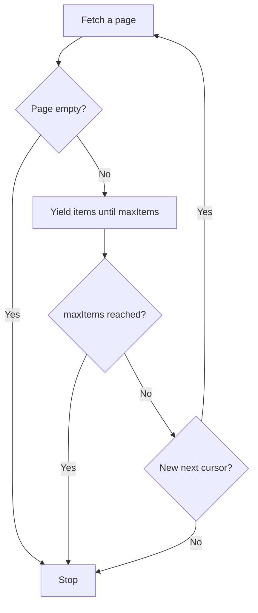

Every paginated list in `@ryuhq/services` has an `iterate()` method that
returns an async iterable of items. It fetches the next page only when you
reach it, sends each page's cursor back for you, and stops at the end of the
list.

<Callout type="info">
@ryuhq/services is not yet published to npm; it requires @ryuhq/client 0.4 or later, which is also not yet on npm (latest is 0.3.0).
</Callout>

<Callout type="info">
The `ryu-sdk` Python package is not yet published to PyPI, so the Python client cannot be installed outside Ryu either.
</Callout>

```ts tab="Node"
import { Ryu } from "@ryuhq/services";

const ryu = new Ryu();

for await (const event of ryu.notify.events.iterate({ level: "error", limit: 100 })) {
  console.log(event.createdAt, event.title);
}
```

```python tab="Python"
from ryu_sdk.services import Ryu

ryu = Ryu()

for event in ryu.notify.events.iterate(level="error", limit=100):
    print(event["createdAt"], event["title"])
```

The Python client's iterators are plain iterators on `Ryu` and async iterators
(`async for`) on `AsyncRyu`. Their filters are keyword arguments in
snake_case, such as `agent_id=...` for the sessions iterator.

Each page is one ordinary call, so [retries](/docs/standalone/sdk/retries-and-idempotency),
timeouts, and [typed errors](/docs/standalone/sdk/errors) apply to every page. Iterators throw `RyuError` on failure in both result modes;
`ryu.safe` does not change them.

## Iterators

| Iterator | How it pages |
|---|---|
| `ryu.notify.events.iterate(filters)` | Sends each page's `nextCursor` back as `before`, newest first, and keeps your filters. |
| `ryu.managedAgents.agents.iterate(query)` | Sends `nextCursor` back as `cursor`; items are in `data`. |
| `ryu.managedAgents.environments.iterate(query)` | The same. |
| `ryu.managedAgents.sessions.iterate(query)` | The same. |
| `ryu.mail.messages.iterate(inboxId, query)` | Asks for messages created before the last one it saw, newest first. |
| `ryu.connect.usage.iterate({ from, to })` | Sends `nextCursor` back as `cursor` with the same window. |
| `ryu.messaging.messages.iterate(query)` | Sends `nextCursor` back as `cursor`, newest first, and keeps your filters; items are in `messages`. |
| `ryu.messaging.optOuts.iterate()` | Sends `nextToken` back as `nextToken`; items are in `optOuts`. |

Box, Passport, and Sites lists come back in one response, so they have no
iterator.

An iterator stops when the service returns no next cursor, when a page is
empty, when the service repeats a cursor it already returned, or after
`maxItems` items. Every iterator query takes `maxItems`.



```ts tab="Node"
const recent = ryu.managedAgents.sessions.iterate({ maxItems: 50 });
for await (const session of recent) {
  console.log(session.id, session.status);
}
```

```python tab="Python"
for session in ryu.managed_agents.sessions.iterate(max_items=50):
    print(session["id"], session["status"])
```

## Pages and collect

`.pages()` yields the raw pages, with whatever else each page carries, and
`.collect(max)` reads items into an array (a list in Python):

```ts tab="Node"
const sessions = ryu.managedAgents.sessions.iterate();

for await (const page of sessions.pages()) {
  console.log(page.data.length, page.nextCursor);
}

const firstTwenty = await ryu.managedAgents.sessions.iterate().collect(20);
```

```python tab="Python"
sessions = ryu.managed_agents.sessions.iterate()

for page in sessions.pages():
    print(len(page["data"]), page["nextCursor"])

first_twenty = ryu.managed_agents.sessions.iterate().collect(20)
```

Without a limit, `collect()` reads the whole list. Prefer a `max` or
`maxItems` for lists that can grow large.

## Mail ordering caveat

Mail lists have no cursor, so `ryu.mail.messages.iterate()` pages by time: it
asks for messages created before the last one it saw, stops on a short page,
and drops a message it has already returned.

Both the hosted and the
self-hosted Mail servers filter strictly older than that time. When more
messages share the boundary timestamp than fit on a page, the ones past the
end of that page are skipped. One inbox rarely has identical timestamps; a
`limit` of up to 200 per page keeps the window small:

```ts tab="Node"
for await (const message of ryu.mail.messages.iterate("<inbox-id>", { limit: 200 })) {
  console.log(message.createdAt, message.subject);
}
```

```python tab="Python"
for message in ryu.mail.messages.iterate("<inbox-id>", limit=200):
    print(message["createdAt"], message["subject"])
```

## Your own lists

`ryu.iterate()` gives any cursor-paginated list the same shape. Pass a page
fetcher, how to read the items, and how to read the next cursor:

```ts
const tools = ryu.iterate({
  fetchPage: (cursor) => fetchMyPage(cursor),
  items: (page) => page.items,
  nextCursor: (page) => page.nextCursor,
});

for await (const tool of tools) {
  console.log(tool.id);
}
```

`fetchMyPage` stands for your own request. The optional `key` reader drops
repeated items, and `maxItems` caps the walk. The Python client has no
`ryu.iterate()`; loop over your own pages there.

## Read next

<Cards>
  <DocCard href="/docs/standalone/sdk/retries-and-idempotency" />
  <DocCard href="/docs/standalone/sdk/notify" />
</Cards>
