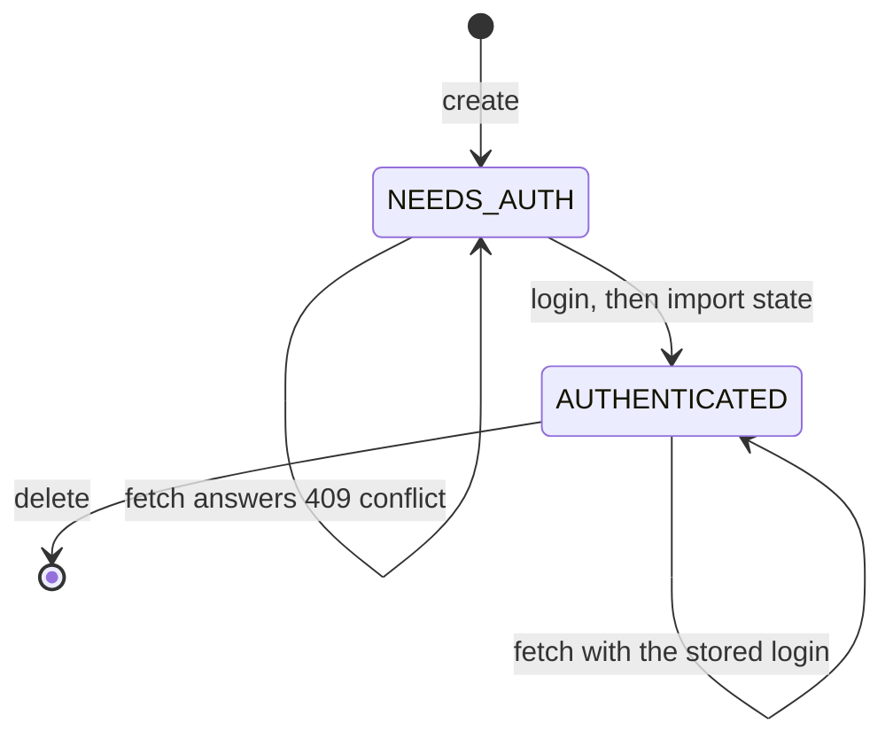

<Callout type="warn">
Early access: hosted keys are provisioned by Ryu; the self-hosted service is not yet published.
</Callout>

This page makes a first call to [Ryu Passport](/docs/standalone/passport)
with curl, with the `@ryuhq/services` TypeScript SDK, with the `ryu_sdk.services` Python client, with the `ryu-services`
command line, and with its MCP tools.

- The full route list is on [Passport API](/docs/standalone/passport-api).
- Destination and header rules for fetches are on
  [Fetch through a Passport connection](/docs/standalone/passport-fetch-api).

<Callout type="info">
@ryuhq/services is not yet published to npm; it requires @ryuhq/client 0.4 or later, which is also not yet on npm (latest is 0.3.0).
</Callout>

<Callout type="info">
The `ryu-sdk` Python package is not yet published to PyPI, so the Python client cannot be installed outside Ryu either.
</Callout>

## What you need

- **A Passport base URL and a tenant administration token.** Passport is in
  early access: Ryu provisions hosted keys for your organization, and there is
  no self-serve signup. Pricing is on [Ryu Passport](/docs/standalone/passport#pricing).
- **Optionally, a runtime grant token.** The operator binds each runtime
  grant to one tenant and a list of profiles. Agents should use a runtime
  grant rather than the administration token.
- Passport's source and builds are not yet published, so there is nothing to
  download and run unless you have an early-access source checkout. Such a
  process binds `http://127.0.0.1:8093` by default.

Passport has no default URL in the SDK. A call without one fails before any
request is sent.

## Configure

The SDK and the CLI read these environment variables. Options passed to
`new Ryu()` win over them, and `new Ryu({ env: false })` turns env reads off.

| Variable | Default | Description |
|---|---|---|
| `RYU_PASSPORT_URL` | none | Passport origin (no default). |
| `RYU_PASSPORT_API_KEY` | none | Passport admin bearer token; optional when RYU_PASSPORT_RUNTIME_KEY is set. |
| `RYU_PASSPORT_RUNTIME_KEY` | none | Passport runtime bearer token, used on /v1/runtime/* routes and runtime fetches. |

```sh
export RYU_PASSPORT_URL="<the Passport URL Ryu issued>"
export RYU_PASSPORT_API_KEY="<tenant administration token>"   # administration
export RYU_PASSPORT_RUNTIME_KEY="<runtime grant token>"        # agents
```

Set `RYU_PASSPORT_URL` and at least one key. An agent process needs only
`RYU_PASSPORT_RUNTIME_KEY`; keep the tenant administration token out of it.

Both keys are sent as `Authorization: Bearer`, and only to
`RYU_PASSPORT_URL`. The SDK sends the runtime key on `/v1/runtime/*` and on
`runtime.connections.fetch()`, and the administration key everywhere else.

Passport refuses the administration key on runtime routes, so a runtime call
without `RYU_PASSPORT_RUNTIME_KEY` fails with a `RyuConfigurationError`
before any request. An administration call without `RYU_PASSPORT_API_KEY`
fails the same way, naming that variable.

## First call with curl

Create a connection, start its login, import the credential state you
captured, then fetch through it. A new connection is `NEEDS_AUTH`, and a fetch
answers `409 conflict` until the import marks it `AUTHENTICATED`.



Use the
`connection.id` from the create response in place of `<connection-id>`.
GitHub, like some other APIs, refuses a request without a `User-Agent` header
with `403`, so the fetch sends one in `headers`.

```sh
curl -sS -X POST "$RYU_PASSPORT_URL/v1/connections" \
  -H "Authorization: Bearer $RYU_PASSPORT_API_KEY" \
  -H "Content-Type: application/json" \
  -d '{"profile_id":"work","domain":"api.github.com","source":"manual"}'

curl -sS -X POST "$RYU_PASSPORT_URL/v1/connections/<connection-id>/login" \
  -H "Authorization: Bearer $RYU_PASSPORT_API_KEY"

curl -sS -X POST "$RYU_PASSPORT_URL/v1/connections/<connection-id>/import" \
  -H "Authorization: Bearer $RYU_PASSPORT_API_KEY" \
  -H "Content-Type: application/json" \
  -d '{"state":"<captured state, for example a cookie header>"}'

curl -sS -X POST "$RYU_PASSPORT_URL/v1/connections/<connection-id>/fetch" \
  -H "Authorization: Bearer $RYU_PASSPORT_RUNTIME_KEY" \
  -H "Content-Type: application/json" \
  -d '{"url":"https://api.github.com/user","headers":{"User-Agent":"my-agent"},"credentialHeaders":{"Authorization":"Bearer vault:api.github.com"}}'
```

## First call with the SDK

With `result: "object"`, every call resolves to `{ data, error, meta }` and
never throws for API or configuration errors:

```ts tab="Node"
import { Ryu } from "@ryuhq/services";

// Reads RYU_PASSPORT_URL, RYU_PASSPORT_API_KEY and RYU_PASSPORT_RUNTIME_KEY.
const ryu = new Ryu({ result: "object" });

const { data, error } = await ryu.passport.connections.create({
  profile_id: "work",
  domain: "api.github.com",
});

if (error) {
  console.error(error.code, error.message);
  throw error;
}

console.log(data.connection.id, data.connection.status); // "NEEDS_AUTH"
```

```python tab="Python"
from ryu_sdk.services import Ryu

# Reads RYU_PASSPORT_URL, RYU_PASSPORT_API_KEY and RYU_PASSPORT_RUNTIME_KEY.
ryu = Ryu(result="object")

data, error, meta = ryu.passport.connections.create({"profile_id": "work", "domain": "api.github.com"})

if error:
    print(error.code, error.message)
elif data:
    print(data["connection"]["id"], data["connection"]["status"])  # "NEEDS_AUTH"
```

`connections.login(id)` starts the
configured login source:

- When the flow's `kind` is `manual`, complete the
  provider login yourself, then hand Passport the captured state (one string of
  at most 512 KiB, such as a cookie header) with `connections.importState(id, { state })`
  (`connections.import_state` in Python).
- A `hosted` flow returns a URL to open instead (see
  [Passport API](/docs/standalone/passport-api#create-a-connection)).

`importState` uses the administration key, is
never retried, and returns status metadata only; Passport never returns the
state. A missing or non-string `state` is refused with `invalid_request` before
any request, and a reply that is not a connection detail fails with
`invalid_response`, in Node and Python alike.

Every Passport method checks the reply's shape the same way in Node and Python:
a connection, profile, login flow, fetch result, capabilities or usage body
that is missing a required field, or carries a field of the wrong type, fails
with `invalid_response` instead of reaching your code. Fields the SDK does not
know yet are kept.

```ts tab="Node"
const id = data.connection.id;

const { data: flow } = await ryu.passport.connections.login(id);

if (flow?.kind.kind === "manual") {
  const { data: imported } = await ryu.passport.connections.importState(id, {
    state: "<captured state, for example a cookie header>",
  });
  console.log(imported?.status); // "AUTHENTICATED"
}
```

```python tab="Python"
connection_id = data["connection"]["id"]

flow = ryu.passport.connections.login(connection_id).data

if flow and flow["kind"]["kind"] == "manual":
    imported = ryu.passport.connections.import_state(
        connection_id, {"state": "<captured state, for example a cookie header>"}
    ).data
    print(imported and imported["status"])  # "AUTHENTICATED"
```

Once the connection is `AUTHENTICATED`, an agent fetches through it with its
runtime grant:

```ts tab="Node"
const { data: page } = await ryu.passport.runtime.connections.fetch("<connection-id>", {
  url: "https://api.github.com/user",
  // GitHub refuses requests without a User-Agent.
  headers: { "User-Agent": "my-agent" },
  credentialHeaders: { Authorization: "Bearer vault:api.github.com" },
});

console.log(page?.status, page?.content);
```

```python tab="Python"
page = ryu.passport.runtime.connections.fetch(
    "<connection-id>",
    {
        "url": "https://api.github.com/user",
        # GitHub refuses requests without a User-Agent.
        "headers": {"User-Agent": "my-agent"},
        "credentialHeaders": {"Authorization": "Bearer vault:api.github.com"},
    },
).data

print(page and page["status"], page and page["content"])
```

The namespace also has `capabilities()`, `profiles.list()`,
`connections.list()`, `connections.get(id)`, `connections.delete(id)`,
`connections.fetch(id, input)` (administration key, `GET` only),
`runtime.connections.list()`, `runtime.connections.hasRuntimeGrant()`, and
`usage({ from, to })`. Passport lists are not paginated.

`hasRuntimeGrant()` resolves to whether
`RYU_PASSPORT_RUNTIME_KEY` is set, without a request, so an agent can choose
the runtime routes before it calls them.

Bodies keep
Passport's wire casing: `profile_id`, `flow_status`, and `created_at` on
connections; `credentialHeaders` and `maxContentChars` on fetches; and
`connectionSeconds` in the usage report.

## Expected response

`connections.create()` returns the new connection. Example from the
[OpenAPI document](https://ryuhq.com/openapi/passport.json):

```json
{
  "connection": {
    "id": "conn_0f8e2a6c4b1d4e7f9a3c5b2d1e0f6a7b",
    "profile_id": "work",
    "domain": "api.github.com",
    "status": "NEEDS_AUTH",
    "flow_status": "IDLE",
    "source": "manual",
    "last_checked": 0,
    "created_at": 1760000000,
    "updated_at": 1760000000
  }
}
```

A fetch returns the upstream status inside the body, with credential values
redacted: `{ "status": 200, "authenticated": true, "content": "…",
"truncated": false }`. Credential state never appears in any response.

## Errors

Every Passport error is JSON with the message in `error` and a stable machine
`code`, for example `{ "error": "connection not found", "code": "not_found" }`.
Each becomes a `RyuError` subclass; branch on `code`.

| Status and code | SDK error | Notes |
|---|---|---|
| `400 invalid_request` | `RyuInvalidRequestError` | Read `error.message`. A malformed body, a missing JSON `Content-Type`, a missing or mistyped field, an unknown key on a fetch, or a usage window off the hour. |
| `401 unauthorized` | `RyuAuthenticationError` | A missing or unknown token, or the administration token on a runtime route. |
| `402 insufficient_credits` | `RyuPaymentRequiredError` | Ryu-hosted Passport only: the organization has no Ryu credits left. On creates and fetches. Never retried. |
| `403 forbidden` | `RyuPermissionError` | The fetch method is not granted to this credential. |
| `404 not_found` | `RyuNotFoundError` | The connection does not exist, or is outside the runtime grant's profiles. |
| `409 conflict` | `RyuConflictError` | The connection needs a login before a fetch. |
| `413 body_too_large` | `RyuInvalidRequestError` | The request body is larger than Passport reads. |
| `429 rate_limited` | `RyuRateLimitError` | Too many unknown tokens from this address; retried after `Retry-After` when that wait fits `maxRetryDelayMs`. |
| `502 bad_gateway` | `RyuServerError` | The upstream fetch failed or its target was denied. |
| `503 metering_unavailable` | `RyuUnavailableError` | Passport cannot record usage yet. Never retried. |

Passport sends no request id, so `error.requestId` is null.

Earlier Passport releases answered some errors with plain text or an empty
body, and used `unauthenticated` for `401` and `bad_request` for prose `400`s.
Code that compares `error.code` should also accept those older values while
older servers are still running.

The `idempotency_*` codes in the
[HTTP API reference](/docs/standalone/passport-api#errors) reach the SDK only
on a Passport that advertises idempotency keys (see below):
`409 idempotency_in_progress` is retried with the same key, and
`409 idempotency_conflict` raises `RyuConflictError`.

## Idempotency and retries

Newer Passport builds deduplicate `POST /v1/connections` keyed with an
`Idempotency-Key` header (see the
[HTTP API reference](/docs/standalone/passport-api#create-a-connection)) and
say so in `GET /v1/capabilities` as `features.idempotency_keys: true`; an
older build ignores the header.

Before a `connections.create()`, the SDK reads
the capabilities with the administration key. This is one extra request that:

- your `onRequest`, `onResponse`, and `onRetry` hooks do not see;
- is never retried, and times out after 5 seconds (or your shorter `timeoutMs`);
- is not cancelled by one call's signal, because concurrent creates share it.

The answer is remembered per `Ryu` instance and base URL for five minutes:

| Capabilities answer | What `connections.create()` does |
|---|---|
| `features.idempotency_keys: true` | Sends an `Idempotency-Key` (a UUID, or yours from `.with({ idempotencyKey })`) and retries with the same key after a network error, timeout, or `5xx`. `meta.idempotencyKey` reports the key. |
| The flag is missing or `false`, or there is no capabilities route (`404`) | Generates no key and never retries after those failures. A key you supplied is still sent. |
| The read was refused (`401`, `403`) | Same as above; the answer is kept for 30 seconds, so a wrong key is not presented twice per create. |
| The read failed (network error, timeout, `5xx`) | Same as above for this call; the next create asks again. |

A key you supply, with `.with({ idempotencyKey })` or an `Idempotency-Key`
header, is always sent on the create, whatever the capabilities say. A
Passport that supports keys then deduplicates your own retry with the same
key even when the SDK's capabilities read failed, and an older build ignores
it. That makes a stable key per operation the safe pattern:

```ts tab="Node"
const created = await ryu.passport
  .with({ idempotencyKey: "work-github-com" })
  .connections.create({ profile_id: "work", domain: "github.com" });
```

```python tab="Python"
created = ryu.passport.with_options(idempotency_key="work-github-com").connections.create(
    {"profile_id": "work", "domain": "github.com"}
)
```

The Python client follows the same rules: it reads the capabilities before a
create, remembers the answer per `Ryu` or `AsyncRyu` instance for five
minutes, and always sends a key you bind with `with_options(idempotency_key=...)`.

To retry the same operation after a lost response, call
`.with({ idempotencyKey })` again with the same key. On a Passport without
the flag, that retry can still create a second connection for the same
domain: list the profile's connections first and reuse one.

With `autoIdempotency: false` and no key of your own, the SDK skips the
capabilities read and sends the create unkeyed. If Passport is rolled back to
a build without the flag, the SDK can keep keying and retrying creates for up
to five minutes, until its cached answer expires.

What the SDK retries:

- A fetch is never retried, because the upstream call may already have
  happened.
- Reads and `connections.delete()` are retried on network errors, timeouts,
  and `500`, `502`, `503`, and `504` responses.
- A `429` with `Retry-After` is retried for any method, because Passport
  refused it before doing anything.

The defaults are two retries and a 60-second timeout until response headers
arrive; change them with `maxRetries` and `timeoutMs`.

If a delete succeeded but its response was lost, the retry answers
`404 not_found`, so treat a `404` from `connections.delete()` as already
deleted.

## CLI

<Callout type="info">
Until `@ryuhq/services-cli` is on npm, run the commands below as
`ryu-cli services passport ...`, with the same flags. `ryu-cli services`
arrives in a Ryu release after 0.4.0, and until then neither the CLI nor the
MCP server can be installed outside the Ryu repository (see
[ryu-services CLI](/docs/standalone/sdk/cli#run-it-from-ryu-cli)).
</Callout>

The `ryu-services` command line reads the same variables. Every Passport
command only reads, so the CLI cannot create a connection, start a login, or
import state: do those with the SDK or curl above. Add `--json` for `{ data, meta }` output, or `--dry-run`
to print the equivalent curl command with `$RYU_PASSPORT_API_KEY` in place of
the key.

```sh
ryu-services passport capabilities
ryu-services passport profiles
ryu-services passport connections list
ryu-services passport connections get <connection-id>
ryu-services passport usage --from 2026-10-12T00:00:00Z --to 2026-10-12T02:00:00Z
```

`profiles` and `connections list` print one JSON line per profile or
connection (see [list output](/docs/standalone/sdk/cli#list-output)). `usage` without `--from` and `--to` reads the last
24 whole UTC hours, including the current one.

## MCP

`ryu-services mcp` serves MCP tools over stdio for the services you have
configured. Limit it to Passport with `--services passport`. Every Passport
tool reads, so the default read-only mode keeps all three and
`--allow-writes` is not needed.

Read-only mode still includes `passport_fetch`, which sends a `GET` with the
stored login to the connection's site, and most hosts do not ask before a
read-only tool. An agent that also reads untrusted email, messages, or files
could be steered into fetches whose query strings carry data out.

Keep
Passport in its own `ryu-services mcp --services passport` entry, away from
agents that read untrusted text, or set your host to ask before
`passport_fetch`.

Until `@ryuhq/services-cli` is on npm, start the server through `ryu-cli`, as
below. Once it is published, use `"command": "ryu-services"` and drop
`"services"` from `args`.

```json
{
  "mcpServers": {
    "ryu-services": {
      "command": "ryu-cli",
      "args": ["services", "mcp", "--services", "passport"],
      "env": {
        "RYU_PASSPORT_URL": "<the Passport URL Ryu issued>",
        "RYU_PASSPORT_RUNTIME_KEY": "<runtime grant token>"
      }
    }
  }
}
```

| Tool | What it does | Read-only |
|---|---|---|
| `passport_list_profiles` | Lists profiles and their connections' status. Needs `RYU_PASSPORT_API_KEY`. | Yes |
| `passport_list_connections` | Lists connections: the runtime grant's when `RYU_PASSPORT_RUNTIME_KEY` is set, otherwise the tenant's. | Yes |
| `passport_fetch` | Sends one `GET` through an authenticated connection and returns the redacted answer. | Yes (open world) |

An agent's MCP server needs only the runtime grant, as above. Add
`RYU_PASSPORT_API_KEY` only for an operator's own tools: `passport_fetch`
uses the runtime grant when it is set, and the administration key otherwise.

`passport_fetch` reaches the connection's site with the
stored login, so hosts should treat it as an outside request. Failures are
tool errors that carry the `RyuError` fields and never a key.

## Read next

<Cards>
  <DocCard href="/docs/standalone/passport" />
  <DocCard href="/docs/standalone/passport-api" />
  <DocCard href="/docs/standalone/passport-fetch-api" />
</Cards>
