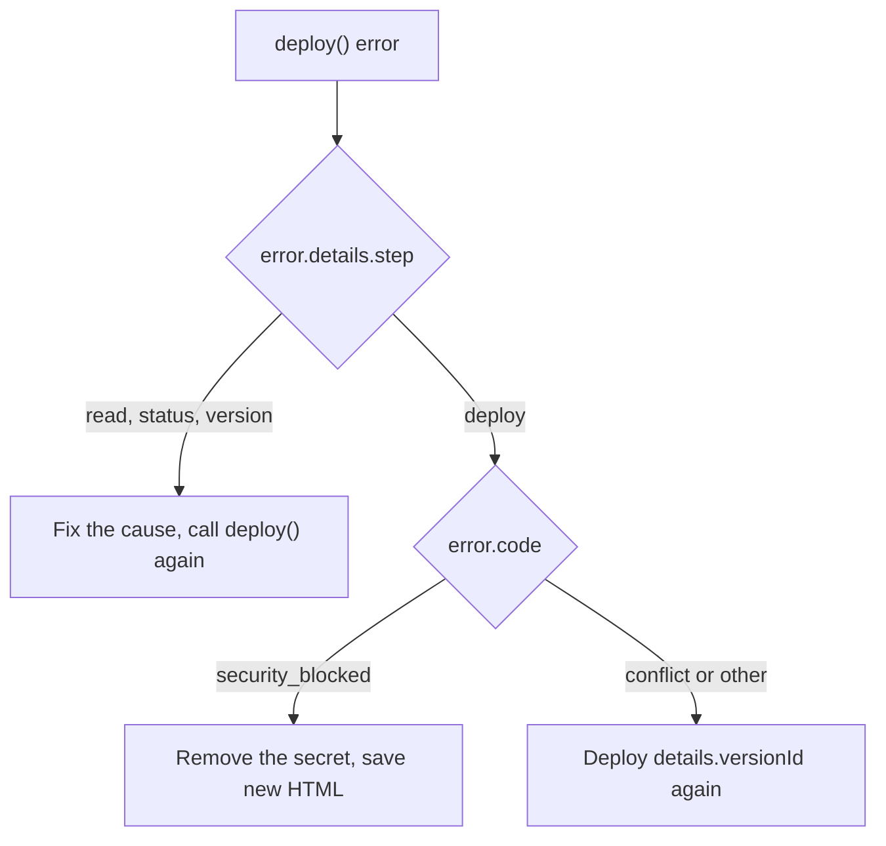

<Callout type="warn">
Early access: self-hosted process only, and standalone mode needs a ryu-sites release after 0.4.0, which is not published yet; there is no Ryu-hosted offer.
</Callout>

This page lists the errors the Sites client raises and how it retries. It
applies to the `ryu` client from the
[Sites SDK quickstart](/docs/standalone/sdk/sites#first-call-with-the-sdk).

<Callout type="info">
@ryuhq/services is not yet published to npm; it requires @ryuhq/client 0.4 or later, which is also not yet on npm (latest is 0.3.0).
</Callout>

<Callout type="info">
The `ryu-sdk` Python package is not yet published to PyPI, so the Python client cannot be installed outside Ryu either.
</Callout>

## Errors

Sites errors are `{ "error": { "code", "message", "fields"? } }`. Each
becomes a `RyuError` subclass with the Sites `code`, and `fields` is in
`error.details.fields`.

| Status and code | SDK error | Notes |
|---|---|---|
| `400 invalid_input` | `RyuInvalidRequestError` | `error.details.fields` lists the rejected fields. |
| `400 incompatible` | `RyuInvalidRequestError` | The `html` is not a self-contained document: it must begin with `<!doctype html>`. Not retried. |
| `401 unauthorized` | `RyuAuthenticationError` | A missing or wrong management bearer. |
| `403 forbidden`, `policy_denied` | `RyuPermissionError` | Sites refused the action for this caller, or the operator disallows it, such as the public audience while public Sites are off, or a `workspaceId` you do not belong to. Read `error.message` and `error.hint`. |
| `404 not_found` | `RyuNotFoundError` | The Site or version does not exist. |
| `409 conflict` | `RyuConflictError` | A stale `expectedRevision`. Read the Site again and retry. Also a slug that another Site already uses. |
| `503 unavailable` | `RyuUnavailableError` | A setting needs a service the process has not connected, such as OpenID Connect sign-in for `invited`. Not retried (`retryable: false`). |
| `422 security_blocked` | `RyuInvalidRequestError` | The secret scan refused to deploy the version. Save new HTML without the secret; that version stays saved but cannot be deployed. |
| `413` or `429 quota` | `RyuInvalidRequestError` or `RyuRateLimitError` | A size or storage limit. Not retried. |

### Deploy step failures

When a step of `deploy()` fails, `error.details.step` names it (`read`,
`status`, `version`, or `deploy`), with the `projectId` and the
`expectedRevision` it sent.

A failed deploy step also carries the saved `versionId`. After a transient
failure, such as a stale `expectedRevision`, you can deploy that version
without saving it again.

A `422 security_blocked` is different: the scan runs on the deploy step, so the
version holding the secret is already saved and can never be deployed. Remove
the secret and save new HTML instead of redeploying that `versionId`.

## Idempotency and retries

Sites deduplicates no write, so the SDK sends no `Idempotency-Key`. Every
change carries `expectedRevision` instead: Sites refuses a stale one with
`409 conflict`, so a write can never silently overwrite someone else's.

The SDK never retries a `409`, and never retries a `POST` after a network
error, timeout, or `5xx`.

Reads are retried on network errors, timeouts, and `500`, `502`, `503`, and
`504` responses. The defaults are two retries and a 60-second timeout until
response headers arrive; change them with `maxRetries` and `timeoutMs`.

### Writes that are sent once

`projects.delete()`, `projects.updateSettings()`, and `projects.makePublic()`
are sent once after a network error, timeout, or `5xx`, although they use `PUT`
or `DELETE`. Only a `429` that names a wait is retried.

Each carries `expectedRevision`, and Sites moves the revision when the first
attempt commits. So a resend would answer `409 conflict` even though the write
applied.

If the response to one of these calls was lost:

1. Read the Site with `projects.get()` to see whether the change or the removal
   took effect.
2. If it did not, repeat it with the new `revision`.

A `projects.delete()` can fail after Sites has already moved the Site's
revision, because Sites updates the revision before it removes the Site's
records. A `503` from that removal leaves the Site in place with a newer
revision. Read the Site with `projects.get()` and delete again with the new
`revision`.

A `503 unavailable` from the settings route reports a missing service, not an
outage, and is not retryable.

## Read next

<Cards>
  <DocCard href="/docs/standalone/sdk/sites" />
  <DocCard href="/docs/standalone/sdk/sites-cli-mcp" />
  <DocCard href="/docs/standalone/sites-api" />
</Cards>
