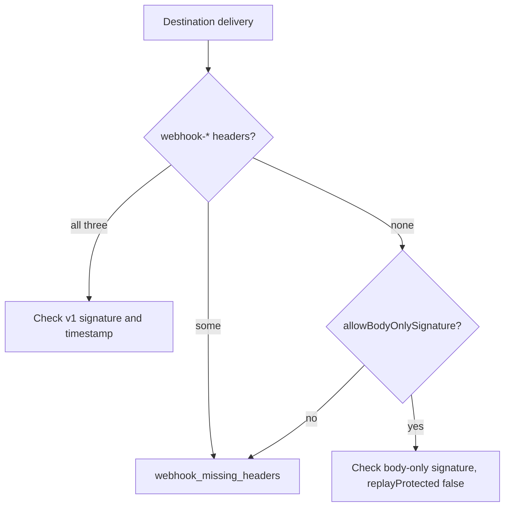

[Ryu Mail](/docs/standalone/mail), [Ryu Notify](/docs/standalone/notify), and
[Ryu Messaging](/docs/standalone/messaging) sign the requests they send to
your server. `@ryuhq/services/webhooks` checks those signatures.

It uses Web Crypto only, with no client code and no Node.js modules, so it runs
on Node.js, Bun, Deno, and Workers-style edge runtimes. Every verifier compares
signatures in constant time and throws `RyuWebhookVerificationError` on
failure.

<Callout type="info">
@ryuhq/services is not yet published to npm; it requires @ryuhq/client 0.4 or later, which is also not yet on npm (latest is 0.3.0).
</Callout>

<Callout type="info">
The `ryu-sdk` Python package is not yet published to PyPI, so the Python client cannot be installed outside Ryu either.
</Callout>

Always verify the raw body, exactly as it arrived: read it with
`await request.text()` before anything parses it. Parsing the JSON and
serializing it again changes the bytes and breaks the signature.

The Python samples are FastAPI handlers. `ryu-sdk` does not depend on FastAPI,
so install it and a server to run them, for example
`pip install fastapi uvicorn`.

Every sample answers as [Verification errors](#verification-errors) describes.
Only a `2xx` acknowledges a delivery, so the sender may retry a forged or
replayed one like any other failed attempt; each retry fails verification
again.

## Mail

Mail signs event webhooks with Standard Webhooks headers: `webhook-id`,
`webhook-timestamp`, and `webhook-signature`, with `svix-*` names accepted
too. The secret is the `whsec_` value Mail returned
when you created or rotated the webhook. `verifyMailWebhook` returns the
parsed event, typed by `event_type`.

```ts tab="Node"
import { RyuWebhookVerificationError, verifyMailWebhook } from "@ryuhq/services/webhooks";

export async function POST(request: Request): Promise<Response> {
  try {
    const event = await verifyMailWebhook({
      payload: await request.text(),
      headers: request.headers,
      secret: process.env.MAIL_WEBHOOK_SECRET ?? "",
    });
    if (event.event_type === "message.bounced") {
      console.log("bounced", event.event_id);
    }
    return Response.json({ ok: true });
  } catch (error) {
    // A signed delivery whose body is not the service's JSON gets 422. A forged, altered, or stale one gets 401 so it is not acknowledged; each retry fails verification again.
    if (error instanceof RyuWebhookVerificationError) {
      const status = error.code === "webhook_payload_invalid" ? 422 : 401;
      return Response.json({ code: error.code }, { status });
    }
    throw error;
  }
}
```

```python tab="Python"
import os

from fastapi import FastAPI, Request
from fastapi.responses import JSONResponse
from ryu_sdk.services import RyuWebhookVerificationError, verify_mail_webhook

app = FastAPI()


@app.post("/webhooks/mail")
async def mail_webhook(request: Request) -> JSONResponse:
    try:
        event = verify_mail_webhook(
            payload=await request.body(),
            headers=request.headers,
            secret=os.environ.get("MAIL_WEBHOOK_SECRET", ""),
        )
    except RyuWebhookVerificationError as error:
        status = 422 if error.code == "webhook_payload_invalid" else 401
        return JSONResponse({"ok": False, "error": {"code": error.code, "message": error.message}}, status_code=status)
    if event["event_type"] == "message.bounced":
        print("bounced", event["event_id"])
    return JSONResponse({"ok": True})
```

Timestamps more than five minutes from your clock, in either direction, are
rejected. Change that with `toleranceSeconds`, a number of seconds from `0` to
`86400`. Bad values fail closed:

- Any other value, such as `NaN` from an unset environment variable, throws a
  `RyuConfigurationError` with `invalid_tolerance` instead of turning replay
  protection off.
- A `now` that is not a real time (an invalid `Date`, or `NaN` in Python)
  rejects every delivery with `webhook_timestamp_out_of_range`.

Mail retries failed deliveries, so deduplicate on `event_id`. A webhook created
before Standard Webhooks signing uses the raw secret instead: pass
`scheme: "legacy"`.

The known event types are exported as `MAIL_EVENT_TYPES`. They are `message.received`,
`message.received.spam`, `message.received.blocked`,
`message.received.unauthenticated`, `message.sent`, `message.delivered`,
`message.bounced`, `message.complained`, `message.rejected`,
`message.opened`, and `domain.verified`.

An event type newer than your SDK
version still verifies and reaches your code; `isKnownMailWebhookEvent(event)`
tells the two apart.

## Notify

Notify signs two kinds of request, and they differ in what the signature
covers:

| Kind | Sent when | Signed content | Replay protection |
|---|---|---|---|
| `destination` | Notify delivers an event to a webhook destination that has a secret. | Standard Webhooks headers: `webhook-signature` (`v1,<base64>`) over `webhook-id`, a dot, `webhook-timestamp`, a dot, and the raw body, keyed with the UTF-8 bytes of the destination secret. Notify also sends `X-Ryu-Notify-Signature: sha256=<hex>` over the raw body only. | Timestamps more than five minutes from your clock are rejected. The body-only signature has no timestamp, so the verifier refuses it unless you opt in. Record each `deliveryId` and ignore repeats. |
| `callback` | Someone answers an approval request that has a `callbackUrl`. | `X-Ryu-Notify-Signature: sha256=<hex>` over `X-Ryu-Notify-Timestamp`, a dot, and the raw body. | Timestamps more than five minutes from your clock are rejected. |

For a destination, `verifyNotifyWebhook` checks the `webhook-*` headers
whenever they are present and never falls back once it has. A stale timestamp
or a bad `v1` signature fails even when `X-Ryu-Notify-Signature` matches. A
delivery with only some of the three, or none, fails with
`webhook_missing_headers`.



The body-only signature cannot tell a replay from a first delivery. An attacker
who captured a signed delivery could strip its `webhook-*` headers to replay it
forever, so the verifier checks it only when you pass
`allowBodyOnlySignature: true`.

Notify sends the `webhook-*` headers on every destination delivery, so you need
that option only for a receiver that must accept the older signature alone.
`delivery.replayProtected` is then `false`, and you must dedupe on
`deliveryId`. An explicit `requireTimestamp: true` wins over the opt-in;
`requireTimestamp: false` is the same opt-in. `toleranceSeconds` applies to
both kinds.

```ts tab="Node"
import { RyuWebhookVerificationError, verifyNotifyWebhook } from "@ryuhq/services/webhooks";

export async function POST(request: Request): Promise<Response> {
  try {
    const delivery = await verifyNotifyWebhook({
      kind: "destination",
      payload: await request.text(),
      headers: request.headers,
      secret: process.env.NOTIFY_DESTINATION_SECRET ?? "",
    });
    if (!delivery.eventId) {
      // A plain-text (ntfy) or test delivery is authentic but not an event: acknowledge it without acting.
      return Response.json({ ok: true });
    }
    console.log(delivery.deliveryId, delivery.replayProtected, delivery.body);
    return Response.json({ ok: true });
  } catch (error) {
    // A forged, altered, or stale delivery gets 401 so it is not acknowledged; each retry fails verification again. Destination deliveries never raise webhook_payload_invalid.
    if (error instanceof RyuWebhookVerificationError) {
      return Response.json({ code: error.code }, { status: 401 });
    }
    throw error;
  }
}
```

```python tab="Python"
import os

from fastapi import FastAPI, Request
from fastapi.responses import JSONResponse
from ryu_sdk.services import RyuWebhookVerificationError, verify_notify_webhook

app = FastAPI()


@app.post("/webhooks/notify")
async def notify_webhook(request: Request) -> JSONResponse:
    try:
        delivery = verify_notify_webhook(
            kind="destination",
            payload=await request.body(),
            headers=request.headers,
            secret=os.environ.get("NOTIFY_DESTINATION_SECRET", ""),
        )
    except RyuWebhookVerificationError as error:
        # A forged, altered, or stale delivery gets 401; destination deliveries never raise webhook_payload_invalid.
        return JSONResponse({"ok": False, "error": {"code": error.code, "message": error.message}}, status_code=401)
    if delivery.event_id is None:
        # A plain-text (ntfy) or test delivery is authentic but not an event: acknowledge it without acting.
        return JSONResponse({"ok": True})
    print(delivery.delivery_id, delivery.replay_protected, delivery.body)
    return JSONResponse({"ok": True})
```

`deliveryId` and `eventId` come from signed content, never from the unsigned
`X-Ryu-Notify-Delivery` and `X-Ryu-Notify-Event` headers:

- With the `webhook-*` headers, `deliveryId` is the signed `webhook-id`
  (`test_…` for a destination test delivery).
- Otherwise it is the signed body's `deliveryId`.
- A header, or a body `deliveryId`, that disagrees fails with
  `webhook_invalid_signature`.

A destination body that is not JSON, such as an ntfy-formatted delivery,
comes back as the raw string in `body`, and its `eventId` is `null`. Its
`deliveryId` is the signed `webhook-id` when the Standard Webhooks headers
are present, and `null` otherwise.

A destination delivery therefore never
raises `webhook_payload_invalid`; only an approval callback whose body is not
JSON does. Treat a destination delivery whose `eventId` is `null`
(`event_id` is `None` in Python) as not an event.

Before acting on an approval callback, read the event with
`ryu.notify.events.get()` and check its stored response.

## Messaging

Messaging signs deliveries to the organization's webhook URL exactly like
Mail: Standard Webhooks headers (with `svix-*` copies) over `webhook-id`, a
dot, `webhook-timestamp`, a dot, and the raw body.

The key is the `whsec_` secret that `settings.update` returned when it set the
first webhook URL, or that `settings.rotateWebhookSecret` returned.
`verifyMessagingWebhook` returns the event, typed by `event_type`.

```ts tab="Node"
import { isKnownMessagingWebhookEvent, RyuWebhookVerificationError, verifyMessagingWebhook } from "@ryuhq/services/webhooks";

export async function POST(request: Request): Promise<Response> {
  try {
    const event = await verifyMessagingWebhook({
      payload: await request.text(),
      headers: request.headers,
      secret: process.env.MESSAGING_WEBHOOK_SECRET ?? "",
    });
    if (isKnownMessagingWebhookEvent(event) && event.event_type === "message.failed") {
      console.log("failed", event.data.message.id, event.data.message.error);
    }
    return Response.json({ ok: true });
  } catch (error) {
    // A signed delivery whose body is not the service's JSON gets 422. A forged, altered, or stale one gets 401 so it is not acknowledged; each retry fails verification again.
    if (error instanceof RyuWebhookVerificationError) {
      const status = error.code === "webhook_payload_invalid" ? 422 : 401;
      return Response.json({ code: error.code }, { status });
    }
    throw error;
  }
}
```

```python tab="Python"
import os

from fastapi import FastAPI, Request
from fastapi.responses import JSONResponse
from ryu_sdk.services import (
    RyuWebhookVerificationError,
    is_known_messaging_webhook_event,
    verify_messaging_webhook,
)

app = FastAPI()


@app.post("/webhooks/messaging")
async def messaging_webhook(request: Request) -> JSONResponse:
    try:
        event = verify_messaging_webhook(
            payload=await request.body(),
            headers=request.headers,
            secret=os.environ.get("MESSAGING_WEBHOOK_SECRET", ""),
        )
    except RyuWebhookVerificationError as error:
        status = 422 if error.code == "webhook_payload_invalid" else 401
        return JSONResponse({"ok": False, "error": {"code": error.code, "message": error.message}}, status_code=status)
    if is_known_messaging_webhook_event(event) and event["event_type"] == "message.failed":
        message = event["data"]["message"]
        print("failed", message["id"], message["error"])
    return JSONResponse({"ok": True})
```

The known event types are exported as `MESSAGING_EVENT_TYPES`.
`message.received`, `message.delivered`, and `message.failed` carry
`data.message`; `number.suspended` and `number.released` carry
`data.number`. A newer event type still verifies and reaches your code.

Each event is delivered at most once per organization, with up to three
attempts a few hundred milliseconds apart and no durable retry queue. So
deduplicate on `event_id` and read the message log to reconcile after an
outage. `toleranceSeconds` works as it does for Mail.

## A ready-made endpoint

`webhookHandler()` builds a `(request: Request) => Promise<Response>` that
reads the raw body, verifies it, and calls your `onEvent`. Next.js route
handlers, Hono, Bun, Deno, and Workers all accept that shape:

```ts tab="Node"
import { webhookHandler } from "@ryuhq/services/webhooks";

export const POST = webhookHandler({
  service: "mail",
  secret: process.env.MAIL_WEBHOOK_SECRET ?? "",
  onEvent: async (event) => {
    console.log(event.event_type, event.event_id);
  },
});
```

```python tab="Python"
import os

from fastapi import FastAPI, Request
from fastapi.responses import JSONResponse
from ryu_sdk.services import RyuWebhookVerificationError, verify_webhook

app = FastAPI()


@app.post("/webhooks/mail")
async def mail_webhook(request: Request) -> JSONResponse:
    try:
        event = verify_webhook(
            service="mail",
            payload=await request.body(),
            headers=request.headers,
            secret=os.environ.get("MAIL_WEBHOOK_SECRET", ""),
        )
    except RyuWebhookVerificationError as error:
        status = 422 if error.code == "webhook_payload_invalid" else 401
        return JSONResponse({"ok": False, "error": {"code": error.code, "message": error.message}}, status_code=status)
    print(event["event_type"], event["event_id"])
    return JSONResponse({"ok": True})
```

### Python verifiers

The Python client has no `webhookHandler()`. Verify in your framework's
handler as above. The Python verifiers:

- take the same options in snake_case (`tolerance_seconds`,
  `require_timestamp`, `allow_body_only_signature`, `scheme="legacy"`);
- accept a dict, a list of pairs, or your framework's headers object;
- compare signatures with `hmac.compare_digest`;
- raise `RyuConfigurationError` with the code `invalid_option` for a `kind`
  other than `"destination"` or `"callback"`, or a `scheme` other than
  `"standard"` or `"legacy"`, instead of reading it as a default.

The Python return types follow `service`. `"mail"` gives a
`MailWebhookEvent`, `"messaging"` a `MessagingWebhookEvent`, and `"notify"`
a `NotifyWebhookDelivery`. `is_known_mail_webhook_event` and
`is_known_messaging_webhook_event` are type guards, so `event_type` reads as
one of the known event types inside the `if`. The envelope types live in
`ryu_sdk.services.shapes`.

### What webhookHandler() answers

| Request | Answer |
|---|---|
| Not a `POST` | `405` |
| Body larger than `maxBodyBytes` (default 1 MiB) | `413` with `payload_too_large`, before verification; the body is not buffered past the limit. |
| Fails verification | `401` with `{ ok: false, error: { code, message } }`; `onEvent` is not called. |
| Authentic, but the body is not the service's JSON | `422` with `webhook_payload_invalid`. |
| `onEvent` throws | `500` without error details; `onError` (or `console.error`) receives the error. Mail and Notify destinations retry the delivery; a Notify callback is sent once. Messaging retries twice within about 300 ms and then drops the event; reconcile from the message log. |
| Verified and handled | `200` with `{ ok: true }`. |

### Handler options

- **Notify** - pass `service: "notify"` and `kind: "destination"` or
  `kind: "callback"`. A destination delivery without the `webhook-*` headers
  gets `401` unless you also pass `allowBodyOnlySignature: true`;
  `verifyWebhook()` takes the same option.
- **Messaging** - pass `service: "messaging"`.

`webhookHandler()` checks its settings when you create it: `maxBodyBytes` must
be a positive integer (`invalid_max_body_bytes`), and `toleranceSeconds`
follows the same `0` to `86400` rule (`invalid_tolerance`).

The secret is not checked then. An unset or empty secret, such as a missing env
var or Workers binding, answers each delivery `401` with
`webhook_invalid_secret`, so a handler built inside a Worker's `fetch()` never
throws a `5xx` that the sender would retry. Watch for that code in your logs
after a deploy.

With a `Ryu` instance you can also call
`ryu.webhooks.verify({ service: "mail", payload, headers, secret })`.

## Verification errors

| Code | Meaning |
|---|---|
| `webhook_missing_headers` | A signature, id, or timestamp header is missing. |
| `webhook_invalid_secret` | The secret is unset (`undefined`, Python `None`), empty, or not in the expected format. It is checked before the headers. |
| `webhook_invalid_signature` | No signature matches the body and secret. |
| `webhook_timestamp_out_of_range` | The timestamp is outside `toleranceSeconds`. |
| `webhook_payload_invalid` | The signature is valid, but the body is not the expected JSON. |

Answer a failed verification with `401` and do not process the request.
We recommend answering `webhook_payload_invalid` with `422`, because the delivery is
authentic, so `401` would tell the sender it is not. The samples on this page,
the Next.js and Hono framework guides, and `webhookHandler()` do this.

## Check a delivery from the command line

`ryu-services webhooks verify` checks a captured delivery offline and prints
its parsed body. It exits with `4` when the delivery is rejected.

- It reads the raw payload from standard input.
- It reads the headers from a JSON file.
  `headers.json` is a JSON object mapping each header name to its value.
- Pass the secret as `@path` or in `RYU_WEBHOOK_SECRET`, so it stays out of
  your shell history.

```sh
ryu-services webhooks verify --service mail --secret @mail-secret.txt --headers @headers.json < payload.json
ryu-services webhooks verify --service notify --kind callback --secret @notify-secret.txt --headers @headers.json < payload.json
ryu-services webhooks verify --service messaging --secret @messaging-secret.txt --headers @headers.json < payload.json
```

A Notify destination delivery without the `webhook-id`, `webhook-timestamp`
and `webhook-signature` headers is rejected, because its body-only signature
can be replayed. `--allow-body-only-signature` does what
`allowBodyOnlySignature: true` does in code and accepts that signature.

It applies to `--service notify` destination deliveries only. It cannot be
combined with `--require-timestamp`, which keeps the default and exists for
older scripts:

```sh
ryu-services webhooks verify --service notify --allow-body-only-signature --secret @notify-secret.txt --headers @headers.json < payload.json
```

## Read next

<Cards>
  <DocCard href="/docs/standalone/sdk/frameworks/nextjs" />
  <DocCard href="/docs/standalone/sdk/frameworks/edge" />
  <DocCard href="/docs/standalone/mail-api" />
  <DocCard href="/docs/standalone/notify-streams" />
</Cards>
