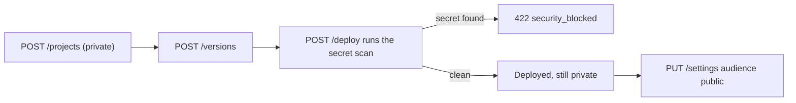

<Callout type="warn">
Standalone mode needs a ryu-sites release after 0.4.0, which is not published
yet: the published `amajorai/ryu-sites` 0.4.0 runs only as the Core-managed
sidecar. Until a later release is out, the standalone bearer and listeners on
this page have no published process behind them. See
[Start the standalone service](/docs/standalone/sites#start-the-standalone-service).
</Callout>

The standalone Sites service keeps the `/api/sites/*` route spelling used by
the Sites Companion in Ryu Desktop. It answers on two listeners:

- **Management listener** - the routes under `/api/sites/*`, called with the
  standalone Sites bearer.
- **Visitor listener** - deployed pages and their browser data routes.

The contract version is `v1`, also returned as `apiVersion` by the status
route. The Core-managed app and the standalone process use the same resource
names. Only the credential and ownership rules differ.

## Bearer authentication

Management calls send:

```text
Authorization: Bearer <RYU_SITES_API_TOKEN>
```

The token is separate from Core sidecar credentials, Gateway keys, and visitor
sign-in. In standalone mode a visitor session is never accepted on the
management API.

A missing or wrong bearer returns `401` with a
`WWW-Authenticate: Bearer realm="ryu-sites"` challenge. When a bearer token was
sent but rejected, the challenge adds `error="invalid_token"`.

Every management response, including errors, carries an `X-Request-ID`
(`req_` followed by 32 hex characters). Quote it when you report a problem. The
one exception is a body over the listener's cap (below).

## Management routes

| Method | Path | Credential | Purpose |
|---|---|---|---|
| `GET` | `/health` | None | Read process liveness |
| `GET` | `/` | None | Describe the service; redirect only when `RYU_PRODUCT_DASHBOARD_URL` is set (standalone mode) |
| `GET` | `/api/sites/status` | Sites bearer | Read limits, mode, and which services this process has |
| `GET` | `/api/sites/runtime` | Sites bearer | Read the browser runtime script served to deployed pages |
| `GET/POST` | `/api/sites/projects` | Sites bearer | List (`?scope=owned`, `shared`, or `remixable`) or create Sites |
| `GET/DELETE` | `/api/sites/projects/:id` | Sites bearer | Read a Site, or delete it after typing its URL name |
| `POST` | `/api/sites/projects/:id/remix` | Sites bearer | Copy a Site into a new private Site |
| `POST` | `/api/sites/projects/:id/versions` | Sites bearer | Save an immutable HTML version |
| `GET` | `/api/sites/projects/:id/versions/:versionId` | Sites bearer | Read a saved version's HTML |
| `GET` | `/api/sites/projects/:id/security` | Sites bearer | Scan a saved version (`?versionId=`, latest by default) |
| `POST` | `/api/sites/projects/:id/deploy` | Sites bearer | Scan and deploy a saved version |
| `POST` | `/api/sites/projects/:id/unpublish` | Sites bearer | Take the Site offline and keep its versions |
| `PUT` | `/api/sites/projects/:id/settings` | Sites bearer | Change audience, data mode, records, uploads, shared data, AI, and remixing |
| `PUT` | `/api/sites/projects/:id/name` | Sites bearer | Rename the Site |
| `PUT` | `/api/sites/projects/:id/url` | Sites bearer | Change the URL name; the old name redirects |
| `POST/DELETE` | `/api/sites/projects/:id/domains` | Sites bearer | Add or remove a custom domain |
| `POST` | `/api/sites/projects/:id/domains/check` | Sites bearer | Check a custom domain's ownership TXT record |
| `GET` | `/api/sites/projects/:id/analytics` | Sites bearer | Read visitors and page views (`?days=1` to `90`) |
| `POST` | `/api/sites/projects/:id/database/connect` | Sites bearer | Create the Site's records database |
| `GET` | `/api/sites/projects/:id/database` | Sites bearer | Read the records database binding and row count |
| `POST` | `/api/sites/projects/:id/database/query` | Sites bearer | Run one read-only SQL query over the Site's records |
| `GET` | `/api/sites/projects/:id/visitors` | Sites bearer | List each visitor's stored records and files, and recent purges |
| `DELETE` | `/api/sites/projects/:id/visitors/:visitor/data` | Sites bearer | Delete one visitor's records and files |
| `GET/PUT` | `/api/sites/projects/:id/extensions` | Sites bearer | Read or change Site tools and MCP settings |
| `GET/PUT` | `/api/sites/projects/:id/connections` | Sites bearer | Read or replace owner connections (saving needs Ryu Core) |

Plugin installation (`install-plugin`), owner reset checks (`reset`), and
saving owner connections (`PUT connections`, which returns `503`) need Ryu Core
and are unavailable in standalone mode.

## Create, save, and deploy



Create a Site with a display name and a URL name. URL names start with a
lowercase letter, have 5 to 48 characters, and use lowercase letters, digits,
and single hyphens. `template` is optional and defaults to `website`.

```http
POST /api/sites/projects
Content-Type: application/json

{ "name": "Launch notes", "slug": "launch-notes" }
```

Save a complete, self-contained HTML document that begins with
`<!doctype html>`, up to 2 MB.

```http
POST /api/sites/projects/:id/versions
Content-Type: application/json

{ "html": "<!doctype html>…", "message": "First draft", "expectedRevision": 0 }
```

Deploy one saved version. Sites repeats the secret scan for that exact version
first. A detected secret returns `422` with the code `security_blocked`.

```http
POST /api/sites/projects/:id/deploy
Content-Type: application/json

{ "versionId": "<saved version id>", "expectedRevision": 1 }
```

A new Site is private, and the first deploy keeps it private: its pages answer
`403` until you change the audience. To serve it to everyone:

1. The operator allows public Sites with `RYU_SITES_PUBLIC=1`, or the runtime
   config's `publicEnabled` when that variable is unset.
   `GET /api/sites/status` reports `publicEnabled`.
2. You set the audience to `public` with the Site's current settings and
   revision:

```http
PUT /api/sites/projects/:id/settings
Content-Type: application/json

{ "settings": { "…current settings…": "…", "audience": "public" }, "expectedRevision": 2 }
```

Send the whole `settings` object you read, with only `audience` changed. The
SDK's `ryu.sites.projects.makePublic()` and `updateSettings()`, and
`ryu-services sites settings`, read the Site and do this for you (see
[Sites SDK](/docs/standalone/sdk/sites#open-the-site-to-visitors)).

## Revisions and errors

Every response that returns a Site includes its `revision`. Each change sends
the revision it read as `expectedRevision`. A stale revision returns `409` with
the code `conflict`. Read the Site again and retry.

Errors use one shape:

```json
{ "error": { "code": "quota", "message": "Project limit reached" } }
```

- Invalid input returns `400` with the code `invalid_input`. A schema error
  also lists the rejected `fields`.
- Limits return `413` or `429` with the code `quota`. A quota is capacity, not
  a rate limit: no `Retry-After` is sent, and retrying fails until capacity is
  freed.
- A service the process does not have returns `503`.

Common codes:

| Status | Code | Meaning |
|---|---|---|
| `400` | `invalid_input` | The body or a field is invalid |
| `400` | `incompatible` | The saved `html` is not a self-contained HTML document beginning with `<!doctype html>` |
| `401` | `unauthorized` | The bearer is missing or wrong |
| `403` | `forbidden`, `origin_denied`, and others | The caller may not do this |
| `404` | `not_found` | No such Site, version, or route |
| `409` | `conflict` | `expectedRevision` is stale, or the URL name is taken |
| `413` | `too_large` | The request body is larger than the route accepts |
| `413` / `429` | `quota` | A Site, version, record, file, domain, or remix limit is reached |
| `415` | `invalid_input` | The body is not sent as `Content-Type: application/json` |
| `422` | `security_blocked` | The deploy scan found a secret |
| `429` | `rate_limit` | Visitor listener only: the per-minute request budget is spent |
| `503` | `unavailable` and others | A service this process needs is missing |

A body over the route's limit returns `413` with the code `too_large`. A body
over the management listener's own cap of 2,200,000 bytes is refused before
Sites reads it, with an empty `413` that has no body and no `X-Request-ID`.

### Problem details

Send `Accept: application/problem+json` to receive errors as
[RFC 9457](https://www.rfc-editor.org/rfc/rfc9457) problem details. The
response keeps the same `error` member and adds `type`, `title`, `status`,
`detail`, `instance`, `code`, `docs`, and, on the management listener,
`requestId`.

`type` and `docs` link to this section for every code; use `code` to tell
errors apart:

```json
{
  "type": "https://docs.ryuhq.com/docs/standalone/sites-api#revisions-and-errors",
  "title": "Conflict",
  "status": 409,
  "detail": "Site changed. Reload before saving.",
  "instance": "/api/sites/projects/6f1c2d3e-4a5b-46c7-a8b9-c0d1e2f3a4b5/versions",
  "code": "conflict",
  "docs": "https://docs.ryuhq.com/docs/standalone/sites-api#revisions-and-errors",
  "requestId": "req_0123456789abcdef0123456789abcdef",
  "error": { "code": "conflict", "message": "Site changed. Reload before saving." }
}
```

Without that `Accept` value, including `application/json` and `*/*`, errors
keep the shape above. Error responses send `Vary: Accept`.

## Duplicate and remix

```http
POST /api/sites/projects/:id/remix
Content-Type: application/json

{ "name": "Launch notes copy", "slug": "launch-notes-copy", "expectedRevision": 3 }
```

The response is `201` with the new Site. Who can copy what:

- The owner and editors copy the latest saved version.
- Other callers may copy only the deployed version, and only when the source
  Site's `settings.allowRemix` is `true` (the default is `false`).
- A Site the caller cannot visit returns `404`; one without the opt-in returns
  `403`.

A stale `expectedRevision`, a URL name already in use, or a source with nothing
to copy returns `409`.

The copy carries the HTML (as its first version), the template, and the
`mode`, `aiMode`, and `aiDailyLimit` settings. It starts private and
undeployed, and records its source as `remixedFrom` (`siteId`, `versionId`,
`name`).

`GET /api/sites/projects?scope=remixable` returns only
gallery fields (`id`, `name`, `slug`, `template`, `deploymentId`, `updatedAt`,
`access`) for deployed, remix-enabled Sites the caller can visit but does not
own; in a standalone process it is always empty.

## Visitor routes

The visitor listener selects the Site from the request host
(`<url-name>.<RYU_SITES_DOMAIN>`). Requests other than `GET` and `HEAD` must
come from the Site's own origin.

| Method | Path | Credential | Purpose |
|---|---|---|---|
| `GET` | `/` and other page paths | Site audience | Serve the deployed version |
| `GET` | `/_ryu/runtime.js` | Site audience | Load the browser runtime |
| `GET` | `/_ryu/config` | Site audience | Read which data features the Site has, including `sharedData`, `completions`, and `remixable` |
| `GET` | `/_ryu/identity` | Site audience | Read the signed-in visitor, or `null` |
| `GET` | `/_ryu/signin` | None | Start OpenID Connect sign-in |
| `GET/PUT/DELETE` | `/_ryu/records/:collection/:key` | Signed-in visitor | Read, save, or delete one durable record |
| `GET` | `/_ryu/records/:collection` | Signed-in visitor | List the visitor's records in a collection |
| `POST` | `/_ryu/files` | Signed-in visitor | Upload a file (base64, up to 5 MB) |
| `GET/DELETE` | `/_ryu/files/:id` | Signed-in visitor | Download or delete the visitor's own file |
| `GET/POST` | `/_ryu/shared/:collection` | Site audience to read; see below to write | List (`?limit=&cursor=`) or create shared records |
| `GET/PUT/DELETE` | `/_ryu/shared/:collection/:id` | Site audience to read; see below to write | Read, create or replace (`expectedRevision`), or delete one shared record |
| `GET` | `/_ryu/shared/:collection/events` | Site audience | Live changes as Server-Sent Events |
| `POST` | `/_ryu/complete` | Signed-in visitor | General in-page AI (needs Ryu Core) |
| `POST` | `/mcp` | OpenID Connect access token | Call the Site's published MCP tools |

Records and files need a Site in connected mode with records or uploads
enabled. Each visitor sees only their own records and files.

Each visitor address may make 120 requests per minute to one Site, and a Site
accepts 6,000 per minute in total. A refused request returns `429` with the
code `rate_limit`, a `Retry-After` header with the seconds until the minute
resets, and the IETF rate-limit fields:

```text
Retry-After: 37
RateLimit: "visitor";r=0;t=37
RateLimit-Policy: "visitor";q=120;w=60, "site";q=6000;w=60
```

`RateLimit` names the budget that ran out (`visitor` or `site`). Allowed
requests do not carry these fields.

## Shared visitor data

Shared records answer only when `settings.sharedData.enabled` is `true` on a
connected Site with its records database.

| Action | Who may do it |
|---|---|
| Read | Anyone the Site's audience admits |
| Create | Set by `settings.sharedData.write` - `signed-in` visitors or only `editors` |
| Replace or delete | The record's author, an editor, or the owner |

A list returns `records`, `nextCursor`, and `eventCursor`. Each record has `id`,
`value`, `revision`, timestamps, a per-Site pseudonymous `author`, and the
`mine` and `canModify` flags; the author's account ID is never returned.

Replacing a record needs its current revision; a missing or stale revision
returns `409` with the `current` record. A delete may send
`?expectedRevision=`, and a stale one also returns `409`.

The events stream resumes from `Last-Event-ID` or `?since=<eventCursor>`. It
sends a `reset` event when the missed changes are no longer known, after which
the page should list again. Streams re-check access while open and close after
30 minutes so the browser reconnects.

`/_ryu/complete` (general in-page AI) calls Ryu's model service. Standalone
settings refuse the general AI mode, so the route returns `403`.

## Records database queries

```http
POST /api/sites/projects/:id/database/query
Content-Type: application/json

{ "query": "SELECT collection, COUNT(*) AS records FROM data GROUP BY collection" }
```

The query is one read-only `SELECT` or `WITH` statement against the `data`
table, up to 8,000 bytes. The response lists `columns`, `rows`, the table
`schema`, and `truncated`. Results are capped at 500 rows or 1 MB. See
[Standalone Ryu Sites](/docs/standalone/sites#durable-records) for the table
columns and the standalone time limit.

## Visitor data

`GET /api/sites/projects/:id/visitors` lists every visitor with saved records
or uploaded files in the Site, largest first, and the Site's 20 most recent
purges.

```json
{
  "visitors": [
    {
      "visitor": "dmlzaXRvci1h",
      "owner": "visitor-a",
      "records": 3,
      "recordBytes": 412,
      "files": 2,
      "fileBytes": 10240
    }
  ],
  "audit": [
    {
      "action": "visitor_data.delete",
      "actor": "node-owner",
      "at": "2026-10-11T08:00:00.000Z",
      "visitor": "0f1e2d3c4b5a6978",
      "records": 1,
      "files": 0,
      "fileBytes": 0
    }
  ]
}
```

`owner` is the visitor's verified account ID (the OpenID Connect subject).
`visitor` is the same ID encoded as unpadded base64url, which names the visitor
in the delete route.

`DELETE /api/sites/projects/:id/visitors/:visitor/data` permanently deletes
that visitor's records and uploaded files and returns the counts removed under
`deleted`. A key that is not the canonical encoding of an ID returns `400`. The
visitor can keep using the Site afterwards.

Records are deleted first. When the records database cannot be reached, the
route returns `503` and deletes nothing.

Every completed purge is kept in the Site's audit list with its time, the
management caller, the counts, and a digest of the visitor's account ID instead
of the ID. A Site keeps its 1,000 most recent entries, and they are deleted
with the Site.

## Limits

| Resource | Limit |
|---|---|
| Sites | 30 per service |
| Saved versions | 100 per Site, 50 MB in total, 2 MB each |
| Durable records | 1,000 per Site; 100 records and 120 KB per visitor; 64 KB per record; 1.2 MB per Site |
| Shared records | 1,000 per Site; 100 records and 120 KB per author; 16 KB per value; 30 writes per minute per visitor and 600 per Site; 100 live streams per Site and 4 per visitor |
| Uploaded files | 100 per Site; 10 files and 25 MB per visitor; 5 MB per file |
| Remixes and duplicates | 20 started per caller per UTC day |
| Custom domains | 5 per Site |
| Visitor requests | 120 per minute per visitor address; 6,000 per minute per Site |
| Management request body | About 2 MB |

<Cards>
  <DocCard href="/docs/standalone/sites" />
  <DocCard href="/docs/standalone" />
</Cards>

