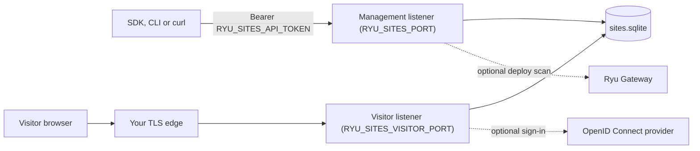
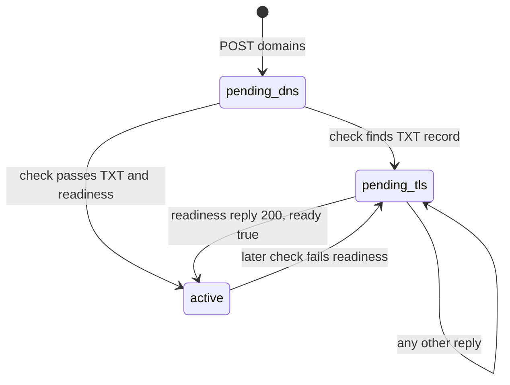

Ryu Sites stores website projects, immutable saved versions, deployments,
durable visitor records, uploaded files, and visitor analytics in SQLite. It
serves the deployed version of each Site on a separate visitor listener under a
restrictive Content Security Policy.

<Figure name="sites" />

Sites can run inside a Ryu node as a Desktop app or as its own process. Both
shapes use the same `/api/sites/*` contract, but they have different process
and credential owners.

<Callout type="warn">
Standalone Sites is early access. There is no Ryu-hosted Sites service, no
published hosted rate, and no published container image. The commands on this
page build and run the service from source on your own infrastructure. Ryu
Sites marketing and catalog pages are shown only for workspaces Ryu has enabled
it for. The Sites app itself ships pre-installed in the Ryu node and keeps
working and receiving updates.
</Callout>

## Choose a deployment shape

| Shape | Credential | API ownership |
|---|---|---|
| Ryu node app | Core-issued sidecar bearer | Core proxies the node-local `/api/sites/*` contract to the Desktop Companion |
| Standalone process | `RYU_SITES_API_TOKEN` | Sites serves `/api/sites/*` directly for one process and data directory |

The standalone process is one tenant per service instance:

- Only the management bearer manages Sites. A signed-in visitor session is
  never accepted on the management API.
- Every Site in the process belongs to one owner, and the project limit (30)
  applies to the whole process.
- Run a separate process and data directory for each tenant that must be
  isolated.

Do not use a Core-issued `RYU_EXT_TOKEN` as a standalone credential.
Standalone mode refuses to start when `RYU_EXT_TOKEN` or `RYU_SITES_TOKEN` is
set.



## Start the standalone service

<Callout type="warn">
Standalone mode needs a ryu-sites release after 0.4.0, and the published
`amajorai/ryu-sites` mirror does not have it yet. Its 0.4.0 sidecar runs only
as the Core-managed sidecar, so `bun run start` with the variables below exits
at once because it has no Core-issued token. Until a later release is
published, the commands below cannot start a standalone process.
</Callout>

Building from source needs [Bun](https://bun.sh).

```sh
git clone --depth 1 https://github.com/amajorai/ryu-sites.git
cd ryu-sites/sidecar
bun install
export RYU_SITES_API_TOKEN="$(openssl rand -hex 32)"
RYU_SITES_MODE=standalone \
RYU_SITES_HOSTNAME=127.0.0.1 \
RYU_SITES_PORT=8021 \
RYU_SITES_VISITOR_PORT=8022 \
RYU_SITES_PUBLIC=1 \
RYU_DIR="$HOME/.local/share/ryu-sites" \
bun run start
```

What each part of the sample needs:

- **`RYU_DIR`** must be a directory the service user can create and write. The
  sample uses one in your home directory. A system path such as
  `/var/lib/ryu-sites` needs a dedicated service account that owns it; see
  [Data and permissions](#data-and-permissions).
- **`RYU_SITES_PUBLIC=1`** lets a Site use the public audience. Without it, and
  without an OpenID Connect client, nobody can open a deployed Site, because a
  private Site needs visitors to sign in; see [Visitor access](#visitor-access).
  Leave it out only when every Site should stay private.
- **`RYU_SITES_API_TOKEN`** must have at least 32 characters and must not be a
  documentation placeholder.
- **Both ports** must be set explicitly. The management API answers on
  `RYU_SITES_PORT`. Deployed pages answer on `RYU_SITES_VISITOR_PORT`.

Setting `RYU_SITES_API_TOKEN` without `RYU_SITES_MODE` also selects standalone
mode. Without either variable, the process runs as the Core-managed sidecar and
needs its Core-issued token.

## Operator configuration

| Variable | Purpose |
|---|---|
| `RYU_SITES_MODE` | `standalone` for this shape. `core` is the Core-managed sidecar. |
| `RYU_SITES_API_TOKEN` | The management bearer. Required in standalone mode. |
| `RYU_SITES_HOSTNAME` | Management bind address. An IP address; the default is `127.0.0.1`. |
| `RYU_SITES_VISITOR_HOSTNAME` | Visitor bind address. An IP address; the default is `127.0.0.1`. |
| `RYU_SITES_PORT`, `RYU_SITES_VISITOR_PORT` | Management and visitor ports. |
| `RYU_DIR` | Data directory. Sites keeps its files in `plugin-data/@ryu+sites/` below it: the database `sites.sqlite`, the visitor quota key `visitor-quota.key`, and the optional `runtime.json`. Unset, it is `~/.ryu` (`~/.ryu-<profile>` when `RYU_PROFILE` names another profile). |
| `RYU_PLUGIN_DATA_DIR` | Optional. Names the Sites data folder itself, replacing `$RYU_DIR/plugin-data/@ryu+sites/`. |
| `RYU_SITES_DOMAIN` | Visitor domain suffix. A Site answers at `<url-name>.<suffix>`. The default is `localhost`. |
| `RYU_SITES_PUBLIC` | `1` allows the public audience. The default is off. |
| `RYU_SITES_TRUSTED_PROXIES` | Comma-separated proxy addresses or CIDRs allowed to report the visitor address. |
| `RYU_SITES_EDGE_READINESS_URL` | Optional HTTPS readiness URL that lets custom domains go live. See [Custom domains](#custom-domains). |
| `RYU_SITES_OWNER_ID` | The owner ID recorded on Sites the management bearer creates. |
| `RYU_SITES_ISSUER`, `RYU_SITES_CLIENT_ID`, `RYU_SITES_CLIENT_SECRET` | An OpenID Connect client for visitor sign-in. The issuer must use HTTPS. |
| `RYU_SITES_GATEWAY_URL`, `RYU_SITES_GATEWAY_KEY` | Optional Ryu Gateway for deploy scans. |
| `RYU_PRODUCT_DASHBOARD_URL` | Optional redirect target for `GET /` on the management listener. Unset, `GET /` describes the service. |

### Without an OpenID Connect client

Settings that need visitor sign-in answer `503 unavailable` with a message that
names `RYU_SITES_ISSUER` and `RYU_SITES_CLIENT_ID`. These are the invited and
workspace audiences, editors, optional sign-in, and shared data. Owner reset
checks are unavailable on a standalone process with any configuration; see
[What still needs Ryu Core](#what-still-needs-ryu-core).

### Owner ID

Choose `RYU_SITES_OWNER_ID` before you create Sites. To view private Sites
while signed in on the visitor origin, set it to your OpenID Connect subject.
Sites created under an earlier owner ID cannot be managed with the bearer, and
still count toward the project limit, until that earlier value is restored.

### runtime.json

`runtime.json` in the Sites data folder (`$RYU_DIR/plugin-data/@ryu+sites/runtime.json`,
or `runtime.json` in `RYU_PLUGIN_DATA_DIR` when that is set) can hold the
non-secret visitor settings: `publicEnabled`, `baseDomain`, `visitorPort`,
`trustedProxies`, `ownerId`, `identity`, and `edge`. Environment variables take
precedence.

## Expose the service

### Management listener

A non-loopback management bind needs `RYU_SITES_API_TOKEN`. The process
refuses `RYU_SITES_HOSTNAME=0.0.0.0` (or any other non-loopback address)
without it, and Core tokens are never accepted in its place.

Put TLS and a rate limit in front of the management API. Sites compares the
bearer in constant time but does not throttle failed authentication itself.

### Visitor listener

The visitor listener serves deployed pages to the public:

- Terminate TLS at your edge and point a wildcard DNS record for
  `*.<RYU_SITES_DOMAIN>` at it.
- When `RYU_SITES_DOMAIN` is not `localhost`, Sites builds HTTPS URLs and sends
  `Strict-Transport-Security`.
- Add the edge address to `RYU_SITES_TRUSTED_PROXIES` so rate limits and
  analytics use the real visitor address.

Visitor requests are limited to 120 per minute per visitor address and 6,000
per minute per Site.

## Custom domains

A custom domain is added, then verified with its ownership TXT record. It
serves visitors only after your edge confirms that it terminates HTTPS for the
domain. No edge ships with Sites.

Without a readiness URL, a verified domain stays pending TLS,
`GET /api/sites/status` reports `domainsAvailable: false`, and visitors use
`<url-name>.<RYU_SITES_DOMAIN>` instead.



Each step runs on `POST /api/sites/projects/:id/domains/check`, which stores
`pending_dns`, `pending_tls` or `active` on the domain.

### Connect an edge

Set `RYU_SITES_EDGE_READINESS_URL`, or `edge.readinessUrl` in `runtime.json` in
the Sites data folder, to an `https://` URL that contains `{host}`.

```json
{ "edge": { "readinessUrl": "https://{host}/_ryu/edge-ready" } }
```

After the TXT record verifies, each domain check replaces `{host}` with the
domain and sends a `GET` to that URL. Sites validates the certificate, does not
follow redirects, and waits up to 5 seconds. The domain becomes active only when
the reply is `200` with this JSON body, naming the same domain.

```json
{ "ready": true, "host": "help.example.com" }
```

Any other reply keeps the domain pending TLS; check it again later. The visitor
listener answers `/_ryu/edge-ready` with that body for every domain bound to a
Site, so an edge that forwards custom domains to the visitor listener can use the
template above.

### Probe safety

A template that puts `{host}` in the hostname proves only what the tenant's own
DNS and server say. Whoever controls the domain's DNS chooses where the probe
connects, and can answer it.

Sites resolves that hostname first and refuses loopback, private, link-local,
carrier-grade NAT, unique-local and cloud metadata addresses. It connects to
the screened address while still checking the certificate for the hostname.

For an edge-attested check, point `readinessUrl` at your edge's own API, such
as `https://edge.example.com/ready?host={host}`, so the edge reports whether it
serves the domain. Sites does not screen a fixed operator hostname. Do not put
credentials in the URL.

## Visitor access

Without an OpenID Connect client, nobody can sign in on the visitor origin. A
private Site then serves nobody, so publish with `RYU_SITES_PUBLIC=1` and the
public audience.

What each kind of access needs:

| Feature | Needs |
|---|---|
| Public audience | `RYU_SITES_PUBLIC=1` |
| Invited viewers (matched by verified email), durable visitor records, uploads | Verified visitor identity from a configured OpenID Connect client |
| Workspace audiences and editors | Ryu workspace membership and management sign-in, so they have no effect in standalone mode |

Register `https://<url-name>.<RYU_SITES_DOMAIN>/_ryu/callback` for each Site at
the identity provider.

### Make a deployed Site public

A new Site is private, and deploying it does not change that: until you choose
the public audience, its pages answer `403` with a "This site is private" page.

1. Start the service with `RYU_SITES_PUBLIC=1`.
2. Set `settings.audience` to `public` with
   `PUT /api/sites/projects/:id/settings` (see
   [the Sites API](/docs/standalone/sites-api#create-save-and-deploy)).

If the operator later turns `RYU_SITES_PUBLIC` off, public Sites are served as
private again until it returns.

## Deploy security checks

Deployment repeats a secret scan of the exact saved version. A match blocks the
deploy with `422 security_blocked`. A passed scan is not a complete code audit.

In standalone mode Sites runs a built-in scanner for common credential formats.
It covers the Ryu Gateway's built-in secret patterns plus a few more:

- **Gateway patterns** - OpenAI, Anthropic, and AWS keys, GitHub tokens, long
  bearer tokens, PEM private keys, API key assignments, and database URLs with
  passwords.
- **Extra formats** - Stripe, Slack, Google, GitLab, npm, and SendGrid keys.

Set `RYU_SITES_GATEWAY_URL` to also require a standalone
[Ryu Gateway](/docs/standalone/gateway) to allow the artifact through its
`POST /v1/firewall/check` secret guardrail, including organization policy. The
URL must use HTTPS, or HTTP to a loopback address. `RYU_SITES_GATEWAY_KEY` is
sent as its bearer.

When the Gateway cannot be reached or refuses the key, the deploy is blocked;
Sites never falls back to the built-in scanner alone.

## Durable records

Connect a Site's database from `POST /api/sites/projects/:id/database/connect`.
In standalone mode the records stay in the service's own SQLite file instead of
a Ryu Spaces database, with the same limits:

- 1,000 records per Site
- 100 records and 120 KB per visitor
- 64 KB per record
- 1.2 MB per Site

Records are deleted with their Site.

### Query records

The owner can query them with one read-only `SELECT` or `WITH` statement
against the `data` table, whose columns are `owner`, `collection`, `key`, and
`value`. Results are capped at 500 rows or 1 MB. Standalone queries run in a
separate helper process and stop after 3 seconds. Give each result column a
distinct name.

### Visitor data requests

The bearer can also list each visitor's stored records and files and delete
one visitor's data, for example to honor a deletion request or to free the
Site's shared limits. Each purge is audited. See
[Visitor data](/docs/standalone/sites-api#visitor-data) in the Sites API.

## Shared visitor data

A Site can keep shared records that every permitted visitor reads together, with
live updates. Turn on `settings.sharedData` (`{ "enabled": true, "write":
"signed-in" }`, or `"editors"`) through the settings route.

Standalone Sites accepts it only when all three hold:

- the Site is in connected mode,
- its records database is connected, and
- an OpenID Connect client is configured.

Shared records are stored in the same local records store and count toward its
1.2 MB size limit. See
[Shared visitor data](/docs/standalone/sites-api#shared-visitor-data) in the Sites
API.

The live change feed and its write rate limits are kept in the service process.
Run one process per data directory; after a restart, reconnecting pages receive a
`reset` event and list the collection again.

## Duplicate a Site

`POST /api/sites/projects/:id/remix` copies a Site's latest saved version into a
new private, undeployed Site.

- **Copied** - the page, its starter, and its data runtime choices.
- **Kept with the original** - access, sign-in, AI settings, the records
  database, shared data, files, extensions, domains, and analytics.

Because one management bearer owns every Site in a standalone process, the
route always acts as a duplicate, and the `remixable` listing is empty.

## Data and permissions

Standalone Sites creates its data directory readable only by the service user
(directories `0700`, files `0600`). The database holds every saved version,
visitor record, uploaded file, and analytics row.

Run the service under a dedicated account that owns `RYU_DIR`, and back up the
Sites data folder, `$RYU_DIR/plugin-data/@ryu+sites/` (or
`RYU_PLUGIN_DATA_DIR`).

### Visitor quota key

Daily AI answer shares are counted under a keyed digest of the visitor's
account or address for that day, never the account or address itself.

Sites creates the 32-byte `visitor-quota.key` in its data folder
(`$RYU_DIR/plugin-data/@ryu+sites/`) on first start and reuses it, so a restart
does not reset anyone's share. Keep it with the database. Sites refuses to
start if the file has any other size, and removing it only starts the current
day's shares over.

## Organization entry point

The standalone management home at `GET /` needs no bearer. It returns a short
JSON description of the service: its name (`ryu-sites`), version, and the
`/health` path.

It redirects people only when `RYU_PRODUCT_DASHBOARD_URL` is set to a non-empty
URL, such as your own console or landing page, so a self-hosted Sites never
sends people to Ryu by default. The Ryu dashboard has no Sites management view.
Manage a standalone service through the [Sites API](/docs/standalone/sites-api).

## What still needs Ryu Core

| Feature | Standalone behavior |
|---|---|
| Sites Companion (the management UI) | Desktop only. Use the API instead. |
| AI page generation (**Generate changes**, **Ask Ryu**) | Desktop only. Send finished HTML to the versions route. |
| Knowledge search and AI answers from Spaces | Unavailable. Settings refuse a knowledge Space and AI answers. |
| General in-page AI (`RyuSite.ai`) | Unavailable. It calls Ryu's model service, so settings refuse the general AI mode. |
| Site Builder agent tools | Unavailable. They run inside Ryu chat. Use the API instead. |
| Owner reset checks | Unavailable. They run a Ryu agent. |
| Plugin installation, visitor connections and owner connections | Unavailable. They use Core's plugin installer and tool dispatcher. Saving owner connections returns `503`. |
| Ryu Spaces database | Replaced by the local records store above. |

`GET /api/sites/status` reports which of these services the process has.

<Cards>
  <DocCard href="/docs/standalone/sites-api" />
  <DocCard href="/docs/surfaces/desktop/user-guide/sites" />
</Cards>
