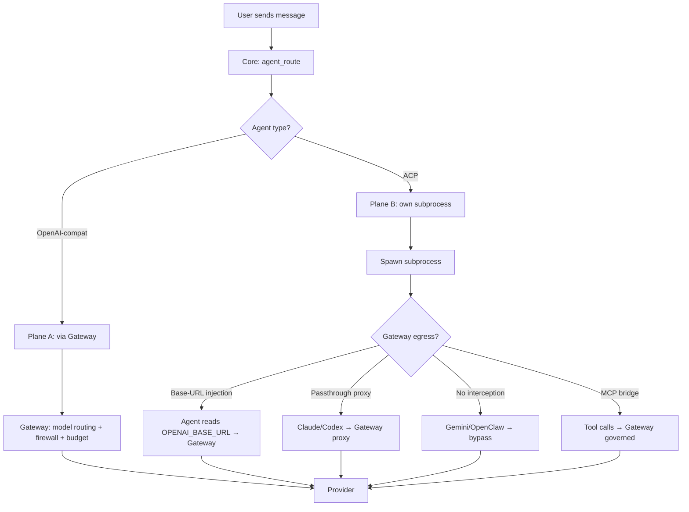

Ryu uses ACP (Agent Client Protocol) to run agents as subprocesses. Core converts each agent's ACP
events into the Vercel AI SDK stream format. The agent's own tool loop reads files, runs commands,
and edits code. The tables below list each agent, its Gateway egress behavior, and how to add it.

## Agent routing overview

## Curated agents

These are hand-curated entries in `AcpAgentRegistry`. They are always listed in the agents
catalog. Only `ryu`, `jay-jr`, and `patrol` are installed by default.

| ID | Canonical ID | Engine | Gateway egress | Description |
|---|---|---|---|---|
| `ryu` | `ryu` | Pi (ACP subprocess) | **Governed by default** | The flagship agent. Pi bound as engine, every call routed through the local Gateway. Pre-installed on a fresh install. Manages its own Pi binary. |
| Jay Jr. | `jay-jr` | `ryu`'s managed Pi (ACP subprocess) | **Governed by default** | An AI twin of Ryu's founder. Runs on the `ryu` agent's Pi and Gateway route under its own agent id, so its spend and budgets are its own. Pre-installed and removable. Its tools are limited to searching its Space and fetching web pages; Pi's own shell and file tools are off for it. |
| Patrol | `patrol` | Ryu's managed Pi | **Governed by default** | The health and security bot. Runs on the flagship's engine under its own agent id, with an hourly patrol and a daily 24-hour report. Pre-installed; removable from the catalog. |
| Claude Code | `acp:claude` | Claude Code (ACP subprocess) | **Governed by default**; direct-egress opt-out | Anthropic's coding agent. Speaks Anthropic Messages format. Subscription-preserving passthrough proxy available. |
| Codex | `acp:codex` | Codex (ACP subprocess) | **Governed by default**; direct-egress opt-out | OpenAI's coding agent. Speaks OpenAI Responses format. Subscription-preserving passthrough proxy available. |
| Gemini CLI | `acp:gemini` | Gemini CLI (ACP subprocess) | **Bypass (not wirable)** | Google's CLI agent. Exposes no base-URL hook, so Gateway cannot intercept its LLM calls. |
| Pi | `acp:pi` | Pi Coding Agent (ACP subprocess) | **Governed by default**; direct-egress opt-out | Earendilworks Pi. Minimal local coding agent. Gateway routing via env injection when used standalone. |

### Gateway egress explained

ACP agents make their own LLM calls inside their subprocess. Whether those calls traverse the
Gateway depends on the agent:

| Mechanism | Agents | How it works |
|---|---|---|
| **Base-URL injection** | `ryu`, `jay-jr`, `patrol`, `pi`, BYO OpenAI-compatible agents | Core injects `OPENAI_BASE_URL` pointing at the local Gateway (`/v1`). The agent's HTTP client routes through the Gateway's firewall, budget, and audit. |
| **Passthrough proxy** | Claude Code, Codex | The agent speaks its native wire format (Anthropic Messages / OpenAI Responses). The Gateway runs a transparent reverse proxy that applies request-side DLP, forwards the caller's subscription credentials unchanged, and streams the response through response-side DLP. |
| **No interception** | Gemini CLI, OpenClaw, Hermes | These agents ignore `OPENAI_BASE_URL` or use their own credential system. Their chat egress bypasses the Gateway. Tool egress is still governed via the MCP bridge. |

New and auto-installed routable ACP agents start with their applicable Gateway path on, plus the
MCP bridge and the current enabled tool/skill scope. An explicit per-agent `false` preference keeps
model egress direct; the separate bridge preference can independently withhold Ryu tools. The
no-interception agents remain chat-routing bypasses because their provider protocol cannot be
redirected.

See [Gateway for any agent](/docs/gateway/gateway-for-any-agent) for the wiring details.

## Registry agents (self-fetching)

Beyond the curated set, Core pulls agents from the official ACP registry
(`https://cdn.agentclientprotocol.com/registry/v1/latest`). Core fetches them and installs them on
demand. If the registry and its local cache are unavailable, Core keeps a small
built-in fallback catalog for the commonly advertised package-based agents, so a cold or offline
install does not make those Store entries disappear. A later launch refreshes the full registry.

### Curated ACP agents (no CDN entry yet)

In addition to the curated agents above, Core curates agents from
`agentclientprotocol.com/get-started/agents` that have no CDN registry entry yet, so the Store
catalog and spawn support them. Each ships its own ACP server over a documented CLI command. All of
them make their own provider calls (Ryu cannot inject `OPENAI_BASE_URL`), so every entry carries
`gateway_bypass: true`.

| Canonical ID | Agent | ACP command | Install hint |
|---|---|---|---|
| `acp:kiro` | Kiro | `kiro-cli acp --agent-engine v2` | Install the [official Kiro CLI](https://kiro.dev/docs/cli/setup/), add it to PATH, then run `kiro-cli login`. The CLI owns authentication and direct model traffic. Saved multi-account credentials and Gateway model compatibility are not available through this native entry. |
| `acp:prime` | Prime Agent | `prime-agent --mode acp` | Prime Intellect's self-improving RLM agent (subagents, quality gates, IPython) |
| `acp:openhands` | OpenHands | `openhands acp` | All Hands AI's autonomous coding agent (formerly OpenDevin); configure an LLM with `/settings` |
| `acp:code-assistant` | Code Assistant | `code-assistant acp` | Open-source Rust coding agent with native GUI, terminal and ACP modes |
| `acp:construct` | Construct | `construct acp` | tmux-for-agent-fleets daemon whose ACP server drives construct sessions |
| `acp:blackbox` | Blackbox CLI | `blackbox --experimental-acp` | Natural-language coding agent; `blackbox configure` first |
| `acp:bub` | Bub | `bub acp` | Bubble-gum Rust coding agent; `bub install bub-acp-server@main` first |
| `acp:raxol` | Raxol | `raxol acp` | Elixir/OTP runtime serving the axol coding agent |
| `acp:localharness` | localharness | `localharness acp --as <name>` | Self-sovereign agent SDK; an on-chain agent identity must exist |
| `acp:kaagum` | Kaagum | `kaagum --api-key-command=… --model=…` | Tiny security-focused Guile agent; speaks ACP natively |
| `acp:docker-agent` | Docker Agent (cagent) | `docker agent serve acp <config>` | Docker's agentic builder/runtime; a config file or URL is required |
| `acp:agentpool` | AgentPool | `uvx agentpool@latest serve-acp <config>` | Orchestrator that bridges external ACP agents; self-fetches via uvx |

### npx / uvx agents

The registry entry supplies the package and arguments. Rows with a full spawn command are in Core's
built-in fallback catalog. "npx (registry)" means the package and arguments come from the live
registry only.

| Registry ID | Canonical ID | Spawn | Description |
|---|---|---|---|
| `qwen-code` | `acp:qwen` | `npx -y @qwen-code/qwen-code --acp --experimental-skills` | Qwen coding agent |
| `github-copilot-cli` | `acp:copilot` | `npx -y @github/copilot --acp` | GitHub Copilot CLI |
| `grok-build` | `acp:grok` | `npx -y @xai-official/grok agent stdio` | Grok coding agent |
| `cline` | `acp:cline` | `npx -y cline --acp` | Cline coding agent |
| `auggie` | `acp:auggie` | `npx -y @augmentcode/auggie --acp` | Auggie coding agent |
| `fast-agent` | `acp:fast-agent` | `uvx fast-agent-acp -x` | Fast Agent |
| `minion-code` | `acp:minion` | `uvx minion-code acp` | Minion coding agent |
| `codebuddy-code` | `acp:codebuddy` | npx (registry) | CodeBuddy coding agent |
| `glm-acp-agent` | `acp:glm` | npx (registry) | GLM coding agent |
| `agoragentic-acp` | `acp:agoragentic` | npx (registry) | Agora coding agent |
| `kilo` | `acp:kilo` | npx (registry) | Kilo coding agent |
| Any other agent on the ACP CDN | `acp:<id>` | Varies | Discovered from the registry |

### Binary-only agents

These agents ship as platform-specific binaries rather than npx packages. The registry publishes
no trusted digest for these archives, so Core refuses to download or run them. Install the agent's
own CLI and put it on PATH. Core then detects the binary and can spawn it.

| Registry ID | Canonical ID | Distribution |
|---|---|---|
| `factory-droid` | `acp:droid` | Binary |
| `goose` | `acp:goose` | Binary |
| `cursor` | `acp:cursor` | Binary |
| `opencode` | `acp:opencode` | Binary |
| `kimi` | `acp:kimi` | Binary |
| `devin` | `acp:devin` | Binary |
| Other binary agents on the ACP CDN | `acp:<id>` | Platform archive |

Registry agents carry `gateway_bypass: true` in their `AgentInfo` because they make their own
provider calls. The exceptions are the Codex and Pi registry entries (`codex-acp`, `pi-acp`),
which read the injected `OPENAI_BASE_URL`. Clients show the flag, so you know the Gateway does not
see that egress.

## Local OpenAI-compatible agents

These agents run as local servers or ACP bridges.

| Engine ID | Description | Gateway egress |
|---|---|---|
| `zeroclaw` | Local OpenAI-compatible server on port 42617 | Routed through Gateway (OpenAI-compat adapter) |
| `openclaw` | OpenClaw native ACP bridge (`openclaw acp`) | Bypass (own gateway) |
| `hermes` | Hermes ACP (`hermes acp`) | Bypass (own credentials) |
| `local` | Plain-LLM fallback (any configured provider) | Routed through Gateway |

## Subscription-login providers

These provider IDs authenticate with the user's existing subscription (OAuth), not an API key.

| Provider ID | Subscription | Wire format |
|---|---|---|
| `openai-codex` | ChatGPT Plus/Pro/Team | OpenAI Responses |
| `claude-pro-max` | Claude Pro/Max | Anthropic Messages |
| `github-copilot` | GitHub Copilot | OpenAI-compatible |

## Per-agent model options

Core publishes the chat-model options for each engine at `GET /api/engines/models`, so every
client shows the same list. The local entry follows the model the Gateway currently serves.

| Engine | Models |
|---|---|
| Claude Code | Opus, Sonnet, Fable, Haiku |
| Codex | GPT-5.1 Codex Max, GPT-5.1 Codex, GPT-5.1 |
| Gemini CLI | Gemini 2.5 Pro, Gemini 2.5 Flash |
| Pi | Default (configurable in the Ryu agent's Pi settings, see [Pi Engine Internals](/docs/start-here/architecture/pi-engine)) |
| Hermes | Hermes 3 |
| Ryu / Local | Gemma 4 E2B (default), any installed model |

## The agents catalog

Onboarding detects which agent CLIs you already have on PATH and offers to add the matching
agent. Only `ryu`, `jay-jr`, and `patrol` are installed by default. Every other agent is opt-in.

| Action | Endpoint |
|---|---|
| List the installable catalog | `GET /api/agents/catalog` |
| Add a catalog agent to the picker | `POST /api/agents/catalog/install` |
| Remove a catalog agent | `POST /api/agents/catalog/uninstall` |
| List installed agents | `GET /api/agents` |

## Agent-auto routing (Plane B)

The agent picker includes an **Auto** entry that picks the agent for each turn from your rules. It
uses the same strategies as smart routing (`llm`, `embedding`, or `keyword`), but each rule
targets an agent ID instead of a model ID. When Auto switches agents, the previous agent's session
stays warm for a switch back, and the conversation history is replayed into the new agent as prior
context. Live state inside the subprocess, such as open files and working buffers, is not
transferred. See [Routing](/docs/gateway/agent-auto) for the
configuration and how the different "auto" settings relate.

## Related

<Cards>
  <DocCard href="/docs/surfaces/desktop/engines/agent-runtimes" />
  <DocCard href="/docs/gateway/gateway-for-any-agent" />
  <DocCard href="/docs/gateway/routing-planes" />
  <DocCard href="/docs/start-here/architecture/core-vs-gateway" />
</Cards>
