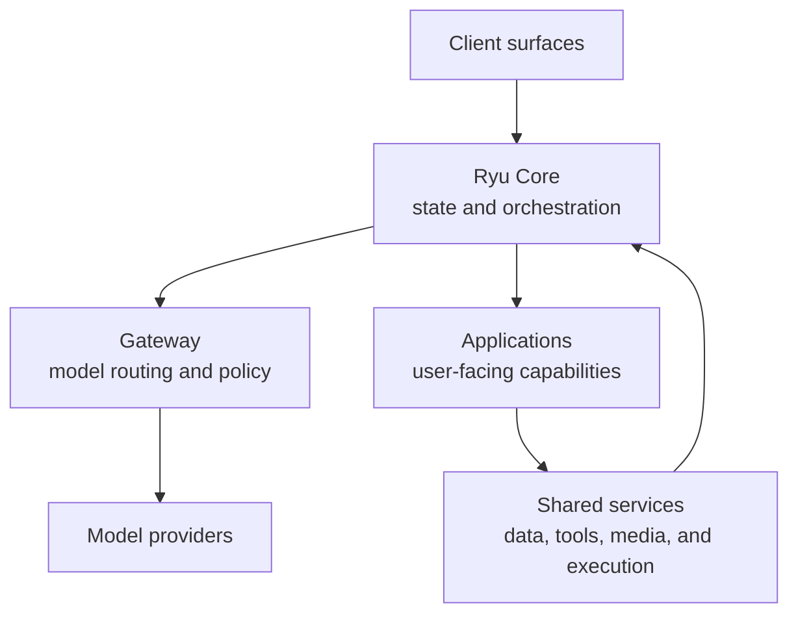
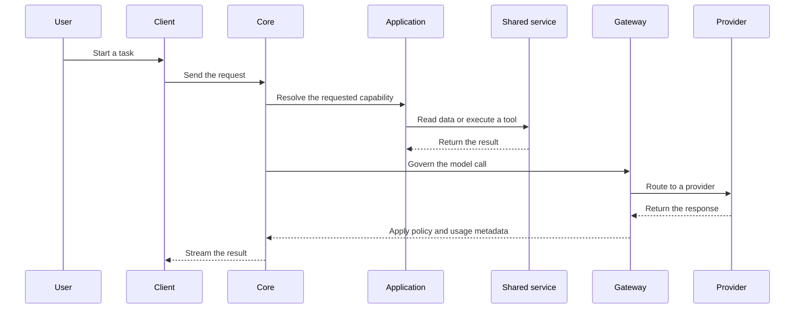

Ryu is organized in layers. Core (the kernel) orchestrates runtime state. Gateway governs model
calls. Applications build user-facing capabilities on top of those services.

This is a conceptual map of runtime responsibilities, not an inventory of internal packages. For
the supported extension points, see the [extension guides](/docs/extend/develop/extensions).

## The layer model

Core owns conversations, identity, lifecycle, and the coordination of work. Shared services
provide durable data, tools, media, and execution capabilities. Applications compose those services
into product surfaces. Gateway keeps model calls governed and observable.

## Cross-layer dependencies

An application may request a shared service through the capability broker
(`apps/core/src/plugins/binding.rs`). The broker resolves the service, applies grants and
configuration, and keeps the application independent of a particular implementation.
[Platform Decomposition](/docs/start-here/architecture/platform-decomposition#the-capability-broker)
gives the resolution order.

Routable model calls pass through Gateway, so routing, budgets, firewall rules, and audit policy
stay in one place. Provider-native agents without a redirect hook are the exception (see
[Core vs Gateway](/docs/start-here/architecture/core-vs-gateway#the-known-bypass)).

## What remains in the kernel

Some responsibilities stay in Core because every authenticated request depends on them: session
coordination, lifecycle and capability resolution, identity, scheduling, and the connection to the
Gateway.

Keeping them in Core avoids duplicated policy and lets applications stay independently
installable. See [Platform Decomposition](/docs/start-here/architecture/platform-decomposition)
for how apps run outside the kernel.

## Related

<Cards>
  <DocCard href="/docs/start-here/architecture/core-vs-gateway" />
  <DocCard href="/docs/start-here/architecture/runnable-model" />
  <DocCard href="/docs/extend/develop/extensions" />
</Cards>
