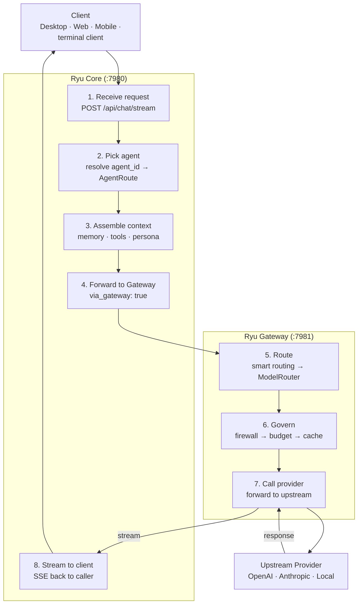
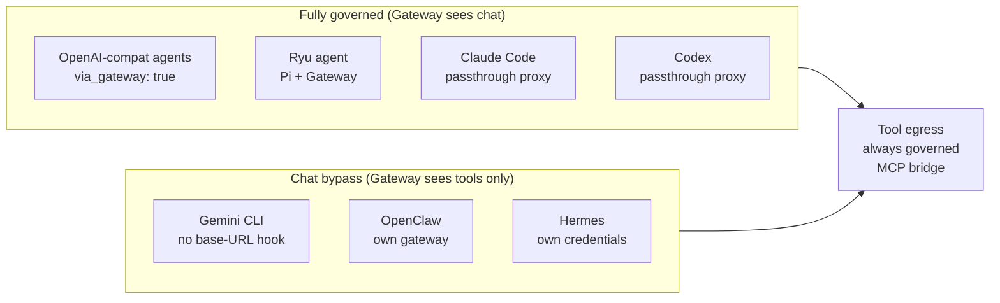

Ryu has two Rust services. One rule decides which service owns a feature.

- If code decides **what runs** (which agent, session, workflow, or tool), it is **Core**.
- If code decides **what is allowed, shared, measured, or paid for** (security, routing, registry,
  evals, budgets, org policy, audit), it is **Gateway**.

Gateway owns policy for model requests routed through its endpoint. Core orchestrates execution;
provider-native runtimes and direct integrations can have separate destinations. Check
[runtime routing](/docs/surfaces/desktop/engines/agent-runtimes) before relying on Gateway controls.

## Why the split matters

Gateway is the control layer. Keeping policy in one service has these results:

- Gateway applies firewall, PII/DLP, budgets, and audit to requests routed through it.
- Compatible clients can use Gateway endpoints after they configure their protocol, credentials, and routing.
- Core contains orchestration only, so it can be self-hosted without the policy layer.

## How a request flows

A default chat request travels through both services:

### Step by step

1. A client calls Core `POST /api/chat/stream` (`apps/core/src/server/mod.rs`).
2. Core decides what runs: it picks the agent, assembles short-term and long-term memory,
   injects allowlisted tools, and selects an adapter.
3. For the default OpenAI-compatible route, Core forwards the model call to the Gateway with
   `via_gateway: true`
   (`apps/core/src/sidecar/adapters/adapter_core/chat_stream_openai_plane.rs`). The Gateway URL
   replaces the provider base URL, and a Gateway inference token, not a provider key, is the
   bearer. Core also forwards the agent id so the Gateway can apply per-agent budgets.
4. The Gateway applies routing, firewall, budgets, caching, and audit, then calls the upstream
   provider.
5. The response streams back through Core to the client.

<Callout type="warn">
  If the Gateway is configured but unreachable, Core falls back to the direct provider path so chat
  keeps working in a degraded mode, and Gateway policy does not apply to that turn. Public agent
  runs with tool access and cloud tasks are the exception. They are rejected instead. An agent
  limited to specific model providers can fall back only to endpoints that need no provider key.
</Callout>

Core manages the Gateway as a sidecar (`apps/core/src/sidecar/gateway.rs`). On spawn, Core passes
the Gateway a `--bind=<addr>` argument derived from `RYU_GATEWAY_URL`. It also sets
`LOCAL_LLM_URL` so the active local engine is a routable provider.

## What lives where

| Concern | Service | Where |
|---|---|---|
| Chat routing and the agent tool loop | Core | `apps/core/src/sidecar/adapters/` |
| Sessions, conversations, memory | Core | `apps/core/src/server/` |
| Spaces (RAG), retrieval | Core | `apps/core/src/server/spaces.rs` |
| Workflows, delegation, scheduler | Core | `apps/core/src/workflow/`, `scheduler/` |
| Sidecar lifecycle, model and skill catalogs | Core | `apps/core/src/sidecar/`, `model_catalog_host.rs`, `skills_catalog/` |
| Capability broker and binding registry | Core | `apps/core/src/plugins/binding.rs` |
| Plugin lifecycle (install/enable/disable) | Core | `apps/core/src/plugins/` |
| Model routing and fallback | Gateway | `apps/gateway/src/router/` |
| Firewall, PII/DLP, prompt-injection | Gateway | `apps/gateway/src/firewall/` |
| Caching, rate limiting, circuit breaker | Gateway | `apps/gateway/src/cache.rs`, `rate_limit/`, `circuit_breaker/` |
| Budgets, evals, audit | Gateway | `apps/gateway/src/budget.rs`, `evals.rs`, `audit.rs` |
| Passthrough proxy (Claude Code, Codex) | Gateway | `apps/gateway/src/passthrough/` |
| Unified tool surface | Gateway | `apps/gateway/src/tools/` |

## The known bypass

ACP agents run as subprocesses that make their own provider calls internally. Core can redirect
routable agents through base-URL injection or the subscription-preserving passthrough. Agents with
provider-native protocols that expose no redirect hook bypass Gateway for chat egress.

The default OpenAI-compatible route and new or auto-installed routable ACP agents route through
Gateway by default. Gemini CLI, OpenClaw, Hermes, and other agents without a redirect hook carry
`gateway_bypass: true` (`apps/core/src/sidecar/adapters/acp/registry_builtin.rs`).

When you need full firewall, budget, and audit coverage, use a Gateway-routed agent and leave its
direct-egress opt-out disabled.

<Callout type="warn">
  Gateway is on the default chat path for routable agents. Provider-native ACP agents remain a chat
  bypass. Gateway sees only their tool egress through the MCP bridge.
</Callout>

## Related

<Cards>
  <DocCard href="/docs/gateway/routing-planes" />
  <DocCard href="/docs/gateway/gateway-for-any-agent" />
  <DocCard href="/docs/start-here/architecture/runnable-model" />
  <DocCard href="/docs/start-here/architecture/capability-layers" />
  <DocCard href="/docs/gateway/routing" />
  <DocCard href="/docs/extend/integrate" />
</Cards>
