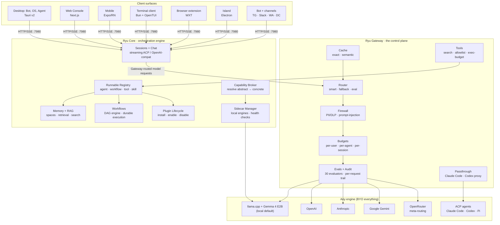

Ryu runs around existing AI agent engines, such as OpenAI models, Claude Code, local Gemma models,
and other OpenAI-compatible runtimes. Ryu controls what an agent can reach, which tools it can use,
what data it can send, and what each call costs.

<Figure name="architecture" />

The product names map to layers of the same system:

- **Bot** is the managed consumer surface.
- **Agent** is the desktop admin surface.
- **Console** is the web admin for accounts and organizations.
- **Platform** is the SDK, Core, and Gateway layer.
- **Apps** are extensions.
- **Infra** is where the node runs.

[Ryu Products, Services, and Infra](/docs/start-here/architecture/three-products) describes each one.

## The full architecture

Core (`apps/core`, default `127.0.0.1:7980`) decides what runs. Gateway (`apps/gateway`, default
`127.0.0.1:7981`) decides what is allowed, routed, measured, and paid for.

- [Core vs Gateway](/docs/start-here/architecture/core-vs-gateway) states the rule and the known
  bypasses.
- [How a request flows](/docs/start-here/architecture/core-vs-gateway#how-a-request-flows) traces
  one chat call through Core, Gateway, and the engine.
- [Routing Planes](/docs/gateway/routing-planes) separates model routing (Gateway) from agent
  routing (Core).

## Where to go next

<AutoCards url="/docs/start-here/architecture" />

<Callout type="info">
  [Core](/docs/core) and [Gateway](/docs/gateway) hold the full subsystem reference.
  [Engines](/docs/surfaces/desktop/engines) covers the swappable runtimes Core manages as sidecars.
</Callout>
