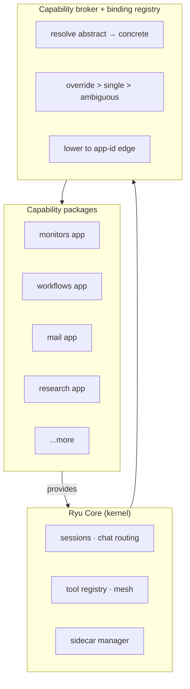
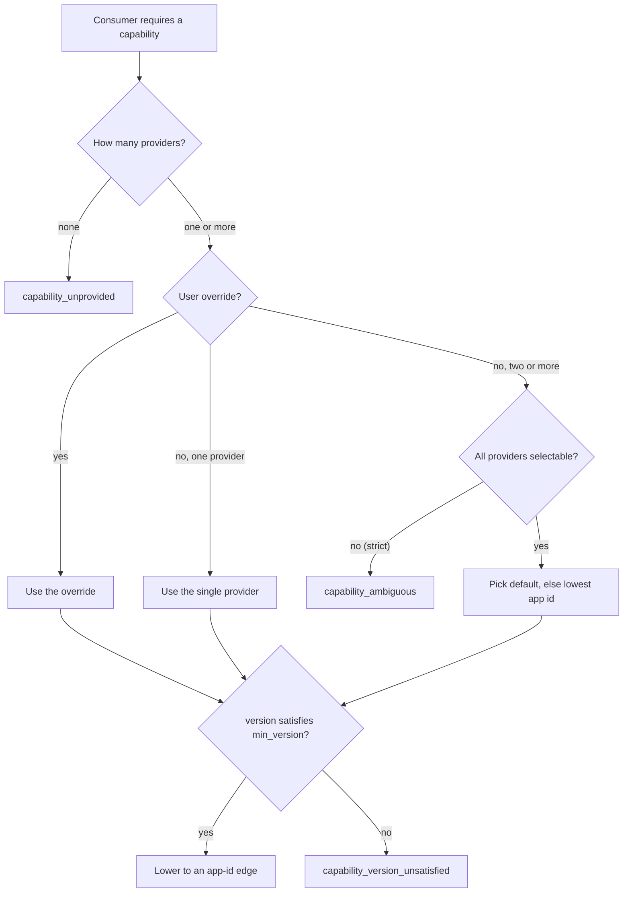
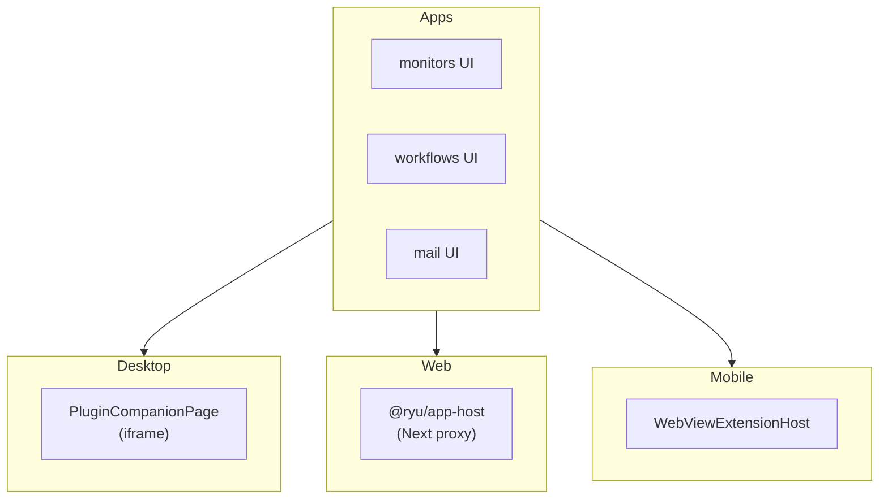

Ryu is a **minimal kernel plus self-contained, sandboxed app packages**. The Core kernel handles
orchestration, sessions, and chat routing. Other capabilities are swappable packages that the
kernel discovers, resolves, and runs. For the conceptual layer map, see
[Capability Layers](/docs/start-here/architecture/capability-layers).

## The model



Each app is a directory under `apps-store/<app>/`. It contains a `manifest.json` and any of the
other entries it needs:

| File | Purpose |
|---|---|
| `manifest.json` | Manifest declaring runnables, permissions, sidecars, and activation events |
| `plugin.json` | Generated Agent Plugins projection of the manifest. Do not hand-edit it (see [Extension schemas and layouts](/docs/extend/develop/extensions/schemas-and-layouts)) |
| `backend/` | Optional Rust backend crate that runs as a sidecar |
| `sidecar/` | Optional external sidecar process |
| `ui/` | Optional Companion UI package, built as a single-file HTML bundle |

## Shared contracts and sidecars

Shared wire types live in a pure-data contracts crate, `crates/core/kernel-contracts`. Core and each
app depend on it, so neither side can drift from the manifest or wire format.

An app that ships a `backend/` or `sidecar/` runs as a separate process. Core starts it,
health-checks it, and proxies its routes through `/api/ext/:plugin_id/*rest`. The sidecar owns its
state and its binary.

## Performance boundary

Ryu keeps the control plane dynamic and the data plane specialized. Providers, capability
bindings, lifecycle, and product surfaces are replaceable plugin contracts. Token/chunk assembly,
event sequencing, authorization, backpressure, queues, and cryptographic invariants stay in the
kernel's tight path.

Resolve a provider once per run, cache its handle, and batch persistence or telemetry. Turn- and
tool-boundary hooks are useful extension points. A hook that runs for every token or chunk needs an
explicit performance budget. See the [kernel boundary benchmark](/docs/reference/benchmark/kernel-boundaries)
for the local comparison track.

## The capability broker

The capability broker (`apps/core/src/plugins/binding.rs`) resolves abstract capability
requirements to concrete provider apps.

A plugin declares:

```json
{
  "requires": { "capabilities": [{ "capability": "rag", "min_version": "1.0" }] },
  "provides": [
    {
      "capability": "rag",
      "version": "1.0",
      "sidecar": "rag-sidecar",
      "route": "/query",
      "grant": "sidecar:process"
    }
  ]
}
```

The registry resolves this to a concrete provider app in this order:

1. **No provider** - resolution fails with `capability_unprovided`.
2. **Override** - an explicit user override wins. The override must name one of the providers,
   else resolution fails with `capability_override_not_provider`.
3. **Single provider** - if only one app provides the capability, the broker uses it.
4. **Two or more providers, no override** - a strict capability (the default, used by `rag` and
   `engines`) fails with `capability_ambiguous` and lists the candidates. A capability is
   selectable only when every provider declares `selectable` (for example `web.search`,
   `browser.control`, or `memory`). The broker then picks the provider that declares `default`,
   else the lexicographically lowest app id.
5. **Version floor** - the chosen provider's capability `version` must satisfy the consumer's
   `min_version`, else resolution fails with `capability_version_unsatisfied`.

The broker then lowers the abstract edge to a bare app-id edge so the existing dependency
graph handles enable/disable/cycle detection unchanged.



## What runs out of process

Feature apps such as mail, teams, research, clips, finetune, quests, healing, monitors,
dashboards, meetings, and recipes ship a `backend/` under `apps-store/<app>/` and serve their API
as a sidecar. The scheduler stays in Core because every subsystem depends on it.

## How apps are surfaced

Each client surface mounts app UIs differently:

| Surface | Mechanism | Implementation |
|---|---|---|
| **Desktop** | Plugin companion host (iframe) | `PluginCompanionPage` renders plugin-declared Companion UI surfaces |
| **Web** | Plugin host panel | `@ryu/app-host` `ExtensionHost` mounts app UIs and calls the app's `/api/ext/*` route |
| **Mobile** | WebView extension host | `WebViewExtensionHost` renders app UIs in a WebView |



## Related

<Cards>
  <DocCard href="/docs/start-here/architecture/capability-layers" />
  <DocCard href="/docs/extend/develop/extensions/plugin-json-manifest" />
  <DocCard href="/docs/core/app-manifest-lifecycle" />
  <DocCard href="/docs/surfaces/desktop/user-guide/store" />
</Cards>
