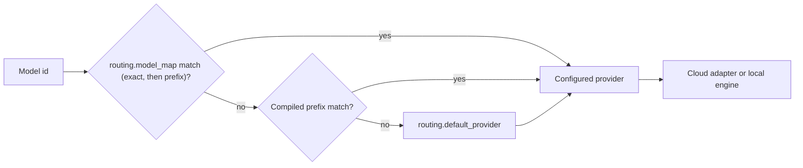

Ryu is provider-agnostic. Every chat model, embedding, reranker, Audio, Voice Recognition, Speech
Processing, and image generation backend is a swappable default. One registry and one
configuration resolve each request to a provider, so you change a provider without changing the
agent, tool, or client that uses it.

<Figure name="providers" />

## Three layers decide where a model call goes

1. **The model id.** A client or agent names a model, for example `claude-sonnet-4-5`, a local
   `gemma` model, or a Ryu Router id. The id is the only thing a caller needs to know.
2. **Gateway routing.** Gateway maps the id to a configured provider. Operator mappings in
   `routing.model_map` win over the compiled prefix table in `crates/gateway/router/src/lib.rs`,
   and `routing.default_provider` takes anything left over. The full order, strategies, and
   smart routing are in [Routing](/docs/gateway/routing).
3. **The provider or engine.** A cloud provider answers through its adapter, or Core serves the
   model from a local engine that it runs as a sidecar process. The engine is chosen from the
   model's weight format (`crates/core/model-format/src/lib.rs`), so an incompatible model shows
   why it needs another engine instead of being hidden.

Provider-native agent engines can bypass Gateway for some calls. Read
[Core and Gateway coverage](/docs/start-here/architecture/core-vs-gateway#the-known-bypass)
before you assume that every model call is governed.

## Where the details live

| Question | Canonical page |
|---|---|
| Which providers exist, by capability | [Providers](/docs/providers) |
| Cloud provider IDs and supported operations | [Cloud providers](/docs/providers/cloud) |
| Local runtimes, platforms, and process ownership | [Local providers and engines](/docs/providers/local) |
| Resolution order, prefix rules, credentials, and `GET /v1/models` | [Routing](/docs/gateway/routing) |
| Model formats and engine compatibility | [Models](/docs/surfaces/desktop/models#model-formats-and-engine-compatibility) |
| Default models per tier | [Default models](/docs/reference/defaults/models) |

## Related

<Cards>
  <DocCard href="/docs/providers" />
  <DocCard href="/docs/gateway/routing" />
  <DocCard href="/docs/surfaces/desktop/engines" />
  <DocCard href="/docs/surfaces/desktop/engines/agent-runtimes" />
</Cards>
