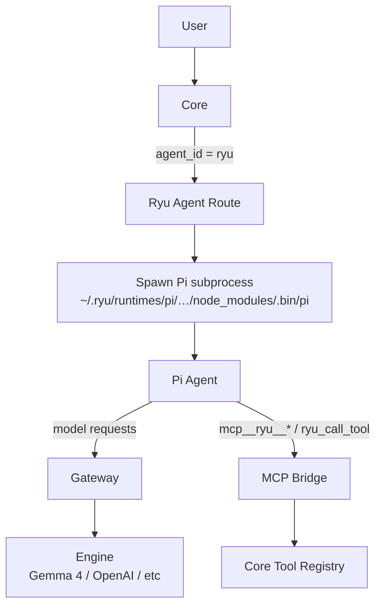

The **Ryu** agent is the default agent installed on every Ryu node (`DEFAULT_AGENT_ID` is `"ryu"`).
It is Pi (the coding agent from Earendilworks) with Gateway on top. When you send a message in Ryu,
the Ryu agent handles it unless you pick a different agent.

## What it is

Ryu is **not** a separate engine. It is a managed configuration of Pi that:

1. **Runs Pi as an ACP subprocess.** Pi is a tool-loop agent that reads files, runs commands, and
   edits code.
2. **Routes model calls through Gateway by default.** Firewall, budget, evals, and audit apply.
   You can opt out (see [When Gateway is off](#when-gateway-is-off)).
3. **Uses an isolated config directory.** `~/.ryu/runtimes/pi-agent` is separate from any Pi you
   have installed yourself.
4. **Exposes Core's tools to Pi.** The managed extension lists and calls tools through Core. Core
   enforces the Ryu agent's allowlist, permissions, approvals, and identity bindings. The built-in
   Ryu agent is seeded with the explicit `*` grant. Newly created agents start with no executable
   tools until you grant a specific tool or `*` in their card.
5. **Manages its own Pi binary.** Core's onboarding installs and version-checks it under
   `~/.ryu/runtimes/pi/`.



## How it differs from bare Pi

| Feature | Bare Pi (`acp:pi`) | Ryu agent (`ryu`) |
|---|---|---|
| **Binary** | User's own `pi` on PATH | Managed `~/.ryu/runtimes/pi/…/node_modules/.bin/pi` |
| **Config directory** | `~/.pi/agent` | `~/.ryu/runtimes/pi-agent` (isolated) |
| **Gateway routing** | **On by default** for the routable ACP entry; direct-egress opt-out | **On by default** (`gateway_bypass: false`); direct-egress opt-out |
| **Model calls** | Gateway-governed by default (unless opted out) | Gateway-governed by default (unless opted out) |
| **MCP tools** | Pi's built-in only | Core's allowlisted tool registry via `ryu-mcp.ts` |
| **Skills** | Pi's own skill system | Core's skill catalog (progressive disclosure) |
| **Context management** | Pi's own (llama.cpp context-shift) | Ryu's trim/compact layer (opt-in) |
| **Update lifecycle** | Manual | Core manages Pi binary updates |

## The routing chain

When a chat message arrives with `agent_id = "ryu"`, Core follows this path:

1. **`agent_route()`** (`apps/core/src/sidecar/adapters/adapter_core/route_reach.rs`) delegates to
   `agent_route_with_user_jwt()` (`adapter_core/agent_route_jwt.rs`), which matches the `"ryu"` id
   before the generic default and calls `ryu_agent_route_with_user_jwt()`
   (`adapter_core/ryu_route.rs`). Jay Jr. and Patrol take the same route under their own agent id.
2. **`ryu_agent_route_with_user_jwt()`** builds the spawn command with
   `acp::ryu_pi_acp_cmd_for_agent()` (`apps/core/src/sidecar/adapters/acp/pi_cmd.rs`). If the
   managed Pi binary is not installed yet, it falls back to the `acp:pi` entry, still pointed at
   Ryu's isolated config directory.
3. Core prepares the managed Pi runtime and isolated configuration, then starts it through ACP.
   No node-wide bearer or user JWT is passed into the agent process.
4. The managed extension receives a short-lived capability for that exact ACP session. Core accepts
   it only on the dedicated tool broker, resolves caller, conversation, agent, and narrowing scopes
   from its server-side record, and forwards calls through the normal governed dispatcher.
5. Pi runs its full tool loop (model, tool calls, tool results, continue) over ACP.
6. Core forwards ACP events (text, tool calls, results, usage) to the client.

The extension is a proxy, not an authorization bypass. It does not submit caller, agent,
conversation, or profile-scope values as authority. Core recovers them from the session record and
rechecks ownership and current agent policy on every call.

The capability has a bounded life:

- It expires.
- It is revoked when the session is replaced or closed.
- It is invalidated when the node token rotates.
- It cannot authenticate to other Core routes.

## The Gateway integration

Gateway routing is on by default for the Ryu agent. Other routable ACP agents use the same
governed-by-default posture through their own mechanism. Two mechanisms send the Ryu agent's model
calls through Gateway:

### 1. Environment injection

Core injects `OPENAI_BASE_URL=http://127.0.0.1:7981/v1` and `OPENAI_API_KEY=<gateway-token>` into
the Pi subprocess when Gateway routing is on. Any HTTP client in Pi that reads these env vars
routes through Gateway.

### 2. models.json pinning

Pi does **not** honor `OPENAI_BASE_URL` for its built-in `openai` provider. It uses its own
provider config with its native `api: "openai-responses"`.

Ryu's config layer writes
`models.json` to pin the `openai` provider at the local Gateway (`http://127.0.0.1:7981/v1`), with
the Gateway token as its `apiKey`. Pi's model calls then reach Gateway however Pi resolves its
provider internally. See [Pi Engine Internals](/docs/start-here/architecture/pi-engine#modelsjson)
for the file format.

### What the Gateway applies

When a model call from the Ryu agent reaches the Gateway, it goes through the full pipeline:

- **Authentication** validates the Gateway token.
- **Budget check** enforces per-key, per-org, and per-agent budgets.
- **Firewall scan** runs PII/DLP, prompt-injection detection, and custom patterns.
- **Model routing** picks the upstream provider for the call.
- **Cache check** looks up the exact and semantic caches.
- **Provider call** forwards the request to the upstream (OpenAI, a local engine, and others).
- **Audit** logs the request.
- **Evals** run inline evaluation, such as prompt-injection and PII detectors.

See [Gateway routing](/docs/gateway/routing) for the full pipeline.

## The MCP bridge for Pi

Pi's ACP bridge does not pass MCP servers through from the ACP session. The `ryu-mcp.ts`
extension connects Pi to Core's tools through these paths:

| Path | What it does |
|---|---|
| `mcp__ryu__*` tools | Core's MCP bridge, registered with Pi's built-in MCP client. The agent's granted tools are deferred: Pi's `tool_search` loads them when needed. |
| `ryu_call_tool` | Calls any Core tool by id, including searchable-but-unlisted tools such as Composio actions |
| `ryu_list_tools` | Lists the Ryu tools this agent can call |

With these paths the Ryu agent can call widget-bearing tools (Apps-SDK / MCP apps), use the
self-API, and reach any tool in Core's registry. Interactive apps render inline in the chat on
both calling paths (`mcp__ryu__*` and `ryu_call_tool`).
See [Pi engine internals](/docs/start-here/architecture/pi-engine#the-ryu-mcpts-extension).

## Context management

Without Ryu's context-window management, Pi relies on llama.cpp's built-in context-shift, which
can evict the **system prompt** along with the oldest turns.

Ryu's context-management layer keeps
the system block and either trims older turns (**Trim**) or summarizes them through Gateway
(**Compact**). It moves the cut in fixed steps so a provider prompt cache keeps hitting, and it can
compact harder once that cache has expired.

<Callout type="warn">
  Context management is opt-in and off by default.
</Callout>

Separately, when you switch a conversation to a model with a smaller context window, Ryu hands the
earlier history off as a one-time summary. That handoff is **on by default**.

The modes, token accounting, cache behavior, handoff options, and the preferences that turn each
one on are in
[Pi Context Management](/docs/start-here/architecture/pi-context-management).

## Managed Pi config

Ryu owns `settings.json`, `models.json`, and `auth.json` in the `~/.ryu/runtimes/pi-agent/`
directory. `models.json` pins Pi's `openai` provider at the local Gateway, and `auth.json` holds
only the active account's credentials. The fields and the credential vault are in
[Pi Engine Internals](/docs/start-here/architecture/pi-engine#the-config-directory).

## The managed subscription

The default model for the Ryu agent is `openrouter/auto` via the managed subscription provider
(`managed-openrouter`). This is always Gateway-routed: it reuses the `openai` pin so egress is
governed and metered against the user's Ryu credits. The Gateway maps `openrouter/auto` onto the
OpenRouter provider. No BYOK required.

## Agent configuration

The Ryu agent exposes independent settings for its model, voice, tools, memory, persona, and policy:

| Setting | Default | Configurable? |
|---|---|---|
| Chat model | `openrouter/auto` (managed) or `gemma-4-E2B-it-Q4_K_M` (local) | Yes, any Gateway-routable model |
| Voice Recognition engine | Whisper / Parakeet | Yes |
| Audio engine | Kokoro 82M (OuteTTS fallback) | Yes |
| Image model | stable-diffusion.cpp | Yes |
| Tools / MCP | Core's allowlisted registry | Yes, through the MCP registry and plugin system |
| Memory / Spaces | Long-term memory + RAG | Yes |
| Persona | System prompt | Yes |
| Gateway Policy | Default firewall + budget | Yes |

See [Agent setup](/docs/learn/academy/operator/agents-as-cards) for the complete configuration walkthrough.

## When Gateway is off

The Ryu agent has no separate Gateway on/off switch. The provider you pick in the Ryu agent's
model settings decides the route: the Ryu-managed `gateway` provider is routed through Gateway,
and your own provider key is not. The per-agent `agent-gateway-routing` preference is not read for
the Ryu agent (`apps/desktop/src/lib/api/agent-egress.ts`).

With a direct provider, the Ryu agent becomes plain Pi: an ACP subprocess that calls that provider
directly. The MCP bridge still works (tools are still callable), but the Gateway pipeline
(firewall, budget, evals, audit) does not apply to model calls. To set the provider from the Core
API, send `PUT /api/pi-config` (`apps/core/src/pi_config/mod.rs`, `PiConfigInput`):

```bash
# Send the Ryu agent's model calls straight to your own provider key
curl -X PUT http://localhost:7980/api/pi-config \
  -H "Authorization: Bearer $RYU_CORE_TOKEN" \
  -H 'Content-Type: application/json' \
  -d '{ "provider": "openai", "model": "<model-id>", "apiKey": "<your-key>" }'
```

## Related

<Cards>
  <DocCard href="/docs/start-here/architecture/pi-engine" />
  <DocCard href="/docs/start-here/architecture/acp-agents" />
  <DocCard href="/docs/gateway/routing" />
  <DocCard href="/docs/core/conversations-sessions" />
  <DocCard href="/docs/start-here/architecture/batteries-included" />
</Cards>
