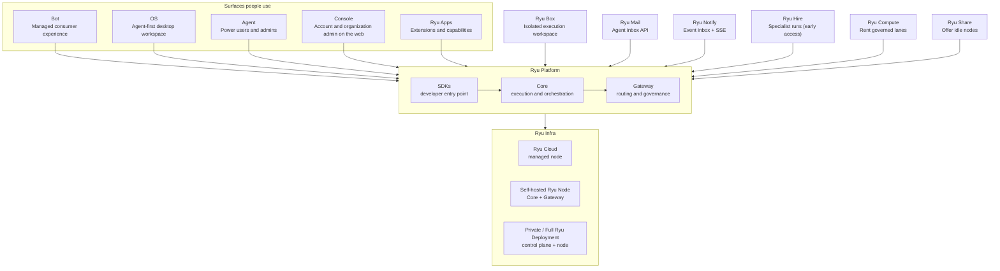

Ryu is one system with different surfaces for different jobs. Each name below describes a
different boundary. None of them is a separate runtime or a copy of another interface.

- **Desktop app.** Bot (managed), OS (agent-first workspace), and Agent (power users and admins).
- **Web.** Console, for your account and organizations.
- **Standalone services.** Ryu Gateway, Ryu Box, Ryu Mail, and Ryu Notify, which can also plug
  into the workspace. Ryu Hire is planned. Ryu Compute and Ryu Share are early-access exchange
  surfaces.
- **Building and running.** Ryu Platform (the developer layer), Ryu Apps (extensions), and Ryu
  Infra (Ryu Cloud, a Self-hosted Ryu Node, or a Private/Full Ryu Deployment).

In the desktop app, Bot, OS, and Agent are the built-in [interfaces](/docs/surfaces/desktop/interfaces)
for three tiers: managed, workspace, and admin. They are not the only interfaces. Channels, Feed,
and 2D and 3D worlds present the same agents and conversations in the workspace tier, and plugins
can add more from the Store.

The tier decides what a person can access. The interface decides only how it looks.

## The product model

| Surface or layer | Audience | What it is for |
|---|---|---|
| **Bot** | Everyday teams | Use managed AI without configuring providers, nodes, or infrastructure. |
| **OS** | People moving between agent Apps | Arrange live work in a dock-and-window desktop with an App Launcher. |
| **Agent** | Power users and admins | Configure and operate a Ryu node, its models, tools, permissions, and Apps. |
| **Console** | Account owners and organization admins | Manage usage, limits, members, keys, policies, and billing on the web. |
| **Ryu Gateway** | Product teams and operators | Call models, tools, and Skills programmatically through a governed standalone service. |
| **Ryu Box** | Agent builders and operators | Give runs a persistent, isolated workspace for files, commands, and previews. |
| **Ryu Mail** | Agent builders and operators | Give agents inboxes they can receive from and send through an authenticated API. |
| **Ryu Notify** | Product teams and operators | Store product events and consume them through bounded REST history or SSE. |
| **Ryu Hire** | People with a one-off task | Planned: recruit a managed specialist for one run without installing it. Early access; not yet available. |
| **Ryu Compute** | People who need temporary capacity | Choose a bounded CPU or GPU workcell; the early-access Desktop surface does not submit live leases yet. |
| **Ryu Share** | People with idle nodes or agents | Configure when a node may offer a workcell or approved agent; publishing and payouts are not live yet. |
| **Ryu Platform** | Developers and product teams | Build on the SDKs, Core, Gateway, orchestration, routing, and governance contracts. |
| **Ryu Apps** | Users, admins, and extension authors | Add packaged capabilities and user-facing surfaces to Ryu. |
| **Ryu Infra** | Operators and enterprises | Choose Ryu Cloud, run a Self-hosted Ryu Node, or operate the full private deployment. |

The public product pages are [Bot](https://ryuhq.com/bot), [OS](https://ryuhq.com/products/os),
[Agent](https://ryuhq.com/agent), [Ryu Gateway](https://ryuhq.com/products/gateway),
[Ryu Box](https://ryuhq.com/products/box), [Ryu Mail](https://ryuhq.com/products/mail),
[Ryu Notify](https://ryuhq.com/products/notify), [Ryu Hire](https://ryuhq.com/products/hire),
[Ryu Compute](https://ryuhq.com/products/compute), [Ryu Share](https://ryuhq.com/products/share),
and [Ryu Platform](https://ryuhq.com/platform).

The exchange surfaces are currently an early-access Desktop experience. See
[Compute and Share](/docs/surfaces/desktop/user-guide/compute-share) for their product split and
the current lease and provider boundaries.

The standalone service domains are API entry points. Their browser home routes lead back to the
signed-in organization's [Console](/docs/billing/organization-console). There, the organization
**Products** view manages Box workspaces and Agent Inboxes alongside the existing Gateway controls.

## Bot

Bot is the fully managed consumer interface. A person creates an account, connects the sources
they approve, and gives Ryu work in plain language.

Bot does not expose:

- provider keys or model routing;
- node, Gateway, or infrastructure setup;
- evaluation and policy configuration;
- the full extension and operator surface.

Bot can still enforce simple access levels for the data and tools each Bot can use. The managed
workspace, model access, sandbox, and device permissions remain controlled by Ryu and the
organization.

See [Bot](/docs/surfaces/desktop/bot) for the implementation-facing surface notes.

## Agent

Agent is the desktop app's full workspace. It is the control surface for people who need to
understand and configure how Ryu runs work. (It is not the same thing as **Ryu Agent**, the
default agent you chat with in every interface.)

Agent is where a power user or admin can:

- use a Ryu-managed model, a local model, or a provider they already pay for;
- configure a managed or self-hosted node;
- manage tools, Skills, Apps, permissions, and approval behavior;
- inspect runs, costs, context, and the records a workflow leaves behind.

Agent gives access to controls that are too complex or risky for an everyday Bot user. It is
not a separate runtime. It connects to the same Core and Gateway contracts used by the rest of
Ryu.

The technical desktop reference is [Agent](/docs/surfaces/desktop/agent). The [Island](/docs/surfaces/island)
is a separate companion surface and is not part of the Bot product.

## OS

OS is a dock-and-window view of the desktop workspace. The dock opens Chat, Spaces, Tools,
Skills, Apps, and Review as live windows. The App Launcher (`Cmd/Ctrl-K`) shows both Apps and open
windows, so you can switch without closing work in progress.

OS uses the same desktop tabs, Core sessions, Gateway policies, and permission checks as
Agent. Its wallpaper and window chrome change only the presentation. They do not create a new
runtime or change what an App is allowed to do.

See [OS](/docs/surfaces/desktop/ryu-os) for the user-facing interaction model.

## Console

Console is Ryu on the web for your account and your organizations. Each organization has its own
section for usage, limits and budgets, members, keys, policies, vault secrets, and billing. See
[Organizations in Console](/docs/billing/organization-console) for the pages it holds.

## Ryu services

These services can be used without the desktop as the entry point:

- **Ryu Gateway** exposes governed model, tool, and Skill calls for an agent or another system.
  Programmatic execution still follows the allowlist, budget, and audit path described in
  [Programmatic tool calling](/docs/core/programmatic-tool-calling).
- **Ryu Box** provides a persistent, isolated execution workspace for a run. It is not a model
  provider or a replacement for Gateway policy.
- **Ryu Mail** provides Agent Inboxes through the Mail service. The self-host process owns its
  mailbox state, SMTP hand-off, and per-inbox HMAC inbound route.
- **Ryu Notify** provides a separate event inbox for products and agents. It is not Core's
  user-scoped notification/HITL feed. Its service contract is HTTP history plus SSE.
- **Ryu Hire** is the planned one-off path: choose a specialist, review what it needs, then run
  it without installing the agent. It is in early access; no Hire run, price, or API is available
  yet.

<Callout type="warn">
  Each standalone service is rolled out separately per account, and Ryu Box is on by default. The
  standalone listings for Ryu Gateway, Ryu Mail, Ryu Notify, and Ryu Hire stay hidden until the
  rollout reaches your account, so their pricing cards and Store entries may not be visible yet.

  The Ryu Gateway product page stays visible because the managed Gateway is in every plan.
  Plan-included features, such as Agent Inboxes and the managed Gateway, do not depend on these
  rollouts.
</Callout>

## Ryu Platform

Platform is the layer for building an AI product on Ryu rather than using Ryu only through its
interfaces.

### SDKs

The SDKs are the developer entry point. They let an application create sessions, call Ryu
capabilities, stream results, and connect its own interface to the runtime. SDKs are contracts.
They do not decide whether the underlying node is managed or self-hosted.

### Core

Core executes and orchestrates work. It owns the runtime behavior that turns a request into model,
tool, sandbox, memory, and workflow activity.

### Gateway

Gateway is the control point for calls entering and leaving Ryu. It handles:

- model and provider routing;
- permissions and tool policy;
- budgets, rate limits, and cost visibility;
- firewall and data-boundary checks;
- evaluation hooks and audit records.

See [Core vs Gateway](/docs/start-here/architecture/core-vs-gateway) for the ownership boundary
and [Gateway for any agent](/docs/gateway/gateway-for-any-agent) for the integration path.

## Ryu Apps

Apps are extensions, not another interface. An App can add a tool, workflow, data
surface, or interactive UI using Ryu's extension contracts.

Apps can be:

- installed and used from Bot when the capability is safe and simple enough for a managed user;
- configured and operated from Agent;
- built and distributed by developers through Platform and the SDKs.

The App manifest and lifecycle are documented in [Ryu Apps](/docs/extend/develop/extensions/ryu-apps).

## Ryu Infra

Infra describes deployment, not product UX.

### Ryu Cloud

Ryu Cloud is the managed path. Ryu operates the node, the managed Core and Gateway, identity,
billing, and the surrounding operational services. Bot uses this path by default, while Agent
and Platform can connect to the managed node when the account or organization allows it.

### Self-hosted Ryu Node

The Self-hosted Ryu Node is the default OSS self-hosting unit. The customer runs Core and Gateway
in its own environment, and `ryu-cli`, the SDK, or a compatible client operates it. The desktop
app is optional, and no Ryu-operated account or backend is required.

### Private/Full Ryu Deployment

The Private/Full Ryu Deployment adds a customer-operated identity, organization, entitlement,
billing, Marketplace, and optional Web/API control plane around one or more self-hosted nodes. It
is an expanded operating model, not a replacement runtime or another user interface.

Managed and self-hosted are deployment choices for the same Core, Gateway, and SDK contracts.
[Open Core](/docs/start-here/architecture/open-core#deployment-units) lists what each
self-hosted unit contains, what it leaves out, and how each part is licensed.

## Enterprise

Enterprise is a commercial operating model across Agent, Console, Platform, and Infra. Depending
on the deployment, it can include organization policies, SSO, provisioning, audit, private managed
infrastructure, self-hosting support, and service commitments.

Enterprise does not replace Bot, Agent, Console, or Platform. It determines how an organization
governs, deploys, and supports them.

## Which should I use?

| If you want to... | Start with... |
|---|---|
| Give AI everyday work without setting up a stack | [Bot](https://ryuhq.com/bot) |
| Arrange agent Apps in a desktop workspace | [OS](https://ryuhq.com/products/os) |
| Configure models, tools, permissions, or a Ryu node | [Agent](https://ryuhq.com/agent) |
| Manage an organization's members, usage, and billing | [Console](https://ryuhq.com/console) |
| Call governed tools or Skills from another system | [Ryu Gateway](https://ryuhq.com/products/gateway) |
| Give a run an isolated persistent workspace | [Ryu Box](https://ryuhq.com/products/box) |
| Give an agent an API-backed email inbox | [Ryu Mail](https://ryuhq.com/products/mail) |
| Record product events and follow them live | [Ryu Notify](https://ryuhq.com/products/notify) |
| Run a specialist once (early access, not yet available) | [Ryu Hire](https://ryuhq.com/products/hire) |
| Build an AI product on Core and Gateway | [Ryu Platform](https://ryuhq.com/platform) |
| Add a packaged capability or UI | [Ryu Apps](/docs/extend/develop/extensions/ryu-apps) |
| Decide where the node runs | [Ryu Infra](#ryu-infra) |
| Meet organization or deployment requirements | [Enterprise](#enterprise) |

## Related

<Cards>
  <DocCard href="/docs/start-here/architecture/core-vs-gateway" />
  <DocCard href="/docs/start-here/architecture/open-core" />
  <DocCard href="/docs/start-here/architecture/batteries-included" />
  <DocCard href="/docs/gateway/gateway-for-any-agent" />
  <DocCard href="/docs/extend/develop/extensions/ryu-apps" />
</Cards>
