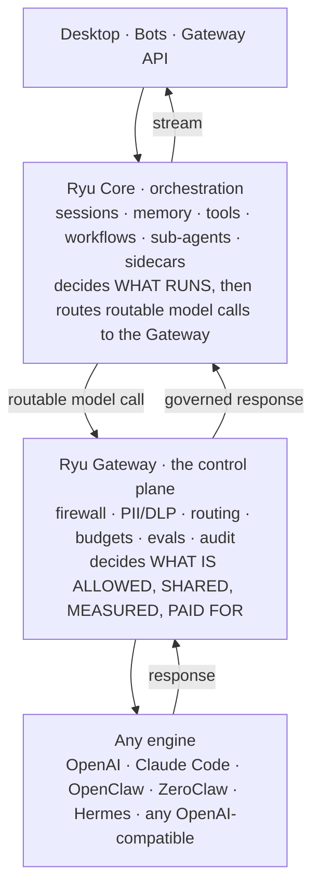
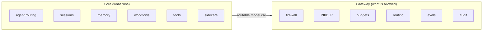

Ryu is a managed AI deployment platform for lean tech teams without a platform team. Bring the AI
agent or bot you already have, connect the tools and models it needs, and Ryu deploys it and keeps
it running in the cloud.

Agent engines already exist, including OpenAI, Claude Code, OpenClaw, ZeroClaw, Hermes, and any
OpenAI-compatible runtime. Ryu treats them as interchangeable parts and provides the layer around
them. That layer decides which models an agent can reach, which tools it can use, which data is safe
to send, what each call costs, how the agent is governed, and how good its outputs are.

## Nothing hardcoded, everything swappable

Ryu provides orchestration and controls around supported runtimes, including Claude Code,
Codex, Pi, and OpenClaw. You can change supported models, providers, and runtime configuration.
That does not guarantee direct migration of an existing agent or its tools and state.

The main configurable layers include:

| Layer | Default or configured component | Replacement options |
|---|---|---|
| Chat and model | llama.cpp + Gemma 4 (local) | Ollama, vLLM, SGLang, MLX, any OpenAI-compatible, or a hosted provider |
| Embedding | `nomic-embed-text-v1.5` (GGUF, local) | any registry embedder |
| Reranker | BAAI `bge-reranker` | any registered reranker |
| RAG strategy | vector (sqlite-vec) | vector and GraphRAG |
| Agent engine | "Ryu" (Pi + the Gateway on top) | Claude Code, Codex, Gemini CLI, bare Pi, OpenClaw, Hermes, any ACP agent |
| Audio / Voice Recognition | Kokoro 82M (OuteTTS fallback), whisper.cpp / parakeet | KittenTTS, Pocket TTS, any Audio-sidecar backend |
| Image generation | stable-diffusion.cpp | any compatible engine |
| Sandbox backend | wasmtime (ephemeral) | Docker/OCI (opt-in, requires a Docker daemon) |
| Marketplace source | first-party + HF / skills.sh / MCP registry | any user-added `CatalogSource` |

These components use registry or configuration choices. A replacement needs a compatible
interface and its own credentials, files, and runtime setup. `DEFAULT_AGENT_ID` is `"ryu"`, the
default chat model is overridable, and the data folder is relocatable (see
[Data and storage](/docs/surfaces/desktop/user-guide/data-and-storage)). The full list of shipped
defaults is in [Batteries Included](/docs/start-here/architecture/batteries-included). Check
supported replacements and test the task after you change a default.

## Orchestration above engines, not another engine

Ryu does not reimplement the agent loop. It wraps whatever engine you picked and hands every
**routable** model call to the Gateway for governance. Every request that the selected engine
exposes to Ryu follows this flow:

The diagram shows the main design rule: Core decides *what runs*, and Gateway decides *what is
allowed, shared, measured, or paid for*. Provider-native runtimes that do not expose a redirect hook
bypass Gateway, and Ryu labels their model traffic as a bypass. See
[Core vs Gateway](/docs/start-here/architecture/core-vs-gateway) for the rule and the coverage
matrix.

<Cards>
  <DocCard href="/docs/start-here/architecture/core-vs-gateway" />
  <DocCard href="/docs/start-here/architecture/runnable-model" />
  <DocCard href="/docs/start-here/architecture/capability-layers" />
</Cards>

## From chat to completed work

Give Ryu an outcome, see a short plan, let it work while you leave, approve only consequential
actions, and return to a receipt of what happened. The [last-mover agent](/docs/start-here/architecture/last-mover-agent)
page describes the quality bar for that experience.

That experience sits on the durable contracts Ryu already exposes for runs, workflows, approvals,
artifacts, routines, and agent teams.

## The non-negotiable principles

| Principle | What it means |
|---|---|
| **Orchestration-first** | Wrap whatever engine the user picked. Never reimplement the agent loop. |
| **Outcome-first** | A long or consequential request becomes a durable task with a plan, progress, evidence, and a truthful outcome. |
| **Local-first and headless-first** | Core runs with no UI, no cloud, and no streaming required. It is a real local backend, not a thin client. |
| **Modular** | Everything beyond the kernel is opt-in through configuration. |
| **Configurable access** | Supported agents, provider keys, and account integrations need their own setup and migration checks. |
| **Encrypted by default, diagnostics export off by default** | Conversations and memory are sealed at rest. Diagnostics export is opt-in. Product analytics, crash reports, anonymous community stats, and the signed-in daily activity ping are on by default and can be turned off in **Settings → Privacy** (see [Privacy and Telemetry](/docs/surfaces/desktop/transparency)). |

<Callout type="info">
With no API key or setup, Ryu runs locally after install. See
[Batteries Included](/docs/start-here/architecture/batteries-included) for the defaults that ship
with Ryu and how to swap them.
</Callout>

## Different surfaces, one Ryu system

Ryu separates the experience people use from the layers that make it run. Bot is the managed
surface, Agent is the desktop operator surface, Ryu Platform is the SDK, Core, and Gateway layer, Ryu
Apps are extensions, and Ryu Infra is where the node runs. The business shape is open core plus
managed cloud. See [Ryu Products, Services, and Infra](/docs/start-here/architecture/three-products)
for the full comparison and [Open Core](/docs/start-here/architecture/open-core) for the license split.

<Callout type="warn">
Some surfaces described across these docs are opt-in, off by default, platform-limited, or built
but not yet live-verified against a running node. Each page carries its own maturity caveats. Read
them before you rely on a feature.
</Callout>
