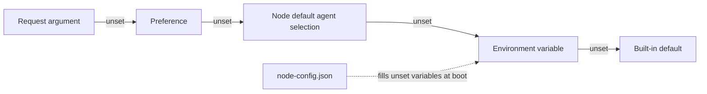

Most of what you configure in Ryu is **not** an environment variable. Bots, agent bindings,
models, prompts, and policies live in config stores you edit from Settings. Their environment
variables are fallbacks for headless and container deployments, listed in
[Environment Variables](/docs/start-here/environment-variables).

<Figure name="configuration" />

## The three tiers

| Tier | What lives here | Stored in | You change it via |
|---|---|---|---|
| **1. Bootstrap** | Profile, bind addresses, data directory, the path *to* the config file, node auth token | Environment only | Shell, systemd unit, Docker/compose |
| **2. Secrets** | Provider API keys, bot tokens | Environment, or sealed per-value inside the channel store | Shell, or Settings (sealed, write-only) |
| **3. Behavior** | Bots, agent bindings, models, prompts, reply policies, budgets | Channel store, node preferences, `node-config.json`, `gateway.toml` | Settings UI, the JSON file, or the TOML file |

Tier 1 must be in the environment, because Ryu cannot read a setting from a config file whose
location that setting provides. Most settings are tier 3, where the environment is the weakest
source.

<Callout type="info">
  **Rule of thumb.** If a setting has a picker in Settings, the picker wins. The matching
  environment variable only applies when nothing has been set through the UI.
</Callout>

## The configuration format standard

Ryu chooses a file format by ownership:

| Format | Ryu uses it for |
|---|---|
| **JSON** | Machine-managed state, cross-language configuration, manifests, API payloads, and generated or signed artifacts |
| **TOML** | Human-authored service policy, including `gateway.toml` |
| **YAML** | External contracts that require it, such as OpenAPI or GitHub Actions |
| **Environment or secret store** | Secrets, bootstrap values, deployment shape, and process wiring |

Ryu does not introduce new Ryu-native YAML configuration. Existing YAML files required by another
tool keep their native format. The same logical setting has one source of truth. A JSON or TOML
projection is not a second configuration store.

The format is not a security boundary. Keep credentials in the deployment or secret boundary even
when a neighboring behavior configuration is stored in JSON or TOML.

### Core node config

Core also accepts a structured, non-secret JSON file, `node-config.json`, in the active profile's
`ryu` folder under the OS config directory (`apps/core/src/config_file.rs`). A copyable starting
point lives in
[`config/node-config.example.json`](https://github.com/amajorai/ryu/blob/main/config/node-config.example.json).

The file uses grouped settings. At boot, Core converts them to the existing `RYU_*` names:

```json
{
  "version": 1,
  "settings": {
    "models": { "defaultLlm": { "model": "gpt-4o-mini" } },
    "rag": { "strategy": "vector", "autoRecall": { "enabled": true } },
    "node": { "corsOrigins": ["http://localhost:3001"] }
  }
}
```

[Environment variables](/docs/start-here/environment-variables#model-and-recall-defaults) lists
each documented grouped path beside its environment name.

An `overrides` object is also accepted for a non-secret `RYU_*` name that has no
grouped path yet. It does not accept credentials.

Core validates the complete file before applying its values. A malformed value,
unsupported version, or file larger than 256 KiB rejects the load without applying
earlier settings from that file. Exact `overrides` take precedence over grouped
paths within the file.

An explicitly set environment variable, even an empty one, always wins over the file. For a
setting that also has a Settings preference, the preference wins over both (see
[Node preferences](#node-preferences)). An existing deployment can keep its environment values,
while a local node moves model, RAG, sandbox, voice, and feature defaults into the file.

Secrets and bootstrap values are rejected from this file. Keep API keys, tokens,
master keys, bind addresses, data-directory selection, and manifest-driven sidecar
ports in their existing secret/deployment boundaries.

### Vector store

Retrieval runs on the built-in local stores by default: memory and imported knowledge in one
SQLite database, and each Space in its own sqlite-vec index. You can also attach **one external
vector collection** as an extra knowledge source. Configure it under `settings.rag.vectorStore` in
`node-config.json`, for example:

```json
{
  "version": 1,
  "settings": {
    "rag": {
      "vectorStore": {
        "provider": "qdrant",
        "url": "https://qdrant.example.com:6333",
        "collection": "company_handbook",
        "credential": "secret:qdrant-api-key",
        "textField": "page_content"
      }
    }
  }
}
```

| Key | Environment name | Meaning |
|---|---|---|
| `provider` | `RYU_RAG_VECTOR_STORE_PROVIDER` | `sqlite-vec`, `qdrant`, `chroma`, `pinecone`, `weaviate`, `milvus`, or `pgvector`. Unset means no external collection. |
| `url` | `RYU_RAG_VECTOR_STORE_URL` | Server URL. A `postgres://` connection string for `pgvector`. Required for every provider except `sqlite-vec` and `pinecone`. |
| `collection` | `RYU_RAG_VECTOR_STORE_COLLECTION` | Collection, class, table, or Pinecone namespace. Default `ryu_knowledge`. |
| `credential` | `RYU_RAG_VECTOR_STORE_CREDENTIAL` | A reference to the credential, never the value: `env:NAME` or `secret:NAME` (a node-scoped vault secret). |
| `textField` | `RYU_RAG_VECTOR_STORE_TEXT_FIELD` | Payload key that holds each record's text. Default `document`. |
| `metric` | `RYU_RAG_VECTOR_STORE_METRIC` | `cosine` (default), `dot`, or `euclidean`, used when Ryu creates the collection. |
| `index`, `cloud`, `region` | `RYU_RAG_VECTOR_STORE_INDEX`, `…_CLOUD`, `…_REGION` | Pinecone: the index name (required); cloud and region let Ryu create a missing serverless index. |
| `tenant`, `database` | `RYU_RAG_VECTOR_STORE_TENANT`, `…_DATABASE` | Chroma tenant and database. Defaults `default_tenant` and `default_database`. |

`settings.rag.provider` (`RYU_RAG_PROVIDER`) also accepts a vector-store id as shorthand, so
`"provider": "qdrant"` there is the same as setting `vectorStore.provider`. Setting the two keys to
different stores, or naming an unknown provider, stops Core at boot with an error instead of
silently falling back to the local stores.

How each backend stores records:

| Provider | Layout |
|---|---|
| `sqlite-vec` | A local file in the node's database directory. Exact search with filters applied before the limit. |
| `qdrant` | Payload `{ <textField>, metadata: {...} }`, the layout LangChain's Qdrant integration writes. Non-UUID ids are mapped to stable UUIDs. |
| `chroma` | Native documents and flat metadata, through the v2 REST API. |
| `pinecone` | One index; each collection is a namespace. Text is stored in metadata under `textField`. |
| `weaviate` | One class per collection (first letter capitalized), caller-supplied vectors. An existing class is read as-is; it must have the `textField` property. |
| `milvus` | Quick-setup collection with a `VarChar` id and dynamic fields for metadata. |
| `pgvector` | One table per collection with `id`, `embedding vector(n)`, `document`, and `metadata jsonb`, plus an HNSW index. Add `sslmode=require` (or `verify-full`) to the connection string for a verified TLS connection. |

The collection joins retrieval as the source id `vector-store`. How it behaves:

- Searches that cover every source include it. An agent includes it on chat turns when
  `vector-store` is in its Space list, the same way it opts into a Space.
- Results are merged by rank with memory and Spaces, with ids of the form `vector-store:<id>`.
- Core queries the collection with the node's embedding model, so write it with that same model.
- On first use Core creates a missing collection. It reports an error if the collection's
  dimensions don't match the embedding model.
- On a node bound to an organization, anonymous callers get no results from the collection.
- An unreachable collection is skipped with a warning and the rest of the answer still returns.
  Core then waits 30 seconds before it contacts that server again.
- Core does not follow HTTP redirects from the vector store, so the credential is only ever sent
  to the configured URL.

## Channel bots

Telegram, Slack, Discord, WhatsApp Personal, WhatsApp Business (Cloud API), and iMessage bots
are configured **per channel**, not per platform. Each channel is its own record with its own
credentials, agent, and reply policy.

You can run several bots on the same platform pointed at different agents. For example, a
support bot on one Telegram token bound to one agent, and a marketing bot on another token bound
to a different agent. Bot records are unique per organization, channel type, and name, so two
bots on the same platform cannot share a name.

Add and edit them under **Channels** in the desktop app or Console on the web. The Gateway loads
every enabled record on start and runs one adapter per record.

When an organization is active, a new record is associated with that organization, so its Gateway
only receives the enabled records for the same organization. Personal contexts remain separate.

WhatsApp Personal uses an OpenWA session and WhatsApp Business uses Meta's Cloud API. Their
credentials and webhook settings never share a global provider record.

### Telegram without copying a token

In the desktop Channels dialog, Telegram may offer **Create a bot for me**. This managed pairing
path opens a QR code or deep link in Telegram, waits for the bot to be created under your Telegram
account, and asks you to verify the returned `@username` before **Connect** saves it. The
`Not mine, discard` button and **Cancel** revoke an unaccepted pairing. The link expires after a
short window.

The option depends on the deployment. If it is not offered, or if you want to reuse an existing
bot, choose **Paste a token** and follow the manual setup. Headless and TOML deployments continue
to use explicit platform credentials.

### Per-bot settings

| Field | What it does |
|---|---|
| `name` | Label for the bot. Unique per platform. |
| `channelType` | `telegram`, `slack`, `discord`, `whatsapp_personal`, `whatsapp`, `bluebubbles`. |
| `secrets` | Bot token and any platform credentials. Write-only - never returned by read endpoints. |
| `agentId` | Core agent this bot routes to. This is the binding that makes two bots behave differently. |
| `teamId` | Route to a group (a lead agent orchestrating members) instead of a single agent. Takes precedence over `agentId`. |
| `model` | Model override, used when no agent or team is bound. |
| `systemPrompt` | System prompt prepended to every inbound conversation. |
| `groupReplyMode` | Whether the bot answers everything in a group or only on mention. Defaults to mentions-only. |
| `dmPolicy` / `dmAllowlist` | Who may DM the bot, and how a stranger enrols. |
| `groupPolicy` / `groupAllowlist` | Whether and where the bot answers in groups. |
| `typingIndicator`, `publishCommands`, `richText` | Presentation toggles. On by default. |
| `streaming` | Stream the reply as it generates instead of sending it whole. |
| `voiceReply` | `never`, `mirror` (speak only when the user sent a voice note), or `always`. |
| `threadReplies` | Discord: answer inside a thread opened on the triggering message. |
| `sendReadReceipts` | WhatsApp / iMessage: mark inbound messages read. |
| `profileName`, `profileShortBio`, `profileDescription` | Bot profile shown on the platform. |

### The environment fallback

If you have configured **no** bots for a platform, the Gateway falls back to a single
env-configured bot for it. This path supports only one bot per platform, so use it only for
headless and container deployments.

The credential that enables it (`TELEGRAM_BOT_TOKEN`, `SLACK_APP_TOKEN` + `SLACK_BOT_TOKEN`,
`DISCORD_BOT_TOKEN`, the `WHATSAPP_*` set, or the `BLUEBUBBLES_*` set) belongs in the deployment's
secret store. The behaviour knobs that mirror the bot-record fields are:

| Environment variable | Bot record field |
|---|---|
| `TELEGRAM_MODEL`, `SLACK_MODEL`, `DISCORD_MODEL`, `WHATSAPP_MODEL` | `model` |
| `TELEGRAM_SYSTEM_PROMPT`, `SLACK_SYSTEM_PROMPT`, `DISCORD_SYSTEM_PROMPT`, `WHATSAPP_SYSTEM_PROMPT` | `systemPrompt` |
| `TELEGRAM_AGENT_ID`, `SLACK_AGENT_ID`, `DISCORD_AGENT_ID`, `WHATSAPP_AGENT_ID` | `agentId` |
| `TELEGRAM_TEAM_ID`, `SLACK_TEAM_ID`, `DISCORD_TEAM_ID`, `WHATSAPP_TEAM_ID` | `teamId` |
| `TELEGRAM_GROUP_REPLY_MODE`, `SLACK_GROUP_REPLY_MODE`, `DISCORD_GROUP_REPLY_MODE`, `WHATSAPP_GROUP_REPLY_MODE` | `groupReplyMode` |
| `RYU_CHANNEL_ALLOWED_USERS`, `RYU_CHANNEL_ALLOWED_USERS_TELEGRAM`, `RYU_CHANNEL_ALLOW_ALL` | `dmAllowlist` / `dmPolicy` |

<Callout type="warn">
  **The fallback is all-or-nothing, per platform.** As soon as one Telegram bot exists in the
  store, `TELEGRAM_BOT_TOKEN` and every other `TELEGRAM_*` variable stop being read. Nothing
  logs that they were ignored. If you added a bot in Settings and your env token appears dead,
  move its settings onto the bot record.
</Callout>

`gateway.toml` also carries a `[channels.<platform>]` table with the same knobs, which behaves
like the env fallback: one bot per platform, superseded by the store.

## Node preferences

Core keeps a preferences store on the node for settings that belong to the machine rather than
to a deployment. Every key below is set from Settings. Some keys have an environment variable
fallback that Core reads only when the preference is unset; those variables are listed in
[Model and recall defaults](/docs/start-here/environment-variables#model-and-recall-defaults).

Resolution is: **explicit request argument -> preference -> node-wide default agent selection ->
environment variable -> built-in default.** A `node-config.json` value only fills an environment
variable that was not set explicitly.



### Model selection

| Preference | What it selects |
|---|---|
| `advisor-model` | Stronger reviewer model for `/advisor`. Shared with the advisor plugin's settings tab. |
| `btw-model`, `btw-effort` | Side-question model for `/btw`. |
| `auto-title-model`, `auto-title-effort` | Conversation auto-titling. Falls back to the resident local engine. A configured cloud model can receive the content used to generate a title; review the model endpoint before using sensitive conversations. |
| `chat-suggestions-model` | Follow-up suggestion generation. |
| `context.compact-model` | Model used to compact a conversation that outgrew its window. |
| `default-agent-selection` | Node-wide default every unset model selection inherits. |

### Recall and context

| Preference | Default |
|---|---|
| `auto-recall-enabled` | On |
| `auto-recall-top-k` | 5 |
| `fts-recall-enabled` | Off |
| `context.max-tokens` | Per-model window |
| `context.max-tokens.local` | Unset (uses `context.max-tokens`). Same values; applies only to agents on a local engine |
| `context.max-tokens.engine.<engine>` | Unset. Same values; applies only to agents on that engine, for example `context.max-tokens.engine.llamacpp` |
| `context.auto-compact` | Off (summarizes dropped turns instead of trimming them; only applies when a context budget is in effect) |
| `context.handoff-on-model-change` | `smaller-context` (summarize earlier history when a model switch would overflow the new model; also `different-provider`, `always`, `off`) |
| `context.compact-on-cache-expire` | Off |

The most specific budget key wins: the per-engine key, then `.local` for local engines, then
`context.max-tokens`. A blank scoped key falls through; an explicit `off` turns trimming off for
that scope.

Desktop's **Settings → Memory → Conversation context** card edits only the global key. It shows a
note when `.local` or a local engine's per-engine key is set, so you can see when a scoped key trims
turns while the card reads Off. See
[context management](/docs/start-here/architecture/pi-context-management#how-to-enable) for the full contract.

An agent can override these for its own turns with `memory.compaction` (`threshold`, `enabled`,
`model`, `effort`) in its configuration. See
[working memory and compaction](/docs/extend/develop/sdk/working-memory#core-agents).

### Routing

| Preference | What it does |
|---|---|
| `routing-fallback-policy` | Which cheaper model to fall back to when credit or quota runs low. |
| `routing-retry-policy` | Whether a capped turn retries automatically on the next-best window. |

## Gateway TOML

The Gateway's own settings - providers, pipeline, budgets, prompt cache - live in
`gateway.toml`, with `GATEWAY_*` environment variables as overrides on top of it. The file is
the primary source; see [Gateway configuration](/docs/gateway/configuration) for the full
reference.

`GATEWAY_CONFIG` is a tier-1 variable: it is the path to that file, so it can only be an
environment variable.

## App settings are registered by the app

Feature apps own their own configuration. An app that has settings declares them in its manifest
under `contributes.settings_tabs`, and Settings renders the tab from that declaration. Core has
no hardcoded page for it.

```json
"contributes": {
  "settings_tabs": [
    { "id": "learning.settings", "title": "Learning", "scope": "node", "view": "learning" }
  ]
}
```

`scope: "node"` means the values are stored per node, alongside Core's other node preferences.
Apps without a `settings_tabs` entry have no settings surface of their own. Apps that declare a
tab include:

| App | Settings tab | Enabled on a fresh install |
|---|---|---|
| Dictation | Dictation | Yes |
| Learning | Learning | Yes |
| Meetings | Meetings | No - install it from the Store first |
| Autocomplete (`predict`) | Autocomplete | No - opt-in, because it sends text from other apps to a model |
| Quests (`quests`) | Tasks | No - install it from the Store first |

Wire (`news`), Automated Reasoning (`reasoning`), Recursive Language Model (`rlm`), and Tuition
(`tuition`) also declare a settings tab. Many plugins in `amajorai/ryu-marketplace` declare one too.

<Callout type="warn">
  **A settings tab inherits its app's enablement.** A disabled app contributes nothing, so its
  tab is absent from Settings rather than shown greyed out. If you cannot find a
  feature's settings, enable the app first.
</Callout>

## What stays in the environment

These have no config-file home:

- **Bootstrap** - `RYU_PROFILE`, `RYU_BIND`, `RYU_DIR`, `RYU_TOKEN`, `GATEWAY_CONFIG`
- **Master key** - `RYU_MASTER_KEY`, which unseals everything else
- **Provider API keys** - `OPENAI_API_KEY`, `ANTHROPIC_API_KEY` and the rest, unless you enter
  them in Settings instead
- **Deployment shape** - container ports, `RYU_GATEWAY_FLEET`, service URLs

Other environment variables are deployment-specific overrides. Use the primary config surface
described above when one exists.
