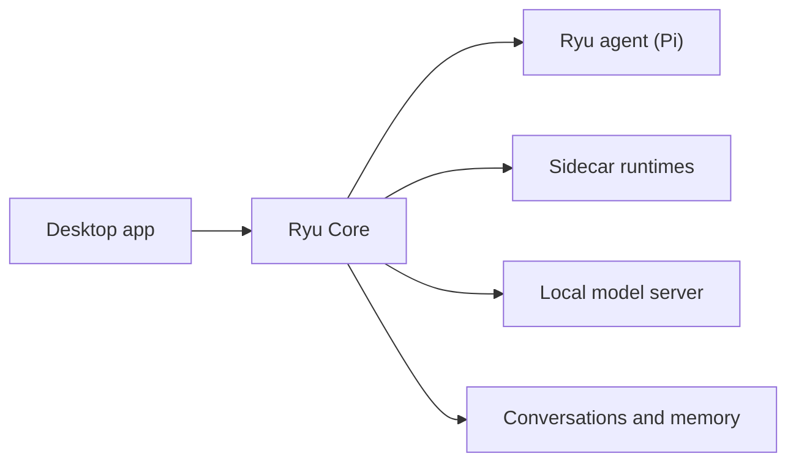

Install Ryu and run an agent. The desktop app includes a chat interface, a local agent, Core, and
the default runtime. You can configure a local model without a provider API key. Model downloads
and runtime setup must finish before local inference is ready.

<Figure name="getting-started" />

The desktop app talks to **Ryu Core**, the local backend that runs agents, sends requests to the
selected engine, and stores conversations and memory on your machine. Additional agent runtimes run
as sidecars, which are separate helper processes.

<Cards>
  <DocCard href="/docs/start-here/getting-started/install" />
  <DocCard href="/docs/start-here/getting-started/first-chat" />
  <DocCard href="/docs/start-here/getting-started/install-sidecar" />
  <DocCard href="/docs/start-here/getting-started/self-host" />
</Cards>

## System requirements

- **Operating system** - macOS or Windows 10 and newer for the desktop app. A headless Core node
  installs on macOS (Apple silicon or Intel), Linux x86_64, and Windows (see
  [Install Core on a headless machine](/docs/start-here/getting-started/install#install-core-on-a-headless-machine)).
  Other Linux architectures must build from source.
- **Memory** - Model requirements vary by size and runtime. Check the selected model's requirements
  and leave memory available for the app and your other tools.
- **Disk** - a few GB free for the local model and any agent runtimes you install.

<Callout type="info">
  A self-hosted node can perform local inference after its model and runtime are installed and
  configured. Cloud models, account services, and network tools have separate connectivity and
  data destinations. The account-backed desktop app is a separate client surface.
</Callout>

## Choose where work runs

- **Ryu Cloud** - Ryu manages the runtime and node maintenance.
- **Run locally** - Configure local inference and check tool and provider destinations. You own
  downloads, disk space, updates, performance, and uptime.
- **Connect an existing node** - Use a Core node your team operates. You provide its URL and token;
  your team owns setup, upgrades, access, and uptime.

Check which node and provider a task uses before you run it.
