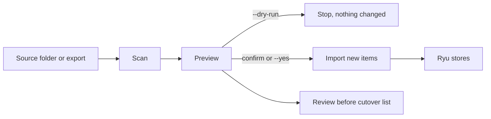

`ryu-cli migrate` reads an existing agent setup or chat export, shows you everything it found, and
copies the parts Ryu can represent into Ryu's own stores. The same scan powers
**Import agent setup** in the desktop app. Your source folder is never modified, and re-running a
migration only adds what is new.

```bash
ryu-cli migrate                      # list setups this node can migrate
ryu-cli migrate openclaw --dry-run   # preview, change nothing
ryu-cli migrate openclaw             # preview, confirm, import
```



<Callout type="info">
Migration copies. Keep the source running until you have tried a few chats in Ryu, then follow
[Plan a safe migration](/docs/start-here/migration/plan-and-cutover) for the cutover.
</Callout>

## Choose your source

| Coming from | Command | Ryu reads |
|---|---|---|
| ChatGPT | `ryu-cli migrate chatgpt <folder>` | Your unzipped ChatGPT data export |
| Claude.ai | `ryu-cli migrate claude <folder>` | Your unzipped Claude data export |
| OpenClaw (also Clawdbot and Moltbot) | `ryu-cli migrate openclaw` | `~/.openclaw`, then `~/.clawdbot`, then `~/.moltbot` |
| Hermes Agent | `ryu-cli migrate hermes` | `~/.hermes` |
| Meta Muse | `ryu-cli migrate muse <folder>` | An extracted Muse data download |
| OpenAI Dots | `ryu-cli migrate dots <folder>` | A folder you prepare (Dots has no setup export) |
| Mastra | `ryu-cli migrate mastra [project]` | The project folder (default: the current directory) |
| LangChain or LangGraph | `ryu-cli migrate langchain [project]` | The project folder (default: the current directory) |

You can also pass any folder directly, such as `ryu-cli migrate ~/backups/openclaw-home`. Ryu detects
the source from the files it finds.

## What moves

| Source data | Ryu destination |
|---|---|
| ChatGPT and Claude conversations | Ryu chats with their original titles, message text, and timestamps. ChatGPT chats follow the branch you last saw; edited-away branches are skipped. |
| ChatGPT and Claude projects | A project folder in `~/Documents/Ryu` whose `AGENTS.md` holds the project instructions (and Claude project memory), with Claude knowledge files under `knowledge/`. Ryu applies `AGENTS.md` to every chat in that folder. |
| ChatGPT custom instructions and Claude memory | Ryu memories |
| Persona files: `SOUL.md`, `IDENTITY.md`, `AGENTS.md`, `TOOLS.md` | One Ryu agent whose system prompt is the composed persona. The name comes from `IDENTITY.md` (`Name: …`), and the default model comes from the source config. |
| `MEMORY.md`, `USER.md`, dated daily notes in `memory/`, and Muse `memory/bank/` | Individual Ryu memories. `USER.md` entries become user facts, daily notes keep their date, and Hermes `§`-separated entries stay separate. |
| Skills (`SKILL.md` folders) | Installed Ryu skills |
| MCP servers in `openclaw.json` (`mcp.servers`) or Hermes `config.yaml` (`mcp_servers`) | Your Ryu MCP servers |
| Mastra `new Agent({ … })` and LangChain `create_agent`, `create_react_agent`, or `createReactAgent` calls whose instructions are plain strings | One Ryu agent each, with the instructions and model |
| Credential names in the source `.env` | Listed for review. Values move only with `--secrets` (see below). |

Already-present items are marked and skipped. Agents are matched by name, memories by content, and
MCP servers and skills by name, so running the same migration twice is safe.

Imported chats, memories, and agents are stored in Ryu's encrypted data folder.

Project folders are different. They are an ordinary working folder in `~/Documents/Ryu` so you and
your agents can open the files directly. Their `AGENTS.md` (project instructions and memory) and
knowledge files are not encrypted by Ryu. Keep them on an encrypted disk or move sensitive
knowledge files out if that matters to you.

## What you set up again

The preview lists each of these under **Review before cutover** so nothing is lost silently:

- **Messaging channels.** Telegram, Discord, Slack, WhatsApp, and other bots are reconnected in
  [Channels](/docs/gateway/channels). Bot tokens are never copied from a config file.
- **Schedules.** `HEARTBEAT.md` and cron jobs become [Ryu schedules](/docs/core/scheduler).
- **Provider sign-ins.** OAuth sessions such as Hermes `auth.json` are not copied. Sign in again
  in Providers.
- **Runtime-built prompts and code tools.** Instructions built at run time (functions, f-strings, or
  template literals with variables), tools, workflows, and graphs are code. The preview names each
  agent it could not convert.
- **Muse reflections.** `dreams/` and `ALIGNMENT_SYNTHESIS.md` are reflections, not memories. Add any
  standing guidance to the agent yourself.

## Move credentials deliberately

A scan reports credential names, never values. To move them, add the `--secrets` flag.

```bash
ryu-cli migrate hermes --secrets
```

Ryu reads keys ending in `_KEY`, `_TOKEN`, `_SECRET`, or `_PASSWORD` from the source `.env` on the
computer running the command. It imports them into your user-scoped
[Secret Vault](/docs/security/secret-vault) and skips names that already exist. Values are never printed. If the Ryu node is a different
machine, use `ryu-cli secrets set` or `ryu-cli secrets import` instead.

## Command options

| Option | Effect |
|---|---|
| `--dry-run` | Show the plan and change nothing |
| `--yes` | Import without the confirmation prompt (required when not running in a terminal) |
| `--only <kinds>` | Import only these comma-separated kinds, for example `--only skills,mcp,memory,agents`. Kinds include `chats`, `agents`, `skills`, `mcp`, `memory`, `plugins`, and `slash_commands` |
| `--secrets` | Also move credential values from the source `.env` into the Secret Vault |
| `--json` | Print the plan, or the import results with `--yes`, as one JSON document. With `--secrets`, the Secret Vault report is its `secrets` field. |

## Per-source notes

### ChatGPT

In ChatGPT, open **Settings → Data controls → Export data**. You get an email with a download link.
Unzip the download and run `ryu-cli migrate chatgpt <folder>`, or choose the folder in the desktop app.
Large accounts may receive `conversations-000.json`, `conversations-001.json`, and so on; Ryu reads
all of them. Together, the conversation files of one export can be up to 1 GB.

- Chats that belong to a ChatGPT project are filed under a project folder. ChatGPT does not export
  project names, files, or project instructions, so each project folder is named by its id. The
  preview shows a recent chat from each project so you can recognize it; rename the folder in Ryu.
- Your latest custom instructions ("about you" and "how to respond") become Ryu memories. ChatGPT
  does not export saved memories.
- Images, voice, and uploaded files are imported as `[image]` or `[attached: …]` placeholders.
  Reasoning summaries and tool calls are skipped.

### Claude

In Claude, open **Settings → Privacy → Export data**. Unzip the download and run
`ryu-cli migrate claude <folder>`, or choose the folder in the desktop app.

- Every chat is imported. Claude's export does not record which project a chat belongs to, so
  project chats are imported with your other Claude chats.
- Each project becomes a project folder with its instructions, knowledge files, and project memory.
- Saved memory (`memories.json`) becomes Ryu memories.
- Attachments are listed as `[attached: …]`. Thinking blocks are skipped.

### OpenClaw

Ryu reads `openclaw.json` (JSON5 is supported) and every persona workspace: `workspace/`,
`workspace.default/`, and per-agent `workspace-<id>/` folders. Each workspace becomes its own agent.
If `agents.defaults.workspace` points outside `~/.openclaw`, the preview tells you to migrate that
folder too.

### Hermes

Ryu reads `SOUL.md`, `memories/MEMORY.md` and `memories/USER.md`, `skills/`, and `config.yaml` for
the default model and MCP servers. MCP servers disabled in Hermes are not offered.

### Muse

Download your data from Muse (**Settings → Data controls → Download your Muse data**), extract it,
and pass the folder that contains `SOUL.md` and `MEMORY.md`. Ryu imports the persona, `MEMORY.md`,
daily notes, and the categorized `memory/bank/` files. Skills are imported when the download includes
their `SKILL.md` folders.

### Dots

OpenAI Dots does not offer a setup export, and its memories cannot be viewed or exported. Ask your
dot to write out its standing instructions and the facts it relies on, then save them in one folder:

```text
my-dot/
├── SOUL.md       # the dot's instructions
├── IDENTITY.md   # optional: "Name: Research Dot"
└── MEMORY.md     # one fact per bullet
```

Run `ryu-cli migrate dots my-dot`. Reconnect the apps your dot used through Ryu
[MCP servers](/docs/core/mcp-registry) or plugins.

### Mastra and LangChain

Ryu scans the project's TypeScript, JavaScript, and Python sources, skipping dependencies and
tests. It converts agents whose instructions are a plain string, a concatenation of plain strings,
or a constant defined in the same file. Model references such as `openai("gpt-4o")`,
`"openai:gpt-4o"`, and `ChatAnthropic(model="…")` become `provider/model` IDs.

You do not have to convert everything. To keep running an existing Mastra or LangChain app while
you move, point its model client at the Ryu Gateway. One base-URL change routes it through Ryu's
policies, budgets, and audit log. See
[Gateway for any OpenAI-compatible agent](/docs/gateway/gateway-for-any-agent). Expose the project's tools to Ryu agents through an MCP server.

## In the desktop app

### During setup

The **Coming from another agent?** step looks for Claude Code, Codex, Cursor, OpenClaw, and Hermes
on the node. It shows what each would bring over, plus anything you will need to set up again.

1. Choose **Choose a folder…** for an unzipped ChatGPT or Claude export, a Muse download, a Dots
   folder, or a Mastra or LangChain project.
2. Clear a source to leave it out, then choose **Import**.

Choose **Skip for now** to come back later.

### In Gateway settings

Open **Gateway → Import agents**. OpenClaw and Hermes appear next to Claude, Codex, and Cursor as
one-click scans.

- For other sources, enter the folder in **Root path** and pick ChatGPT, Claude.ai, Muse, Dots,
  Mastra, or LangChain under **Agent**.
- The import preview lists every item and a **Review before cutover** list.
- Choose **Save root + enable import** to keep a source in sync. For a ChatGPT or Claude export,
  unzip a newer export into the same folder and Ryu imports what changed.

### Anywhere else

Open **Import agent setup** from the Chats section, launchpad, or command palette. It offers the
same OpenClaw and Hermes shortcuts and folder picker.

## After migrating

1. Open an imported chat and continue it, or start a new one. Imported agents, skills, and memory
   apply to new sessions.
2. Open each imported MCP server and sign in again where it uses OAuth or custom headers.
3. Work through the **Review before cutover** list.
4. Keep the source folder until you are satisfied. Nothing in it was changed.

## Troubleshooting

- **"Nothing to migrate" for a ChatGPT or Claude export.** Unzip the download first and choose the
  folder that contains `conversations.json`.
- **Running the import again.** Ryu matches each chat by its original id and only adds messages
  that are new, so you can import a newer export over an older one.
  - If you edited an earlier prompt in ChatGPT (or regenerated a reply) after the last import, that
    chat is left as it was imported and the result says how many were skipped. Delete the Ryu copy
    and import again to take the new version.
  - A project folder's `AGENTS.md` and `knowledge/` files are refreshed only if you have not edited
    them since the last import; your edits are kept.
- **"No OpenClaw folder found."** Pass the folder: `ryu-cli migrate openclaw /path/to/.openclaw`.
- **An agent is missing from a Mastra or LangChain project.** Its instructions are built at run
  time. The preview lists it. Copy the prompt into a Ryu agent.
- **A memory entry was skipped as sensitive.** Allow sensitive topics in **Settings → Memory** and
  run the migration again. Only the skipped entries are added.

<Cards>
  <DocCard href="/docs/start-here/migration/plan-and-cutover" />
  <DocCard href="/docs/start-here/migration/agents-and-threads" />
  <DocCard href="/docs/gateway/gateway-for-any-agent" />
</Cards>
