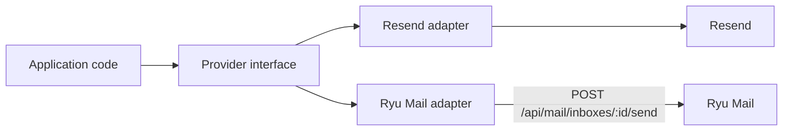

Use this page when an application sends through a hosted provider and you are moving it to Ryu Mail
or building a compatible alternative. Treat the work as a provider cutover, not an account clone.

## Resend-style migration

Resend separates email activity, domains, contacts, templates, API keys, and webhooks. Its
dashboard offers admin CSV exports for emails, broadcasts, contacts, segments, domains, logs, and
API keys. Export those categories before removing the old account or key. See the official
[Resend email export documentation](https://resend.com/docs/dashboard/emails/introduction).

<Callout type="warn">
Ryu Mail is not a Resend drop-in importer, and standalone Ryu Mail is in early access.

Its public contract covers inboxes, messages, threads, drafts, attachments, custom domains,
allow/block lists, signed outbound event webhooks, and a signed inbound webhook. It has no import
for Resend domains, hosted templates, contacts, broadcasts, API keys, or delivery history. Keep each
mapping explicit and keep the old provider available for rollback.
</Callout>

| Resend concern | Migration action | Ryu Mail boundary |
|---|---|---|
| Send calls | Put a provider adapter behind the existing send function. Map `to`, `cc`, `bcc`, `subject`, `text`, `html`, `replyTo`, and `inReplyTo`. | `POST /api/mail/inboxes/:id/send` sends from the selected inbox through its configured transport. |
| Sending address and domain | Recreate the sender at the destination and verify its DNS and transport before changing production traffic. Keep the source configuration during the canary. | An inbox has a fixed address. Custom domains are added with `POST /api/mail/domains`; Ryu Mail does not copy the Resend domain record for you. |
| Inbound mail | Configure the new forwarder only after the destination inbox exists, then test a signed inbound message. | `POST /api/mail/inbound/:id` accepts raw inbound mail with that inbox's HMAC secret. It is not a Resend event envelope. |
| Delivery events | Normalize provider events into your application's event model. Store the source event ID and received time, and make handlers safe to replay. | `POST /api/mail/webhooks` subscribes to events such as `message.sent`, `message.delivered`, and `message.bounced`, signed with Standard Webhooks headers. A successful send means transport hand-off, not recipient delivery. |
| Contacts and audiences | Import the source CSV into the system that owns contacts and consent. Do not use an inbox table as a mailing list. | The Mail API has no contacts, audiences, segments, or broadcast contract. Its lists are allow/block entries, not mailing lists. |
| Hosted templates | Keep template source in your application or move it to the destination renderer. Test rendered HTML and plain text separately. | The send body accepts rendered `text` and `html`; the Mail API has no hosted-template endpoint. |
| API keys and signing secrets | Issue new destination credentials. Rotate the source key only after the cutover is proven. | Standalone Mail uses `RYU_MAIL_API_TOKEN` for protected routes. Inbound mail uses a separate per-inbox HMAC secret, and each webhook has its own signing secret. |
| History and logs | Preserve the source export as a read-only archive. Keep source IDs and provider message IDs beside any records you recreate. | Mail messages are owned by the Mail service. There is no Resend-history importer. |

A minimal Ryu Mail send body:

```json
{
  "to": ["person@example.com"],
  "cc": [],
  "subject": "Your receipt",
  "text": "Thanks for your order.",
  "html": "<p>Thanks for your order.</p>",
  "inReplyTo": "<previous-message@example.com>"
}
```

The `inReplyTo` value is the source message's `Message-ID` when the recipient's mail client should
continue the same thread. See the [Ryu Mail API](/docs/standalone/mail-api) for the full send
contract, limits, webhook verification, and route table, and
[Standalone Ryu Mail](/docs/standalone/mail) for running the service.

## Resend-to-Ryu cutover



1. **Create one provider interface.** Keep application code independent of `resend` or Ryu Mail.
   Put provider-specific payloads, errors, retries, and event verification inside adapters.
2. **Export and map.** Download the source exports, preserve every source ID, and map contacts,
   templates, domains, webhooks, and message history to their real owners. Do not put all of them
   into the Mail inbox store.
3. **Provision the destination.** Create a Ryu Mail inbox, configure its outbound transport, save
   its protected bearer, and store its inbound HMAC secret in the forwarder. Ryu Mail returns the
   inbound secret only when an inbox is created or its secret is rotated.
4. **Test without duplicate sends.** Send only to internal test recipients. Confirm the rendered
   message, reply threading, inbound signature check, attachments, and application event handling.
5. **Canary one workload.** Route one application, tenant, or notification class through the new
   adapter. Compare accepted-send counts, failures, reply threading, and inbound processing.
6. **Switch and retain rollback.** Change provider selection, keep the old adapter and source
   exports available, and stop the old path only after the destination passes reconciliation.

Both Resend and Ryu Mail accept an `Idempotency-Key` header on a send. In Ryu Mail, reusing a key
with a different request body returns `409`. Send a stable key derived from your own message or
notification ID so a retried request cannot create a second email. See
[Resend idempotency keys](https://resend.com/docs/dashboard/emails/idempotency-keys).

Resend webhooks are at-least-once and can arrive out of order. Ryu Mail retries webhook deliveries
too. Deduplicate by event ID (`event_id` in a Ryu Mail delivery), persist the event timestamp, and
make replay safe. See [Resend webhooks](https://resend.com/docs/webhooks/introduction) for the
source provider's event and retry behavior.

## Build migration into an alternative

If you are building a Ryu app or a service that replaces another product, ship an export and import
contract in the first release. The required properties are listed in
[Requirements for a migration-friendly importer](/docs/start-here/migration/plan-and-cutover#requirements-for-a-migration-friendly-importer).

<Cards>
  <DocCard href="/docs/standalone/mail-api" />
  <DocCard href="/docs/standalone/mail" />
  <DocCard href="/docs/extend/integrate/protocol-compat" />
  <DocCard href="/docs/start-here/migration/plan-and-cutover" />
</Cards>
